<p align="center">
  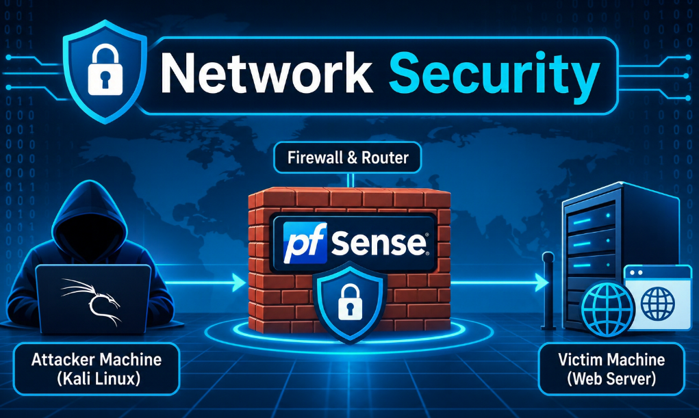
</p>

<h1 align="center">Behind the Firewall — A Segmented Attack Simulation Lab</h1>
<p align="center"><i>Standing up a pfSense-segmented network, then walking a full attack chain — recon, SQL injection via Burp Suite, stored XSS, and credential brute-forcing with Hydra — against the machine sitting behind it.</i></p>

<p align="center">
  
  
  
  
</p>

---

## 📖 Why This Repo Exists

Most attack demos skip straight to the exploit and leave the network out of the picture. This lab does the opposite: it starts by actually **building** a segmented network around a firewall — a WAN side, a LAN side, a pfSense box routing between them — and only then launches a full, multi-stage attack against the server sitting on the protected side. The goal is to see how a realistic network boundary changes (and doesn't change) what an attacker can do once they're inside it.

Three virtual machines make up the lab: **pfSense** (firewall/router), an **Attacker Machine** (Kali Linux), and a **Victim Machine** (Windows Server 2019 hosting a vulnerable web application over IIS). Every step — from configuring virtual network adapters to dumping valid credentials with Hydra — was carried out entirely inside this isolated VMware environment.

> ⚠️ **Disclaimer:** This lab was built and attacked entirely inside a private, disposable virtual environment created for learning. None of these steps should ever be run against a network or system you don't own or don't have explicit written permission to test.

---

## 🗂️ Table of Contents

- [Lab Objectives](#-lab-objectives)
- [Environment & Addressing](#-environment--addressing)
- [Network Design](#-network-design)
- [pfSense Installation & Configuration](#-pfsense-installation--configuration)
- [Attacker Machine Configuration](#-attacker-machine-configuration)
- [Phase 1 — Reconnaissance](#-phase-1--reconnaissance-nmap)
- [Phase 2 — SQL Injection via Burp Suite](#-phase-2--sql-injection-via-burp-suite)
- [Phase 3 — Stored Cross-Site Scripting](#-phase-3--stored-cross-site-scripting-xss)
- [Phase 4 — Brute-Force Attack with Hydra](#-phase-4--brute-force-attack-with-hydra)
- [Attack Chain Summary](#-attack-chain-summary)
- [🎓 What I Learned](#-what-i-learned)
- [Image Folder](#️-image-folder)

---

## 🎯 Lab Objectives

- Build a segmented virtual network with a pfSense firewall separating a WAN-facing attacker from a LAN-side victim
- Configure pfSense's WAN and LAN interfaces, including a DHCP scope for the internal network
- Confirm routing and connectivity across the firewall before attacking anything
- Fingerprint the victim's open ports and services with **Nmap**
- Bypass login authentication using **Boolean-based blind SQL injection**, intercepted and replayed through **Burp Suite**
- Demonstrate a **stored XSS** vulnerability on a public comment form
- Enumerate valid usernames and brute-force passwords with **Hydra**
- Tie every phase together into a single, end-to-end compromise narrative

---

## 🧭 Environment & Addressing

| Machine | OS / Image | Role | IP Address |
|---|---|---|---|
| **pfSense** | pfSense ISO | Firewall & router between WAN and LAN | WAN: DHCP (192.168.50.x) · LAN: 192.168.10.4/24 |
| **Attacker Machine** | Kali Linux | Launch point for every attack phase | 192.168.50.10 (WAN side, via NAT) |
| **Victim Machine** | Windows Server 2019 + IIS | Hosts the vulnerable web application | 192.168.10.100 (LAN side, via pfSense DHCP) |

**Hypervisor:** VMware Workstation, running on a Windows host.

---

## 🌐 Network Design

Two VMware virtual adapters carry the two sides of this network: one set to **NAT** (acting as the WAN) and one set to **Host-only** (acting as the internal LAN). pfSense sits in the middle, with one virtual NIC on each.

<p align="center">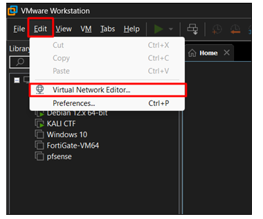</p>

**1. Opening the Virtual Network Editor.**
In VMware Workstation, `Edit → Virtual Network Editor` is where every virtual adapter used in this lab gets defined. This is the very first step, because pfSense's WAN and LAN interfaces will later be mapped directly onto whatever is configured here.

<p align="center">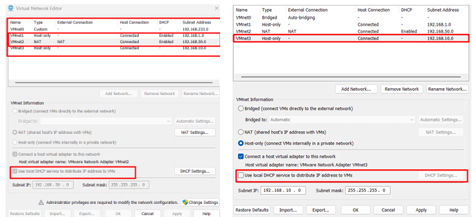</p>

**2. Reviewing the existing virtual adapters.**
Before changing anything, the editor lists the adapters already present — VMnet0 through VMnet3 — along with their type, DHCP status, and subnet. This baseline view makes it clear which two adapters are free to repurpose for WAN and LAN.

<p align="center">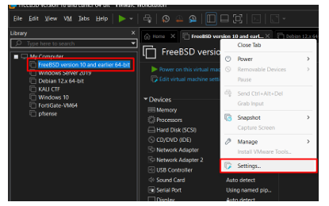</p>

**3. Configuring the WAN and LAN adapters.**
One adapter is set to **NAT** with "Use local DHCP server" enabled (this becomes the WAN side, giving the attacker machine internet-style addressing), and a second is set to **Host-only** with the DHCP option unchecked (this becomes the LAN side, with addressing managed by pfSense itself instead). Subnet IP `192.168.10.0` is noted here — it's the LAN segment pfSense will serve.

---

## 🔥 pfSense Installation & Configuration

<p align="center">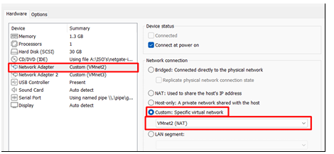</p>

**4. Opening pfSense's VM settings.**
With the two adapters ready, pfSense's own virtual machine settings are opened next so its two network interfaces can be pointed at the correct adapters.

<p align="center">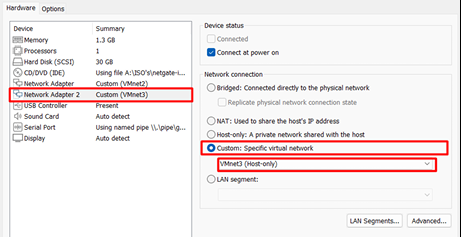</p>

**5. Assigning the WAN interface.**
The first network adapter on the pfSense VM is set to **Custom: Specific virtual network** and pointed at the NAT adapter created earlier — this becomes pfSense's `em0` (WAN) interface.

<p align="center">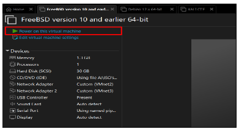</p>

**6. Assigning the LAN interface.**
The second network adapter is set to **Custom** as well, this time pointed at the Host-only adapter — this becomes pfSense's `em1` (LAN) interface, the one the Victim Machine will eventually sit behind.

<p align="center">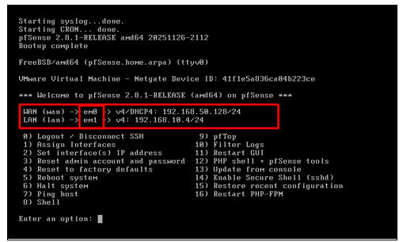</p>

**7. Powering on the pfSense VM.**
With both adapters mapped correctly, the pfSense virtual machine is started for the first time, booting from the FreeBSD-based pfSense installer image.

<p align="center">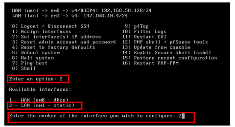</p>

**8. pfSense's console comes up.**
Once boot completes, the console shows both interfaces already detected: `em0` as WAN (pulling an address via DHCP) and `em1` as LAN. From here, the numbered console menu is used to walk through the rest of the configuration.

<p align="center">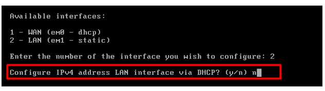</p>

**9. Selecting the LAN interface to configure.**
Option `2` ("Set interface(s) IP address") is chosen from the menu, then interface `2` (LAN) is selected specifically — the WAN side is left alone since it already has a DHCP-assigned address.

<p align="center">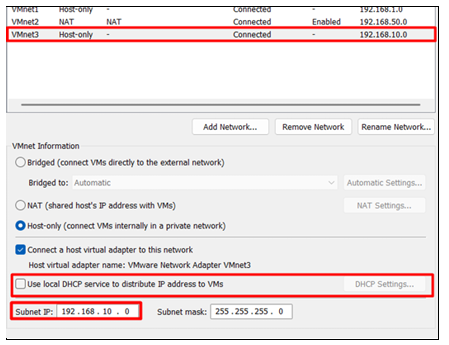</p>

**10. Declining DHCP on the LAN interface.**
pfSense asks whether to configure the LAN interface's IPv4 address via DHCP. Answering `n` here is deliberate — the LAN interface needs a fixed, predictable static address so the Victim Machine (and its DHCP pool) always has a stable gateway.

<p align="center">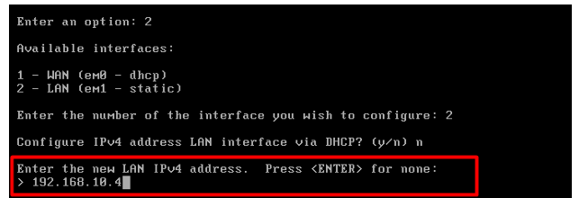</p>

**11. Confirming the Host-only subnet.**
Back in the Virtual Network Editor, the Host-only adapter (VMnet3) is confirmed to be serving the `192.168.10.0` subnet — this is the number that decides what static address pfSense's LAN interface should take.

<p align="center">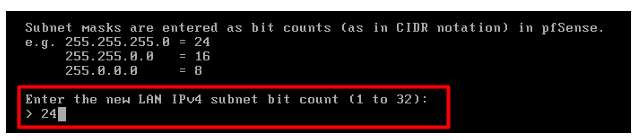</p>

**12. Assigning the static LAN address.**
`192.168.10.4` is entered as the new LAN IPv4 address — a deliberate, memorable address inside the `192.168.10.0` subnet confirmed in the previous step.

<p align="center">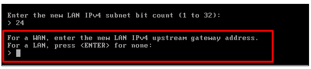</p>

**13. Setting the subnet mask.**
The subnet bit count is entered as `24`, which corresponds to a standard `255.255.255.0` mask — giving the LAN side 254 usable addresses, more than enough for this lab.

<p align="center">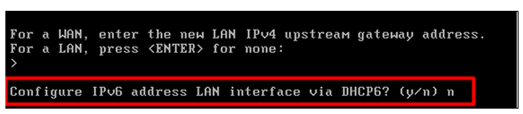</p>

**14. Skipping the upstream gateway prompt.**
Since this is a LAN interface (not a WAN interface), pfSense doesn't need an upstream gateway address here — pressing Enter on a blank line skips the prompt and moves on.

<p align="center">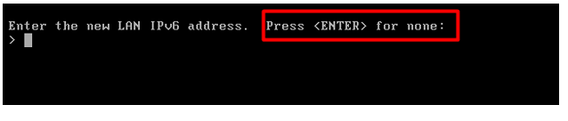</p>

**15. Declining IPv6 via DHCP.**
This lab is IPv4-only, so the prompt asking whether to configure IPv6 on the LAN interface via DHCP is answered `n`.

<p align="center">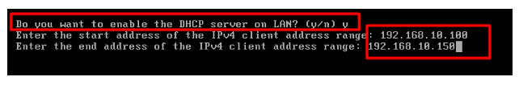</p>

**16. Skipping manual IPv6 configuration.**
The follow-up prompt for a manual IPv6 address is also skipped by pressing Enter on a blank line, keeping the whole lab consistently IPv4.

<p align="center">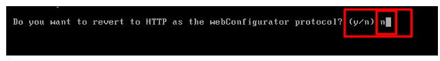</p>

**17. Enabling DHCP on the LAN.**
Answering `y` turns on pfSense's own DHCP server for the LAN interface, then a client address range of `192.168.10.100` to `192.168.10.150` is entered — this is the pool the Victim Machine will draw its address from.

<p align="center">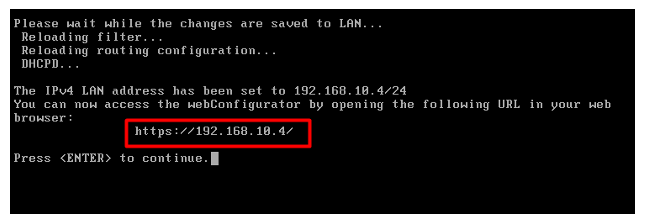</p>

**18. Keeping HTTPS for the web configurator.**
Asked whether to revert to plain HTTP for pfSense's web-based configuration interface, the answer is `n` — keeping HTTPS enabled for the admin GUI, a small but meaningful security choice even inside a lab.

<p align="center">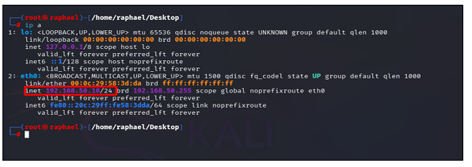</p>

**19. Configuration complete.**
pfSense confirms the LAN address is now set to `192.168.10.4/24` and that its web GUI is reachable at `https://192.168.10.4/`. With this, the firewall itself is fully stood up and ready to route traffic between the attacker and the victim.

---

## 🐧 Attacker Machine Configuration

<p align="center">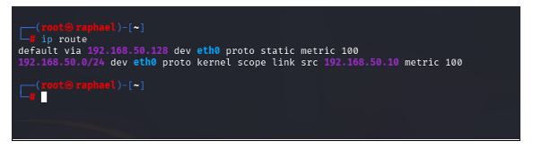</p>

**20. Confirming the Kali Linux IP.**
Running `ip a` on the Attacker Machine shows `eth0` holding `192.168.50.10/24` — an address handed out by the NAT adapter's DHCP service, placing the attacker squarely on the WAN side of the new firewall.

<p align="center">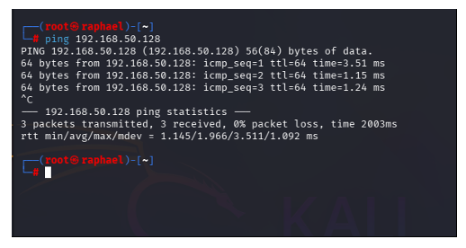</p>

**21. Setting and verifying the default route.**
After pointing the default route at pfSense's WAN IP with `sudo ip route add default via <WAN IP> dev eth0`, running `ip route` confirms the change: the default route now goes through `192.168.50.128` via `eth0`, meaning every packet leaving this machine first passes through pfSense.

<p align="center">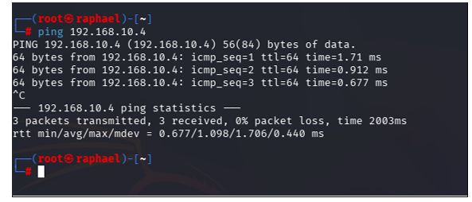</p>

**22. Pinging pfSense's WAN interface.**
A ping to `192.168.50.128` returns clean replies with low latency — proof the attacker machine can reach the WAN side of the firewall at all.

<p align="center">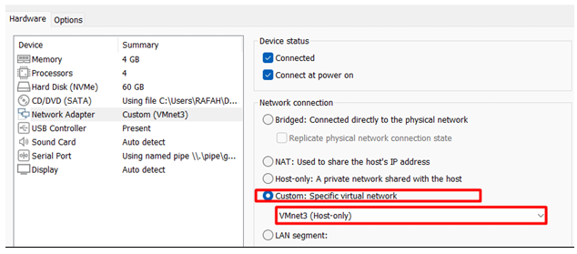</p>

**23. Pinging pfSense's LAN interface.**
A second ping, this time to `192.168.10.4` (the LAN side), also comes back clean. This confirms pfSense is actually routing traffic between the two interfaces rather than just sitting there — if this ping had failed, the next suspect would be the firewall's rules, not the routing table.

---

## 🖥️ Victim Machine Configuration

<p align="center">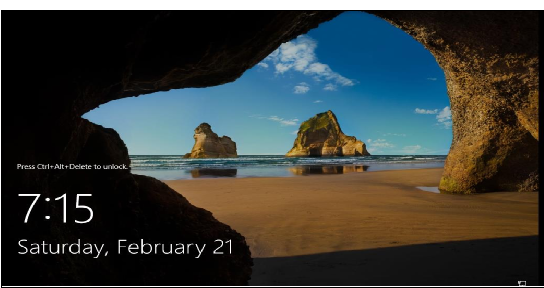</p>

**24. Placing the Victim Machine on the LAN.**
The Victim Machine's network adapter is set to **Custom: Specific virtual network**, pointed at the same Host-only adapter (VMnet3) used for pfSense's LAN side — this puts the Windows Server 2019 box firmly behind the firewall.

<p align="center">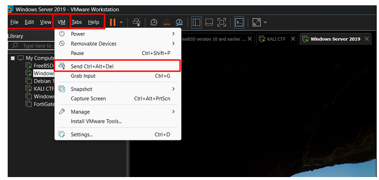</p>

**25. Booting into the Windows lock screen.**
Powering on the Victim Machine for the first time lands on the standard Windows lock screen, waiting for the `Ctrl+Alt+Delete` sequence to proceed to login.

<p align="center">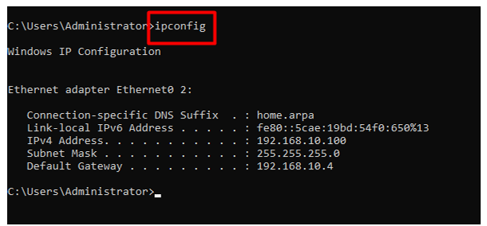</p>

**26. Sending Ctrl+Alt+Del through VMware.**
Since the key combination can't always be sent directly from the host keyboard, VMware's own `VM → Send Ctrl+Alt+Del` menu option is used instead, which reliably delivers the signal into the guest OS.

<p align="center">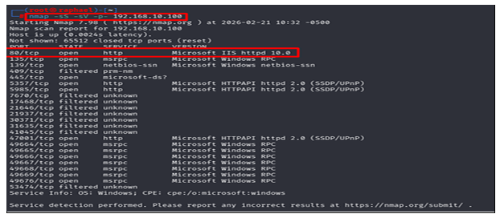</p>

**27. Confirming the DHCP-assigned address.**
After logging in as Administrator, `ipconfig` in a Command Prompt shows an IPv4 address of `192.168.10.100` with a default gateway of `192.168.10.4` — exactly matching pfSense's DHCP pool and LAN interface. The network is now fully wired together: attacker on WAN, victim on LAN, pfSense routing between them.

---

## 📡 Phase 1 — Reconnaissance (Nmap)

**Objective:** identify which ports and services are exposed on the victim before attempting anything else.

<p align="center">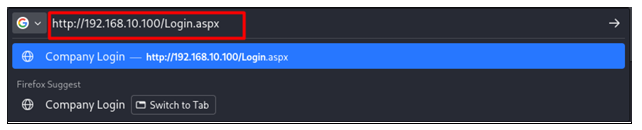</p>

**28. Running the Nmap scan.**
`nmap -sS -sV -p- 192.168.10.100` is launched from the Attacker Machine: `-sS` performs a SYN stealth scan, `-sV` adds service version detection, and `-p-` scans the full 65,535-port range rather than just the common ones. The result: **port 80 open**, identified as Microsoft IIS httpd — a web service running on the victim and worth investigating further.

---

## 💉 Phase 2 — SQL Injection via Burp Suite

**Objective:** bypass the application's login form using Boolean-based blind SQL injection.

<p align="center">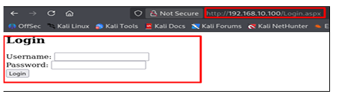</p>

**29. Browsing to the login page.**
Firefox on the Attacker Machine is pointed at `http://192.168.10.100/Login.aspx` — the entry point for the internal web application running behind the firewall.

<p align="center">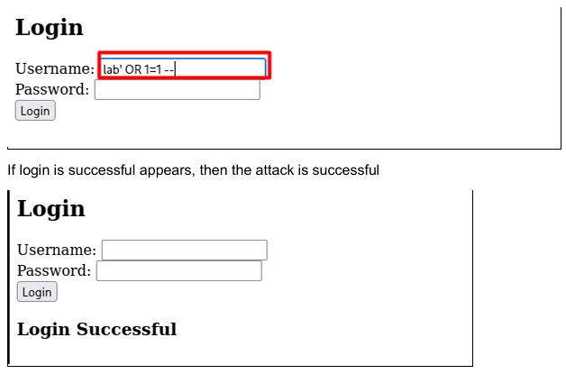</p>

**30. The Company Login page.**
A simple, minimally-styled login form appears with just a username and password field — nothing in the interface hints at what's underneath, which is exactly why this phase exists.

<p align="center">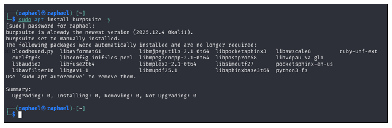</p>

**31. Trying a Boolean-based payload directly.**
`lab' OR 1=1 --` is typed into the username field with the password left blank. This payload is designed to turn the login query's WHERE clause into something that's always true, regardless of the real credentials.

<p align="center">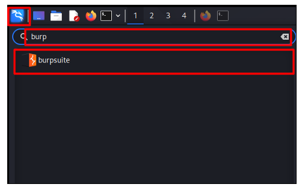</p>

**32. Login Successful — no real credentials needed.**
The page responds with "Login Successful," confirming the authentication check can be bypassed entirely through the username field alone. From here, the attack moves to Burp Suite to probe the injection more carefully and without leaving obvious logs.

<p align="center">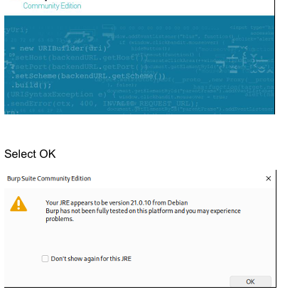</p>

**33. Installing Burp Suite.**
`sudo apt install burpsuite -y` installs (or confirms) Burp Suite Community Edition on Kali — the intercepting proxy that will sit between the browser and the web application for the rest of this phase.

<p align="center">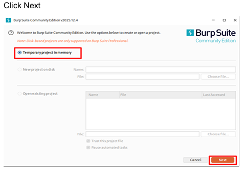</p>

**34. Launching Burp from the Applications menu.**
Kali's application launcher is searched for "burp," surfacing the Burp Suite icon ready to be opened.

<p align="center">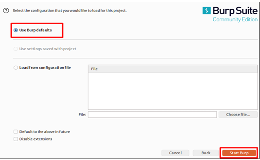</p>

**35. Burp Suite's splash screen.**
The Community Edition splash screen appears while the application initializes.

<p align="center">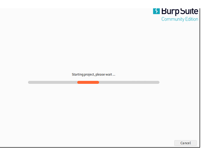</p>

**36. Acknowledging the JRE compatibility warning.**
Burp flags that the installed Java runtime hasn't been fully tested on this platform. Since this is a lab environment, clicking OK and continuing is safe.

<p align="center">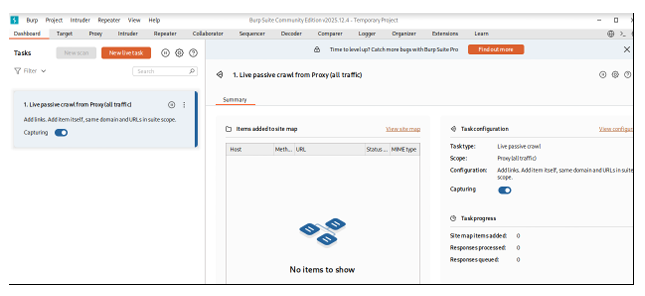</p>

**37. Starting a temporary project.**
"Temporary project in memory" is selected rather than a disk-based project (a Professional-only feature), then Next is clicked to continue setup.

<p align="center">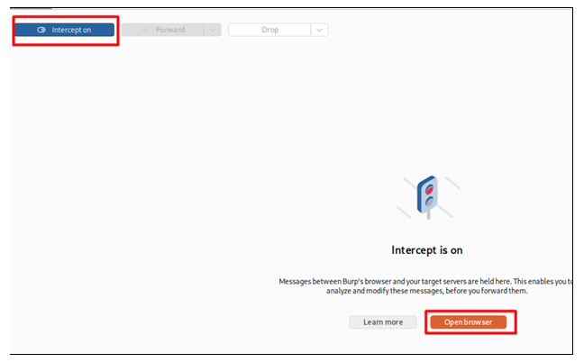</p>

**38. Using Burp's default configuration.**
"Use Burp defaults" is selected and "Start Burp" clicked — no custom proxy settings are needed for this lab.

<p align="center">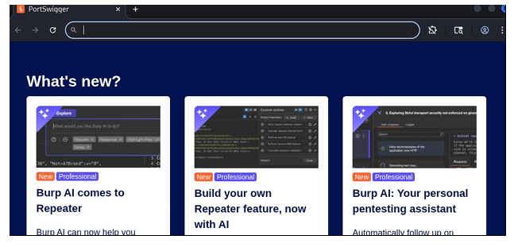</p>

**39. Waiting for Burp to initialize.**
A short progress bar shows the project starting up before the main interface loads.

<p align="center">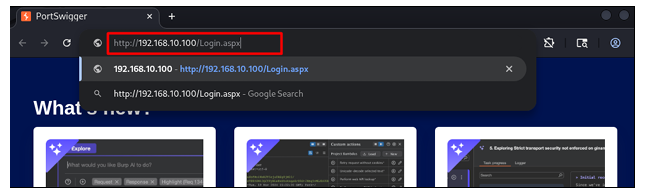</p>

**40. Burp Suite's dashboard.**
The main dashboard appears, showing a live passive crawl task already listening on the proxy — this is where every intercepted request and response will be tracked from here on.

<p align="center">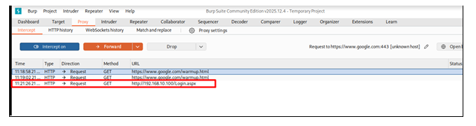</p>

**41. Turning on Intercept.**
In the Proxy tab, "Intercept on" is enabled and the built-in Chromium browser opened — from this point, every request the browser makes will pause in Burp before reaching the server, giving the attacker a chance to read or modify it first.

<p align="center">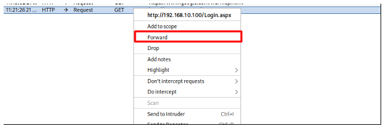</p>

**42. Burp's built-in browser opens.**
The embedded Chromium browser launches to Burp/PortSwigger's default start page, pre-configured to route all its traffic through the proxy.

<p align="center">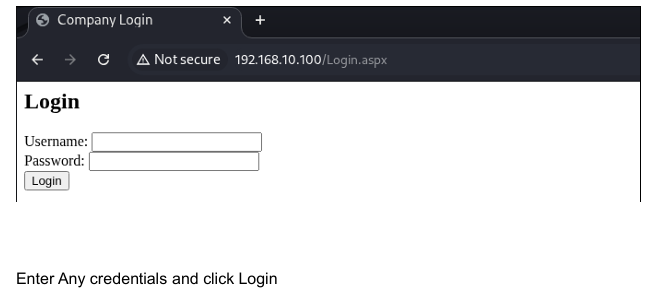</p>

**43. Navigating to the login page again.**
`http://192.168.10.100/Login.aspx` is typed into the proxied browser's address bar — this request is about to be captured by Burp instead of going straight to the server.

<p align="center">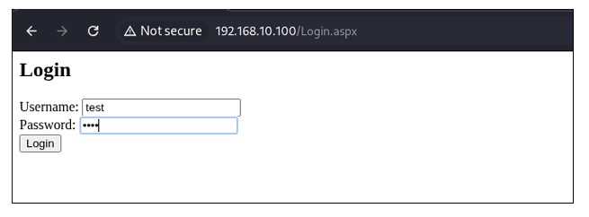</p>

**44. The GET request is intercepted.**
Switching back to Burp, the paused GET request to `/Login.aspx` is now visible, sitting in the Proxy tab waiting for a decision — forward it, drop it, or edit it first.

<p align="center">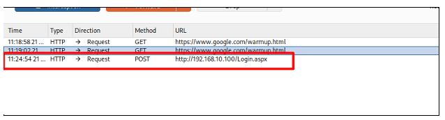</p>

**45. Forwarding the request.**
Right-clicking the intercepted request and selecting "Forward" lets this particular GET request through unmodified, so the login page can actually load in the browser.

<p align="center">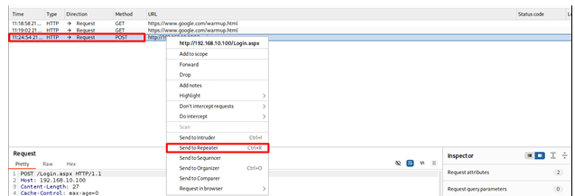</p>

**46. The login page renders.**
With the request forwarded, the familiar Company Login form now appears inside Burp's embedded Chromium browser.

<p align="center">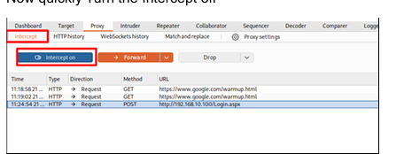</p>

**47. Submitting throwaway credentials.**
A placeholder username (`test`) and password are entered and the Login button clicked — this submission is what Burp will capture next, as a POST request this time.

<p align="center">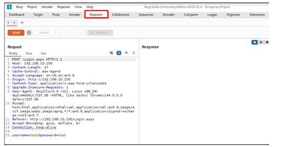</p>

**48. The POST request appears.**
Back in Burp's Proxy history, a `POST /Login.aspx` request now shows up, carrying the submitted username and password in its body — exactly the request that needs to be manipulated to test the injection.

<p align="center">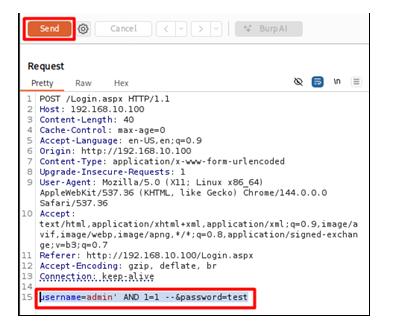</p>

**49. Sending it to Repeater.**
Right-clicking the POST request and choosing "Send to Repeater" copies it into Burp's Repeater tool — the feature built specifically for re-sending and tweaking the same request over and over without needing the browser each time.

<p align="center"></p>

**50. Turning Intercept back off.**
With the request safely captured in Repeater, Intercept is switched off quickly — leaving it on too long can overload and crash the attacker VM, since every single request from the browser would otherwise be paused.

<p align="center"></p>

**51. The raw request inside Repeater.**
The Repeater tab shows the full POST request, including its body: `username=test&password=test`. This is the exact line that gets edited for the next few steps.

<p align="center"></p>

**52. Crafting the Blind SQLi payload.**
The body is rewritten to `username=admin' AND 1=1 --&password=test`. Because this goes through Repeater rather than the live login form, it avoids spamming the web server's logs with repeated failed login attempts while the injection is being tested.

<p align="center"></p>

**53. Sending the "always true" payload.**
Clicking Send fires the request. The response comes back containing `<h3>Login Successful</h3>` — confirming the `AND 1=1` condition evaluated to true and the backend accepted the forged login.

<p align="center"></p>

**54. Testing the "always false" control case.**
As a control, the payload is changed to `admin' AND 1=2 --` — a condition that should always evaluate to false if the injection point really is responding to boolean logic.

<p align="center"></p>

**55. Confirming the Boolean behavior.**
This time the response reads `User does not exist`. Because `1=1` logged in and `1=2` didn't, the application's behavior is directly tied to the truth of the injected SQL condition — textbook Boolean-based blind SQL injection, now fully confirmed, along with the backend being SQL Server.

---

## 🧪 Phase 3 — Stored Cross-Site Scripting (XSS)

**Objective:** inject JavaScript into a public comment form that executes in another visitor's browser.

<p align="center"></p>

**56. Opening the comments page.**
`http://192.168.10.100/Comments.aspx` loads a plain "Leave a Comment" form with a username field and a larger comment box — exactly the kind of open, unauthenticated input this class of vulnerability tends to live in.

<p align="center"></p>

**57. Submitting the payload.**
A username (`attacker`) is entered alongside the comment `<script>alert('Network Security Module')</script>`, then "Submit Comment" is clicked. If the application stores this exactly as typed and later displays it without encoding, the script will run for anyone who views the page.

<p align="center"></p>

**58. The payload fires in the Victim's own browser.**
Opening Firefox *on the Victim Machine itself* and loading the same Comments page triggers a JavaScript alert reading "Network Security Module," with the attacker's comment now listed under "All Comments." This is the real danger of stored XSS: the payload doesn't need the attacker present — it waits in the database and fires for whoever loads the page next, which here could just as easily be an administrator.

---

## 🔑 Phase 4 — Brute-Force Attack with Hydra

**Objective:** discover valid usernames and passwords on the login form with no prior knowledge of either.

<p align="center"></p>

**59. Building a username wordlist.**
On the Attacker Machine's Desktop, `nano usernames.txt` opens a blank file, and a list of common and guessed usernames — `admin`, `administrator`, `john`, `alice`, `guest`, `test`, `user`, and a few more — is typed in and saved.

<p align="center"></p>

**60. Elevating to root and running username discovery.**
After `sudo su`, Hydra is pointed at the login form with a known-invalid fixed password and the application's distinctive "User does not exist" error message as the failure condition: `hydra -L usernames.txt -p randompass 192.168.10.100 http-post-form "/Login.aspx:username=^USER^&password=randompass:User does not exist"`. Any username that *doesn't* trigger that exact error message gets flagged as valid — Hydra reports `alice`, `admin`, and `john` as real accounts on the system.

<p align="center"></p>

**61. Building a password wordlist.**
With three confirmed usernames in hand, `nano pwd.txt` creates a second wordlist of candidate passwords — `123456`, `password`, `admin`, `admin123`, `john123`, `alice123` — mixing generic weak passwords with guesses tailored to each discovered username.

<p align="center"></p>

**62. Cracking each account's password.**
Hydra is run once per discovered username (`hydra -l admin -P pwd.txt ...`, then repeated for `john` and `alice`), this time watching for the "Invalid password" error instead. All three accounts crack cleanly: **admin : admin123**, **john : john123**, and **alice : alice123** — complete, working credentials for three separate accounts, built from nothing but two short wordlists and the application's own error messages.

---

## 🔗 Attack Chain Summary

| Phase | Vulnerability | Impact |
|---|---|---|
| **Nmap** | Open port discovery | Attack surface identified |
| **SQL Injection** | Input validation failure | Authentication bypass |
| **XSS** | Stored script injection | Client-side compromise |
| **Brute Force** | No lockout / weak passwords | Account takeover |

### Full Compromise Path

1. Attacker scans the network and finds an exposed web service on the victim
2. Exploits SQL injection to bypass the login form entirely
3. Injects stored XSS to compromise whoever else views the comments page
4. Runs a brute-force attack to recover valid, working credentials
5. Ends up with persistent, legitimate-looking access to multiple accounts

**Conclusion:** No single step here required an especially sophisticated exploit. What turned this into a full compromise was several *ordinary* weaknesses — unvalidated input, unencoded output, and no account lockout — all sitting on the same application at once. Individually, each one is a known, well-documented issue; together, they form a complete attack chain from the outside all the way to multiple sets of working credentials.

---

## 🎓 What I Learned

- How to actually build the network boundary a pentest usually takes for granted — mapping VMware virtual adapters to pfSense's WAN and LAN interfaces, assigning a static LAN IP, and standing up pfSense's own DHCP pool from the console.
- How to verify connectivity methodically before attacking anything: pinging both sides of the firewall separately made it clear the problem (if there had been one) would be routing versus firewall rules.
- How much more controllable an attack becomes once it goes through an intercepting proxy — editing a request in Burp's Repeater instead of resubmitting a web form avoided spamming the server's logs with failed attempts while testing the Boolean injection.
- How a single error message difference ("User does not exist" vs. "Invalid password") is all Hydra needs to turn a brute-force attack into a two-stage, highly efficient username-then-password crack.
- How small, individually "minor" weaknesses — no input validation, no output encoding, no lockout policy — compound into a full compromise when they coexist on the same target.

---

## 🖼️ Image Folder

All 62 screenshots referenced above, plus the banner image, live in the [`images/`](./images) folder of this repo:

```
images/
├── ai.png                                → banner image
├── Screenshot_1.png … Screenshot_3.png   → Network Design
├── Screenshot_4.png … Screenshot_19.png  → pfSense Installation & Configuration
├── Screenshot_20.png … Screenshot_23.png → Attacker Machine Configuration
├── Screenshot_24.png … Screenshot_27.png → Victim Machine Configuration
├── Screenshot_28.png                     → Phase 1: Reconnaissance (Nmap)
├── Screenshot_29.png … Screenshot_55.png → Phase 2: SQL Injection via Burp Suite
├── Screenshot_56.png … Screenshot_58.png → Phase 3: Stored XSS
└── Screenshot_59.png … Screenshot_62.png → Phase 4: Brute-Force Attack (Hydra)
```

Drop your screenshots into `images/` using these exact file names (or rename the links above to match your own naming) and every image will render automatically once this repo is pushed to GitHub.

---

## 🚀 How to Use This Repository

```bash
git clone https://github.com/<your-username>/<repo-name>.git
```

1. Clone this repo
2. Drop your 62 screenshots and the banner image into the `images/` folder, using the file names listed above
3. Push to GitHub — every image, badge, and table will render automatically on the repo page

---

## 📞 Connect With Me

<p align="center">
  <a href="mailto:sanawarimran.pk@gmail.com"></a>
  <a href="https://www.linkedin.com/in/your-linkedin"></a>
</p>

---

## 📄 License

This project was built for **educational purposes only**, inside a closed, disposable lab environment, and is shared here purely for learning. No part of it should be used against a system you don't own or don't have explicit written permission to test.

<h3 align="center">⭐ If you found this helpful, please give it a star!</h3>

<p align="center"><b>Made with 💛 by [Sanawar Imran]</b></p>

<p align="center"><i>Last Updated: November 2026</i></p>
