<p align="center">
  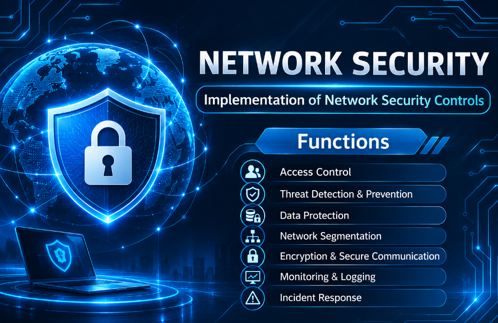
</p>

<h1 align="center">🛡️ Network Security — Module 3 Lab</h1>
<h3 align="center">Implementation of Network Security Controls on an Active Directory Lab</h3>

<p align="center">
  
  
  
  
  
  
</p>

---

## 📖 About This Project

This repository is the complete, step by step documentation of **Module 3 — Network Security Controls Implementation** from the *Certified Network Defender* course. Starting from the Active Directory domain built in Module 2 (`corp.local`), the lab adds three new virtual machines and then implements, hardens and finally **attack-tests** a full set of technical network security controls.

It covers network segmentation with Windows Firewall, disabling insecure protocols (SMBv1, LLMNR, NetBIOS, mDNS), TLS hardening, an Enterprise Certificate Authority (PKI), a SoftEther L2TP/IPsec VPN, Suricata IDS with custom rules, Sysmon logging, Windows Admin Center, and six live attack simulations from Kali Linux that prove the controls work.

Every step is illustrated with the original screenshots from the lab (179 images) and a short explanation of what each picture shows, so the repository can be used both as a **lab report** and as a **hands-on guide** you can reproduce.

| | |
|---|---|
| **Author** | Sanawar Imran |
| **Roll No.** | 243633 |
| **Submitted to** | Muhammad Azam |
| **Program** | BS Cybersecurity, Air University |
| **Course** | Network Security — Certified Network Defender (CND) |
| **Report** | Module 3 — Lab Report (78 pages) |

---

## 📑 Table of Contents

1. [Lab Objectives](#-lab-objectives)
2. [Lab Topology and IP Plan](#-lab-topology-and-ip-plan)
3. [Prerequisites](#-prerequisites)
4. [Quick Start — Order of Work](#-quick-start--order-of-work)
5. [Section 1 — Create VPN01 and Join the Domain](#1-create-vpn01-and-join-the-domain)
6. [Section 2 — Create IDS01 and ATTACK01 (Kali Linux)](#2-create-ids01-and-attack01-kali-linux)
7. [Section 3 — Fix Active Directory (OU, Service Account, Groups)](#3-fix-active-directory-ou-service-account-groups)
8. [Section 4 — Network Segmentation (Windows Firewall)](#4-network-segmentation-windows-firewall-on-dc01)
9. [Section 5 — Disable Insecure Protocols](#5-disable-insecure-protocols)
10. [Section 6 — TLS Hardening](#6-tls-hardening)
11. [Section 7 — Certificate Authority (PKI)](#7-certificate-authority-pki)
12. [Section 8 — Certificate Auto-Enrollment via GPO](#8-certificate-auto-enrollment-via-gpo)
13. [Section 9 — VPN Server (SoftEther)](#9-vpn-server-softether-on-vpn01)
14. [Section 10 — Intrusion Detection (Suricata)](#10-intrusion-detection-system-suricata-on-ids01)
15. [Section 11 — Sysmon](#11-sysmon-enhanced-logging)
16. [Section 12 — Windows Admin Center](#12-windows-admin-center)
17. [Section 13 — Attack Simulation](#13-attack-simulation-from-attack01)
18. [Results Summary](#-results-summary)
19. [Troubleshooting Guide](#-troubleshooting-guide)
20. [Security Best Practices and Lessons Learned](#-security-best-practices-and-lessons-learned)
21. [Extra Knowledge — Concepts Explained](#-extra-knowledge--concepts-explained)
22. [Repository Structure](#-repository-structure)
23. [Disclaimer](#-disclaimer)

---

## 🎯 Lab Objectives

- Add VPN01, IDS01 and ATTACK01 to the Module 2 environment and join VPN01 to the domain.
- Add the missing Active Directory items (ServiceAccounts OU, service account, department security groups).
- Segment the network with inbound Windows Firewall rules on DC01 and turn on firewall logging.
- Disable insecure protocols: **SMBv1, LLMNR, NetBIOS over TCP/IP, mDNS**.
- Enforce **TLS 1.2** only and disable **RC4**.
- Deploy an **Enterprise Root CA** (RSA 4096 / SHA256) and enable **certificate auto-enrollment** by GPO.
- Build a **SoftEther L2TP/IPsec VPN** with a virtual hub, users and SecureNAT.
- Install **Suricata IDS** with 40,000+ rules and three custom detection rules.
- Install **Sysmon** with the SwiftOnSecurity configuration on DC01 and ADMIN01.
- Manage DC01 and VPN01 centrally with **Windows Admin Center** over HTTPS.
- **Validate everything** with six attack simulations (Nmap, EternalBlue check, Hydra, Responder, VPN access test, TLS cipher scan).

---

## 🗺️ Lab Topology and IP Plan

All machines run in **VMware Workstation** on the same **VMnet1 (Host-only)** network, `192.168.64.0/24`. A second NAT adapter (VMnet8/VMnet2) is added **temporarily** on a VM only when it must download software, and removed afterwards.

| VM | IP Address | OS | Role |
|----|-----------|----|------|
| DC01 | 192.168.64.10 | Windows Server 2019 | Domain Controller, DNS, CA, firewall rules — *Module 2* |
| ADMIN01 | 192.168.64.20 | Windows 10 Pro | Management workstation, Windows Admin Center — *Module 2* |
| CL01 | 192.168.64.30 | Windows 10 Pro | Client workstation (target of segmentation tests) — *Module 2* |
| VPN01 | 192.168.64.50 | Windows Server 2019 | SoftEther VPN server — **new in Module 3** |
| IDS01 | 192.168.64.6 | Kali Linux | Suricata intrusion detection — **new in Module 3** |
| ATTACK01 | 192.168.64.4 | Kali Linux | Attack simulation — **new in Module 3** |

```text
                        VMnet1 (Host-only)  192.168.64.0/24
 ┌────────┐  ┌─────────┐  ┌───────┐  ┌────────┐  ┌────────┐  ┌──────────┐
 │  DC01  │  │ ADMIN01 │  │ CL01  │  │ VPN01  │  │ IDS01  │  │ ATTACK01 │
 │ .10    │  │ .20     │  │ .30   │  │ .50    │  │ .6     │  │ .4       │
 │AD DS   │  │ WAC     │  │client │  │SoftEther│ │Suricata│  │Nmap/Hydra│
 │DNS, CA │  │ Sysmon  │  │       │  │L2TP/IPsec││       │  │Responder │
 └────────┘  └─────────┘  └───────┘  └────────┘  └────────┘  └──────────┘
```

Domain: `corp.local` — NetBIOS name: `CORP`.

---

## ✅ Prerequisites

- **Module 2 fully completed**: the `corp.local` domain, users (`hr.user`, `finance.user`, `it.admin`), OUs (HR, FINANCE, IT, Servers, Workstations, Users), GPOs (including account lockout) and the three Windows machines DC01, ADMIN01 and CL01.
- VMware Workstation (or any hypervisor with a host-only network).
- ISO images: Windows Server 2019 and Kali Linux.
- About **16 GB RAM** on the host (VMs used 2 to 3 GB each) and roughly 300 GB of free disk.
- A temporary internet connection (NAT adapter) for downloading SoftEther, OpenSSH, Suricata, Sysmon and Windows Admin Center.

---

## 🚀 Quick Start — Order of Work

If you want to reproduce the lab, follow this order. Each step has its own section below with commands and screenshots.

1. Build **VPN01**, **IDS01**, **ATTACK01** and give them static IPs on the lab network.
2. Join VPN01 to `corp.local`.
3. Add the missing AD objects (OU, service account, groups).
4. Create the firewall rules on DC01 and enable logging.
5. Disable SMBv1, LLMNR, NetBIOS, mDNS and install SSH.
6. Harden TLS and disable RC4, then reboot DC01.
7. Install and configure the Enterprise Root CA, then enable auto-enrollment.
8. Install and configure SoftEther VPN on VPN01.
9. Install Suricata on IDS01 and add custom rules.
10. Install Sysmon on DC01 and ADMIN01.
11. Install Windows Admin Center and connect DC01 and VPN01.
12. Run the six attacks from ATTACK01 and compare with the expected results.

> 💡 **Tip:** take a VM snapshot before every major section (firewall, TLS, CA). If something breaks you can roll back in seconds instead of rebuilding.

> ⚠️ **Lab credentials:** the original report uses simple lab passwords and a pre-shared key. They are intentionally **not repeated in this README**. Use your own strong values, and never publish real secrets (one screenshot shows the lab IPsec key in clear text).


---

## 1. Create VPN01 and Join the Domain

A new **Windows Server 2019** VM named **VPN01** is created for the VPN role. Its adapter is put on the same host-only network as DC01, it gets the static address `192.168.64.50` with DC01 (`192.168.64.10`) as DNS, and it is then joined to `corp.local` through System Properties.

**Steps**
1. Create the VM in VMware Workstation and set the adapter to *Custom: VMnet1 (Host-only)*.
2. Network Connections → adapter → Properties → IPv4.
3. IP `192.168.64.50`, mask `255.255.255.0`, DNS `192.168.64.10`.
4. Settings → About → System info → Advanced system settings → Computer Name → Change.
5. Name `VPN01`, domain `corp.local`, enter the domain administrator credentials, restart, log in as `CORP\Administrator`.

> 📝 **Note:** if the join fails with *domain not found*, the problem is almost always DNS. VPN01 must use DC01 as its only DNS server.


<p align="center">
  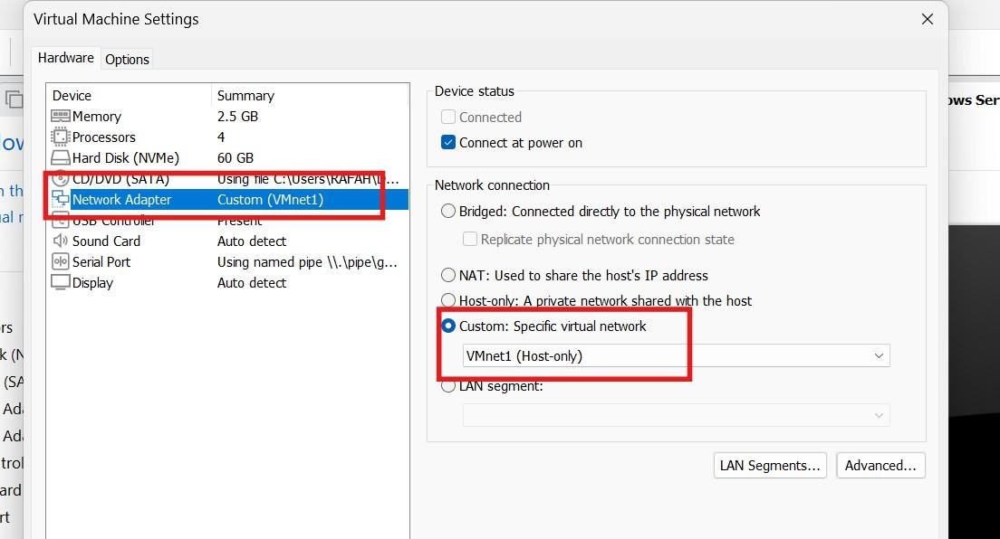
  <br>
  <b>VPN01 network adapter set to Host-Only</b>
</p>

> VMware Virtual Machine Settings for VPN01 with Network Adapter highlighted.  
> The adapter uses Custom: Specific virtual network = VMnet1 (Host-only), the same VMnet as DC01.  
> This puts VPN01 on the isolated lab LAN so it can reach the domain controller.

<p align="center">
  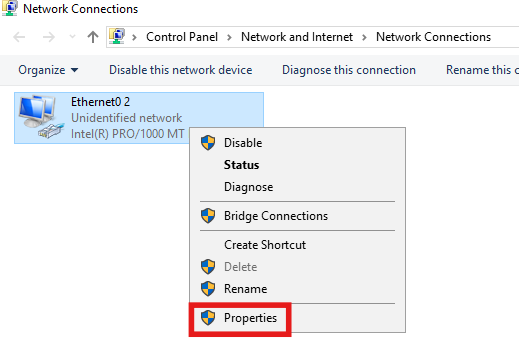
  <br>
  <b>Network Connections - adapter Properties</b>
</p>

> Windows Network Connections window showing Ethernet0 2 (Unidentified network) with its right-click menu.  
> The Properties entry is highlighted; this is how the TCP/IPv4 settings are reached.  
> It is the first step towards giving VPN01 a static IP address.

<p align="center">
  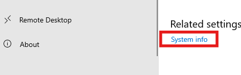 About > System info" width="85%">
  <br>
  <b>Settings > About > System info</b>
</p>

> Windows Settings page showing Remote Desktop and About, with the Related settings > System info link highlighted.  
> System info leads to the classic System Properties dialog.  
> That dialog is needed to rename the server and join it to the domain.

<p align="center">
  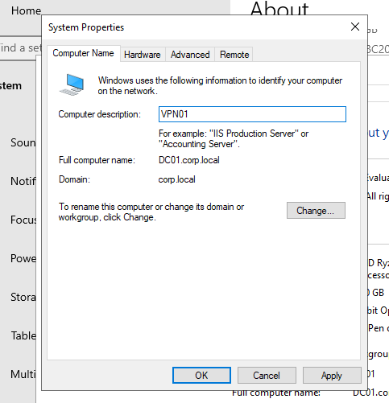
  <br>
  <b>System Properties - computer name</b>
</p>

> System Properties dialog on the Computer Name tab showing the description VPN01 and the domain corp.local.  
> The Change... button is where the computer name and domain membership are edited.  
> This is the screen used to join VPN01 to the CORP domain.

<p align="center">
  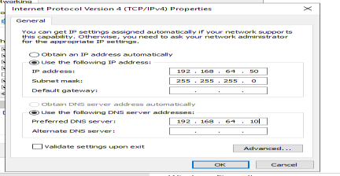
  <br>
  <b>Static IPv4 for VPN01</b>
</p>

> TCP/IPv4 Properties with Use the following IP address selected.  
> IP address 192.168.64.50, subnet mask 255.255.255.0, preferred DNS 192.168.64.10 (DC01).  
> Pointing DNS to the domain controller is mandatory, otherwise the domain join fails.


---

## 2. Create IDS01 and ATTACK01 (Kali Linux)

Two Kali Linux VMs are added. **IDS01** (`192.168.64.6`) will run Suricata, **ATTACK01** (`192.168.64.4`) is the attacker. Both use static addresses configured with `nmcli`, and both are checked with ping against DC01.

```bash
# IDS01
sudo nmcli con mod "eth0" ipv4.addresses 192.168.64.6/24 ipv4.dns 192.168.64.10 ipv4.method manual
sudo nmcli con up "eth0"
ip a
ping 192.168.64.10

# ATTACK01
sudo nmcli con mod "Wired connection 1" \
  ipv4.addresses 192.168.64.4/24 ipv4.dns 192.168.64.10 \
  ipv4.gateway "" ipv4.never-default yes ipv4.method manual
sudo nmcli con up "Wired connection 1"

# connectivity check from ATTACK01
for ip in 10 20 30 50 6; do ping -c 2 192.168.64.$ip; done
```

> 📝 **Why `never-default yes`?** The host-only network has no gateway. This option stops NetworkManager from using it as the default route, so the second (NAT) interface keeps internet access when it is attached.


<p align="center">
  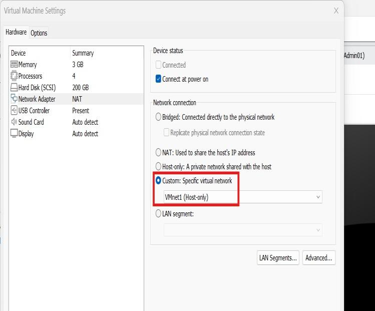
  <br>
  <b>Kali VM network settings (VMnet1)</b>
</p>

> VMware settings of a Kali Linux VM (3 GB RAM, 200 GB disk) with the network adapter set to Custom: VMnet1 (Host-only).  
> The same host-only network is used by every machine in the lab.  
> This is the adapter configuration used for the Kali based IDS01 / ATTACK01 machines.

<p align="center">
  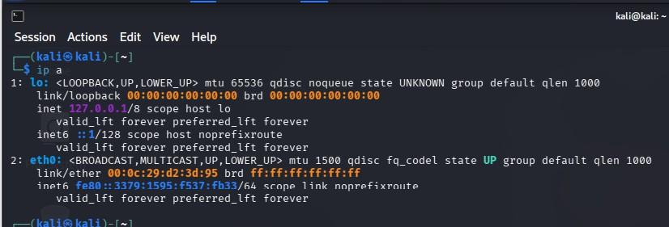
  <br>
  <b>ip a on the new Kali VM</b>
</p>

> Kali terminal running ip a to list network interfaces.  
> eth0 is UP and carries the VM MAC address, but no IPv4 address has been assigned yet.  
> This confirms the interface name (eth0) that is needed for the nmcli commands.

<p align="center">
  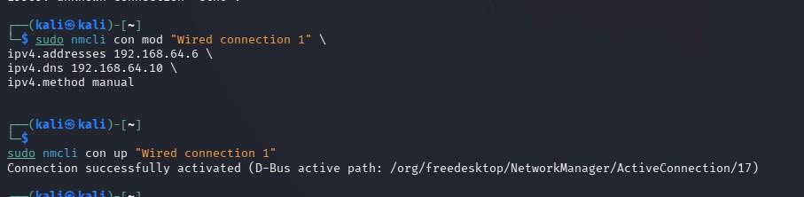
  <br>
  <b>IDS01 static IP with nmcli</b>
</p>

> Terminal showing sudo nmcli con mod with ipv4.addresses 192.168.64.6, ipv4.dns 192.168.64.10 and ipv4.method manual.  
> The connection is then brought up with nmcli con up and NetworkManager reports Connection successfully activated.  
> IDS01 now has the fixed address 192.168.64.6.

<p align="center">
  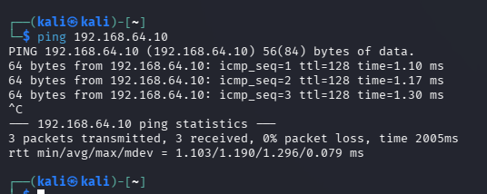
  <br>
  <b>IDS01 pings DC01</b>
</p>

> Ping from Kali to 192.168.64.10 returns 3 of 3 replies with 0% packet loss and TTL 128.  
> TTL 128 is typical of a Windows host, which is DC01.  
> Connectivity between IDS01 and the domain controller is verified.

<p align="center">
  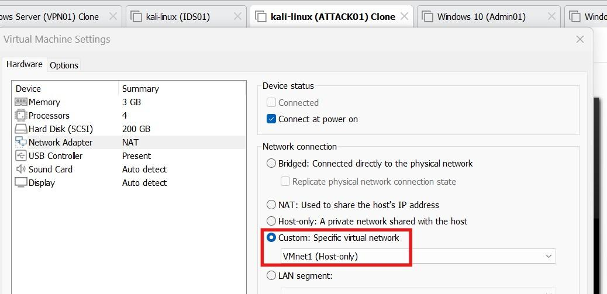
  <br>
  <b>ATTACK01 network adapter</b>
</p>

> VMware settings for the kali-linux (ATTACK01) Clone VM, tab bar shows VPN01, IDS01, ATTACK01 and Admin01.  
> Network connection is Custom: VMnet1 (Host-only) so the attacker sits inside the lab network.  
> The attacker machine is deliberately on the same segment so that every control can be tested.

<p align="center">
  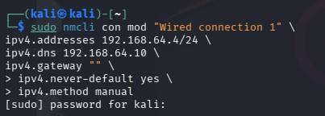
  <br>
  <b>ATTACK01 static IP command</b>
</p>

> nmcli command setting 192.168.64.4/24, DNS 192.168.64.10, empty gateway and ipv4.never-default yes with manual method.  
> never-default prevents this isolated interface from becoming the default route.  
> The sudo password prompt is visible at the bottom.

<p align="center">
  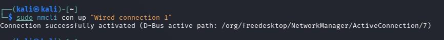
  <br>
  <b>ATTACK01 connection activated</b>
</p>

> Output of sudo nmcli con up Wired connection 1 confirming the connection was successfully activated.  
> The address configured in the previous step is now live.  
> ATTACK01 is ready to ping and scan the other lab VMs.

<p align="center">
  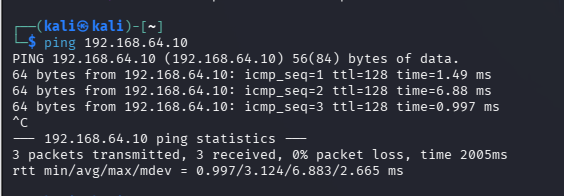
  <br>
  <b>Ping test from Kali to DC01</b>
</p>

> Three ICMP echo replies from 192.168.64.10 with 0% packet loss.  
> Latency is about 1 to 7 ms, normal for VMs on the same host.  
> Proves IDS01 can talk to DC01 over the host-only network.

<p align="center">
  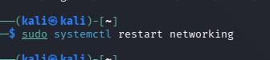
  <br>
  <b>Restart networking</b>
</p>

> Terminal running sudo systemctl restart networking.  
> The service restart applies the new static IP configuration.  
> It is used when the nmcli changes do not take effect immediately.


---

## 3. Fix Active Directory (OU, Service Account, Groups)

Module 2 had users but not every object that Module 3 needs. On **DC01** (`Win+R → dsa.msc`) the following are added:

| Object | Name | Where |
|--------|------|-------|
| Organizational Unit | `ServiceAccounts` | `corp.local` |
| Service account | `svc.backup` (SVC Backup) | `ServiceAccounts` OU, *User must change password* **unchecked** |
| Security group | `GRP_HR` (member `hr.user`) | HR OU, Global / Security |
| Security group | `GRP_Finance` (member `finance.user`) | FINANCE OU, Global / Security |
| Security group | `GRP_IT` (member `it.admin`) | IT OU, Global / Security |

> 📝 **Good practice:** service accounts get their own OU so they can have a separate password policy, are easy to audit, and are never used for interactive logon.


<p align="center">
  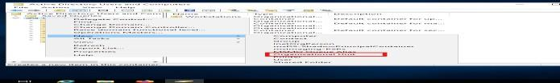
  <br>
  <b>Active Directory Users and Computers (tiny view)</b>
</p>

> A very small capture of dsa.msc with the right-click New menu open.  
> The list of object types is visible, including Organizational Unit.  
> It is the starting point for adding the missing OU in Module 3.

<p align="center">
  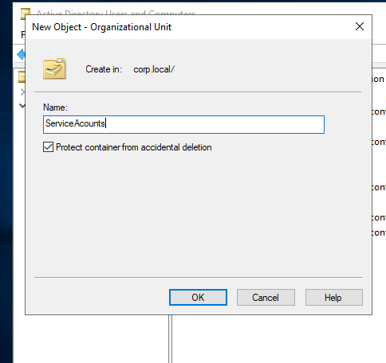
  <br>
  <b>New OU - ServiceAccounts</b>
</p>

> New Object - Organizational Unit dialog created in corp.local.  
> Name field contains ServiceAccounts and Protect container from accidental deletion is ticked.  
> This OU will hold non-human service accounts such as the backup account.

<p align="center">
  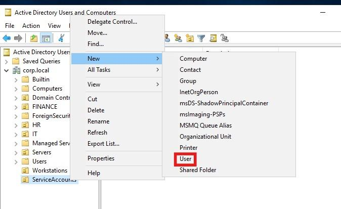 User in ServiceAccounts OU" width="85%">
  <br>
  <b>New > User in ServiceAccounts OU</b>
</p>

> ADUC tree with OUs FINANCE, HR, IT, Servers, Users, Workstations and ServiceAccounts.  
> Right-click on the OU, then New > User (highlighted in red).  
> Starts the creation of the service account.

<p align="center">
  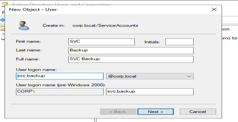
  <br>
  <b>New user svc.backup</b>
</p>

> New Object - User wizard in corp.local/ServiceAccounts.  
> First name SVC, last name Backup, logon name svc.backup@corp.local (pre-Windows 2000: CORP\svc.backup).  
> The account follows a clear naming convention for service accounts.

<p align="center">
  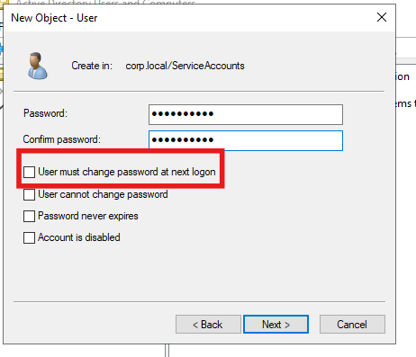
  <br>
  <b>Service account password options</b>
</p>

> Password page of the New User wizard with both password fields filled.  
> User must change password at next logon is unticked and highlighted in red.  
> Service accounts must not prompt for a password change because no human logs in with them.

<p align="center">
  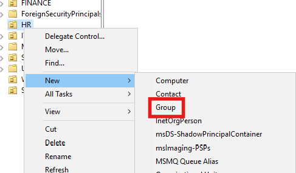
  <br>
  <b>Create group in HR OU</b>
</p>

> Right-click on the HR OU, New menu, Group option highlighted.  
> The group will be created inside the department OU it belongs to.  
> This starts the role based group structure (GRP_HR).

<p align="center">
  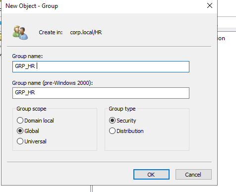
  <br>
  <b>New group GRP_HR</b>
</p>

> New Object - Group in corp.local/HR with the name GRP_HR.  
> Scope is Global and type is Security.  
> A global security group is the standard choice for department access control.

<p align="center">
  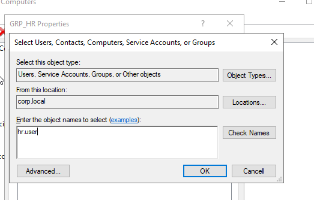
  <br>
  <b>Add hr.user to GRP_HR</b>
</p>

> GRP_HR Properties, Select Users dialog with hr.user typed from corp.local.  
> Check Names then OK adds the member.  
> Links the HR user account to its department group.

<p align="center">
  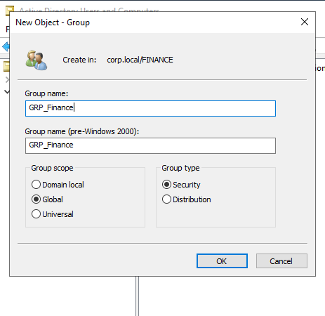
  <br>
  <b>New group GRP_Finance</b>
</p>

> New Object - Group created in corp.local/FINANCE.  
> Group name GRP_Finance, Global scope, Security type.  
> Second of the three department groups.

<p align="center">
  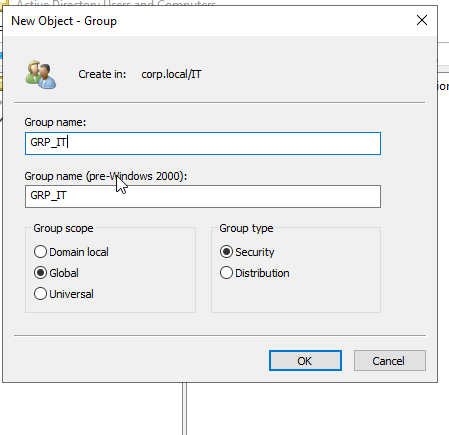
  <br>
  <b>New group GRP_IT</b>
</p>

> New Object - Group created in corp.local/IT.  
> Group name GRP_IT, Global scope, Security type.  
> Third department group; IT administrators will be added to it.

<p align="center">
  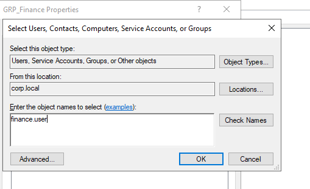
  <br>
  <b>Add finance.user to GRP_Finance</b>
</p>

> GRP_Finance Properties, Select Users dialog with finance.user entered.  
> The object type and location (corp.local) are already correct.  
> Completes the Finance group membership.

<p align="center">
  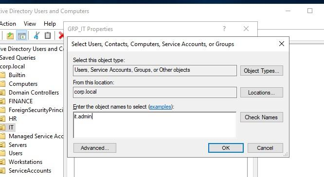
  <br>
  <b>Add it.admin to GRP_IT</b>
</p>

> GRP_IT Properties, Select Users dialog with it.admin typed in.  
> The ADUC tree behind it shows all OUs including ServiceAccounts.  
> Completes the group setup for Module 3.


---

## 4. Network Segmentation (Windows Firewall on DC01)

Windows Firewall (`Win+R → wf.msc`) on DC01 is used to control which machines may talk to the domain controller.

| Rule | Type | Settings | Action |
|------|------|----------|--------|
| `Block-ICMP-From-CL01` | Custom, all programs | Protocol ICMPv4, remote IP `192.168.64.30`, all profiles | **Block** |
| `Block-RDP-From-CL01` | Port, TCP | Port `3389`, remote IP `192.168.64.30` | **Block** |
| `Allow-AD-Services-Internal` | Port, TCP | `53,88,389,445,636,3268,3269`, remote IP `192.168.64.0/24` | **Allow** |

**Firewall logging** is switched on for the Domain, Private and Public profiles (*Properties → Logging → Customize*): log dropped packets = **Yes**, log successful connections = **Yes**, size 32768 KB. Logs go to `%systemroot%\system32\logfiles\firewall\pfirewall.log`.

**Verification on CL01**
```cmd
ping 192.168.64.10        :: Request timed out  (ICMP blocked)
nslookup corp.local       :: resolves           (port 53 still allowed)
```

> 💡 **Tip:** the same rules can be created with PowerShell, which is faster and repeatable:
> ```powershell
> New-NetFirewallRule -DisplayName "Block-ICMP-From-CL01" -Direction Inbound -Protocol ICMPv4 -RemoteAddress 192.168.64.30 -Action Block
> New-NetFirewallRule -DisplayName "Block-RDP-From-CL01"  -Direction Inbound -Protocol TCP -LocalPort 3389 -RemoteAddress 192.168.64.30 -Action Block
> New-NetFirewallRule -DisplayName "Allow-AD-Services-Internal" -Direction Inbound -Protocol TCP -LocalPort 53,88,389,445,636,3268,3269 -RemoteAddress 192.168.64.0/24 -Action Allow
> ```


<p align="center">
  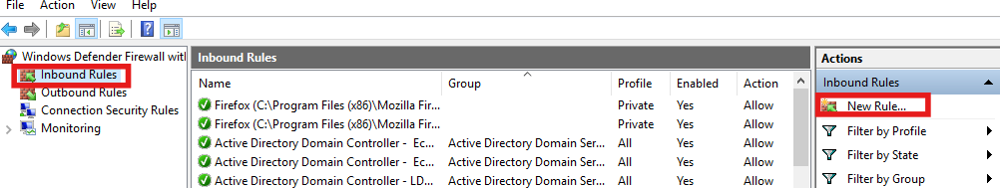 New Rule" width="85%">
  <br>
  <b>Windows Firewall - Inbound Rules > New Rule</b>
</p>

> wf.msc on DC01 with Inbound Rules selected and the New Rule... action highlighted.  
> Existing rules such as Firefox and Active Directory Domain Controller are listed.  
> All segmentation rules in Module 3 start from this action.

<p align="center">
  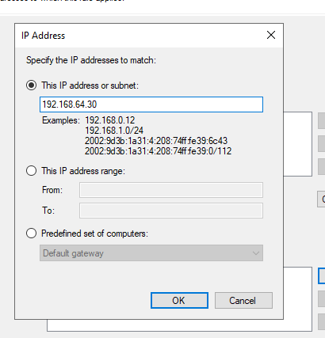
  <br>
  <b>Rule scope - IP 192.168.64.30</b>
</p>

> IP Address dialog with This IP address or subnet set to 192.168.64.30.  
> 192.168.64.30 is CL01, the client workstation that should be restricted.  
> Used for both the ICMP block rule and the RDP block rule.

<p align="center">
  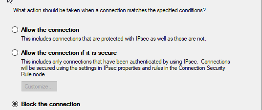
  <br>
  <b>Rule action - Block the connection</b>
</p>

> New Inbound Rule wizard action page.  
> Block the connection is selected instead of Allow.  
> This is what turns the rule into a deny rule for traffic coming from CL01.

<p align="center">
  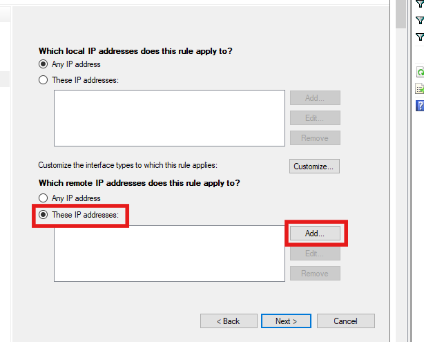
  <br>
  <b>Remote IP addresses - Add</b>
</p>

> Rule scope page, Remote IP section.  
> These IP addresses is selected and the Add... button is highlighted.  
> The remote IP of CL01 is added here.

<p align="center">
  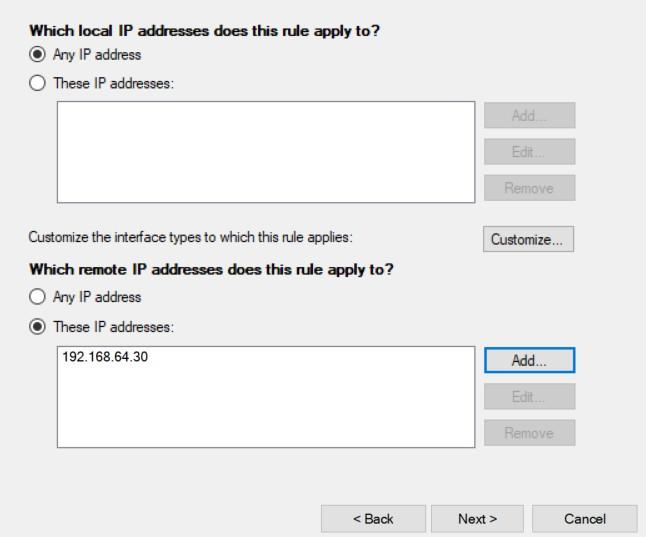
  <br>
  <b>Remote IP list with 192.168.64.30</b>
</p>

> Scope page after adding the address.  
> 192.168.64.30 appears in the remote IP list, local addresses remain Any.  
> Rule will only match traffic whose source is CL01.

<p align="center">
  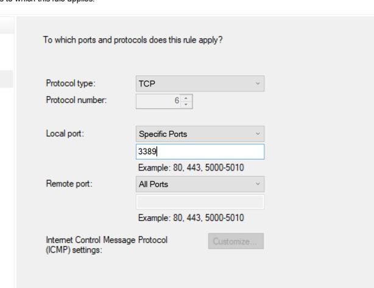
  <br>
  <b>Block RDP - TCP port 3389</b>
</p>

> Protocol and Ports page: TCP, protocol number 6, Specific Ports 3389.  
> Remote port stays All Ports.  
> Prevents CL01 from opening Remote Desktop sessions to DC01.

<p align="center">
  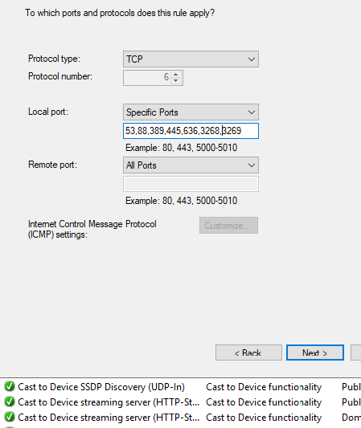
  <br>
  <b>Allow AD services - port list</b>
</p>

> Protocol TCP with Specific Ports 53,88,389,445,636,3268,3269.  
> These are DNS, Kerberos, LDAP, SMB, LDAPS and Global Catalog ports.  
> Domain functionality is kept alive for the internal network.

<p align="center">
  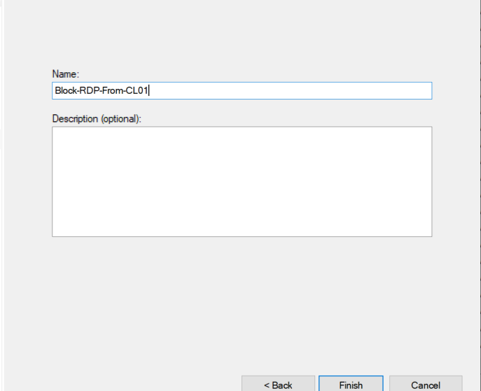
  <br>
  <b>Rule name Block-RDP-From-CL01</b>
</p>

> Final wizard page with the name Block-RDP-From-CL01.  
> A clear descriptive name makes the rule easy to audit later.  
> Finish creates the rule.

<p align="center">
  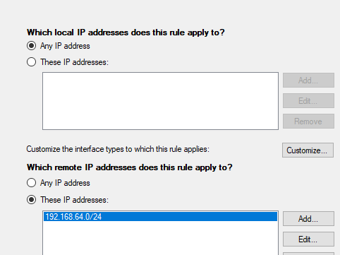
  <br>
  <b>Allow rule - remote scope 192.168.64.0/24</b>
</p>

> Scope page of the Allow-AD-Services rule.  
> Remote IP is the whole lab subnet 192.168.64.0/24.  
> Only internal hosts may use the AD service ports.

<p align="center">
  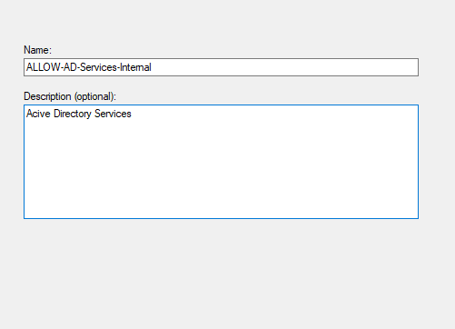
  <br>
  <b>Rule name Allow-AD-Services-Internal</b>
</p>

> Name ALLOW-AD-Services-Internal with description Active Directory Services.  
> This closes the 3-rule set: block ICMP, block RDP, allow AD.  
> Documentation in the description helps future administrators.

<p align="center">
  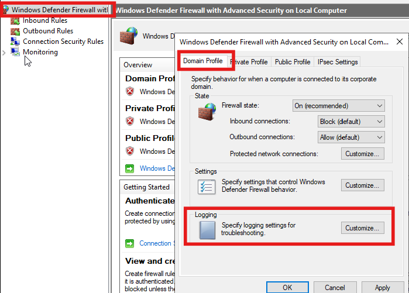
  <br>
  <b>Firewall properties - Logging customize</b>
</p>

> Windows Defender Firewall with Advanced Security Properties, Domain Profile tab.  
> The Logging section with the Customize button is highlighted.  
> Logging is needed so blocked packets can be reviewed.

<p align="center">
  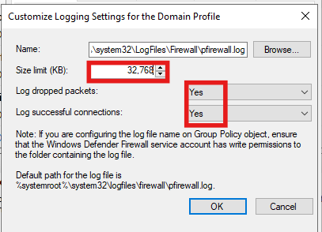
  <br>
  <b>Logging settings - Domain profile</b>
</p>

> Domain profile logging dialog with size limit 32,768 KB and both Yes values highlighted.  
> The log file is pfirewall.log in system32\LogFiles\Firewall.  
> These logs show which connections the segmentation rules dropped.

<p align="center">
  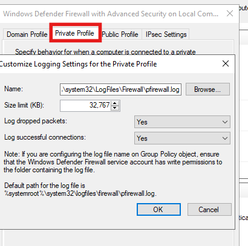
  <br>
  <b>Logging settings - Private profile</b>
</p>

> Customize Logging Settings for the Private Profile.  
> Log dropped packets = Yes, Log successful connections = Yes, size limit 32,767 KB.  
> Same settings are repeated for every profile.

<p align="center">
  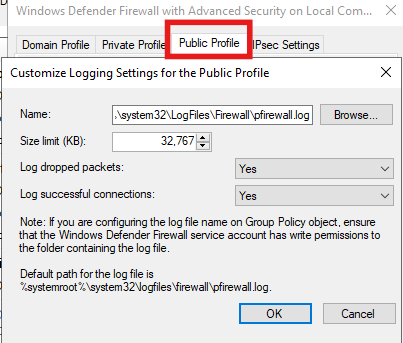
  <br>
  <b>Logging settings - Public profile</b>
</p>

> Customize Logging Settings for the Public Profile.  
> Dropped packets and successful connections are both logged.  
> Default log path is %systemroot%\system32\logfiles\firewall\pfirewall.log.

<p align="center">
  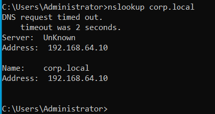
  <br>
  <b>nslookup corp.local from CL01</b>
</p>

> Command Prompt on CL01 running nslookup corp.local.  
> After a first timeout for the reverse lookup, the name corp.local resolves to 192.168.64.10.  
> Port 53 is still open, proving the Allow-AD rule works.

<p align="center">
  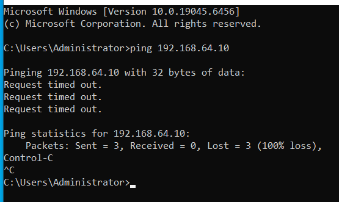
  <br>
  <b>ping DC01 from CL01 - blocked</b>
</p>

> Command Prompt on CL01 running ping 192.168.64.10.  
> Three Request timed out lines and 100% loss.  
> Evidence that the Block-ICMP-From-CL01 firewall rule works.


---

## 5. Disable Insecure Protocols

All commands are run on **DC01** in an elevated PowerShell window.

| Protocol | Why it is dangerous | How it is disabled |
|----------|--------------------|--------------------|
| **SMBv1** | Exploited by EternalBlue and WannaCry | `Disable-WindowsOptionalFeature` + registry value `SMB1 = 0` |
| **LLMNR** | Name poisoning (Responder) | GPO *Turn off multicast name resolution* = Enabled |
| **NetBIOS over TCP/IP** | NBT-NS poisoning | `SetTcpipNetbios(2)` on all adapters |
| **mDNS** | Multicast poisoning | Registry `EnableMDNS = 0` |
| **Telnet-style plain admin** | — | OpenSSH installed as the encrypted alternative |

```powershell
# 5.1 SMBv1
Disable-WindowsOptionalFeature -Online -FeatureName SMB1Protocol
Set-ItemProperty -Path "HKLM:\SYSTEM\CurrentControlSet\Services\LanmanServer\Parameters" -Name "SMB1" -Value 0

# 5.2 make sure SMBv2/3 still works  -> must return True
Get-SmbServerConfiguration | Select EnableSMB2Protocol

# 5.3 LLMNR via GPO: gpmc.msc -> Default Domain Policy -> Edit
#     Computer Configuration > Policies > Administrative Templates > Network > DNS Client
#     "Turn off multicast name resolution" = Enabled
gpupdate /force

# 5.4 NetBIOS
$adapters = Get-WmiObject Win32_NetworkAdapterConfiguration
foreach ($adapter in $adapters) { $adapter.SetTcpipNetbios(2) }

# 5.5 mDNS
reg add "HKLM\SYSTEM\CurrentControlSet\Services\Dnscache\Parameters" /v EnableMDNS /t REG_DWORD /d 0 /f

# 5.6 OpenSSH (needs a temporary NAT adapter for the download)
Add-WindowsCapability -Online -Name OpenSSH.Server~~~~0.0.1.0
Start-Service sshd
Set-Service -Name sshd -StartupType Automatic
Get-Service sshd
```

> ⚠️ **Remember:** `SetTcpipNetbios(2)` printing `ReturnValue : 84` in the output is normal in this lab; verify the final state with `Get-WmiObject Win32_NetworkAdapterConfiguration | Select Description,TcpipNetbiosOptions`.


<p align="center">
  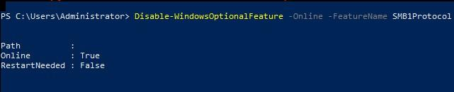
  <br>
  <b>Disable SMBv1 feature</b>
</p>

> PowerShell on DC01 running Disable-WindowsOptionalFeature -Online -FeatureName SMB1Protocol.  
> Output shows Online : True and RestartNeeded : False.  
> SMBv1 is the protocol abused by EternalBlue and WannaCry.

<p align="center">
  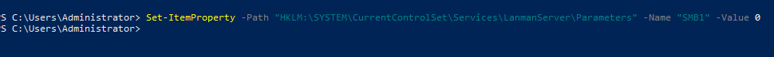
  <br>
  <b>SMBv1 registry value set to 0</b>
</p>

> Set-ItemProperty on HKLM:\SYSTEM\CurrentControlSet\Services\LanmanServer\Parameters sets SMB1 to 0.  
> The command returns silently, which means success.  
> A second layer that makes sure SMBv1 stays off.

<p align="center">
  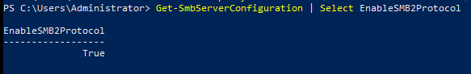
  <br>
  <b>SMBv2 still enabled</b>
</p>

> Get-SmbServerConfiguration  
> Select EnableSMB2Protocol returns True.  
> SMBv2 and v3 remain active after SMBv1 was removed.  
> File sharing and Active Directory keep working.

<p align="center">
  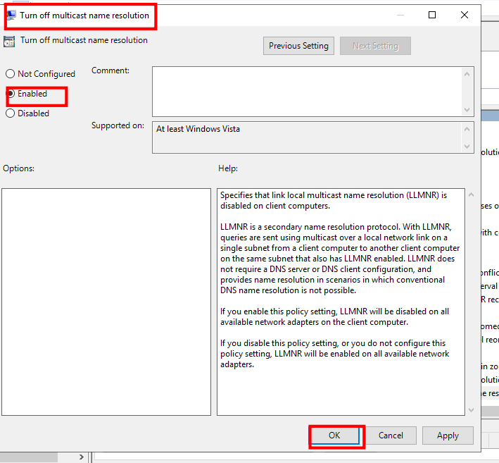
  <br>
  <b>LLMNR policy - Enabled</b>
</p>

> Group Policy setting Turn off multicast name resolution with Enabled selected.  
> The help text explains that LLMNR is disabled on all client adapters.  
> Stops LLMNR poisoning tools such as Responder.

<p align="center">
  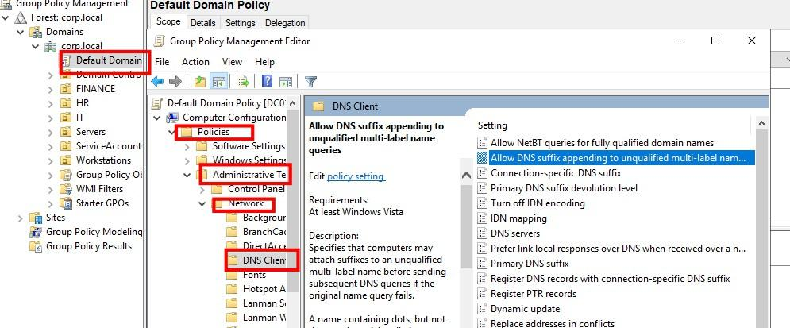
  <br>
  <b>GPMC path to the DNS Client policy</b>
</p>

> Group Policy Management Editor on Default Domain Policy.  
> Navigated to Computer Configuration > Policies > Administrative Templates > Network > DNS Client.  
> Highlighted nodes show the exact path.

<p align="center">
  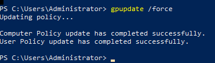
  <br>
  <b>gpupdate /force on DC01</b>
</p>

> PowerShell output: Computer Policy update and User Policy update completed successfully.  
> Applies the new LLMNR policy immediately.  
> No reboot is needed.

<p align="center">
  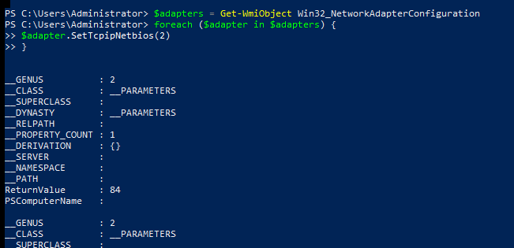
  <br>
  <b>Disable NetBIOS over TCP/IP</b>
</p>

> PowerShell loop calling SetTcpipNetbios(2) on every network adapter.  
> ReturnValue 84 appears in the output, which is shown by WMI when the call is processed.  
> Option 2 means Disable NetBIOS over TCP/IP.

<p align="center">
  
  <br>
  <b>Disable mDNS in registry</b>
</p>

> reg add on HKLM\...\Dnscache\Parameters with EnableMDNS = 0.  
> The operation completed successfully.  
> Closes another multicast name resolution channel.

<p align="center">
  
  <br>
  <b>Temporary NAT adapter on DC01</b>
</p>

> VMware settings showing Network Adapter 2 added as Custom: VMnet8 (NAT).  
> It gives DC01 internet access only for downloading OpenSSH.  
> It is removed again after the install to keep the lab isolated.

<p align="center">
  
  <br>
  <b>Install OpenSSH Server</b>
</p>

> Add-WindowsCapability -Online -Name OpenSSH.Server~~~~0.0.1.0.  
> Result shows Online : True and RestartNeeded : False.  
> Adds SSH as an encrypted management protocol.

<p align="center">
  
  <br>
  <b>sshd running</b>
</p>

> Start-Service sshd, Set-Service with StartupType Automatic and Get-Service sshd.  
> Status is Running for OpenSSH SSH Server.  
> SSH is now available and starts at boot.


---

## 6. TLS Hardening

TLS 1.0 and 1.1 are disabled, TLS 1.2 is enforced and the RC4 cipher is switched off through the SCHANNEL registry keys on **DC01**. DC01 is rebooted afterwards.

```powershell
$base = "HKLM:\SYSTEM\CurrentControlSet\Control\SecurityProviders\SCHANNEL\Protocols"

# disable TLS 1.0 / 1.1 (server and client)
foreach ($p in "TLS 1.0","TLS 1.1") {
  foreach ($r in "Server","Client") {
    New-Item -Path "$base\$p\$r" -Force | Out-Null
    New-ItemProperty -Path "$base\$p\$r" -Name "Enabled" -Value 0 -PropertyType DWORD -Force
    New-ItemProperty -Path "$base\$p\$r" -Name "DisabledByDefault" -Value 1 -PropertyType DWORD -Force
  }
}

# enable TLS 1.2 (server)
New-Item -Path "$base\TLS 1.2\Server" -Force | Out-Null
New-ItemProperty -Path "$base\TLS 1.2\Server" -Name "Enabled" -Value 1 -PropertyType DWORD -Force
New-ItemProperty -Path "$base\TLS 1.2\Server" -Name "DisabledByDefault" -Value 0 -PropertyType DWORD -Force

# disable RC4
$cBase = "HKLM:\SYSTEM\CurrentControlSet\Control\SecurityProviders\SCHANNEL\Ciphers"
New-Item -Path "$cBase\RC4 128/128" -Force | Out-Null
New-ItemProperty -Path "$cBase\RC4 128/128" -Name "Enabled" -Value 0 -PropertyType DWORD -Force

Restart-Computer
```

> 📝 The report lists the individual commands for *TLS 1.0 Server, TLS 1.0 Client, TLS 1.1 Server, TLS 1.2 Server and RC4*; the loop above is an equivalent shorter form that also covers *TLS 1.1 Client*.


<p align="center">
  
  <br>
  <b>TLS base registry path</b>
</p>

> PowerShell assigns $base to the SCHANNEL Protocols registry key.  
> All TLS changes are made below this path.  
> Using a variable keeps the following commands short.

<p align="center">
  
  <br>
  <b>Disable TLS 1.0 Server</b>
</p>

> TLS 1.0\Server key created with Enabled = 0 and DisabledByDefault = 1.  
> PSChildName is Server under TLS 1.0.  
> Prevents clients from negotiating TLS 1.0 with DC01.

<p align="center">
  
  <br>
  <b>Disable TLS 1.0 Client</b>
</p>

> New-Item and New-ItemProperty create TLS 1.0\Client with Enabled = 0 and DisabledByDefault = 1.  
> The registry path is echoed back.  
> Stops DC01 acting as a client with an obsolete protocol.

<p align="center">
  
  <br>
  <b>Disable TLS 1.1 Server</b>
</p>

> TLS 1.1\Server key created with Enabled = 0 and DisabledByDefault = 1.  
> Output lists the registry provider path.  
> TLS 1.1 is deprecated and no longer allowed.

<p align="center">
  
  <br>
  <b>Enable TLS 1.2 Server</b>
</p>

> TLS 1.2\Server created with Enabled = 1 and DisabledByDefault = 0.  
> Output confirms the registry values.  
> TLS 1.2 becomes the only protocol DC01 accepts.

<p align="center">
  
  <br>
  <b>RC4 cipher base path</b>
</p>

> Variable $cBase is set to the SCHANNEL Ciphers key and the RC4 128/128 key is created.  
> The command is cut off at the bottom of the capture.  
> First step of disabling RC4.

<p align="center">
  
  <br>
  <b>RC4 128/128 disabled</b>
</p>

> New-ItemProperty sets Enabled = 0 for RC4 128/128.  
> The result shows the Ciphers\RC4 128/128 registry path.  
> RC4 is a broken stream cipher.


---

## 7. Certificate Authority (PKI)

An **Enterprise Root CA** named `CORP-ROOT-CA` is installed on DC01 with Active Directory Certificate Services.

| Wizard page | Value |
|-------------|-------|
| Role | Active Directory Certificate Services → *Certification Authority* only |
| Setup type | **Enterprise CA** |
| CA type | **Root CA** |
| Private key | Create a new private key |
| Cryptography | RSA#Microsoft Software Key Storage Provider, **4096** bit, **SHA256** |
| CA common name | `CORP-ROOT-CA` (DN: `CN=CORP-ROOT-CA,DC=corp,DC=local`) |
| Validity | **10 years** |
| Database | `C:\Windows\system32\CertLog` (default) |

**Verification:** Server Manager → Tools → *Certification Authority*; `CORP-ROOT-CA` shows a **green check mark** and the folders Revoked Certificates, Issued Certificates, Pending Requests, Failed Requests and Certificate Templates.

```powershell
# command line check
certutil -ping
Get-Service CertSvc
```


<p align="center">
  
  <br>
  <b>Server Manager Dashboard</b>
</p>

> Server Manager on DC01 with Add roles and features highlighted.  
> The left menu shows AD DS, DNS, File and Storage Services and IIS.  
> Entry point for installing Active Directory Certificate Services.

<p align="center">
  
  <br>
  <b>Installation type</b>
</p>

> Add Roles and Features Wizard, Installation Type page.  
> Role-based or feature-based installation is selected.  
> Destination server is DC01.corp.local.

<p align="center">
  
  <br>
  <b>Server selection</b>
</p>

> Server Selection page with the server pool.  
> DC01.corp.local (192.168.10.133 NAT address and Windows Server 2019 Standard Evaluation) is highlighted.  
> Role will be installed on the domain controller itself.

<p align="center">
  
  <br>
  <b>Select AD CS role</b>
</p>

> Server Roles list with Active Directory Certificate Services ticked and highlighted.  
> AD DS is already installed.  
> Starts PKI deployment.

<p align="center">
  
  <br>
  <b>AD CS role services</b>
</p>

> Role Services page with Certification Authority ticked.  
> Web Enrollment, Online Responder and NDES stay unticked.  
> Only the core CA role is needed.

<p align="center">
  
  <br>
  <b>Post-deployment configuration</b>
</p>

> Server Manager flag notification: Configure Active Directory Certificate Services on the destination server.  
> Link highlighted in red.  
> Feature installation succeeded on DC01.corp.local.

<p align="center">
  
  <br>
  <b>Restart if required</b>
</p>

> Confirmation page with Restart the destination server automatically if required ticked.  
> A popup asks to allow automatic restarts and Yes is highlighted.  
> Lets the wizard finish without manual intervention.

<p align="center">
  
  <br>
  <b>CA role service to configure</b>
</p>

> Configure AD CS wizard, Certification Authority ticked.  
> Other role services are greyed out.  
> Only the CA is configured.

<p align="center">
  
  <br>
  <b>Enterprise CA</b>
</p>

> Setup Type page with Enterprise CA selected.  
> Enterprise CAs must be domain members and integrate with Active Directory.  
> Needed for auto-enrollment.

<p align="center">
  
  <br>
  <b>Root CA</b>
</p>

> CA Type page with Root CA selected.  
> Root CAs are the first CA of a PKI hierarchy.  
> CORP is a single-tier lab PKI.

<p align="center">
  
  <br>
  <b>Private key</b>
</p>

> Create a new private key option selected.  
> A new key is generated because none exists.  
> Required for a first-time CA.

<p align="center">
  
  <br>
  <b>Cryptography - RSA 4096 / SHA256</b>
</p>

> Provider RSA#Microsoft Software Key Storage Provider, key length 4096.  
> Hash algorithm SHA256 is selected.  
> Strong modern parameters.

<p align="center">
  
  <br>
  <b>CA name CORP-ROOT-CA</b>
</p>

> Common name for this CA is CORP-ROOT-CA.  
> Distinguished name suffix DC=corp,DC=local.  
> Preview DN: CN=CORP-ROOT-CA,DC=corp,DC=local.

<p align="center">
  
  <br>
  <b>CA validity - 10 years</b>
</p>

> Specify the validity period page set to 10 Years.  
> CA expiration date shows 3/18/2036.  
> CA certificate should outlast the certificates it issues.

<p align="center">
  
  <br>
  <b>Database locations</b>
</p>

> Certificate database and log both set to C:\Windows\system32\CertLog.  
> Default paths are accepted.  
> Next then Configure finishes setup.

<p align="center">
  
  <br>
  <b>CA configuration summary</b>
</p>

> Confirmation page listing CA Type Enterprise Root, RSA 4096, SHA256, validity until 3/18/2036.  
> Database location is C:\Windows\system32\CertLog.  
> Final review before Configure.

<p align="center">
   Certification Authority" width="85%">
  <br>
  <b>Tools > Certification Authority</b>
</p>

> Server Manager Tools menu with Certification Authority highlighted.  
> Opens the CA management console.  
> Used to verify that the CA is running.

<p align="center">
  
  <br>
  <b>CORP-ROOT-CA console</b>
</p>

> Certification Authority (Local) tree with CORP-ROOT-CA showing a green tick.  
> Folders: Revoked Certificates, Issued Certificates, Pending Requests, Failed Requests, Certificate Templates.  
> CA is running correctly.


---

## 8. Certificate Auto-Enrollment via GPO

Auto-enrollment lets every domain computer and user receive certificates without manual requests.

1. `gpmc.msc` → *Forest → Domains → corp.local* → right-click **Default Domain Policy** → Edit.
2. *Computer Configuration → Policies → Windows Settings → Security Settings → Public Key Policies*.
3. Double-click **Certificate Services Client – Auto-Enrollment**.
4. *Configuration Model* = **Enabled**; tick *Renew expired certificates…* and *Update certificates that use certificate templates*.
5. Apply → OK, then run `gpupdate /force`.


<p align="center">
  
  <br>
  <b>Edit Default Domain Policy</b>
</p>

> GPMC with right-click menu on Default Domain Policy, Edit... highlighted.  
> Link Enabled is ticked.  
> Auto-enrollment is configured in this GPO.

<p align="center">
  
  <br>
  <b>Public Key Policies path</b>
</p>

> GPO editor path Computer Configuration > Policies > Windows Settings > Security Settings > Public Key Policies.  
> Certificate Services Client - Auto-Enrollment is highlighted.  
> Shows where the setting lives.

<p align="center">
  
  <br>
  <b>Auto-Enrollment properties</b>
</p>

> Certificate Services Client - Auto-Enrollment properties.  
> Configuration Model is Enabled and both renewal options are ticked.  
> OK is highlighted.

<p align="center">
  
  <br>
  <b>gpupdate /force after auto-enrollment</b>
</p>

> PowerShell on DC01 shows policy update completed successfully.  
> Computer and user policies refreshed.  
> Clients can now request certificates automatically.


---

## 9. VPN Server (SoftEther on VPN01)

A **SoftEther VPN Server** with **L2TP/IPsec** remote access is built on VPN01. A temporary NAT adapter is used only for the download.

**Settings used**
- Component: *SoftEther VPN Server*, platform Windows, CPU Intel x86/x64.
- Mode: **Remote Access VPN Server** (Easy Setup).
- Virtual Hub: `CORP-VPN`.
- **L2TP over IPsec** enabled with a pre-shared key. VPN Azure is **disabled**.
- Users: `vpnuser` and `vpnadmin` (password authentication).
- **SecureNAT** enabled so VPN clients receive DHCP and NAT.

```powershell
# required for L2TP/IPsec when the server is behind NAT
Set-ItemProperty -Path "HKLM:\SYSTEM\CurrentControlSet\Services\PolicyAgent" `
  -Name "AssumeUDPEncapsulationContextOnSendRule" -Value 2 -Type DWORD -Force
Restart-Computer
```

> ⚠️ **Security:** use long unique passwords and a long random IPsec pre-shared key in any real deployment. SecureNAT should be reviewed carefully because it creates a path between VPN clients and the network.


<p align="center">
  
  <br>
  <b>Temporary NAT adapter on VPN01</b>
</p>

> VMware settings showing Network Adapter 2 on VMnet2 (NAT) with 2 GB RAM.  
> Gives VPN01 internet access for the download only.  
> Removed afterwards.

<p align="center">
  
  <br>
  <b>SoftEther download page</b>
</p>

> softether.org 5-download page in Edge.  
> Download SoftEther VPN link highlighted.  
> Open source VPN software.

<p align="center">
  
  <br>
  <b>Download options</b>
</p>

> Select Software SoftEther VPN (Freeware), Component SoftEther VPN Server, Platform Windows, CPU Intel x86 and x64.  
> Correct build for VPN01.  
> Final download choice.

<p align="center">
  
  <br>
  <b>SoftEther Server Manager - Connect</b>
</p>

> Server Manager listing localhost (This server).  
> Connect button highlighted.  
> SoftEther Server Manager icon on the desktop.

<p align="center">
  
  <br>
  <b>SoftEther admin password</b>
</p>

> Change Administrator Password of localhost dialog with New and Confirm Password filled (masked).  
> Shown on first connection.  
> Use a strong unique password in production.

<p align="center">
  
  <br>
  <b>Easy Setup - Remote Access VPN Server</b>
</p>

> SoftEther Easy Setup with Remote Access VPN Server ticked.  
> Description explains that remote clients can access the LAN.  
> Chosen server type.

<p align="center">
  
  <br>
  <b>Virtual Hub name CORP-VPN</b>
</p>

> Easy Setup - Decide the Virtual Hub Name with CORP-VPN typed.  
> At least one hub is required.  
> All VPN users connect to this hub.

<p align="center">
  
  <br>
  <b>L2TP/IPsec settings</b>
</p>

> Enable L2TP Server Function (L2TP over IPsec) is ticked and the IPsec pre-shared key field is highlighted.  
> Default hub is CORP-VPN.  
> The PSK is visible in this lab capture; never publish a real key.

<p align="center">
  
  <br>
  <b>VPN Azure disabled</b>
</p>

> VPN Azure Cloud VPN Service dialog with Disable VPN Azure selected.  
> Avoids exposing the server through a cloud relay.  
> OK is highlighted.

<p align="center">
  
  <br>
  <b>Create users step</b>
</p>

> VPN Easy Setup Tasks, Step 1 Create a User to Accept VPN Connection.  
> Create Users button highlighted.  
> Opens the user creation dialog.

<p align="center">
  
  <br>
  <b>Create user vpnuser</b>
</p>

> Create New User with user name vpnuser.  
> Auth type Password Authentication and masked password fields are highlighted.  
> Regular VPN account.

<p align="center">
  
  <br>
  <b>Create user vpnadmin</b>
</p>

> Create New User with user name vpnadmin and Password Authentication.  
> Same procedure as the first user.  
> Second account for administration tests.

<p align="center">
  
  <br>
  <b>Manage Users list</b>
</p>

> Virtual Hub CORP-VPN has the following users: vpnuser.  
> New button highlighted to add the second one.  
> Management interface for hub users.

<p align="center">
  
  <br>
  <b>Virtual Hub management</b>
</p>

> Management of Virtual Hub CORP-VPN: status Online, Users 2, SecureNAT Disabled.  
> Virtual NAT and Virtual DHCP Server (SecureNAT) button highlighted.  
> Next step enables DHCP for VPN clients.

<p align="center">
  
  <br>
  <b>Enable SecureNAT</b>
</p>

> SecureNAT dialog with warning text.  
> Enable SecureNAT highlighted.  
> Provides DHCP and NAT to VPN clients.

<p align="center">
  
  <br>
  <b>Manage VPN Server localhost</b>
</p>

> Virtual hub list shows CORP-VPN Online, Standalone, 2 users.  
> Manage Virtual Hub button highlighted.  
> Overview of the server.

<p align="center">
  
  <br>
  <b>UDP encapsulation registry fix</b>
</p>

> PowerShell Set-ItemProperty on PolicyAgent sets AssumeUDPEncapsulationContextOnSendRule = 2.  
> Required for L2TP/IPsec behind NAT.  
> Followed by a restart.

<p align="center">
  
  <br>
  <b>Restart-Computer</b>
</p>

> PowerShell command Restart-Computer on VPN01.  
> Applies the registry change.  
> VPN service is started afterwards.


---

## 10. Intrusion Detection System (Suricata on IDS01)

**Suricata 8.0.3** is installed on IDS01 (temporary NAT adapter for downloads), updated with the Emerging Threats Open ruleset (**40,000+ rules**) and extended with three custom rules.

```bash
sudo apt update && sudo apt upgrade -y
sudo apt install suricata -y
sudo suricata-update                 # downloads 40,000+ rules
ip addr show                         # find the lab interface -> eth0 (192.168.64.6)

sudo nano /etc/suricata/suricata.yaml
#   HOME_NET: "[192.168.64.0/24]"

sudo nano /etc/suricata/rules/local.rules
```

**Custom rules (`local.rules`)**
```text
alert icmp any any -> $HOME_NET any (msg:"ICMP Ping Sweep Detected"; threshold: type threshold, track by_src, count 10, seconds 5; sid:9000001; rev:1;)
alert tcp  any any -> $HOME_NET any (msg:"TCP Port Scan Detected"; flags:S; threshold: type threshold, track by_src, count 50, seconds 10; sid:9000002; rev:1;)
alert tcp  any any -> $HOME_NET 445 (msg:"SMB Brute Force Detected"; threshold: type threshold, track by_src, count 5, seconds 30; sid:9000003; rev:1;)
```

```bash
# add local.rules to the rule-files section of suricata.yaml
#   rule-files:
#     - suricata.rules
#     - local.rules
sudo systemctl start suricata
sudo systemctl enable suricata
sudo systemctl status suricata
sudo tail -f /var/log/suricata/fast.log     # live alert monitor
```

> 📝 **Check your HOME_NET:** in the `suricata.yaml` picture above (the one with the highlighted `HOME_NET` line), the value written is `192.168.64.6/32`. That only covers IDS01 itself. Change it to **`[192.168.64.0/24]`**, exactly as written in the report text, so that Suricata raises alerts for every machine in the lab (DC01, ADMIN01, CL01, VPN01 and IDS01), not just IDS01.
>
> 💡 `sudo suricata -T -c /etc/suricata/suricata.yaml` validates the configuration before you restart the service. Also check the `af-packet` interface name in `suricata.yaml` matches `eth0`.


<p align="center">
  
  <br>
  <b>Temporary NAT adapter on IDS01</b>
</p>

> VMware settings of IDS01 with Network Adapter 2 on VMnet2 (NAT) highlighted.  
> Needed for apt downloads.  
> Remove afterwards.

<p align="center">
  
  <br>
  <b>sudo apt update</b>
</p>

> Kali repositories fetched, 76 MB downloaded.  
> 1789 packages can be upgraded.  
> Package lists are fresh.

<p align="center">
  
  <br>
  <b>Install Suricata</b>
</p>

> Output of sudo apt install suricata -y.  
> Dependencies such as libhtp and libnetfilter are being fetched.  
> Installs the IDS engine.

<p align="center">
  
  <br>
  <b>suricata-update</b>
</p>

> suricata-update starts, shows Suricata 8.0.3 and fetches Emerging Threats Open rules.  
> Downloads more than 40,000 rules.  
> Rules ready for use.

<p align="center">
  
  <br>
  <b>Find interface - ip addr show</b>
</p>

> ip addr show: eth0 holds 192.168.64.6 (highlighted), eth1 holds the temporary NAT address 192.168.10.144.  
> eth0 is the monitored interface.  
> Needed in suricata.yaml.

<p align="center">
  
  <br>
  <b>HOME_NET in suricata.yaml</b>
</p>

> nano with vars address-groups and HOME_NET highlighted.  
> The capture shows the single address 192.168.64.6/32.  
> Set it to [192.168.64.0/24] to cover the whole lab.

<p align="center">
  
  <br>
  <b>Open local.rules</b>
</p>

> Command sudo nano /etc/suricata/rules/local.rules.  
> Custom rules are stored here.  
> Separate from downloaded rules.

<p align="center">
  
  <br>
  <b>Custom Suricata rules</b>
</p>

> nano shows three alert rules with sid 9000001 to 9000003.  
> Rules detect ICMP ping sweep, TCP port scan and SMB brute force.  
> Thresholds avoid false positives.

<p align="center">
  
  <br>
  <b>Open suricata.yaml</b>
</p>

> Command sudo nano /etc/suricata/suricata.yaml.  
> Main config file.  
> Used to add local.rules.

<p align="center">
  
  <br>
  <b>Edit suricata.yaml</b>
</p>

> Same command repeated while editing HOME_NET.  
> The config must be saved with Ctrl+S.  
> Exit with Ctrl+X.

<p align="center">
  
  <br>
  <b>rule-files includes local.rules</b>
</p>

> rule-files section lists suricata.rules and local.rules.  
> Cursor sits on local.rules.  
> Engine will load custom detections.

<p align="center">
  
  <br>
  <b>Start and enable Suricata</b>
</p>

> systemctl start suricata and enable suricata, symlink created.  
> Service starts at boot.  
> Engine is launched.

<p align="center">
  
  <br>
  <b>Suricata status</b>
</p>

> systemctl status shows Active: running and enabled, Suricata-Main PID.  
> Log lines show it is running in SYSTEM mode.  
> IDS is ready to detect.


---

## 11. Sysmon (Enhanced Logging)

**Sysmon v15.15** with the community **SwiftOnSecurity** configuration is installed on **DC01** and **ADMIN01** to get detailed process, network and file telemetry.

```cmd
:: folder that contains Sysmon64.exe and sysmonconfig-export.xml
sysmon64.exe -i sysmonconfig-export.xml

:: update the configuration later
sysmon64.exe -c sysmonconfig-export.xml
```

Verify in **Event Viewer → Applications and Services Logs → Microsoft → Windows → Sysmon → Operational**.

| Useful Sysmon Event ID | Meaning |
|------------------------|---------|
| 1 | Process creation |
| 3 | Network connection |
| 7 | Image loaded |
| 11 | File created |
| 13 | Registry value set |
| 22 | DNS query |


<p align="center">
  
  <br>
  <b>Sysmon download page</b>
</p>

> learn.microsoft.com Sysmon v15.15 page with Download Sysmon highlighted.  
> Published July 23, 2024, 4.6 MB.  
> Official Sysinternals source.

<p align="center">
  
  <br>
  <b>SwiftOnSecurity sysmon-config</b>
</p>

> GitHub repository sysmon-config, clone menu with Download ZIP.  
> High-quality default Sysmon configuration.  
> Starting point for tuning.

<p align="center">
  
  <br>
  <b>Copy sysmonconfig-export.xml</b>
</p>

> Explorer shows .gitignore, README.md and sysmonconfig-export.xml; Copy highlighted.  
> File will be placed next to sysmon.exe.  
> Config extracted.

<p align="center">
  
  <br>
  <b>Sysmon folder</b>
</p>

> Downloads\Sysmon contains Eula, Sysmon, Sysmon64, Sysmon64a and sysmonconfig-export.  
> Everything needed in one folder.  
> Ready to install.

<p align="center">
  
  <br>
  <b>Install Sysmon</b>
</p>

> Command sysmon64.exe -i sysmonconfig-export.xml shows schema 4.90 and config validation.  
> The message says the service was already registered.  
> Sysmon is running.

<p align="center">
  
  <br>
  <b>Event Viewer - Sysmon log</b>
</p>

> Event Viewer path Applications and Services Logs > Microsoft > Windows > Sysmon.  
> Operational log has 50,822 events, 63 MB.  
> Shows logging works.

<p align="center">
  
  <br>
  <b>Sysmon events</b>
</p>

> Sysmon Operational log with Process Create events.  
> Event ID 1 detail is open.  
> Rich telemetry for hunting.


---

## 12. Windows Admin Center

**Windows Admin Center (WAC)** is installed on ADMIN01 for browser based management of DC01 and VPN01.

**Installer options chosen**
- Custom setup, network access **Remote access**, port **6516**.
- **Windows Authentication**, self-signed TLS certificate.
- *Allow access to only trusted domain computers*, FQDN `ADMIN01.corp.local`.
- **WinRM over HTTPS only**, automatic updates disabled, required diagnostic data only.

Open `https://localhost:6516`, accept the self-signed certificate warning (*Advanced → Continue*) and the dashboard appears.

**Adding DC01 and VPN01 (WinRM over HTTPS)**
```powershell
# ---- on the target server (DC01 / VPN01) ----
winrm quickconfig
winrm set winrm/config/service '@{AllowUnencrypted="true"}'
winrm set winrm/config/client  '@{TrustedHosts="*"}'
netsh advfirewall firewall add rule name="WinRM Port 5985"  dir=in action=allow protocol=TCP localport=5985
netsh advfirewall firewall add rule name="WinRM HTTPS 5986" dir=in action=allow protocol=TCP localport=5986
$cert = New-SelfSignedCertificate -DnsName "DC01","DC01.corp.local","192.168.64.10" -CertStoreLocation "cert:\LocalMachine\My"
New-Item -Path WSMan:\localhost\Listener -Transport HTTPS -Address * -CertificateThumbprint $cert.Thumbprint -Force
Export-Certificate -Cert $cert -FilePath "C:\dc01cert.cer"
Restart-Service WinRM -Force

# ---- on ADMIN01 ----
Import-Certificate -FilePath "\\192.168.64.10\c$\dc01cert.cer" -CertStoreLocation "Cert:\LocalMachine\Root"
Restart-Service WinRM -Force
```
Repeat with `VPN01`, `192.168.64.50` and `vpn01cert.cer` for the VPN server. In WAC use **+ Add → Servers**, enter the IP and the `CORP\Administrator` account.

> ⚠️ **Lab shortcut:** `AllowUnencrypted="true"` and `TrustedHosts="*"` weaken WinRM. They were used to make the self-signed lab work. In production, use certificates from the internal CA and restrict `TrustedHosts` to specific hosts.

**What can be explored in WAC:** Overview (live CPU/RAM/uptime), Events (Security log), Services, PowerShell, Firewall, Roles and Features.


<p align="center">
  
  <br>
  <b>Run as administrator</b>
</p>

> Context menu on WindowsAdminCenter MSI with Run as administrator highlighted.  
> Installer needs elevation.  
> File in Downloads.

<p align="center">
  
  <br>
  <b>Download WAC</b>
</p>

> Edge downloads panel: WindowsAdminCenter2511.exe 69.8 of 123 MB.  
> Download in progress.  
> Official Microsoft installer.

<p align="center">
  
  <br>
  <b>Network access</b>
</p>

> Installer asks about access mode.  
> Remote access is selected.  
> Other computers can reach WAC.

<p align="center">
  
  <br>
  <b>Custom setup</b>
</p>

> Express or Custom setup page.  
> Custom setup is selected.  
> Needed to control security settings.

<p align="center">
  
  <br>
  <b>Port 6516</b>
</p>

> HTTPS port number page with external port 6516.  
> Firewall rules are created automatically.  
> WAC web interface port.

<p align="center">
  
  <br>
  <b>TLS certificate</b>
</p>

> Generate a self-signed certificate (expires in 60 days) is selected.  
> Official certificate recommended for production.  
> Fine for lab.

<p align="center">
  
  <br>
  <b>Windows Authentication</b>
</p>

> Windows Authentication (NTLM or Kerberos) is selected.  
> HTML Form Login is not chosen.  
> Keeps domain credentials.

<p align="center">
  
  <br>
  <b>Trusted hosts</b>
</p>

> Allow access to only trusted domain computers is selected.  
> Restricts who can be managed.  
> Safer than any computer.

<p align="center">
  
  <br>
  <b>FQDN</b>
</p>

> FQDN field contains ADMIN01.corp.local.  
> Certificate subject must match.  
> Used in browser URL.

<p align="center">
  
  <br>
  <b>Automatic updates</b>
</p>

> Disable automatic updates is selected.  
> Updates are manual.  
> Lab choice for stability.

<p align="center">
  
  <br>
  <b>Diagnostic data</b>
</p>

> Required diagnostic data is selected.  
> Optional data is not sent.  
> Minimal telemetry.

<p align="center">
  
  <br>
  <b>WinRM over HTTPS</b>
</p>

> WinRM over HTTPS is selected.  
> Encrypted management traffic.  
> Final installer choice before Install.

<p align="center">
  
  <br>
  <b>Browser certificate warning</b>
</p>

> Your connection isn't private for admin01.corp.local, ERR_CERT_AUTHORITY_INVALID.  
> Caused by self-signed certificate.  
> Click Advanced, then continue.

<p align="center">
  
  <br>
  <b>WAC dashboard</b>
</p>

> Windows Admin Center All connections lists admin01 [Gateway].  
> Managing as CORP\Administrator.  
> Gateway is working.

<p align="center">
  
  <br>
  <b>DC01 certificate and HTTPS listener</b>
</p>

> PowerShell on DC01 creates a self-signed certificate, HTTPS WinRM listener and exports dc01cert.cer.  
> WinRM restarted.  
> Allows secure remote management.

<p align="center">
  
  <br>
  <b>Import DC01 certificate on ADMIN01</b>
</p>

> Import-Certificate from \\192.168.64.10\c$\dc01cert.cer into LocalMachine\Root.  
> Thumbprint shown for CN=DC01.  
> Restart-Service WinRM follows.

<p align="center">
  
  <br>
  <b>Add resources</b>
</p>

> Add or create resources page with Servers tile and Add highlighted.  
> Starts adding DC01.  
> WAC connection wizard.

<p align="center">
  
  <br>
  <b>Server name</b>
</p>

> Server name field has 192.168.64.10.  
> Message warns the server cannot be confirmed yet.  
> Provide credentials next.

<p align="center">
  
  <br>
  <b>DC01 overview in WAC</b>
</p>

> Overview shows computer name dc01, domain corp.local, Windows Server 2019 Standard Evaluation.  
> Processors and RAM highlighted.  
> Connection works.

<p align="center">
  
  <br>
  <b>Add button in WAC</b>
</p>

> WAC All connections page with + Add highlighted.  
> Only admin01 is listed.  
> Used to add VPN01.

<p align="center">
  
  <br>
  <b>VPN01 certificate</b>
</p>

> PowerShell on VPN01 creates self-signed certificate, HTTPS listener and exports vpn01cert.cer.  
> Firewall rules for WinRM ports 5985 and 5986 added.  
> WinRM restart pending.

<p align="center">
  
  <br>
  <b>Import VPN01 certificate</b>
</p>

> Import-Certificate on ADMIN01 from \\192.168.64.50\c$\vpn01cert.cer.  
> Thumbprint CN=VPN01 shown.  
> Restart-Service WinRM warnings visible.

<p align="center">
  
  <br>
  <b>Add VPN01 credentials</b>
</p>

> WAC list shows 192.168.64.10 (DC01), 192.168.64.50 and admin01.  
> Use another account selected, CORP\ADMINISTRATOR entered.  
> Password masked.

<p align="center">
  
  <br>
  <b>WAC Events</b>
</p>

> Events tool shows Security log with 29109 items.  
> Event ID 5156 and 5158 firewall entries.  
> Remote log review.

<p align="center">
  
  <br>
  <b>VPN01 overview in WAC</b>
</p>

> Overview shows vpn01, corp.local, 2 GB RAM, 2 logical processors, uptime 6:48:37.  
> Highlighted resource boxes.  
> VPN01 managed remotely.

<p align="center">
  
  <br>
  <b>WAC Services</b>
</p>

> Services tool lists 217 services.  
> Start, Restart, Pause and Settings actions available.  
> Control services from browser.

<p align="center">
  
  <br>
  <b>WAC PowerShell on VPN01</b>
</p>

> PowerShell session connecting to 192.168.64.50 as CORP\ADMINISTRATOR.  
> ipconfig shows 192.168.64.50 and the NAT adapter.  
> Remote shell works.

<p align="center">
  
  <br>
  <b>WAC Firewall</b>
</p>

> Firewall tool Overview lists Domain, Private and Public profiles.  
> Default inbound Block, outbound Allow.  
> Profiles can be reviewed remotely.

<p align="center">
  
  <br>
  <b>WAC Roles and features</b>
</p>

> Roles and features list shows AD CS 0 of 6 installed, AD DS available and others.  
> Install and Uninstall buttons.  
> Manage roles from the browser.

<p align="center">
  
  <br>
  <b>VPN01 inbound firewall rules</b>
</p>

> WAC Incoming rules show SoftEther VPN Server and WinRM ports 5985 and 5986 allowed.  
> 156 items in total.  
> Confirms rules exist.


---

## 13. Attack Simulation from ATTACK01

Before attacking, the Suricata live monitor on IDS01 is kept running (`sudo tail -f /var/log/suricata/fast.log`). Six tests then prove that each control works.

| # | Attack | Command | Expected / observed result |
|---|--------|---------|----------------------------|
| 1 | Network reconnaissance | `nmap -sn 192.168.64.0/24`, `nmap -sS -p 1-1024 192.168.64.10`, `nmap -A -T4 192.168.64.10` | Hosts and AD ports found, **Suricata raises alerts** |
| 2 | SMBv1 / EternalBlue | `nmap --script smb-protocols 192.168.64.10`, `nmap --script smb-vuln-ms17-010 192.168.64.10` | **SMBv1 not listed**; v2/v3 present; no MS17-010 vulnerability |
| 3 | Brute force | `hydra -l hr.user -P mywordlist.txt -t 1 smb2://192.168.64.10` | **Account locked after 5 attempts** |
| 4 | LLMNR poisoning | `sudo responder -I eth0 -wv` then `\\fakeshare\test` on CL01 | **No hashes captured** |
| 5 | VPN access | `nmap -p 443 192.168.64.50`, L2TP client connection | Port open, **tunnel up (ppp0 192.168.30.10)** |
| 6 | TLS version check | `nmap --script ssl-enum-ciphers -p 636 192.168.64.10` | **Only TLS 1.2** listed |

> 🔎 **Key lesson:** during the LLMNR test Responder first captured poisoned answers because NetBIOS and mDNS were still active on **CL01**. After they were disabled (and `gpupdate /force` run) the attack failed completely. One unprotected endpoint is enough for an attacker.

> ⚠️ Run these tools **only** inside your own isolated lab. Scanning or attacking systems you do not own or have written permission to test is illegal.

### 13.1 Attack 1 — Network reconnaissance


<p align="center">
  
  <br>
  <b>Live Suricata alert monitor</b>
</p>

> Kali terminal runs sudo tail -f /var/log/suricata/fast.log.  
> Sudo password prompt displayed.  
> Left running during attacks.

<p align="center">
  
  <br>
  <b>Attack 1 - host discovery</b>
</p>

> nmap -sn 192.168.64.0/24 finds 3 hosts up.  
> Hosts: 192.168.64.6, .10 and .4.  
> Basic reconnaissance.

<p align="center">
  
  <br>
  <b>Attack 1 - SYN port scan DC01</b>
</p>

> nmap -sS -p 1-1024 192.168.64.10.  
> Open: 22, 53, 80, 88, 135, 389, 445, 464, 593, 636.  
> 1014 ports filtered.

<p align="center">
  
  <br>
  <b>Suricata alerts</b>
</p>

> fast.log shows SURICATA ICMPv4 unknown code and SMB malformed request dialects alerts.  
> Triggered by scans.  
> IDS detects reconnaissance.

<p align="center">
  
  <br>
  <b>Attack 1 - aggressive scan</b>
</p>

> nmap -A -T4 192.168.64.10 returns service versions.  
> OpenSSH, Simple DNS Plus, IIS 10.0, Kerberos, LDAP.  
> Very noisy scan.


### 13.2 Attack 2 — SMBv1 and EternalBlue check
<p align="center">
  
  <br>
  <b>Attack 2 - SMB protocols</b>
</p>

> nmap --script smb-protocols.  
> Only dialects 2.0.2, 2.1, 3.0, 3.0.2, 3.1.1 are listed.  
> SMBv1 is absent.

<p align="center">
  
  <br>
  <b>Attack 2 - EternalBlue check</b>
</p>

> nmap --script smb-vuln-ms17-010.  
> No vulnerability section in the output.  
> DC01 is not exploitable.

### 13.3 Attack 3 — Brute force (account lockout test)

```bash
nano mywordlist.txt                       # add common passwords
hydra -l hr.user -P mywordlist.txt -t 1 smb2://192.168.64.10
```
After the test, unlock the account on DC01: `dsa.msc → HR OU → hr.user → Account tab → Unlock account`.

<p align="center">
  
  <br>
  <b>Create wordlist</b>
</p>

> nano mywordlist.txt on ATTACK01.  
> List of passwords will be added.  
> Used by Hydra.

<p align="center">
  
  <br>
  <b>Wordlist content</b>
</p>

> nano shows passwords such as Password1 and Admin123.  
> Weak, common choices.  
> Realistic brute force test.

<p align="center">
  
  <br>
  <b>Attack 3 - Hydra</b>
</p>

> hydra -l hr.user -P mywordlist.txt -t 1 smb2://192.168.64.10.  
> Result: 0 valid passwords found.  
> Account lockout stops the attack.

<p align="center">
  
  <br>
  <b>Account locked message</b>
</p>

> Windows login screen: The referenced account is currently locked out.  
> Proof of lockout policy.  
> OK button.

<p align="center">
  
  <br>
  <b>Unlock hr.user</b>
</p>

> ADUC HR user Properties, Account tab, Unlock account ticked.  
> Account was locked by the policy.  
> Unlocked manually.

### 13.4 Attack 4 — LLMNR poisoning test

```bash
sudo responder -I eth0 -wv               # ATTACK01
```
```powershell
# CL01
$adapters = Get-WmiObject Win32_NetworkAdapterConfiguration
foreach ($adapter in $adapters) { $adapter.SetTcpipNetbios(2) }
reg add "HKLM\SYSTEM\CurrentControlSet\Services\Dnscache\Parameters" /v EnableMDNS /t REG_DWORD /d 0 /f
gpupdate /force
# then open File Explorer and type  \\fakeshare\test
```

<p align="center">
  
  <br>
  <b>Attack 4 - Responder</b>
</p>

> sudo responder -I eth0 -wv.  
> Poisoners LLMNR, NBT-NS, MDNS, DNS are ON.  
> Many fake servers listening.

<p align="center">
  
  <br>
  <b>Disable NetBIOS on CL01</b>
</p>

> PowerShell loop SetTcpipNetbios(2) on CL01.  
> Output shows ReturnValue.  
> First step of the fix.

<p align="center">
  
  <br>
  <b>Disable mDNS on CL01</b>
</p>

> reg add EnableMDNS 0.  
> Operation completed successfully.  
> Second CL01 fix.

<p align="center">
  
  <br>
  <b>Restarting CL01</b>
</p>

> Windows restarting screen.  
> Applies changes.  
> CL01 reboots.

<p align="center">
  
  <br>
  <b>gpupdate on CL01</b>
</p>

> gpupdate /force completes successfully.  
> Policies applied.  
> Ready to test again.

<p align="center">
  
  <br>
  <b>Open fake share</b>
</p>

> File Explorer address bar contains \\fakeshare\test.  
> Triggers a name lookup.  
> This is what Responder waits for.

<p align="center">
  
  <br>
  <b>Network Error fakeshare</b>
</p>

> Windows cannot access \\fakeshare\test.  
> Name not resolved.  
> No fallback name queries.

<p align="center">
  
  <br>
  <b>Responder - no hashes</b>
</p>

> Responder shows Listening for events with no captured hashes.  
> Interface eth0, IP 192.168.64.4.  
> Poisoning attack failed.

### 13.5 Attack 5 — VPN access test

```bash
nmap -p 443 192.168.64.50
sudo apt install network-manager-l2tp network-manager-l2tp-gnome -y
# GNOME network manager -> VPN Connections -> Configure VPN... -> L2TP
#   Gateway 192.168.64.50 | Type Password | User vpnuser@CORP-VPN | IPsec pre-shared key
ip addr show        # ppp0 appears with the VPN address
```

<p align="center">
  
  <br>
  <b>Attack 5 - VPN port</b>
</p>

> nmap -p 443 192.168.64.50.  
> 443/tcp open https.  
> VPN server reachable.

<p align="center">
  
  <br>
  <b>Install L2TP client</b>
</p>

> apt install network-manager-l2tp network-manager-l2tp-gnome.  
> Already newest version.  
> Tools ready.

<p align="center">
  
  <br>
  <b>Configure VPN</b>
</p>

> Network menu VPN Connections, Configure VPN... highlighted.  
> Wired connection 1 and 2 listed.  
> Opens editor.

<p align="center">
  
  <br>
  <b>VPN connection settings</b>
</p>

> Editing VPN connection 1, Gateway 192.168.64.50, Password auth, user vpnuser@CORP-VPN.  
> Password masked.  
> IPsec settings next.

<p align="center">
  
  <br>
  <b>IPsec properties</b>
</p>

> Enable IPsec tunnel to L2TP host and Pre-shared key (PSK).  
> PSK masked.  
> Machine authentication.

<p align="center">
  
  <br>
  <b>Connect VPN</b>
</p>

> VPN connection 1 is ticked.  
> Connected.  
> Tunnel being established.

<p align="center">
  
  <br>
  <b>Ping DC01 through VPN</b>
</p>

> ping 192.168.64.10 gets 4 of 4 replies.  
> TTL 128.  
> VPN tunnel works.

<p align="center">
  
  <br>
  <b>VPN interface ppp0</b>
</p>

> ip addr show lists ppp0 with 192.168.30.10 (highlighted).  
> Peer 1.0.0.1.  
> VPN tunnel active.

### 13.6 Attack 6 — TLS version verification

```bash
nmap --script ssl-enum-ciphers -p 636 192.168.64.10
```

<p align="center">
  
  <br>
  <b>Attack 6 - TLS cipher enumeration</b>
</p>

> nmap --script ssl-enum-ciphers -p 636.  
> Only TLSv1.2 listed.  
> TLS 1.0 and 1.1 absent.


---

## 📊 Results Summary

| Control | Implementation | Verified by | Status |
|---------|----------------|-------------|--------|
| Network segmentation | Firewall rules on DC01 (ICMP and RDP from CL01 blocked, AD ports allowed) | Ping from CL01 times out, `nslookup` works | ✅ |
| SMBv1 disabled | Windows feature + registry | `nmap smb-protocols`, `smb-vuln-ms17-010` | ✅ |
| LLMNR / NetBIOS / mDNS disabled | GPO + PowerShell + registry | Responder captured nothing | ✅ |
| Account lockout | GPO (from Module 2) | Hydra locked the account after 5 attempts | ✅ |
| TLS hardening | SCHANNEL registry | `ssl-enum-ciphers` shows TLS 1.2 only | ✅ |
| Enterprise PKI | AD CS, `CORP-ROOT-CA`, auto-enrollment GPO | CA console green tick | ✅ |
| VPN | SoftEther L2TP/IPsec + SecureNAT | `ppp0` interface with 192.168.30.10, ping to DC01 | ✅ |
| IDS | Suricata + custom rules | Alerts in `fast.log` during Nmap scans | ✅ |
| Enhanced logging | Sysmon + SwiftOnSecurity config on DC01 and ADMIN01 | Event Viewer Sysmon/Operational events | ✅ |
| Secure management | Windows Admin Center over HTTPS | DC01 and VPN01 managed from ADMIN01 | ✅ |

### 🧠 Main finding

> Security controls must be applied to **every** machine on the network. A single unprotected endpoint (CL01 with NetBIOS and mDNS still enabled) was enough for LLMNR/NBT-NS poisoning to work, until it was hardened as well.

Module 2 (administrative controls: policies, accounts, groups) and Module 3 (technical controls) form one framework. Neither is effective without the other.

---

## 🧰 Troubleshooting Guide

| Problem | Likely cause | Fix |
|---------|--------------|-----|
| VPN01 cannot join the domain | DNS not pointing to DC01 | Set DNS to `192.168.64.10`, then `nslookup corp.local` |
| Kali IP is lost after reboot | Wrong connection name in `nmcli` | `nmcli con show` and use the exact name (`eth0` or `Wired connection 1`) |
| `ping` to DC01 times out from every host | Your own ICMP block rule is too broad | Check the remote IP in `Block-ICMP-From-CL01` |
| AD logons fail after firewall changes | AD ports not allowed | Re-check `Allow-AD-Services-Internal` (53, 88, 389, 445, 636, 3268, 3269) |
| TLS changes have no effect | Reboot missing | Restart DC01, then re-run the cipher scan |
| AD CS wizard is greyed out | Not logged in as an Enterprise Admin | Use `CORP\Administrator` |
| Certificates are not auto-enrolled | GPO not refreshed | `gpupdate /force`, then `certutil -pulse` |
| L2TP/IPsec connects but no traffic (behind NAT) | UDP encapsulation key missing | Set `AssumeUDPEncapsulationContextOnSendRule = 2` and reboot |
| VPN client fails authentication | Wrong user format | Use `user@HUBNAME` (e.g. `vpnuser@CORP-VPN`) |
| Suricata starts but no alerts | Wrong interface or `HOME_NET` | Match `af-packet` interface to `eth0`, set `HOME_NET` to `/24`, run `sudo suricata -T` |
| `sysmon64.exe -i` says already registered | Sysmon already installed | Use `sysmon64.exe -c config.xml` to update, or `-u` to uninstall first |
| WAC cannot add a server | WinRM / certificate trust | Import the server certificate into `LocalMachine\Root` on ADMIN01 and restart WinRM |
| Browser warns about the WAC certificate | Self-signed certificate | Expected in the lab; issue a certificate from `CORP-ROOT-CA` for production |
| Responder still captures hashes | Another host still has LLMNR/NetBIOS/mDNS on | Harden every host and run `gpupdate /force` |

---

## 🔐 Security Best Practices and Lessons Learned

1. **Defence in depth** — firewall, protocol hardening, TLS, PKI, VPN, IDS and logging each cover a different layer.
2. **Disable what you do not need** — legacy protocols (SMBv1, LLMNR, NetBIOS, mDNS, TLS 1.0/1.1, RC4) only add attack surface.
3. **Least privilege** — use department groups (`GRP_HR`, `GRP_Finance`, `GRP_IT`) and a dedicated service account OU.
4. **Test your controls** — a control is only proven when an attack against it fails.
5. **Log everything useful** — firewall logs, Sysmon and Suricata give the evidence needed for incident response.
6. **Harden every endpoint** — one weak machine defeats a strong network.
7. **Do not reuse lab shortcuts in production** — weak passwords, `TrustedHosts="*"`, unencrypted WinRM and self-signed certificates are lab-only.
8. **Take snapshots** — snapshot VMs before each major change.
9. **Remove temporary NAT adapters** once downloads are finished so the lab stays isolated.
10. **Document with evidence** — screenshots plus commands make the work reproducible.

### Ideas to extend the lab
- Forward Sysmon and Suricata logs to a SIEM (Splunk, Wazuh or Elastic) and build detections.
- Add Suricata rules for LLMNR poisoning and NTLM relay patterns.
- Enable Windows Defender Firewall rules through GPO instead of local configuration.
- Replace self-signed certificates in WAC and WinRM with certificates from `CORP-ROOT-CA`.
- Add a two-tier PKI (offline root + issuing CA).
- Add MFA or certificate authentication to the VPN.

---

## 📚 Extra Knowledge — Concepts Explained

<details>
<summary><b>What is network segmentation?</b></summary>

Splitting a network into zones and limiting which hosts may talk to which. If one host is compromised, the attacker cannot freely reach everything. Here it is done with host firewall rules; in larger networks VLANs, subnets and dedicated firewalls are used.
</details>

<details>
<summary><b>Why is SMBv1 dangerous?</b></summary>

SMBv1 is an old file-sharing protocol with design flaws. The EternalBlue exploit (MS17-010) used it to spread WannaCry and NotPetya. Disabling it removes the whole class of attacks.
</details>

<details>
<summary><b>What are LLMNR, NBT-NS and mDNS poisoning?</b></summary>

When DNS fails, Windows asks the local network "who is this name?" using LLMNR, NetBIOS or mDNS. An attacker running Responder answers falsely and captures the NTLM hash that the victim sends. Disabling these multicast protocols removes the opportunity.
</details>

<details>
<summary><b>Why disable TLS 1.0, TLS 1.1 and RC4?</b></summary>

They are affected by known attacks (BEAST, POODLE, RC4 biases) and are deprecated by the IETF. TLS 1.2 (and 1.3) with modern AES-GCM ciphers is the accepted baseline.
</details>

<details>
<summary><b>Enterprise CA vs Standalone CA</b></summary>

An Enterprise CA is integrated with Active Directory: it uses certificate templates, publishes to AD and supports auto-enrollment. A Standalone CA works without AD and needs manual approval.
</details>

<details>
<summary><b>L2TP/IPsec in short</b></summary>

L2TP creates the tunnel and IPsec encrypts it. Authentication uses a user name/password plus a pre-shared key (or certificates). It uses UDP 500, 4500 and 1701.
</details>

<details>
<summary><b>IDS vs IPS</b></summary>

An IDS (this lab) only **detects and alerts**. An IPS sits inline and can also **block**. Suricata can do both; here it runs in IDS mode on a copy of the traffic.
</details>

<details>
<summary><b>Sysmon</b></summary>

A Sysinternals service that writes detailed events (process creation with command line and hashes, network connections, registry changes, DNS queries) to the Windows event log. It is the standard data source for threat hunting on Windows.
</details>

<details>
<summary><b>Useful ports in this lab</b></summary>

| Port | Service |
|------|---------|
| 22 | SSH (OpenSSH) |
| 53 | DNS |
| 88 | Kerberos |
| 135 / 593 | RPC / RPC over HTTP |
| 389 / 636 | LDAP / LDAPS |
| 445 | SMB |
| 464 | Kerberos password change |
| 3268 / 3269 | Global Catalog / GC over SSL |
| 3389 | RDP |
| 5985 / 5986 | WinRM HTTP / HTTPS |
| 6516 | Windows Admin Center |
| 443, 500, 1701, 4500 | SoftEther / L2TP / IPsec |
</details>

<details>
<summary><b>MITRE ATT&CK mapping of the tests</b></summary>

| Test | Technique |
|------|-----------|
| Nmap host and port discovery | T1046 Network Service Discovery |
| EternalBlue check | T1210 Exploitation of Remote Services |
| Hydra | T1110 Brute Force |
| Responder | T1557.001 LLMNR/NBT-NS Poisoning and SMB Relay |
| VPN access test | T1133 External Remote Services |
</details>

<details>
<summary><b>Handy verification commands</b></summary>

```powershell
Get-SmbServerConfiguration | Select EnableSMB1Protocol, EnableSMB2Protocol
Get-NetFirewallRule -DisplayName "Block-*","Allow-AD-*" | Format-Table DisplayName,Enabled,Action
Get-ItemProperty "HKLM:\SYSTEM\CurrentControlSet\Control\SecurityProviders\SCHANNEL\Protocols\TLS 1.0\Server"
Get-Service CertSvc, sshd, WinRM
```
```bash
sudo suricata -T -c /etc/suricata/suricata.yaml
sudo grep -c "ICMP Ping Sweep" /var/log/suricata/fast.log
nmap --script ssl-enum-ciphers -p 636 192.168.64.10
```
</details>

---

## 📁 Repository Structure

```text
.
├── README.md                          <- this file
├── Network_Security_Module3_Report.pdf  <- full 78-page lab report (optional, add it yourself)
├── images/                            <- banner + first part of the screenshots
│   ├── ai.png                         <- banner at the top of this README
│   ├── screenshot1.png
│   ├── ...
│   └── screenshot90.png
└── image1/                            <- second part of the screenshots
    ├── screenshot91.png
    ├── ...
    └── screenshot179.png
```

> The README refers to pictures as `images/<name>.png` (`ai.png` and `screenshot1` to `screenshot90`) and `image1/<name>.png` (`screenshot91` to `screenshot179`), so both folders must sit next to `README.md` in the repository root.

---

## ⚖️ Disclaimer

This project was created **for educational purposes** in an isolated virtual lab. The attack tools (Nmap, Hydra, Responder) must only be used on systems you own or have explicit written permission to test. The author is not responsible for misuse.

---

<p align="center">
  Made with 🛡️ by <b>Sanawar Imran</b> · BS Cybersecurity · Air University<br>
  <i>Network Security — Module 3 · Certified Network Defender</i>
</p>
