<div align="center">

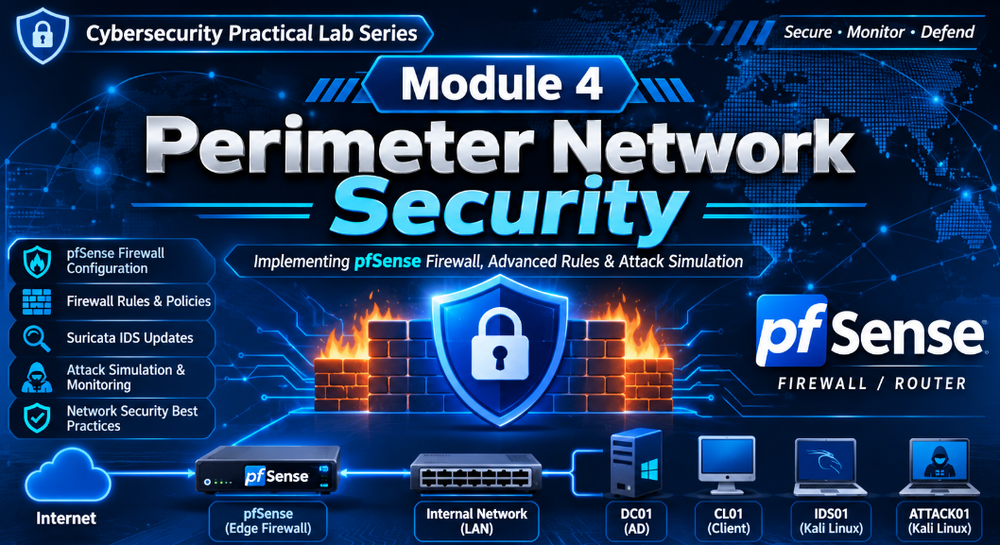

# 🛡️ Module 4 — Perimeter Security with pfSense

### Edge Firewall • Gateway Hardening • Suricata IDS • VPN Validation • Attack Simulation


</div>

---

> ⚠️ **Educational use only.** Everything in this module is performed inside an isolated, self-owned VMware lab. Never run the attack simulations against systems you do not own or have written permission to test. Passwords and keys shown here are lab defaults — never reuse them in real environments.

## 📑 Table of Contents

1. [Introduction](#1-introduction)
2. [Lab Topology](#2-lab-topology)
3. [VMware Workstation Preparation](#3-vmware-workstation-preparation)
4. [pfSense (Edge Firewall / Router)](#4-pfsense-edge-firewall--router)
5. [Update All VMs to Use pfSense as Gateway](#5-update-all-existing-vms-to-use-pfsense-as-gateway)
6. [Configure Firewall Rules on pfSense](#6-configure-firewall-rules-on-pfsense)
7. [Verify Active Directory](#7-verify-active-directory-is-still-correct)
8. [Verify GPOs Still Apply](#8-verify-gpos-still-apply-after-gateway-change)
9. [Update Suricata Rules on IDS01](#9-update-suricata-rules-on-ids01)
10. [Verify VPN01 with pfSense Gateway](#10-verify-vpn01-still-works-with-pfsense-gateway)
11. [Attack Simulation](#11-attack-simulation-all-from-attack01)
12. [Monitoring and Logging Verification](#12-monitoring-and-logging-verification)
13. [Conclusion](#13-conclusion)

---

## 1. Introduction

Module 4 extends the lab built in **Modules 2 and 3** by adding **perimeter network security**.

- **pfSense** is deployed as the network gateway and edge firewall, replacing the blank default gateway on all existing VMs.
- **Firewall rules** are configured to enforce traffic policies across the internal network.
- **Suricata** on IDS01 is updated with new detection rules for SQL injection, XSS, brute force, and LLMNR poisoning.
- **VPN01** (SoftEther) is re-validated behind the new gateway.
- **Attack simulations** from ATTACK01 verify that every security layer works as intended.

### 🎯 Objectives

| # | Objective |
|---|-----------|
| 1 | Deploy pfSense as the edge firewall / default gateway |
| 2 | Point every VM to pfSense (`192.168.10.4`) as gateway |
| 3 | Create block / allow firewall rules with logging |
| 4 | Confirm AD, GPOs and hardening from earlier modules still work |
| 5 | Add Suricata rules for SQLi, XSS, brute force and LLMNR/NBT-NS |
| 6 | Validate VPN access through pfSense |
| 7 | Run 8 attack simulations and observe firewall + IDS logs |

## 2. Lab Topology

| VM | Role | IP Address | OS |
|----|------|-----------|----|
| **pfSense** | Edge firewall / gateway (LAN) | `192.168.10.4` | pfSense CE |
| **DC01** | Domain Controller (DNS, AD) | `192.168.10.10` | Windows Server |
| **ADMIN01** | Admin workstation (pfSense UI, WAC) | `192.168.10.20` | Windows |
| **CL01** | Client workstation | `192.168.10.30` | Windows |
| **ATTACK01** | Attacker machine | `192.168.10.40` | Kali Linux |
| **VPN01** | SoftEther VPN server | `192.168.10.50` | Windows Server |
| **IDS01** | Suricata IDS | `192.168.10.60` | Kali Linux |

- **Domain:** `corp.local`
- **LAN subnet:** `192.168.10.0/24` (VMnet1, Host-Only)
- **WAN:** VMnet8 (NAT, `192.168.1.0`)
- **VPN client range:** `192.168.30.0/24`

---

## 3. VMware Workstation Preparation

### 3.1 Configure Virtual Networks

- Open **VMware Workstation → Edit → Virtual Network Editor** (run as Administrator).

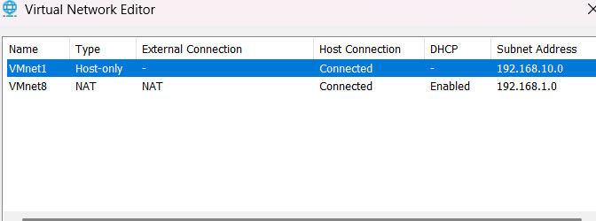

- **VMnet1** → set to **Host-Only**, subnet `192.168.10.0`, mask `255.255.255.0`, **disable DHCP** (static IPs are assigned manually on each VM).

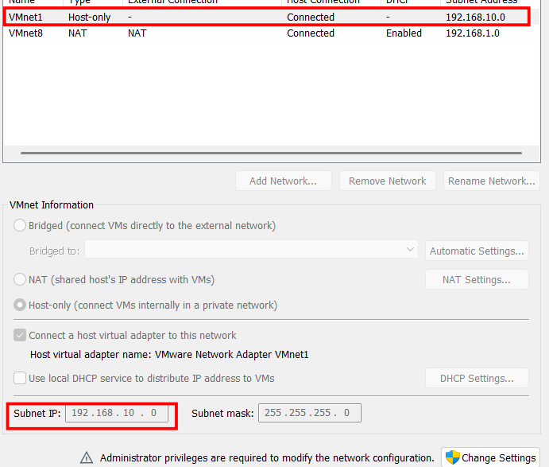

- **VMnet8** → leave as **NAT** (`192.168.1.0`). This gives pfSense, Smoothwall and VPN01 their WAN internet access.

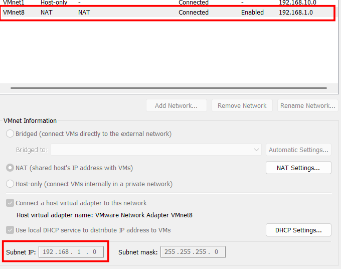

---

## 4. pfSense (Edge Firewall / Router)

Open the pfSense Virtual Machine settings:

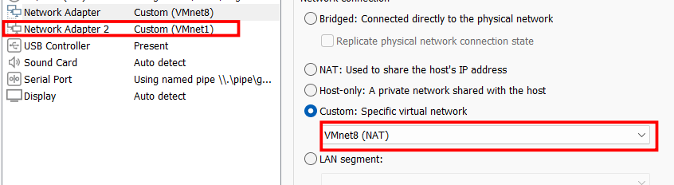

- **Adapter 1** → NAT (becomes **WAN**)
- **Adapter 2** → Host-Only (becomes **LAN**)

> In earlier labs, rules were created so the WAN could reach the LAN. **Delete all those rules** — we will create new ones.

### 4.1 Start the pfSense Virtual Machine

1. Press **2** to set up interface IP addresses.

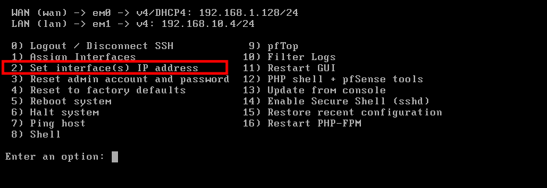

2. Select the **LAN** interface.

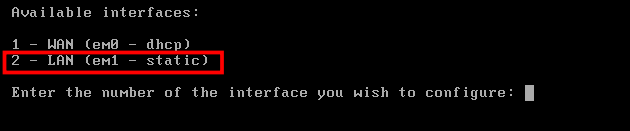

3. Enter **`n`** (do not configure via DHCP).

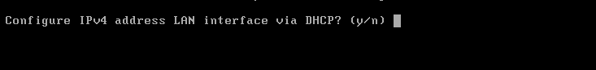

4. Enter the LAN IP address manually (`192.168.10.4`).

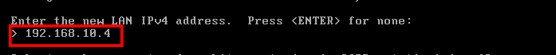

5. Subnet mask: **`24`**
6. Press **Enter** for none (no IPv4 upstream gateway needed).
7. Configure IPv6: **`n`**, then press **Enter** for none.
8. Enable the DHCP server: **`y`**

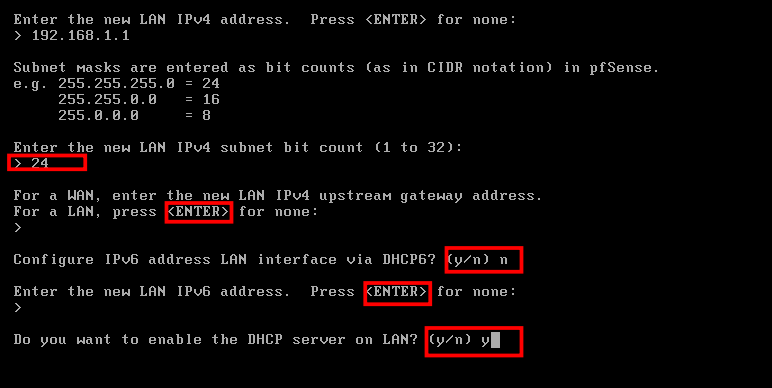

9. Enter the DHCP range.
10. Press **`n`** (do not revert to HTTP).
11. Press **Enter** to continue.

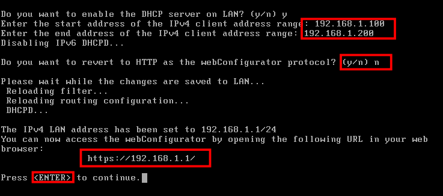

### 4.2 Access the pfSense Web UI

Turn on **ADMIN01** and browse to the pfSense LAN IP.

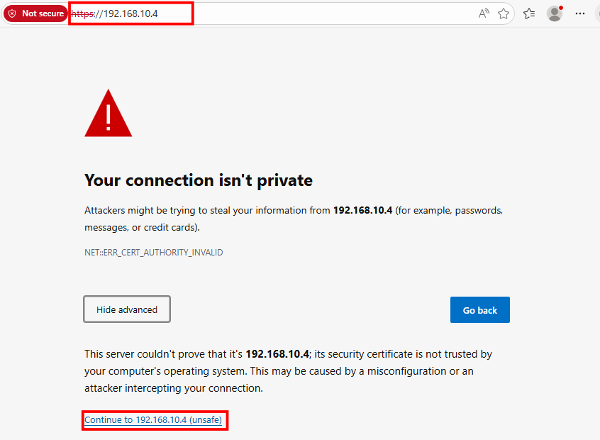

Enter the username and password, then click **SIGN IN**.

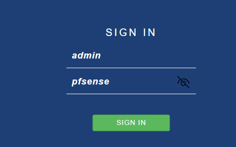

### 4.3 Run the pfSense Setup Wizard

1. Go to **System → Setup Wizard**.

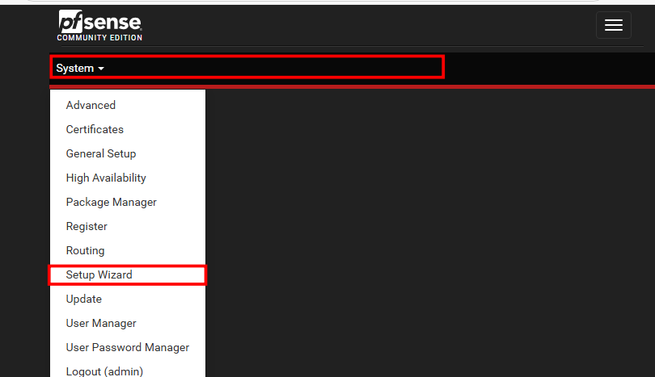

2. Click **Next**.

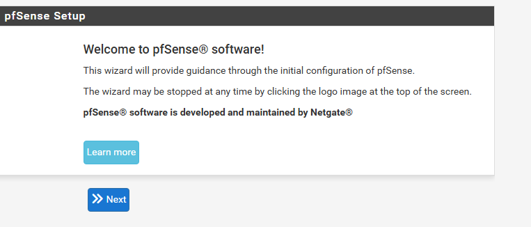

3. Set the **Domain Name** to the one used in Modules 2 and 3 (`corp.local`).

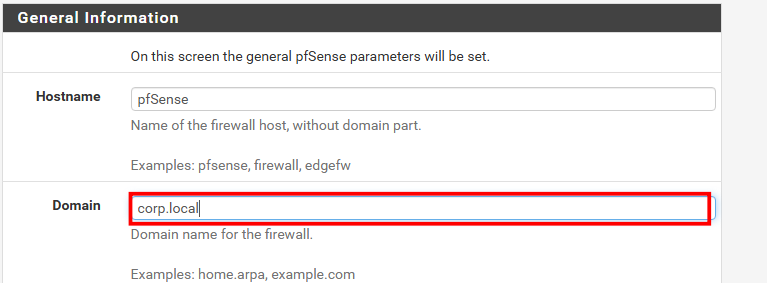

4. Set the **Primary DNS Server** to the IP of **DC01** (`192.168.10.10`) → **Next**.

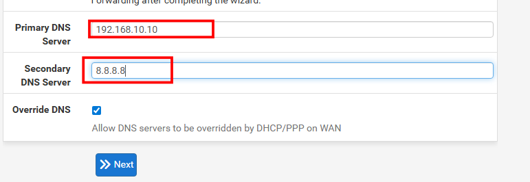

5. Select your correct **Time zone** → **Next**.

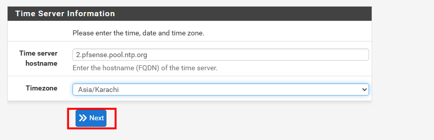

6. Leave the **WAN** configuration as is → **Next**.
7. Confirm the **LAN IP** is correct → **Next**.

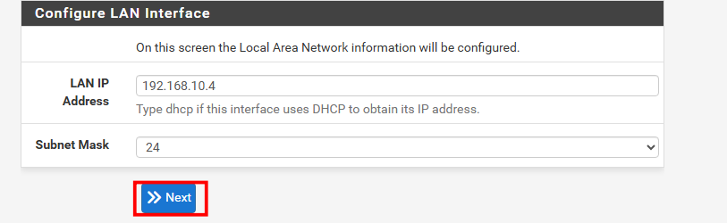

8. Change the admin password from `pfsense` to something you will remember (lab example: `Admin123`) → **Next**.

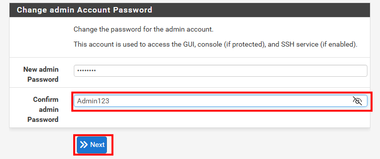

9. Click **Reload** → wait for pfSense to apply → click **Finish**.

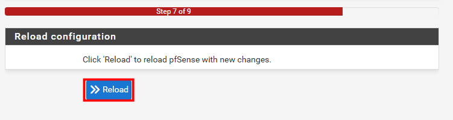

You are now on the pfSense dashboard, showing the WAN IP (from NAT) and LAN IP `192.168.10.4`.

---

## 5. Update All Existing VMs to Use pfSense as Gateway

> 🔑 **This is the single most important step in Module 4.** Every VM must use **`192.168.10.4`** as its default gateway. Without this, traffic will not route through pfSense and the firewall rules will not work.

### 5.1 DC01

1. Log in to **DC01** as `CORP\Administrator`.
2. Open **Network and Sharing Center**.

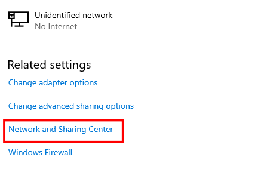

3. Select **Change adapter settings**.

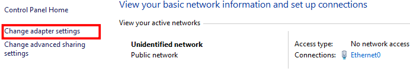

4. Right-click **Ethernet** (Host-Only adapter) → **Properties**.

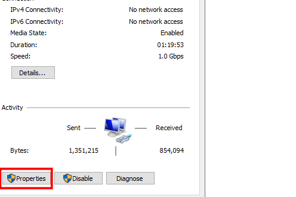

5. Double-click **Internet Protocol Version 4 (TCP/IPv4)**.

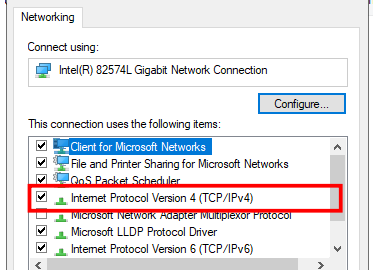

6. Set **Default gateway** to `192.168.10.4`.

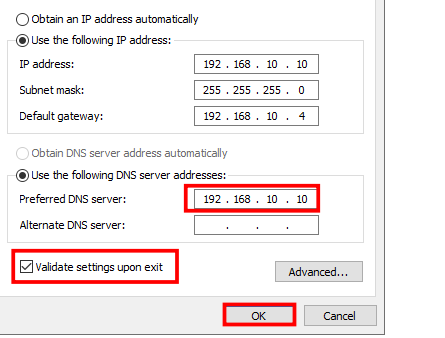

> Leave everything else unchanged — IP `192.168.10.10`, mask `255.255.255.0`, DNS `192.168.10.10`.

### 5.2 ADMIN01

1. Open adapter settings → right-click **Ethernet → Properties** → double-click **IPv4**.
2. Set **Default gateway**: `192.168.10.4`.

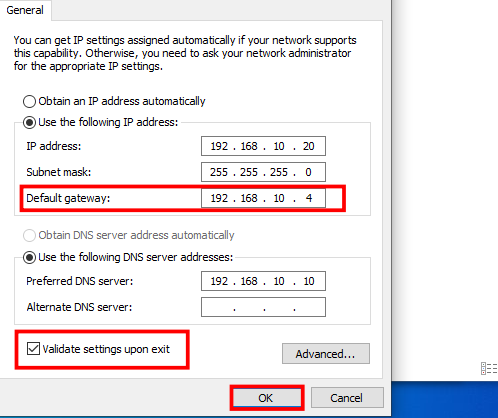

3. IP stays `192.168.10.20`, DNS stays `192.168.10.10`.
4. Click **OK → OK → Close**.

### 5.3 CL01

1. Log in to **CL01** and follow the same steps.
2. Set **Default gateway**: `192.168.10.4`.

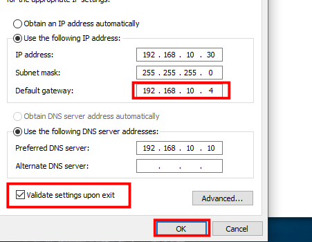

3. IP stays `192.168.10.30`, DNS stays `192.168.10.10`.

### 5.4 VPN01

1. Log in to **VPN01** as `CORP\Administrator` and follow the same steps.
2. Set **Default gateway**: `192.168.10.4`.

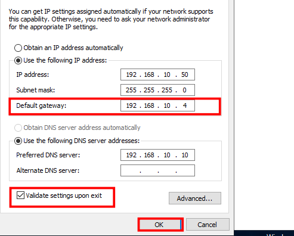

3. IP stays `192.168.10.50`, DNS stays `192.168.10.10`.

### 5.5 IDS01 (Kali Linux)

Open a terminal on IDS01 and run:

```bash
sudo nmcli con mod "Wired connection 1" \
  ipv4.addresses 192.168.10.60/24 \
  ipv4.gateway 192.168.10.4 \
  ipv4.dns 192.168.10.10 \
  ipv4.method manual

sudo nmcli con up "Wired connection 1"
```

You should see: **`default via 192.168.10.4 dev eth0`**

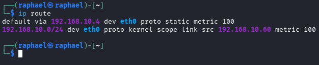

### 5.6 ATTACK01 (Kali Linux)

Same as IDS01 — open a terminal:

```bash
sudo nmcli con mod "Wired connection 1" \
  ipv4.addresses 192.168.10.40/24 \
  ipv4.gateway 192.168.10.4 \
  ipv4.dns 192.168.10.10 \
  ipv4.method manual

sudo nmcli con up "Wired connection 1"
```

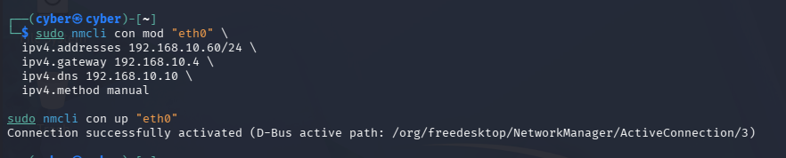

Again, you should see **`default via 192.168.10.4 dev eth0`**.

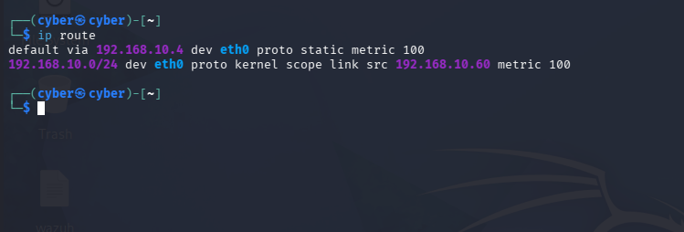

### 5.7 Verify Connectivity After Gateway Update

On ADMIN01 open Command Prompt:

```cmd
ping 192.168.10.4
```

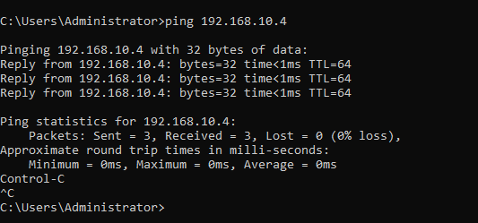

You should get replies from pfSense. Repeat the ping test from each VM to confirm.

---

## 6. Configure Firewall Rules on pfSense

All of this is done in the pfSense web UI from **ADMIN01's** browser at **https://192.168.10.4**.

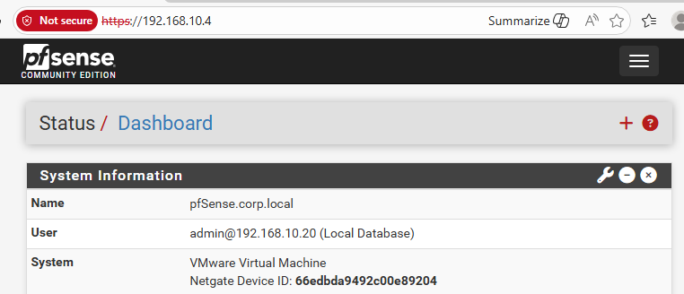

Go to **Firewall → Rules → LAN** tab.

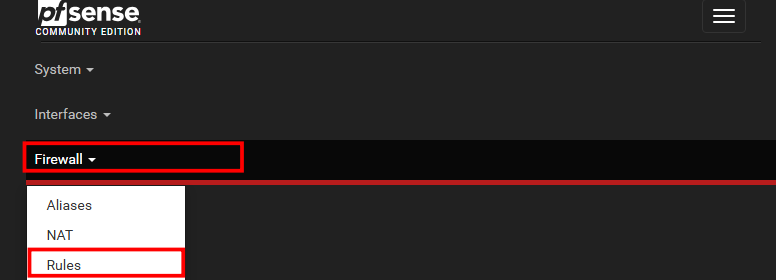

> **Important:** pfSense processes rules **top to bottom**. Block rules must be placed **above** allow rules for the same traffic. Use the **up-arrow Add** button to add to the **top**, and the **down-arrow Add** button to add to the **bottom**.

- Delete all existing rules except the **Allow LAN to any** rule (if you are reusing pfSense from previous labs).

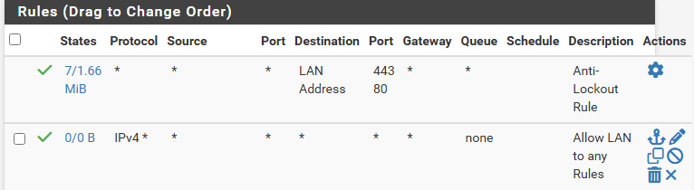

### 6.1 Rule 1 — Block ICMP (ping) from CL01

1. Click **Add** (up-arrow — adds to top).

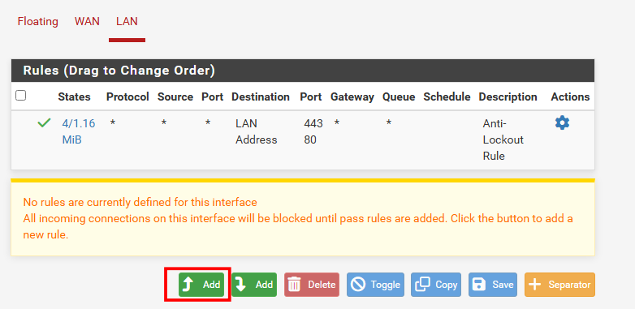

| Setting | Value |
|---------|-------|
| Action | **Block** |
| Interface | **LAN** |
| Address Family | **IPv4** |
| Protocol | **ICMP** |
| ICMP Type | **any** |
| Source | Single host or alias → `192.168.10.30` |
| Destination | **any** |

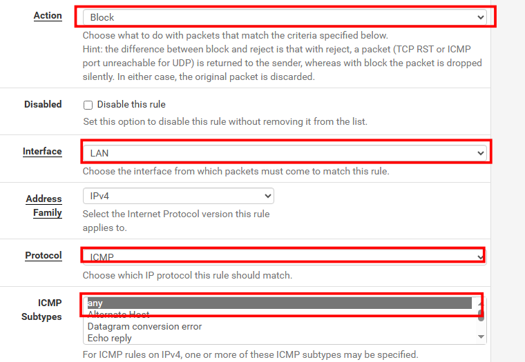

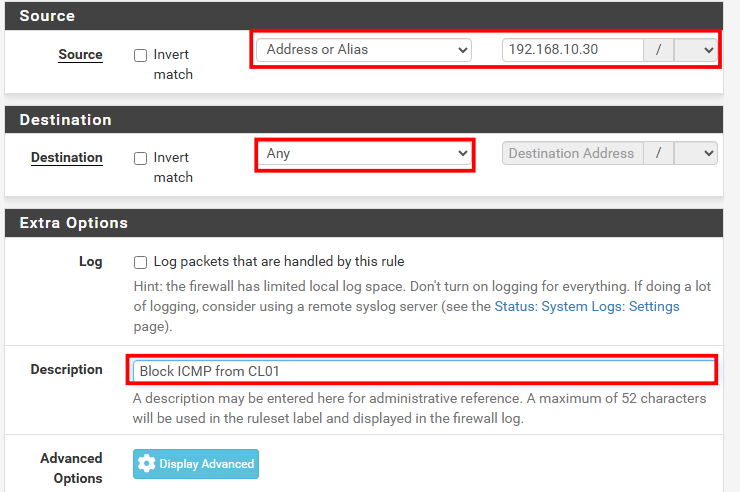

2. Description: **`Block-ICMP-From-CL01`**
3. Click **Save** → **Apply Changes**.
4. Confirm by pinging `8.8.8.8` from CL01.

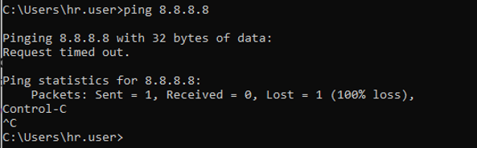

### 6.2 Rule 2 — Block RDP from CL01 to DC01

1. Click **Add** (up-arrow — above the ICMP rule).

| Setting | Value |
|---------|-------|
| Action | **Block** |
| Interface | **LAN** |
| Address Family | **IPv4** |
| Protocol | **TCP** |
| Source | Single host → `192.168.10.30` |
| Destination | Single host → `192.168.10.10` |
| Destination Port Range | **RDP (3389)** in both From and To |

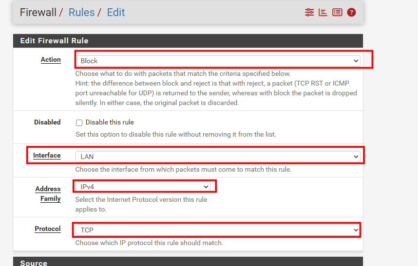

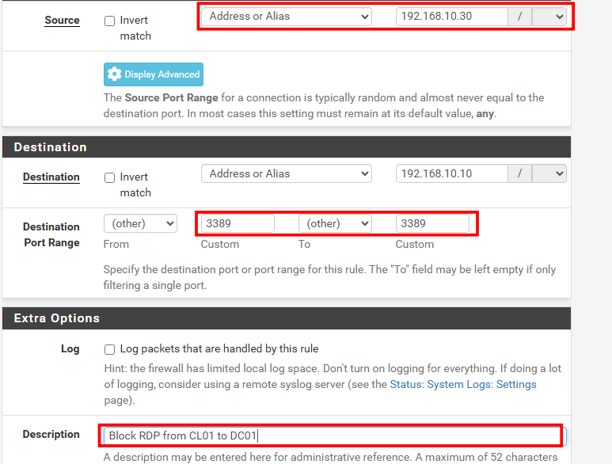

2. Description: **`Block-RDP-CL01-to-DC01`**
3. Click **Save** → **Apply Changes**.

### 6.3 Rule 3 — Allow AD Services from Internal Network to DC01

Add one **Pass** rule per Active Directory port. For each: click **Add** (down-arrow — adds to the **bottom**, after the block rules), then set:

| Setting | Value |
|---------|-------|
| Action | **Pass** |
| Interface | **LAN** |
| Address Family | **IPv4** |
| Source | Network → `192.168.10.0 / 24` |
| Destination | Single host → `192.168.10.10` |

| Port | Protocol | Description |
|------|----------|-------------|
| 53 | TCP | `Allow-DNS-TCP-to-DC01` |
| 53 | UDP | `Allow-DNS-UDP-to-DC01` |
| 88 | TCP/UDP | `Allow-Kerberos-to-DC01` |
| 389 | TCP/UDP | `Allow-LDAP-to-DC01` |
| 445 | TCP | `Allow-SMB-to-DC01` |
| 636 | TCP | `Allow-LDAPS-to-DC01` |
| 3268 | TCP | `Allow-GlobalCatalog-to-DC01` |
| 3269 | TCP | `Allow-GlobalCatalogSSL-to-DC01` |

For **Destination Port Range** select **Other** and type the port number in both the *From* and *To* boxes.

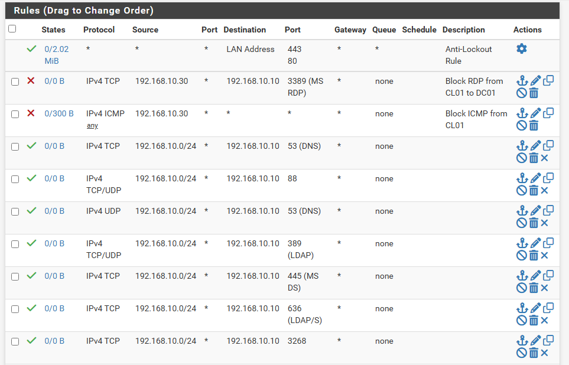

After adding all rules click **Save** → **Apply Changes**.

### 6.4 Enable Logging on All Rules

1. Go to **Firewall → Rules → LAN**.

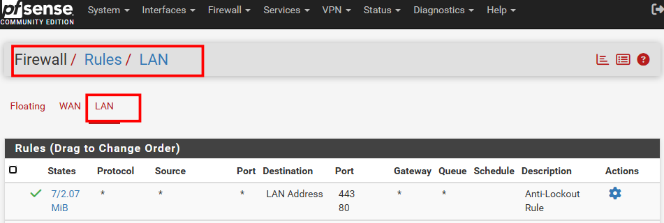

2. Click the **pencil (edit)** icon next to **Block-ICMP-From-CL01**.

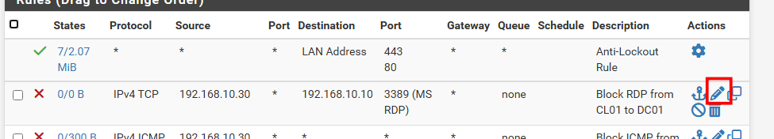

3. Scroll down and check **Log packets that are handled by this rule**.

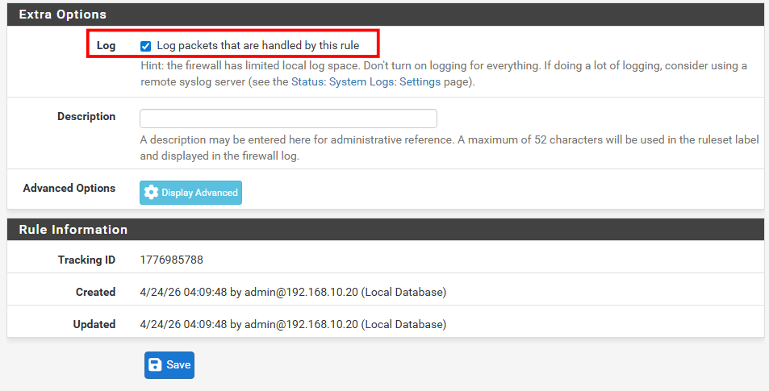

4. Click **Save** → **Apply Changes**.
5. Repeat for **every** rule you created.

To view logs: **Status → System Logs → Firewall** tab.

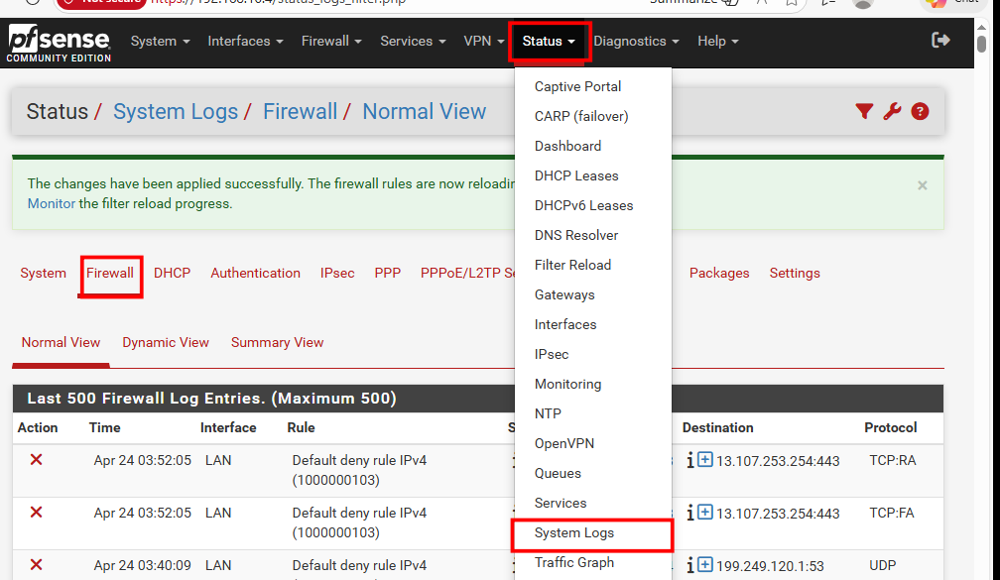

You will see real-time entries with time, interface, action (block/pass), source IP, destination IP and port.

### 6.5 Test Your Firewall Rules

**Test 1 — CL01 cannot ping DC01** (on CL01 Command Prompt):

```cmd
ping 192.168.10.10
```

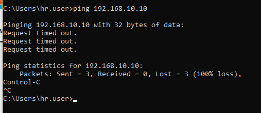

✅ Expected: *Request timed out* — the Block ICMP rule works.

**Test 2 — CL01 can still resolve DNS:**

```cmd
nslookup corp.local
```

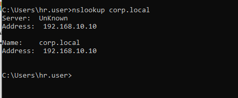

✅ Expected: returns `192.168.10.10` — DNS port 53 is allowed.

**Test 3 — CL01 cannot RDP to DC01:** press **Win+R** → type `mstsc`.

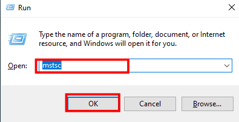

Enter Computer: `192.168.10.10`.


Click **Connect**.


✅ Expected: connection fails — the Block RDP rule works.

---

## 7. Verify Active Directory Is Still Correct

After adding pfSense as the gateway, confirm the AD structure from Modules 2 and 3 is intact.

### 7.1 Check AD OUs and Users on DC01

1. On DC01 press **Win+R** → type `dsa.msc` → Enter.


2. Expand **corp.local**.
3. Confirm these OUs exist: **IT, HR, Finance, Workstations, Servers, ServiceAccounts**.


### 7.2 Check Group Memberships

1. Double-click **GRP_HR** → *Members* tab → confirm **hr.user** is listed.


2. Double-click **GRP_Finance** → confirm **finance.user** is listed.


3. Double-click **GRP_IT** → confirm **it.admin** is listed.


### 7.3 Force GPO Update on All Windows VMs

Run on DC01, then ADMIN01, then CL01 (PowerShell as Administrator):

```powershell
gpupdate /force
```


---

## 8. Verify GPOs Still Apply After Gateway Change

### 8.1 Check GPO Is Applying on CL01

1. Log in to CL01 as `CORP\hr.user`.
2. Open PowerShell:

```powershell
gpresult /r
```


3. Look for **Applied Group Policy Objects** and the security groups the user is a part of.


### 8.2 Verify SMBv1 Is Still Disabled (DC01)

```powershell
Get-SmbServerConfiguration | Select EnableSMB1Protocol
```


### 8.3 Verify Account Lockout Policy Is Still Active (DC01)

```powershell
Get-ADDefaultDomainPasswordPolicy
```


### 8.4 Verify TLS 1.0 Is Still Disabled (DC01)

```powershell
$path = "HKLM:\SYSTEM\CurrentControlSet\Control\SecurityProviders\SCHANNEL\Protocols\TLS 1.0\Server"
Get-ItemProperty -Path $path -Name Enabled
```


✅ Expected: `Enabled : 0`

### 8.5 Verify LLMNR Is Still Disabled (DC01)

```powershell
Get-ItemProperty -Path "HKLM:\SOFTWARE\Policies\Microsoft\Windows NT\DNSClient" -Name EnableMulticast
```


---

## 9. Update Suricata Rules on IDS01

### 9.1 Open the Rules File

Log in to **IDS01** (Kali Linux), open a terminal and run:

```bash
sudo nano /etc/suricata/rules/local.rules
```

### 9.2 Add SQL Injection Detection Rules

Paste these at the bottom:

```text
alert http any any -> $HOME_NET any (msg:"SQL Injection - OR 1=1 Pattern"; content:"' OR"; nocase; http_uri; sid:9000010; rev:1;)
alert http any any -> $HOME_NET any (msg:"SQL Injection - UNION SELECT"; content:"UNION SELECT"; nocase; http_uri; sid:9000011; rev:1;)
alert http any any -> $HOME_NET any (msg:"SQL Injection - DROP TABLE"; content:"DROP TABLE"; nocase; http_uri; sid:9000012; rev:1;)
alert http any any -> $HOME_NET any (msg:"SQL Injection - Single Quote Encoded"; content:"'%20OR%20'"; nocase; http_uri; sid:9000013; rev:1;)
```


### 9.3 Add XSS Detection Rules

```text
alert http any any -> $HOME_NET any (msg:"XSS - Script Tag Detected"; content:"<script>"; nocase; http_uri; sid:9000020; rev:1;)
alert http any any -> $HOME_NET any (msg:"XSS - onerror Attribute"; content:"onerror="; nocase; http_uri; sid:9000021; rev:1;)
alert http any any -> $HOME_NET any (msg:"XSS - onload Attribute"; content:"onload="; nocase; http_uri; sid:9000022; rev:1;)
alert http any any -> $HOME_NET any (msg:"XSS - javascript Protocol"; content:"javascript:"; nocase; http_uri; sid:9000023; rev:1;)
```


### 9.4 Add Brute Force Detection Rules

```text
alert tcp any any -> $HOME_NET 3389 (msg:"Brute Force - RDP Login Attempts"; threshold:type threshold, track by_src, count 10, seconds 60; sid:9000030; rev:1;)
alert tcp any any -> $HOME_NET 22 (msg:"Brute Force - SSH Login Attempts"; threshold:type threshold, track by_src, count 10, seconds 60; sid:9000031; rev:1;)
alert tcp any any -> $HOME_NET 445 (msg:"Brute Force - SMB Authentication"; threshold:type threshold, track by_src, count 5, seconds 30; sid:9000032; rev:1;)
```


### 9.5 Add LLMNR / NBT-NS Poisoning Detection Rules

```text
alert udp any any -> 224.0.0.252 5355 (msg:"LLMNR Multicast Query - Possible Poisoning"; sid:9000040; rev:1;)
alert udp any any -> $HOME_NET 5355 (msg:"LLMNR Unicast Query Detected"; sid:9000041; rev:1;)
alert udp any any -> $HOME_NET 137 (msg:"NBT-NS Query Detected - Possible Poisoning"; sid:9000042; rev:1;)
alert udp any any -> $HOME_NET 138 (msg:"NetBIOS Datagram Service Traffic Detected"; sid:9000043; rev:1;)
```


### 9.6 Save, Test, and Restart Suricata

Press **Ctrl+S** to save, then **Ctrl+X** to exit nano.

Test for syntax errors:

```bash
sudo suricata -T -c /etc/suricata/suricata.yaml -v
```


Restart Suricata:

```bash
sudo systemctl restart suricata
sudo systemctl status suricata
```


Open the live alert monitor (keep this terminal visible during attacks):

```bash
sudo tail -f /var/log/suricata/fast.log
```


---

## 10. Verify VPN01 Still Works with pfSense Gateway

### 10.1 Add pfSense Pass Rule for VPN Client Traffic

SoftEther assigns VPN clients IPs in the **`192.168.30.x`** range. pfSense needs a rule to allow this traffic to reach the internal lab.

In the pfSense web UI (`https://192.168.10.4`) from ADMIN01:

1. Go to **Firewall → Rules → LAN**.


2. Click **Add** (down-arrow — add to bottom).


3. Action: **Pass**.


4. Protocol: **any**.


5. Source: Network → `192.168.30.0 / 24`
6. Destination: Network → `192.168.10.0 / 24`


7. Description: **`Allow-VPN-Clients-to-LAN`**


8. Click **Save** → **Apply Changes**.

### 10.2 Confirm SoftEther VPN Is Still Running on VPN01

1. Log in to **VPN01** as `CORP\Administrator`.
2. Open **SoftEther VPN Server Manager**.


3. Double-click **localhost** → enter the admin password → **Connect**.


4. You should see the **CORP-VPN** hub with status **Online**.


### 10.3 Test VPN Connection from ATTACK01

On ATTACK01 open a terminal:

```bash
which l2tpd && echo installed || echo missing
```


If missing:

```bash
sudo apt install network-manager-l2tp network-manager-l2tp-gnome -y
```


Then connect via the GNOME Network Manager:

1. Click the network icon (top right of the Kali desktop).
2. Click **VPN Connections → Add a VPN connection**.


3. Select **Layer 2 Tunneling Protocol (L2TP)** → **Create**.


| Field | Value |
|-------|-------|
| Name | `CORP-VPN-Test` |
| Gateway | `192.168.10.50` |
| Username | `vpnuser` |
| Password | *(lab password)* |
| NT Domain | *(leave blank)* |


4. Click **IPsec Settings**.


- Check **Enable IPsec tunnel to L2TP host**.
- Enter the **Pre-shared key** (lab value).
- Click **OK**.


- Click **Save**.
5. Toggle the VPN connection **ON**.


**Verify:**

```bash
ip addr show
```


```bash
ping 192.168.10.10
```

DC01 replies through the VPN tunnel.


Suricata detecting the SoftEther VPN connection:


---

## 11. Attack Simulation (All from ATTACK01)

Before starting any attack, on **IDS01** run the following and keep that terminal visible. Turn **off** the VPN as well.

```bash
sudo tail -f /var/log/suricata/fast.log
```


Also keep the pfSense web UI open on ADMIN01 at **Status → System Logs → Firewall** so you can watch both simultaneously.


| # | Attack | Goal |
|---|--------|------|
| 1 | Network Reconnaissance | Discover live hosts and open ports |
| 2 | SMBv1 / EternalBlue Check | Confirm SMBv1 is disabled (attack should **fail**) |
| 3 | Brute Force | Trigger account lockout + IDS alert |
| 4 | LLMNR Poisoning | Confirm LLMNR is disabled |
| 5 | SQL Injection | Trigger Suricata SQLi rules |
| 6 | XSS | Trigger Suricata XSS rules |
| 7 | VPN Access Validation | Valid vs. invalid VPN credentials |
| 8 | TLS Version Verification | Only TLS 1.2 accepted |

### 11.1 Attack 1 — Network Reconnaissance

**Goal:** Discover all live hosts and open ports.

Aggressive scan:

```bash
nmap -A -T5 192.168.10.10
```


Port scan DC01:

```bash
nmap -sS -p 1-1024 192.168.10.10
```


Full aggressive scan with OS and version detection:

```bash
nmap -A -T4 192.168.10.10
```


Scan VPN server UDP ports:

```bash
nmap -sU -p 500,1701,4500 192.168.10.50
```


### 11.2 Attack 2 — SMBv1 / EternalBlue Check (Verification)

**Goal:** Confirm SMBv1 is properly disabled — this attack should **FAIL**, proving the Module 3 hardening worked.

Check which SMB versions DC01 supports:

```bash
nmap --script smb-protocols 192.168.10.10
```


Test for EternalBlue vulnerability:

```bash
nmap --script smb-vuln-ms17-010 192.168.10.10
```


✅ Expected: SMBv1 does **not** appear; the vuln script shows no `VULNERABLE` section.

### 11.3 Attack 3 — Brute Force Attack

**Goal:** Trigger account lockout and the IDS brute-force alert.

Create a password wordlist on ATTACK01:

```bash
nano mywordlist.txt
```

Type these passwords, one per line:

```text
password
123456
admin
Password1
letmein
welcome
test123
Admin123
Password123
Hruser123
qwerty
abc123
monkey
dragon
```


Press **Ctrl+S** then **Ctrl+X** to save. Run Hydra:

```bash
hydra -l hr.user -P mywordlist.txt -t 1 smb2://192.168.10.10
```


✅ After 5 failed attempts the account locks and Hydra cannot find valid credentials.

### 11.4 Attack 4 — LLMNR Poisoning Test

**Goal:** Confirm LLMNR is disabled — if it is properly off, Responder captures nothing.

On ATTACK01 start Responder:

```bash
sudo responder -I eth0 -wv
```


Leave it running and switch to **CL01**: in File Explorer's address bar type `\\fakeshare\test` → Enter.


If LLMNR is properly disabled, CL01 will not broadcast an LLMNR query and Responder captures **no hashes**.


### 11.5 Attack 5 — SQL Injection Test

Run on ATTACK01:

```bash
curl "http://192.168.10.10/Login.aspx" --data "username=' OR '1'='1&password=test"
```


```bash
curl "http://192.168.10.10/Login.aspx" --data "username=' UNION SELECT 1,2--&password=test"
```


### 11.6 Attack 6 — XSS Test

```bash
curl "http://192.168.10.10/Comments.aspx" --data "comment=<script>alert(1)</script>"
```


```bash
curl "http://192.168.10.10/Comments.aspx" --data "comment="
```


### 11.7 Attack 7 — VPN Access Validation

Confirm VPN ports are open:

```bash
nmap -sU -p 500,1701,4500 192.168.10.50
```


Connect to the VPN with valid credentials (toggle the `CORP-VPN-Test` connection):


Then run:

```bash
ip addr show   # look for ppp0 with a 192.168.30.x IP
```


Now test with **wrong credentials**: edit the VPN connection, change the password to a wrong one and try to connect.


The connection should **fail**. Check **SoftEther VPN Server Manager** on VPN01:


You will see the failed authentication attempt in the server log.


### 11.8 Attack 8 — TLS Version Verification

**Goal:** Confirm TLS 1.0 and 1.1 are rejected and only TLS 1.2 is accepted.

Scan TLS on the LDAPS port:

```bash
nmap --script ssl-enum-ciphers -p 636 192.168.10.10
```


Scan TLS on the RDP port:

```bash
nmap --script ssl-enum-ciphers -p 3389 192.168.10.10
```


✅ Only **TLSv1.2** appears. TLSv1.0 and TLSv1.1 must **not** be listed.

---

## 12. Monitoring and Logging Verification

### 12.1 Verify Sysmon Is Running

On DC01 PowerShell:

```powershell
Get-Service sysmon64   # Status should be: Running
```


Open **Event Viewer** and check the Sysmon logs.


### 12.2 Check Windows Admin Center

On ADMIN01 browse to **https://localhost:6516**.

1. Click **DC01** in the server list → confirm *Overview* shows CPU and RAM.


2. Click **Events** → confirm Security logs are loading.


3. Click **PowerShell** → run `hostname` → should return `DC01`.


### 12.3 View pfSense Logs During Attacks

Checked the firewall logs:


Used the **dynamic view** because the log file exceeded the limit:


### 12.4 View IDS Logs

**Brute Force**


**TCP Port Scan**


**ET Scan**


**NBT-NS Query**


---

## 13. Conclusion

Module 4 adds the **perimeter security layer** that completes the three-module lab series. With pfSense as the central gateway, traffic policies are enforced at the **network level** rather than relying solely on host-based controls.

The attack simulation confirms that each security layer works as intended:

- 🔥 **Firewall** blocks restricted traffic (ICMP, RDP from CL01).
- 🚨 **IDS (Suricata)** detects application-layer attacks (SQLi, XSS), scans, brute force and NBT-NS queries.
- 🔒 **Account lockout policy** stops brute-force attempts.
- 🧱 **LLMNR poisoning fails** because of the GPO applied in Module 3; SMBv1 and TLS 1.0/1.1 stay disabled after the gateway change.
- 🔑 **VPN** works with valid credentials and rejects invalid ones.

Together, Modules 2, 3, and 4 demonstrate a practical implementation of **defence in depth** across administrative, technical, and perimeter security controls.

---

<div align="center">

**Module 4 • Perimeter Security Lab** — pfSense · Suricata · Active Directory · SoftEther VPN · Kali Linux

</div>
