# 🛡️ MODULE 5 — Endpoint Security Lab

**A complete, hands-on, screenshot-driven walkthrough — from VM setup to automated active response**

 

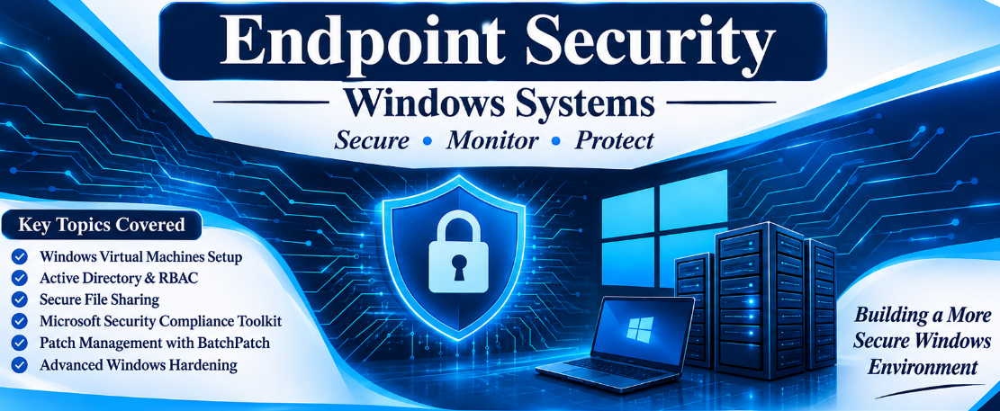

  

[📖 Overview](#-overview) • [🏗️ Lab Architecture](#️-lab-architecture) • [🧰 Tools](#-tools--technologies) • [📂 Structure](#-folder-structure) • [🧪 Walkthrough](#-lab-walkthrough) • [🎯 Outcomes](#-key-outcomes) • [📬 Contact](#-connect-with-me)

---

## 📖 Overview

This module demonstrates a **full Windows endpoint security lifecycle** in a virtual lab: building the domain, enforcing **Role-Based Access Control (RBAC)**, hardening servers with **Microsoft security baselines**, automating **patch management**, deploying a **Wazuh SIEM**, integrating **Sysmon**, mapping detections to **MITRE ATT&CK**, simulating attacks from **Kali Linux**, and finally moving from detection to **automated prevention** with Wazuh Active Response.

> 💡 Every step below includes the original lab screenshot, so the whole workflow can be reproduced.

---

## 🏗️ Lab Architecture

| 🖧 Machine | 🎭 Role | 🌐 IP Address |
| :--- | :--- | :--- |
| **DC01** | Domain Controller (`corp.local`) | `192.168.10.10` |
| **SRV01** | File Server + Patch Management (Windows Server 2019) | `192.168.10.25` |
| **IDS01** | Wazuh SIEM (indexer + manager + dashboard) | `192.168.10.60` |
| **CL01** | Windows 10 client (authorized user tests) | `192.168.10.x` |
| **CL02** | Windows 10 client (unauthorized user tests) | `192.168.10.x` |
| **Kali** | Attacker machine | `192.168.10.x` |

**👥 Test Users:** `bob` ✅ · `john` ✅ (FinanceData members) · `martin` ❌ (unauthorized) · `alice` (general user)

---

## 🧰 Tools & Technologies

| Category | Tools |
| :--- | :--- |
| 🖥️ Virtualization | VMware Workstation |
| 🏢 Identity | Active Directory, Group Policy, RBAC, NTFS + SMB permissions |
| 📏 Hardening | Microsoft Security Compliance Toolkit, Policy Analyzer, LGPO, `auditpol`, Windows Firewall |
| 🔄 Patching | BatchPatch, PsExec, Task Scheduler |
| 📡 Monitoring | Wazuh (SIEM/XDR), Sysmon, SwiftOnSecurity config |
| 🎯 Threat Mapping | MITRE ATT&CK |
| ⚔️ Offensive | Nmap, CrackMapExec, Hydra, Impacket |

## 🗺️ Phase Map

| # | Phase | Steps |
| :-: | :--- | :-: |
| 1 | [🖥️ Phase 1 — VM Setup & Domain Join](#phase1) | 1–20 |
| 2 | [🏢 Phase 2 — Active Directory & RBAC Design](#phase2) | 21–42 |
| 3 | [📁 Phase 3 — Secure File Sharing (FinanceData)](#phase3) | 43–80 |
| 4 | [📏 Phase 4 — Microsoft Security Compliance Toolkit](#phase4) | 81–108 |
| 5 | [🔄 Phase 5 — Patch Management with BatchPatch](#phase5) | 109–126 |
| 6 | [🛡️ Phase 6 — Windows Hardening](#phase6) | 127–137 |
| 7 | [📡 Phase 7 — Wazuh SIEM Deployment & Agents](#phase7) | 138–164 |
| 8 | [🔍 Phase 8 — Sysmon & Log Collection](#phase8) | 165–182 |
| 9 | [🎯 Phase 9 — Custom Detection Rules & MITRE ATT&CK](#phase9) | 183–189 |
| 10 | [⚔️ Phase 10 — Attack Simulation from Kali](#phase10) | 190–214 |
| 11 | [🚨 Phase 11 — Active Response (Detection → Prevention)](#phase11) | 215–218 |

---

## 🧪 Lab Walkthrough

> Every step has its screenshot and full documentation below.

## 🖥️ Phase 1 — VM Setup & Domain Join

Steps 1–20

### 🔹 1. SRV01 Virtual Machine Ready

- The SRV01 virtual machine (Windows Server 2019) is created in VMware and shown in its summary page.
- Its hardware is visible here: 2 GB RAM, 2 processors, a 40 GB NVMe disk and the VMnet1 network adapter.
- This machine becomes the Patch Management server and the Secure File Server for the lab.

### 🔹 2. Open Network & Internet Settings

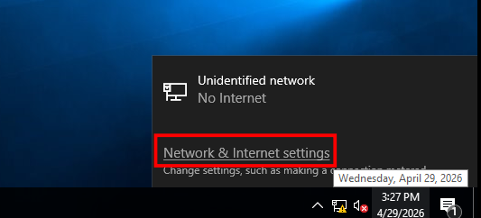

- Right-click the network icon in the taskbar and choose Open Network & Internet Settings on SRV01.
- This is the entry point for assigning a fixed IP address to the server.
- A static IP keeps SRV01 reachable at the same address for every other machine in the domain.

### 🔹 3. Change Adapter Options

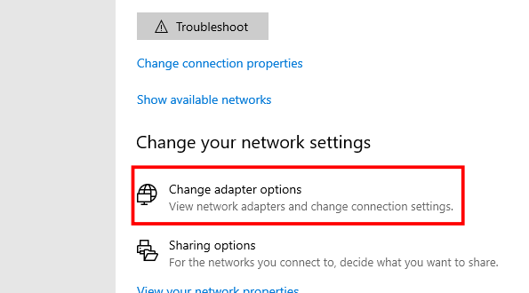

- From the Network & Internet settings page, click Change Adapter Options.
- The Network Connections window opens and lists the available Ethernet adapters.
- Selecting the correct adapter is required before its IPv4 properties can be edited.

### 🔹 4. Ethernet Adapter Properties

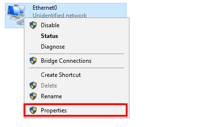

- Right-click the Ethernet adapter and open its Properties dialog.
- The list of protocols and services bound to the adapter is displayed.
- Internet Protocol Version 4 (TCP/IPv4) is selected from this list in the next step.

### 🔹 5. Select IPv4 Properties

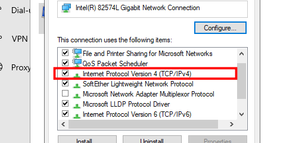

- Double-click Internet Protocol Version 4 (TCP/IPv4) to open its configuration window.
- Choose the option Use the following IP address to switch from DHCP to manual settings.
- This is where the static IP, subnet mask, gateway and DNS server are entered.

### 🔹 6. Static IP Configuration for SRV01

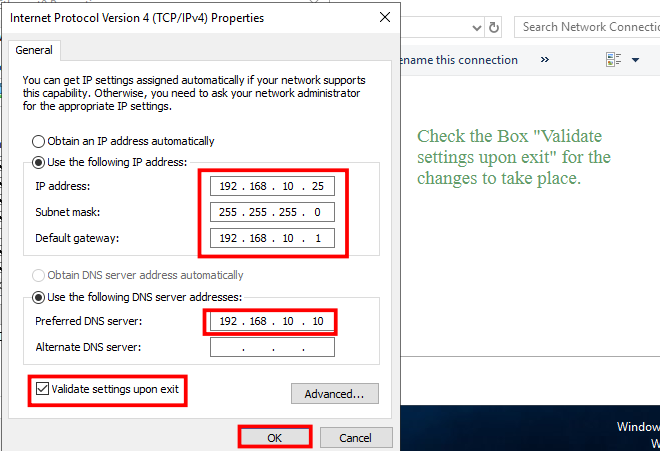

- The values entered are IP `192.168.10.25`, subnet mask `255.255.255.0` and gateway `192.168.10.1`.
- The preferred DNS server is set to `192.168.10.10`, which is DC01, the domain controller.
- Pointing DNS to DC01 is essential so that SRV01 can find and join the corp.local domain.

### 🔹 7. Verify IP with ipconfig /all

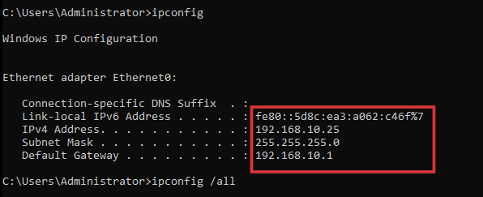

- Command Prompt is opened and `ipconfig /all` is executed on SRV01.
- The output confirms that the adapter now holds the static address 192.168.10.25.
- This proves the manual network configuration was applied correctly.

### 🔹 8. Ping Test to DC01

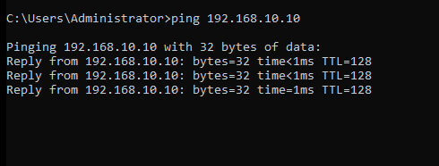

- The command `ping 192.168.10.10` is run from SRV01 to test connectivity.
- Successful replies show that SRV01 can reach the domain controller on the network.
- Connectivity to DC01 must work before attempting to join the domain.

### 🔹 9. Open System Information

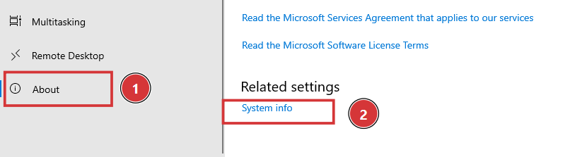

- Go to Settings > System > About to view the current device name and system details.
- The default hostname is still shown, so it must be changed to SRV01.
- The Advanced system settings link on this page leads to the rename and domain options.

### 🔹 10. Advanced System Settings

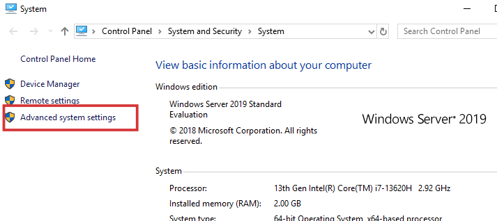

- The System Properties window opens from the Advanced system settings link.
- Switch to the Computer Name tab, which shows the current computer name and domain or workgroup.
- Click the Change button to rename the machine and join it to the domain.

### 🔹 11. Computer Name / Domain Changes

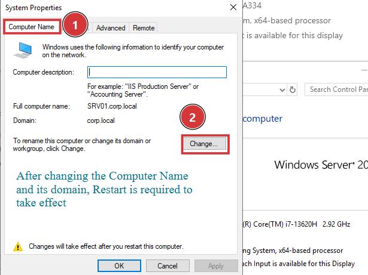

- The Computer Name/Domain Changes dialog is displayed.
- The computer name is typed as SRV01 in the upper box.
- The Member of section is used next to switch the machine from a workgroup to the domain.

### 🔹 12. Join corp.local Domain

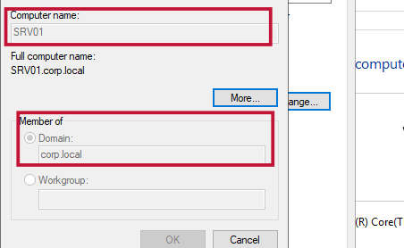

- SRV01 is set as the computer name and Domain is selected with corp.local entered.
- Domain administrator credentials are requested to complete the join.
- After the success message, the VM is restarted so the new name and domain membership take effect.

### 🔹 13. Clone CL01 to Create CL02

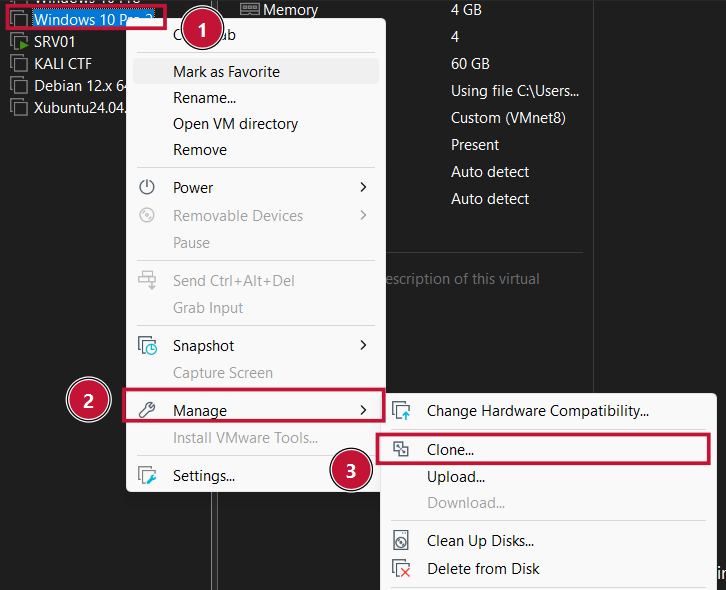

- In VMware, right-click the Windows 10 Pro machine (CL01) and go to Manage > Clone.
- Cloning is the fastest way to create the second client machine with the same software installed.
- CL02 will act as the unauthorized user workstation in the RBAC tests.

### 🔹 14. Create a Full Clone

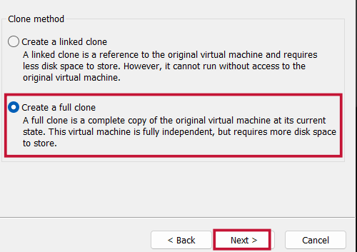

- The Clone Virtual Machine wizard asks for the clone type.
- Create a full clone is selected so CL02 is a completely independent copy of CL01.
- A full clone does not depend on the original VM, which keeps the lab stable.

### 🔹 15. Name the Clone CL02

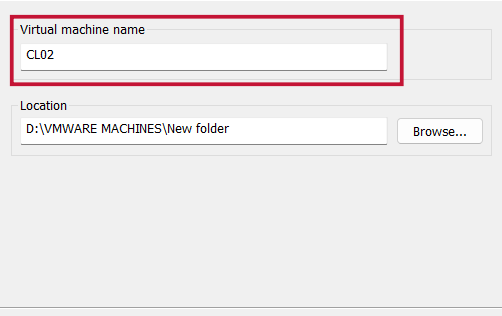

- The new virtual machine is named CL02 and its storage location is chosen.
- Finishing the wizard creates the clone and adds it to the VMware library.
- CL02 is now ready to be powered on and configured with its own IP address.

### 🔹 16. Static IP Configuration for CL02

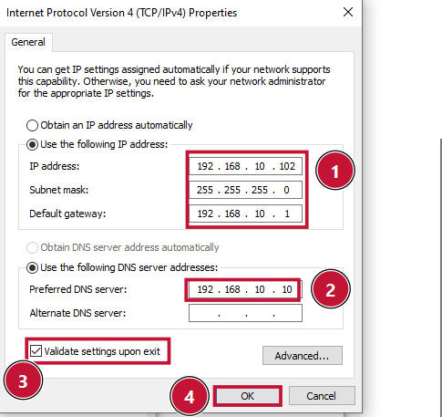

- The IPv4 properties of CL02 are opened and a manual address in the 192.168.10.x range is entered.
- The DNS server is set to 192.168.10.10 so the client can locate the domain controller.
- A unique IP avoids any conflict with CL01 because the machine was cloned.

### 🔹 17. Connectivity Test from CL02

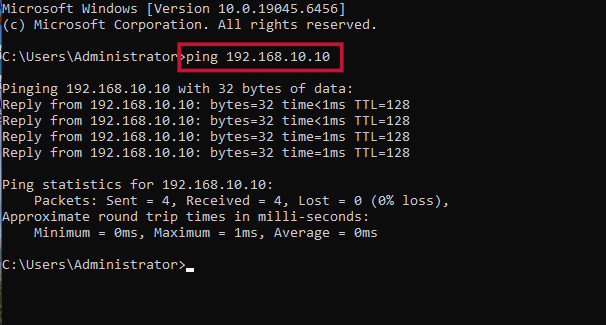

- From Command Prompt on CL02, `ping 192.168.10.10` is executed.
- Replies from DC01 confirm that CL02 is correctly connected to the lab network.
- With the network verified, the domain join can proceed.

### 🔹 18. Open Advanced System Settings on CL02

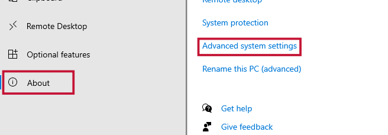

- Settings > About > Advanced system settings is opened on CL02.
- The System Properties window shows the computer name tab for this cloned machine.
- The Change button is used to rename the PC and join it to the domain.

### 🔹 19. Join CL02 to corp.local

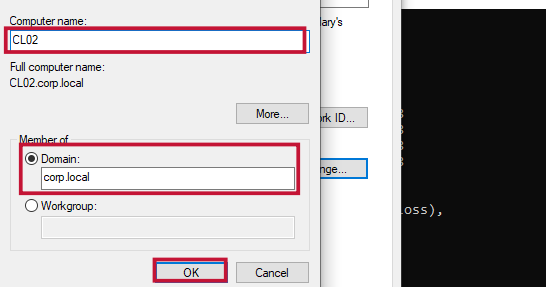

- The Member of Domain option is selected and corp.local is typed in.
- Credentials of a domain administrator are used to authorize the join.
- A welcome message confirms CL02 is now part of the corp.local domain.

### 🔹 20. Login as CORP\Administrator

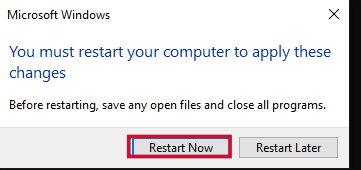

- After the restart, CL02 shows the Windows login screen.
- The domain account CORP\Administrator is used to sign in.
- A successful login verifies that domain authentication works on CL02.

---

## 🏢 Phase 2 — Active Directory & RBAC Design

Steps 21–42

### 🔹 21. Open Active Directory Users and Computers

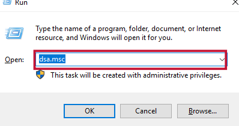

- On DC01, press Win+R and run `dsa.msc` to open Active Directory Users and Computers.
- The console shows the corp.local domain tree with its default containers and OUs.
- All Module 5 users, groups and organizational units are created from here.

### 🔹 22. Create the Finance OU

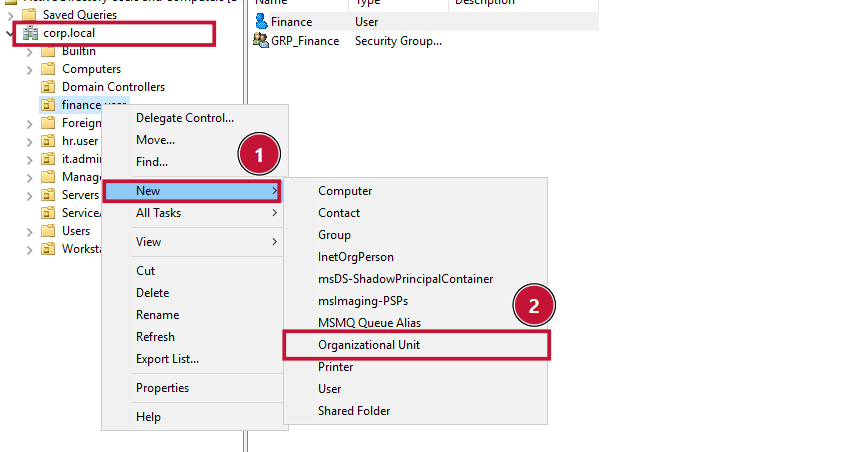

- Right-click corp.local and choose New > Organizational Unit.
- The new OU is named Finance.
- OUs allow administrators to organize accounts and apply policies per department.

### 🔹 23. Finance OU Created

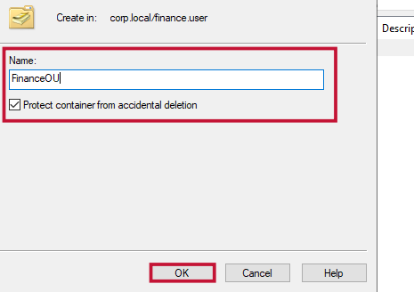

- The Finance organizational unit now appears under corp.local.
- It will contain the finance users and the security group used for RBAC.
- Keeping finance accounts in their own OU makes permission management cleaner.

### 🔹 24. Create the FinanceUsers Sub-OU

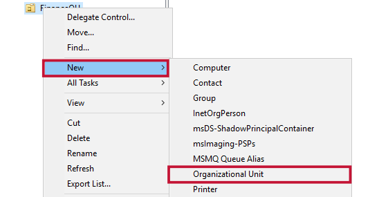

- Right-click the Finance OU and select New > Organizational Unit.
- The sub-OU is named FinanceUsers.
- This OU will hold the authorized finance user accounts such as bob and john.

### 🔹 25. OU Structure Verified

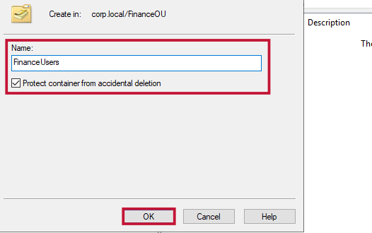

- The console now shows Finance with its FinanceUsers child OU.
- The hierarchy matches the design planned for this lab.
- The next step is to create the user accounts inside FinanceUsers.

### 🔹 26. Create User bob

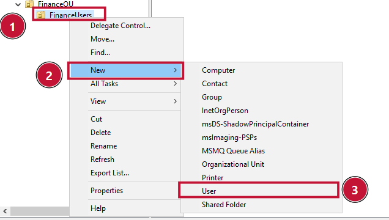

- Right-click the FinanceUsers OU and choose New > User.
- The first name and the logon name are both entered as bob.
- bob is one of the authorized finance users who will access the protected share.

### 🔹 27. Set bob's Password

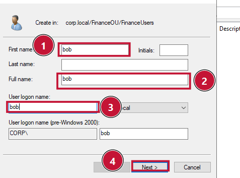

- The password step of the New Object wizard is displayed.
- User must change password at next logon is unchecked and Password never expires is checked.
- These settings keep the lab account stable during testing.

### 🔹 28. bob Account Created

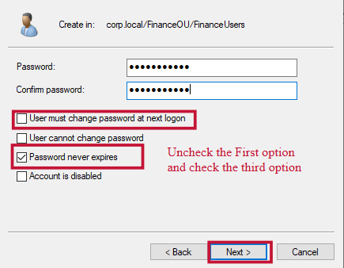

- The final confirmation page shows the summary of the new bob account.
- Clicking Finish creates the user in the FinanceUsers OU.
- bob is now ready to be added to the FinanceData security group.

### 🔹 29. Create User john

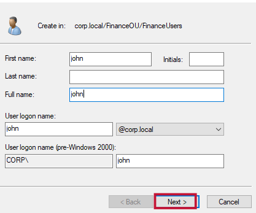

- A second user, john, is created in the FinanceUsers OU using the same wizard.
- The first name and user logon name are both set to john.
- john is the second authorized finance user in the RBAC design.

### 🔹 30. Set john's Password

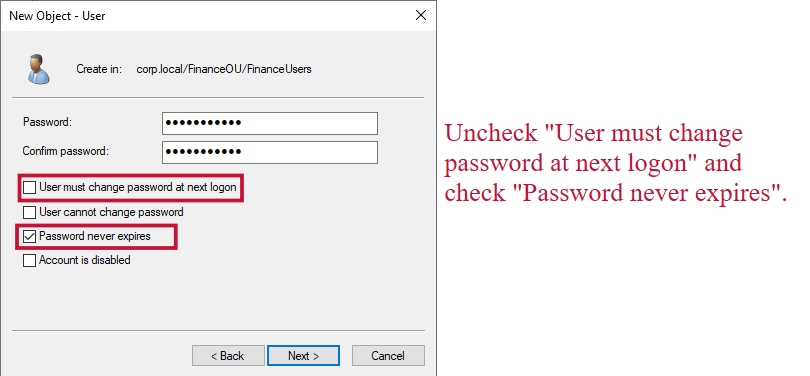

- The password options for john are configured the same way as bob.
- The must-change option is cleared and Password never expires is enabled.
- Finish creates the account and john appears in the OU list.

### 🔹 31. Create User martin (Unauthorized)

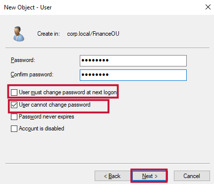

- The user martin is created and given a different password from the finance users.
- martin is deliberately not placed in the FinanceData group.
- He represents the unauthorized user who must be denied access to the finance share.

### 🔹 32. Create User alice

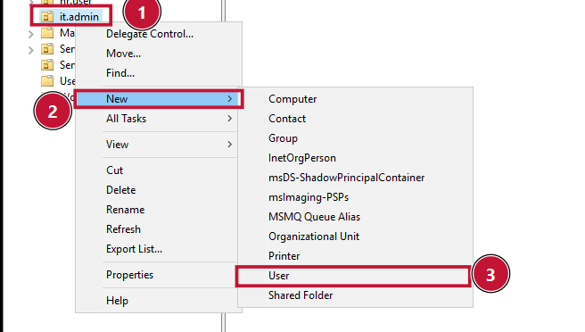

- A general client user named alice is created in the IT or General OU.
- The first name and logon name are entered as alice.
- alice represents a normal employee without any special finance privileges.

### 🔹 33. Set alice's Password

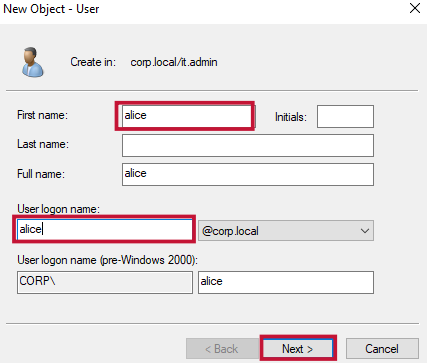

- The password for alice is entered on the password page of the wizard.
- The same account options are applied as for the other users.
- This keeps all four test accounts consistent and easy to use.

### 🔹 34. alice Account Created

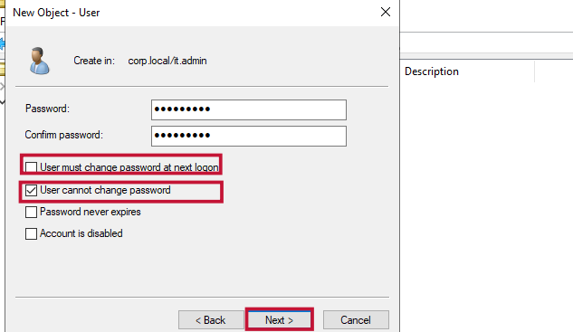

- The wizard summary confirms the alice account details.
- Clicking Finish adds alice to Active Directory.
- All four lab users (bob, john, martin, alice) now exist in the domain.

### 🔹 35. Create the FinanceData Security Group

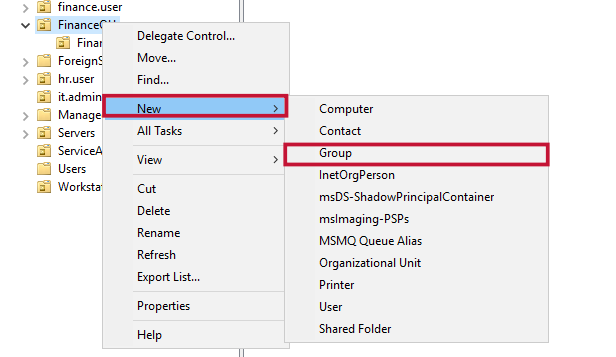

- Right-click the Finance OU and choose New > Group.
- The group is named FinanceData with Global scope and Security type.
- This group is the core of the RBAC model because permissions will be given to the group, not to individuals.

### 🔹 36. FinanceData Group Created

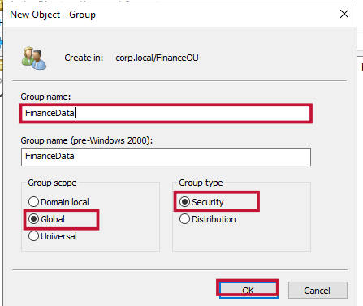

- After clicking OK, the FinanceData group appears inside the Finance OU.
- It is currently empty and has no members yet.
- Next, the authorized users are added to it.

### 🔹 37. Open Group Members Tab

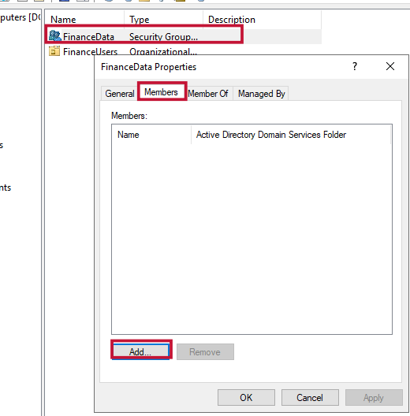

- Double-click the FinanceData group and open the Members tab.
- Click Add to select the users who should belong to this group.
- Only authorized finance employees should ever be members.

### 🔹 38. Add bob to the Group

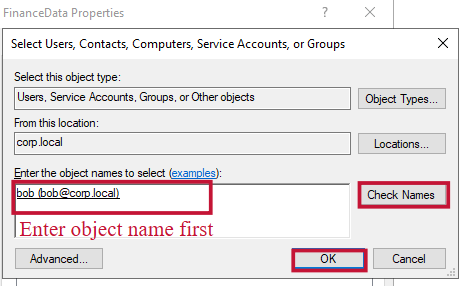

- bob is typed into the Select Users dialog and Check Names is used.
- The name resolves to the correct domain account.
- Clicking OK adds bob as a member of FinanceData.

### 🔹 39. Add john to the Group

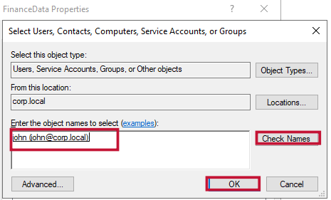

- The same process is repeated to add john to the group.
- Check Names confirms that the account exists in corp.local.
- Both authorized users are now selected for membership.

### 🔹 40. Group Membership Confirmed

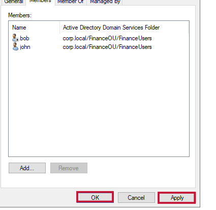

- The Members tab lists bob and john.
- Clicking Apply and OK saves the membership changes.
- martin and alice are intentionally not part of this group.

### 🔹 41. Move CL02 to the Workstations OU

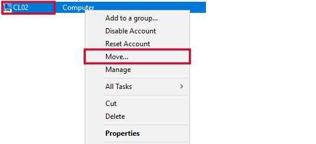

- In Active Directory Users and Computers, right-click the CL02 computer object and choose Move.
- The Workstations OU is selected as the destination.
- Placing CL02 in the proper OU allows workstation policies to be applied to it.

### 🔹 42. CL02 in Workstations OU

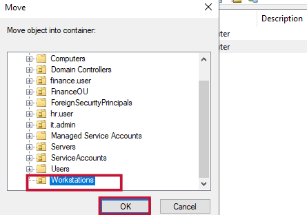

- The CL02 computer account is now listed inside the Workstations OU.
- This confirms the move was completed successfully.
- Phase 2 is finished and the identity structure is ready for the file-share setup.

---

## 📁 Phase 3 — Secure File Sharing (FinanceData)

Steps 43–80

### 🔹 43. Open File Explorer on SRV01

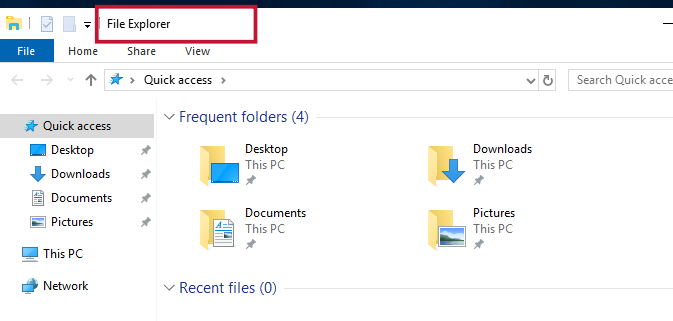

- File Explorer is opened on SRV01 to prepare the shared folder.
- The C: or D: drive is selected as the location for the share.
- This begins the secure file sharing configuration.

### 🔹 44. Choose the Drive

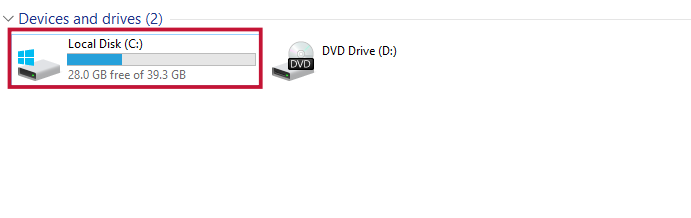

- The local drive where the Shares folder will be created is opened.
- The existing folders on the drive are visible.
- A dedicated Shares folder keeps all shared data in one controlled place.

### 🔹 45. Create the Shares Folder

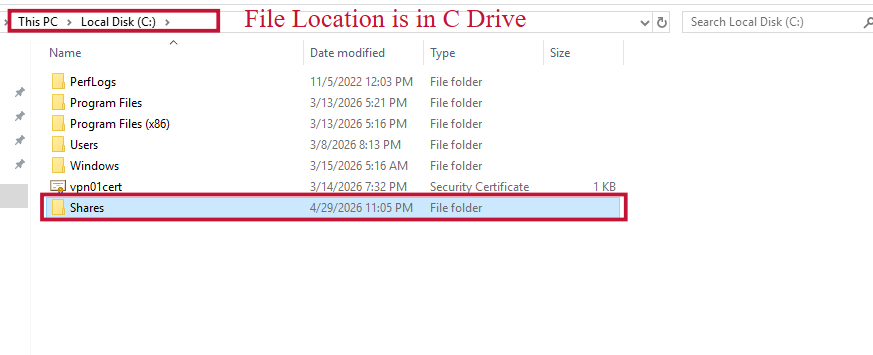

- Right-click inside the drive and choose New > Folder.
- The new folder is named Shares.
- It will be the parent folder for the FinanceData share.

### 🔹 46. Create the FinanceData Folder

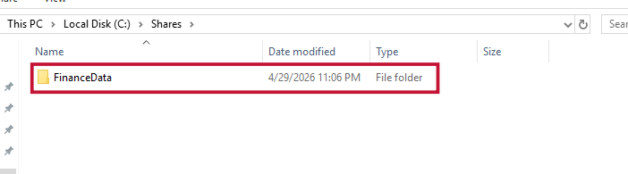

- Inside Shares, a new folder named FinanceData is created.
- This folder will hold the confidential finance files.
- Access to it will be restricted using share and NTFS permissions.

### 🔹 47. Final Folder Path

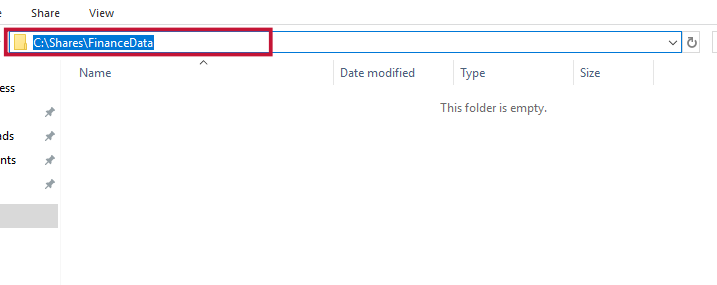

- The Explorer address bar shows the full path `C:\Shares\FinanceData`.
- This is the exact location that will be shared on the network.
- The folder is empty for now and ready to be secured.

### 🔹 48. Open Folder Properties

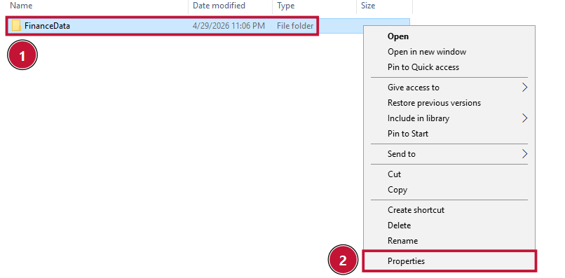

- Right-click the FinanceData folder and choose Properties.
- The Sharing tab is opened and Advanced Sharing is selected.
- This is where network share settings are controlled.

### 🔹 49. Advanced Sharing Dialog

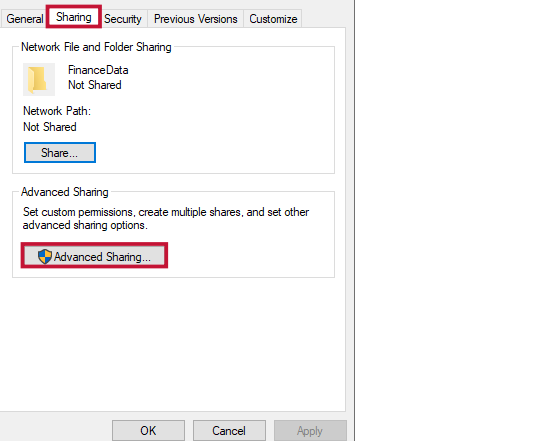

- The Advanced Sharing window opens.
- It contains the option to share the folder and set permissions and caching.
- The folder is not shared yet until the checkbox is enabled.

### 🔹 50. Enable Share This Folder

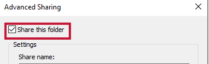

- Share this folder is checked in the Advanced Sharing window.
- The share name is set to FinanceData.
- This publishes the folder to the network under the name FinanceData.

### 🔹 51. Open Share Permissions

- Click the Permissions button to view the share-level permissions.
- By default, the group Everyone has access to the share.
- This default is too open for confidential finance data.

### 🔹 52. Remove Everyone

- The Everyone entry is selected and removed from the list.
- Removing it blocks access for all unauthorized accounts.
- This follows the principle of least privilege.

### 🔹 53. Add the FinanceData Group

- Click Add, type FinanceData, use Check Names and press OK.
- The security group is resolved from Active Directory.
- Permissions will now be given only to this group.

### 🔹 54. Grant Full Control to the Group

- The FinanceData group is selected and Full Control is allowed at the share level.
- Apply and OK are clicked to save the share permissions.
- Real file access is still limited later by the stricter NTFS rules.

### 🔹 55. Open Caching Settings

- Back in Advanced Sharing, the Caching button is clicked.
- The offline settings window appears.
- No files or programs from the shared folder are made available offline.

### 🔹 56. Caching Disabled and Applied

- The no-offline-availability option is selected and confirmed.
- Apply and OK are clicked to finish the share configuration.
- This prevents confidential files from being cached on client machines.

### 🔹 57. Open the Security Tab

- In FinanceData Properties, the Security tab is selected.
- The NTFS permissions currently set on the folder are displayed.
- The Advanced button gives access to inheritance settings.

### 🔹 58. Advanced Security Settings

- The Advanced Security Settings window opens for the FinanceData folder.
- It shows the permission entries and their inheritance state.
- Inheritance must be disabled to control access precisely.

### 🔹 59. Disable Inheritance

- Click Disable inheritance and convert inherited permissions into explicit ones.
- The folder no longer takes permissions from its parent.
- This allows unwanted entries to be removed safely.

### 🔹 60. Explicit Permissions Listed

- After conversion, all former inherited permissions appear as explicit entries.
- These entries can now be edited or removed individually.
- The next step removes everything except the required accounts.

### 🔹 61. Remove Unnecessary Entries

- All entries except Administrators (Full Control) and SYSTEM are removed.
- This tightens the folder so that only essential accounts remain.
- Standard Users and other broad groups lose access.

### 🔹 62. Add the FinanceData Group in NTFS

- Click Add and open Select a principal.
- FinanceData is typed and Check Names is used to resolve it.
- The group is about to receive NTFS permissions on the folder.

### 🔹 63. Set NTFS Permissions for the Group

- In the permission entry, Full Control is checked for the FinanceData group.
- The entry applies to this folder, subfolders and files.
- Members like bob and john now get file access through the group.

### 🔹 64. Apply the NTFS Changes

- Apply is clicked and the permission window is confirmed with OK.
- The updated permission list is saved on the folder.
- The security tab now shows only the allowed accounts.

### 🔹 65. NTFS Permissions Finalized

- The final Security tab lists Administrators, SYSTEM and FinanceData.
- This is the intended RBAC model for the finance folder.
- Anyone outside these accounts, like martin, will be denied.

### 🔹 66. Open Server Manager

- Server Manager is opened on SRV01.
- The dashboard shows the roles and features of the server.
- File and Storage Services is the next area to open.

### 🔹 67. File and Storage Services

- The File and Storage Services section is selected on the left panel.
- The Shares page is opened to list all network shares.
- The FinanceData share created earlier appears here.

### 🔹 68. Open Share Properties

- Right-click the FinanceData share and choose Properties.
- The properties window shows General, Permissions, Settings and Customize pages.
- The Settings page contains the access-based enumeration option.

### 🔹 69. Settings Tab

- The Settings tab of the share properties is opened.
- It lists advanced options such as enumeration and encryption.
- These options add another layer of protection to the share.

### 🔹 70. Enable Access-Based Enumeration

- Enable access-based enumeration is checked.
- With this option, users cannot even see folders they have no permission for.
- This hides the finance folder from unauthorized users like martin.

### 🔹 71. Enable SMB Encryption

- Encrypt data access is checked for the share.
- SMB encryption protects the data in transit between client and server.
- It stops attackers from reading file contents through network sniffing.

### 🔹 72. Apply Share Settings

- Apply and OK are clicked to save the settings.
- Both access-based enumeration and encryption are now active.
- The FinanceData share is configured with defense in depth.

### 🔹 73. Share Settings Verified

- The share properties are reopened and confirm the saved settings.
- The enumeration and encryption options remain enabled.
- The share is ready to contain test files.

### 🔹 74. Create a Test File

- On SRV01, a new text document is created inside `C:\Shares\FinanceData`.
- The file is named Q4_Report.txt.
- It will be used to test whether permissions behave as designed.

### 🔹 75. Add Confidential Content

- The file is opened and a short confidential finance message is typed in.
- This simulates sensitive financial data stored on the server.
- The file is saved and closed.

### 🔹 76. Test File Saved

- The folder now shows Q4_Report.txt in the FinanceData directory.
- The file is ready for access testing from client machines.
- The RBAC tests begin in the next section.

### 🔹 77. Login to CL01 as john

- On CL01, the user logs in with the domain account CORP\john.
- john is an authorized member of the FinanceData group.
- He should be able to open the finance share.

### 🔹 78. Open the Share by UNC Path

- File Explorer is opened and the path `\\192.168.10.25\FinanceData` is typed in the address bar.
- The request is sent to SRV01 over SMB.
- The result shows whether RBAC allows the account in.

### 🔹 79. Access Granted for john

- The FinanceData folder opens and Q4_Report.txt is visible.
- This proves that the authorized user can read the data.
- The positive test case of the RBAC design is successful.

### 🔹 80. Access Denied for martin

- On CL02, martin tries to open `\\192.168.10.25\FinanceData`.
- Windows shows an error saying he does not have permission to access the share.
- This is the expected result and confirms unauthorized users are blocked.

---

## 📏 Phase 4 — Microsoft Security Compliance Toolkit

Steps 81–108

### 🔹 81. Open the MSCT Download Page

- The Microsoft Security Compliance Toolkit download page is opened in the browser.
- This toolkit provides official security baselines for Windows and Windows Server.
- Click Download to start selecting the required packages.

### 🔹 82. Select Files to Download

- The list of available files is displayed on the download page.
- The Windows 10 / Windows Server 2019 baseline, Policy Analyzer and LGPO are chosen.
- Selecting only the needed files keeps the download small.

### 🔹 83. LGPO.zip Selected

- LGPO.zip is highlighted among the available downloads.
- LGPO is the Local Group Policy Object tool used to apply baselines from the command line.
- It will be copied to System32 later so it works from anywhere.

### 🔹 84. Download Both Files

- Click Next to start downloading the selected packages.
- The browser downloads Policy Analyzer and LGPO into the Downloads folder.
- The files will be extracted on DC01 in the next step.

### 🔹 85. Extract Policy Analyzer

- PolicyAnalyzer.zip is extracted into `C:\MSCT\PolicyAnalyzer`.
- The extracted folder contains the PolicyAnalyzer executable and its helper scripts.
- This tool compares baselines against the current system settings.

### 🔹 86. Locate LGPO.exe

- The LGPO folder inside Downloads is opened and LGPO.exe is found.
- This is the version of the tool provided in the toolkit.
- It is copied to a system path in the next step.

### 🔹 87. LGPO Copied to System32

- LGPO.exe is pasted into `C:\Windows\System32`.
- Because System32 is in the PATH, the command can be run from any directory.
- This simplifies applying the baseline from PowerShell.

### 🔹 88. Open Policy Analyzer Folder

- The folder `C:\MSCT\PolicyAnalyzer\PolicyAnalyzer_40` is opened.
- It contains PolicyAnalyzer.exe, Policy Rules and several PowerShell scripts.
- Double-click PolicyAnalyzer.exe to launch the tool.

### 🔹 89. Policy Analyzer Launched

- Policy Analyzer opens its main window after the executable is started.
- The window is empty because no policy rules have been added yet.
- The baseline GPOs are imported in the following steps.

### 🔹 90. Policy Analyzer Main Window

- The main interface shows the options Add, Compare and View.
- These are used to import policy sets and compare them with the local system.
- The Add button begins importing the Microsoft baseline.

### 🔹 91. Add Files from GPOs

- Click File and then Add files from GPO(s).
- This allows the baseline GPO folders from the toolkit to be loaded.
- Policy Analyzer reads the backup GPO format used by Microsoft baselines.

### 🔹 92. Browse to the Baseline GPOs

- The folder `C:\MSCT\Windows 10 Version...\GPOs` is browsed.
- All GPO folders for the baseline are selected.
- These folders hold the recommended Microsoft security settings.

### 🔹 93. Select Policies to Import

- The list of baseline policies is shown in the import window.
- All the policies are selected and the Import button is clicked.
- They will be saved as a single policy rules file.

### 🔹 94. Confirm the Import

- A dialog confirms that the selected policies are being imported.
- Click OK to continue.
- The window then asks for a name for the new rules file.

### 🔹 95. Import Completed

- The import is completed and the policies are listed in Policy Analyzer.
- The rule set is ready for comparison.
- This represents the official Microsoft recommended baseline.

### 🔹 96. Name the Rules File

- The file is saved with the name Server2019_Baseline.
- Naming it clearly makes it easy to find later.
- Click Compare Effective State to check the current system against it.

### 🔹 97. Compare Effective State

- The comparison results window opens.
- Columns show the policy type, the setting, the baseline value and the effective state.
- The effective state is the real current configuration of DC01.

### 🔹 98. Understanding the Result Columns

- The Baseline column shows the Microsoft recommended value.
- The Effective state column shows what is currently configured.
- Differences between them mean the machine is not following the baseline.

### 🔹 99. Open the View Menu

- The View menu at the top of Policy Analyzer is opened.
- It offers several filtering options for the long list of settings.
- Filtering helps focus on settings that need attention.

### 🔹 100. Show Only Differences

- Show only Differences is selected from the View menu.
- The list now contains only settings that differ from the baseline.
- This highlights every misconfiguration on the domain controller.

### 🔹 101. Misconfigurations Highlighted

- Yellow cells show where the effective state does not match the baseline.
- Examples include audit policy settings that are set to No Auditing.
- These findings are documented as the top issues for the lab report.

### 🔹 102. Open the Local_Script Folder

- PowerShell is run as Administrator and the Local_Script folder of the baseline is opened with `cd`.
- This folder contains BaselineLocalInstall.ps1.
- The script applies the security baseline to the local machine.

### 🔹 103. Set the Execution Policy

- `Set-ExecutionPolicy RemoteSigned` is entered and confirmed with Y.
- This allows the downloaded baseline script to be executed.
- Without it, PowerShell would block the script.

### 🔹 104. Apply the Baseline on DC01

- The command `.\BaselineLocalInstall.ps1 -WS2019DomainController` is executed.
- The script uses LGPO to import all recommended settings for a domain controller.
- The output shows each policy area being applied.

### 🔹 105. Open Local Group Policy Editor

- `gpedit.msc` is run to open the Local Group Policy Editor.
- It is used to verify that the baseline has been applied.
- The Computer Configuration section is expanded.

### 🔹 106. Navigate to Account Policies

- The path Computer Configuration > Windows Settings > Security Settings > Account Policies is opened.
- The Password Policy and Account Lockout Policy are listed.
- These are the first settings to review after applying the baseline.

### 🔹 107. Password Policy Verified

- The Password Policy now shows stricter values than before.
- Examples are a longer minimum length and password history enforcement.
- This confirms the security baseline was applied successfully.

### 🔹 108. Baseline Applied on SRV01

- The same baseline process is repeated on SRV01 using LGPO.
- The script output confirms that the settings were imported.
- Both DC01 and SRV01 are now aligned with Microsoft recommendations.

---

## 🔄 Phase 5 — Patch Management with BatchPatch

Steps 109–126

### 🔹 109. Run the BatchPatch Installer

- The BatchPatch installer is launched on SRV01.
- A prompt asks the user to provide the location of PsExec.exe.
- PsExec is needed by BatchPatch to execute actions on remote machines.

### 🔹 110. Locate PsExec

- After clicking OK, a file browser opens.
- The PSTools folder is browsed to find PsExec.exe.
- BatchPatch stores this path for future remote operations.

### 🔹 111. Select PsExec.exe

- PsExec.exe is selected from the PSTools folder.
- BatchPatch confirms the file is valid.
- It will be used for remote command execution.

### 🔹 112. Register File Extensions

- BatchPatch asks if file extensions should be registered.
- Yes is selected.
- BatchPatch is now installed and opens its main grid.

### 🔹 113. Add Hosts to BatchPatch

- In the Grid menu, Add Hosts is selected.
- A window opens where machine names or IP addresses are typed.
- Each target machine is entered on its own line.

### 🔹 114. Hosts Added

- The IP addresses of the lab machines are listed, including 192.168.10.102.
- After clicking OK, they appear as rows in the BatchPatch grid.
- These are the machines that will be scanned and patched.

### 🔹 115. Specify Alternate Credentials

- Actions > Specify alternate logon credentials is opened.
- This lets BatchPatch connect to the remote machines with an administrative account.
- The username is set to Administrator.

### 🔹 116. Enter Domain Credentials

- The domain administrator password and the domain corp.local are entered.
- These credentials give BatchPatch the rights to query and install updates.
- Credentials are stored for the session only.

### 🔹 117. Credentials Saved

- Clicking OK stores the credentials.
- The grid is ready to connect to all hosts.
- The next step is scanning for missing updates.

### 🔹 118. Select All Hosts

- All hosts are selected in the grid with Ctrl+A.
- The Actions menu is opened and Windows Updates is chosen.
- Check for Available Updates is selected to start the scan.

### 🔹 119. Check for Available Updates

- BatchPatch starts connecting to each machine.
- It queries Windows Update on every target.
- Status messages appear in the grid for each host.

### 🔹 120. Scan Results

- After a few minutes, the grid shows the number of missing updates per machine.
- This gives an overview of the patch level across the network.
- Machines with missing patches are selected for installation.

### 🔹 121. Select Machines for Patching

- The machines that show missing updates are highlighted.
- Actions > Windows Update > Download and Install is selected.
- This tells BatchPatch to push the patches remotely.

### 🔹 122. Reboot Option

- The option Automatically reboot if required is checked.
- This makes sure updates that require a restart are completed.
- It reduces manual work after patching.

### 🔹 123. Confirm Installation

- OK is clicked to start downloading and installing updates.
- BatchPatch begins the remote installation on every selected host.
- Progress appears live in the grid.

### 🔹 124. Patching in Progress

- The grid shows real-time status such as downloading, installing and rebooting.
- Each machine has its own status line.
- This allows the administrator to track patching centrally.

### 🔹 125. Open Task Scheduler

- Actions > Task Scheduler is selected to automate patching.
- A scheduling window opens.
- Automatic schedules keep systems updated without manual effort.

### 🔹 126. Weekly Patch Schedule

- The recurrence is set to Weekly and a day and time are chosen.
- Clicking OK creates the scheduled patching task.
- Patches will now be installed automatically every week.

---

## 🛡️ Phase 6 — Windows Hardening

Steps 127–137

### 🔹 127. Open Local Security Policy

- On DC01, `secpol.msc` is started from PowerShell or the Run box.
- The Local Security Policy console opens.
- It is used to harden the authentication settings.

### 🔹 128. Open Security Options

- Security Settings > Local Policies > Security Options is expanded.
- A long list of security-related policies is displayed.
- The NTLM-related setting is located in this list.

### 🔹 129. LAN Manager Authentication Level

- Network security: LAN Manager authentication level is located.
- Double-clicking it opens its properties dialog.
- The setting controls which challenge-response protocol is allowed.

### 🔹 130. Send NTLMv2 Only

- The value is set to Send NTLMv2 response only. Refuse LM & NTLM.
- Older and weaker protocols are disabled.
- The same configuration is then repeated on SRV01.

### 🔹 131. Check Firewall Profiles

- The command `Get-NetFirewallProfile | Select Name, Enabled` is run.
- It lists the Domain, Private and Public profiles with their status.
- All profiles should be enabled for proper protection.

### 🔹 132. Allow SMB from the Internal Network

- A firewall rule is created that allows SMB only from 192.168.10.0/24.
- This limits file sharing access to trusted lab machines.
- The command is run on SRV01 to protect the file share.

### 🔹 133. Block SMB from Everywhere Else

- A second rule named Block SMB External blocks traffic from 0.0.0.0/0.
- Together with the allow rule, only the internal subnet can reach SMB.
- This reduces exposure to attacks from outside the network.

### 🔹 134. Enable Advanced Audit Policies

- The `auditpol` command enables success and failure auditing for categories like DS Access.
- Auditing records important security events in the Windows Security log.
- These logs will later be collected by Wazuh.

### 🔹 135. More Audit Categories Enabled

- Additional `auditpol` commands are executed for other categories.
- Each command returns a success message.
- This increases visibility into logons, account changes and policy changes.

### 🔹 136. Verify Audit Policy

- `auditpol /get /category:*` is executed.
- The output lists every category and its configured setting.
- It confirms that success and failure auditing are active.

### 🔹 137. Audit Policy on SRV01

- The same audit commands are run on SRV01.
- Verification shows the settings are in place.
- Both servers now generate detailed security logs.

---

## 📡 Phase 7 — Wazuh SIEM Deployment & Agents

Steps 138–164

### 🔹 138. Wazuh Server Installation Begins

- The Wazuh logo appears as the introduction to the Wazuh installation on IDS01.
- Wazuh is an open-source SIEM and XDR platform.
- It will collect, analyze and alert on security events across the lab.

### 🔹 139. Update the System

- The commands `sudo apt update && sudo apt upgrade -y` are run on IDS01.
- This makes sure all system packages are current before installing Wazuh.
- It also reduces dependency problems during installation.

### 🔹 140. Install curl

- The command `sudo apt install curl` is executed.
- curl is required to download the Wazuh installation script.
- The terminal shows the package being installed.

### 🔹 141. Run the Wazuh Install Script

- The curl command downloads wazuh-install.sh and runs it with the `-a` option.
- The terminal shows the indexer, manager, Filebeat and dashboard being installed step by step.
- The all-in-one installation sets up every Wazuh component on one machine.

### 🔹 142. Wazuh Admin Credentials

- After installation, the terminal prints the admin username and password.
- These credentials must be saved before closing the terminal.
- They are used to log in to the dashboard.

### 🔹 143. Open the Dashboard in the Browser

- The server IP address is entered in the browser using https.
- A certificate warning appears because the certificate is self-signed.
- Click Advanced and proceed to continue.

### 🔹 144. Wazuh Login Page

- The Wazuh login page is displayed.
- The admin username and the saved password are entered.
- Successful login opens the main dashboard.

### 🔹 145. Wazuh Dashboard Overview

- The dashboard shows the main modules of Wazuh.
- These include security events, integrity monitoring and vulnerability detection.
- Administrators use this interface to monitor all connected agents.

### 🔹 146. Open https://192.168.10.60

- The IDS01 address is opened in the browser on a lab machine.
- A security warning appears for the self-signed certificate.
- The warning is accepted to proceed to the login page.

### 🔹 147. Accept the Certificate Warning

- Advanced is expanded and the option to continue to the site is chosen.
- This is safe because the server is part of the controlled lab.
- The Wazuh login page then loads.

### 🔹 148. Logged In as admin

- The admin account is used to sign in to Wazuh.
- The main dashboard loads successfully.
- The SIEM is ready to receive data from agents.

### 🔹 149. Connect Agents to the Server

- The section about connecting Wazuh agents is opened.
- A Wazuh agent must be installed on each endpoint.
- The first agent will be installed on a Windows VM.

### 🔹 150. Search for Wazuh Agent

- The browser is used to search for the Wazuh agent download.
- The official Wazuh documentation website is chosen.
- Using the official site ensures the installer is genuine.

### 🔹 151. Open the Wazuh Website

- The official Wazuh installation guide is open.
- The GUI option and the Windows installer are selected.
- This leads to the MSI download for Windows.

### 🔹 152. Download the Windows Installer

- The Windows installer is selected on the website.
- The download begins automatically.
- The MSI file is saved in the Downloads folder.

### 🔹 153. Run the Agent Installer

- The downloaded installer is started on the Windows VM.
- The setup wizard opens.
- Administrator rights are required to install it.

### 🔹 154. Install the Agent

- Next is clicked through the setup wizard and the agent is installed.
- The wizard confirms the installation is finished.
- The agent manager can then be opened.

### 🔹 155. Open Wazuh Agent Manager

- The Wazuh Agent Manager window is opened after installation.
- The manager IP field must be filled in.
- It should contain the IP address of the Wazuh server, 192.168.10.60.

### 🔹 156. Enter the Manager IP

- The Wazuh server IP is typed into the Manager IP field.
- Save is clicked to store the configuration.
- This tells the agent where to send its logs.

### 🔹 157. Start the Agent Service

- Start, Restart and Refresh are clicked in the Agent Manager.
- An authentication key is generated automatically.
- The status changes to Running.

### 🔹 158. Agent Registered

- The agent status shows Running and connected.
- The agent now appears in the Wazuh dashboard.
- The same steps are repeated on all other Windows machines.

### 🔹 159. Add the Wazuh GPG Key

- On the Linux machine, the Wazuh GPG key is downloaded and stored in the keyrings folder.
- This lets apt verify that packages come from Wazuh.
- It is the first step of adding the repository.

### 🔹 160. Add the Wazuh Repository

- The Wazuh apt repository line is added to the sources list.
- The command points apt to the official Wazuh package server.
- After this, `apt-get update` refreshes the package list.

### 🔹 161. Install the Wazuh Agent

- `sudo apt-get install wazuh-agent -y` is run on the Linux machine.
- The package manager downloads and installs the agent.
- Installation completes and the service is ready to configure.

### 🔹 162. Configure the Manager IP

- `sed` is used to replace MANAGER_IP in ossec.conf with 192.168.10.60.
- This points the Linux agent to the IDS01 Wazuh server.
- The agent configuration file is updated directly from the command line.

### 🔹 163. Start and Enable the Agent

- `sudo systemctl start wazuh-agent` and `enable wazuh-agent` are executed.
- This starts the agent and configures it to launch at boot.
- The service status can then be checked with `systemctl status`.

### 🔹 164. Active Agent in Dashboard

- The Wazuh dashboard Agents page shows the Linux machine as Active.
- This confirms that logs are now flowing into Wazuh.
- Both Windows and Linux endpoints are now monitored.

---

## 🔍 Phase 8 — Sysmon & Log Collection

Steps 165–182

### 🔹 165. Download Sysmon

- The Sysinternals Sysmon download page is opened.
- Sysmon provides detailed Windows event logging beyond the default logs.
- The ZIP package is downloaded to the Windows VM.

### 🔹 166. Extract the Sysmon Package

- The downloaded Sysmon ZIP file is extracted.
- The extracted folder contains the Sysmon executables and license file.
- These files are used to install the Sysmon service.

### 🔹 167. Sysmon Package Contents

- The extracted folder shows Eula, Sysmon, Sysmon64 and Sysmon64a files.
- Sysmon64 is the 64-bit executable used on modern Windows systems.
- A configuration file will be added to this same folder.

### 🔹 168. Download the SwiftOnSecurity Config

- The SwiftOnSecurity Sysmon configuration is downloaded from GitHub.
- This is a widely used community configuration with strong default rules.
- It defines which events Sysmon should log in detail.

### 🔹 169. Copy the Config File

- The sysmonconfig-export file is copied into the same folder as sysmon64.exe.
- Keeping them together simplifies the installation command.
- The file will be renamed with an .xml extension.

### 🔹 170. Save Config as XML

- The configuration file is saved with the .xml extension in the Sysmon folder.
- This matches the format Sysmon expects when installing.
- The next step installs Sysmon using this configuration.

### 🔹 171. Install Sysmon with the Config

- Command Prompt is run as Administrator and `sysmon64.exe -i sysmonconfig-export.xml` is executed.
- This installs Sysmon as a Windows service using the custom configuration.
- A license agreement prompt appears first.

### 🔹 172. Accept the License Agreement

- The Sysmon license prompt is accepted by clicking Agree.
- Installation then proceeds in the terminal.
- A success message appears once Sysmon is installed.

### 🔹 173. Installation Successful

- The terminal confirms that Sysmon was installed successfully.
- The Sysmon service is now running and logging system activity.
- Its events can be viewed in Event Viewer.

### 🔹 174. View Sysmon Logs in Event Viewer

- Event Viewer is expanded to Microsoft > Windows > Sysmon > Operational.
- Detailed process, network and file events generated by Sysmon are listed here.
- These logs will next be forwarded into Wazuh.

### 🔹 175. Locate the Agent Config File

- The Wazuh agent configuration file ossec.conf is located under `Program Files (x86)\ossec-agent`.
- View Config is used to open it for editing.
- Log sources are defined inside this file.

### 🔹 176. Add Sysmon as a Log Source

- A localfile entry for the Sysmon Operational log is added inside the configuration.
- This tells the Wazuh agent to forward Sysmon events.
- The agent service must be restarted to apply the change.

### 🔹 177. Restart the Wazuh Agent

- The Wazuh agent service is restarted after editing the configuration.
- This loads the new Sysmon log source.
- Sysmon events should now start appearing in the dashboard.

### 🔹 178. Wazuh Rules for Sysmon Events

- The Wazuh dashboard now shows Sysmon-based rule hits such as FileCreate, ProcessAccess and RegistryEvent.
- Each entry includes a timestamp, rule description, level and rule ID.
- This confirms that Sysmon telemetry is being analyzed by Wazuh rules.

### 🔹 179. Sysmon Data Confirmed in Wazuh

- Further browsing of the dashboard shows ongoing Sysmon events being logged.
- Process creation and image load events appear alongside agent status messages.
- The endpoint is now fully integrated with the SIEM.

### 🔹 180. Open Agent Log Configuration

- On another Wazuh agent, View Config is opened to check the localfile section.
- The entries required for log collection are reviewed.
- Any missing log sources are added here.

### 🔹 181. Verify Localfile Entries

- The closing localfile tag confirms the log source block is complete.
- The configuration file is saved after the edit.
- The Wazuh service is restarted to apply the new settings.

### 🔹 182. Restart the Wazuh Service

- The Wazuh agent service is restarted to load the updated log collection settings.
- This ensures the newly added log sources start being monitored.
- Log collection is now active across all configured agents.

---

## 🎯 Phase 9 — Custom Detection Rules & MITRE ATT&CK

Steps 183–189

### 🔹 183. Open local_rules.xml

- On IDS01, `sudo nano /var/ossec/etc/rules/local_rules.xml` is run.
- This file is where custom detection rules are defined.
- It currently needs the lab's custom rule set added.

### 🔹 184. Add Custom Detection Rules

- The existing content is cleared and new custom rules are pasted in.
- These rules detect the specific attack techniques used later in the lab.
- The file is saved with Ctrl+S and closed with Ctrl+X.

### 🔹 185. Restart the Wazuh Manager

- `sudo systemctl restart wazuh-manager` is executed to load the new rules.
- A restart is required for custom rules to take effect.
- The manager comes back online with the updated rule set.

### 🔹 186. Verify Rules Loaded Without Errors

- The Wazuh log is checked to confirm the manager started cleanly.
- No rule syntax errors are reported.
- The custom detection rules are now active.

### 🔹 187. Open Wazuh Dashboard for MITRE

- The Wazuh dashboard is opened at https://192.168.10.60.
- The MITRE ATT&CK module is accessed from the left-hand menu.
- It maps detected events to known adversary techniques.

### 🔹 188. Open the MITRE ATT&CK Menu

- MITRE ATT&CK is selected from the left navigation menu.
- The module loads the ATT&CK matrix inside the dashboard.
- Techniques will light up as matching events are detected.

### 🔹 189. ATT&CK Matrix View

- The ATT&CK matrix is displayed with tactics across the top and techniques below.
- No techniques are highlighted yet because no attacks have been run.
- This view will be revisited after the attack simulations.

---

## ⚔️ Phase 10 — Attack Simulation from Kali

Steps 190–214

### 🔹 190. Update Attacker Tools

- On the Kali attacker machine, `apt-get update` and `upgrade` are run.
- This keeps the operating system and security tools current.
- Up-to-date tools behave more reliably during the simulated attacks.

### 🔹 191. Install CrackMapExec

- `sudo apt-get install crackmapexec -y` installs the SMB attack tool.
- CrackMapExec is used later for enumeration and credential attacks.
- The terminal confirms the package installation.

### 🔹 192. Install Hydra

- `sudo apt-get install hydra -y` installs the brute-force tool Hydra.
- Hydra will be used to simulate password-guessing attacks.
- Its installation output is shown in the terminal.

### 🔹 193. Install python3-impacket

- `sudo apt-get install python3-impacket -y` is run.
- Impacket provides additional SMB and network protocol tools.
- It supports some of the enumeration techniques used later.

### 🔹 194. Verify Tool Versions

- `cme --version` is run to confirm CrackMapExec is installed correctly.
- The version number is printed to the terminal.
- This confirms the tool is ready for use.

### 🔹 195. Verify Hydra Help Output

- `hydra -h | head -5` is run to display the start of Hydra's help text.
- This confirms Hydra was installed and runs correctly.
- The attacker machine is now fully equipped for Phase 10.

### 🔹 196. Network Reconnaissance Scan

- `nmap -sn 192.168.10.0/24` is run from the attacker to discover live hosts.
- This is a ping sweep that lists every responding machine on the subnet.
- It corresponds to MITRE technique **T1046**, Network Service Discovery.

### 🔹 197. Detailed Scan of DC01

- `nmap -sV -sC -O 192.168.10.10` is run against the domain controller.
- This reveals open ports, running services, script results and OS guess.
- The output helps the attacker understand what services DC01 exposes.

### 🔹 198. Full Port Scan

- `nmap -A -p- 192.168.10.10 --max-retries 2` scans all 65535 ports on DC01.
- The -A flag adds OS detection, version detection and script scanning.
- This is a much more thorough scan than the earlier quick check.

### 🔹 199. SMB OS Discovery on SRV01

- `nmap -p 139,445 --script smb-os-discovery 192.168.10.25` targets the SMB ports on SRV01.
- The script reports OS version and domain information over SMB.
- This kind of probe is exactly what the Wazuh rules are designed to detect.

### 🔹 200. Check Wazuh for Scan Alerts

- The Wazuh dashboard Security Events are filtered by agent DC01.
- Alerts related to the nmap scans should appear here.
- This confirms the SIEM detected the reconnaissance activity.

### 🔹 201. SMB Share and User Enumeration

- `nmap --script smb-enum-shares,smb-enum-users -p 445` is run against DC01.
- The script lists available SMB shares and domain user accounts.
- This technique corresponds to MITRE **T1021.002**, SMB/Windows Admin Shares.

### 🔹 202. Enumerate Shares on SRV01

- The same smb-enum-shares script is run against SRV01 at 192.168.10.25.
- It checks which shares are visible without authentication.
- The FinanceData share is expected to be hidden from anonymous enumeration.

### 🔹 203. CrackMapExec Network Sweep

- `crackmapexec smb 192.168.10.0/24` is run to identify all SMB hosts on the subnet.
- CrackMapExec reports the hostname, OS and domain for each responding machine.
- This gives the attacker a map of the Windows infrastructure.

### 🔹 204. Enumerate Shares with CrackMapExec

- `crackmapexec smb 192.168.10.25 --shares` lists the shares exposed by SRV01.
- This checks whether FinanceData is visible without valid credentials.
- The access-based enumeration setting should limit what appears.

### 🔹 205. Enumerate Users with CrackMapExec

- `crackmapexec smb 192.168.10.10 --users` attempts to list domain users from DC01.
- This simulates an attacker trying to build a list of valid account names.
- Such enumeration attempts should also trigger Wazuh alerts.

### 🔹 206. Confirm FinanceData Is Protected

- The enumeration results confirm the FinanceData share is not accessible anonymously.
- SMB enumeration attempts are logged by Sysmon and forwarded to Wazuh.
- This validates that the RBAC and auditing controls are working together.

### 🔹 207. Prepare the Password List

- A password list file is created on the attacker machine using a heredoc (EOF).
- This wordlist will be used for the brute-force attack against martin's account.
- Using a weak, unauthorized account mirrors a realistic attack scenario.

### 🔹 208. Hydra Brute Force Against SMB

- `hydra -l martin -P /tmp/passwords.txt smb://192.168.10.10` is run.
- Hydra tries each password in the list against the martin account over SMB.
- This corresponds to MITRE **T1110**, Brute Force.

### 🔹 209. CrackMapExec Brute Force

- `crackmapexec smb 192.168.10.10 -u martin -p /tmp/passwords.txt` attempts the same attack with CrackMapExec.
- CrackMapExec reports which password attempts succeed or fail.
- Running two tools cross-validates the brute-force results.

### 🔹 210. Check Event Viewer for Failed Logons

- On DC01, Event Viewer > Windows Logs > Security is checked for Event ID 4625 and 4740.
- Event ID 4625 records failed logon attempts and 4740 records account lockouts.
- These events prove the brute-force attack was captured by Windows auditing.

### 🔹 211. Test Multiple Accounts with One Password

- `crackmapexec smb 192.168.10.10 -u bob -u john -u martin -p Finance@123` tests several usernames against one password.
- This simulates a password-spraying style attack across known accounts.
- Results show which accounts, if any, accept the shared password.

### 🔹 212. Authenticated Share Check

- `crackmapexec smb 192.168.10.25 -u john -p Finance@123 --shares` uses john's valid credentials to list shares on SRV01.
- Because john is authorized, FinanceData should now appear in the results.
- This contrasts with the earlier anonymous enumeration attempt.

### 🔹 213. Attempt Administrator Credentials

- `crackmapexec smb 192.168.10.10 -u Administrator -p Admin@SRV01 --shares` tries a guessed administrator password.
- This checks whether weak or reused admin credentials would expose the domain controller.
- A failed attempt shows the account is protected by a stronger password.

### 🔹 214. Check Logged-On Users

- `crackmapexec smb 192.168.10.10 -u Administrator -p YourAdminPass --loggedon-users` is run with valid administrator credentials.
- This lists which users are currently logged on to DC01.
- It demonstrates what an attacker could learn after obtaining valid credentials.

---

## 🚨 Phase 11 — Active Response (Detection → Prevention)

Steps 215–218

### 🔹 215. Open ossec.conf for Active Response

- `sudo nano /var/ossec/etc/ossec.conf` is opened on the Wazuh manager.
- The active-response section will be added to automatically react to attacks.
- This moves the lab from detection to automated prevention.

### 🔹 216. Add the Active Response Configuration

- The active-response block is inserted before the closing global tag.
- It defines which command runs and which rule levels trigger it.
- Typically this blocks the attacking IP address automatically.

### 🔹 217. Restart the Manager to Apply Active Response

- `sudo systemctl restart wazuh-manager` reloads the configuration.
- The active response module is now enabled.
- Future high-severity alerts, such as repeated brute-force attempts, will trigger an automatic block.

### 🔹 218. Verify Active Response Is Configured

- `sudo grep -A5 active-response /var/ossec/etc/ossec.conf` displays the saved configuration block.
- This confirms the settings were written correctly to the file.
- With active response enabled, the Module 5 lab setup is complete.

---

---

## 🎯 Key Outcomes

| ✅ Achievement | 📝 Result |
| :--- | :--- |
| **RBAC enforced** | `john` (FinanceData member) gets access; `martin` is denied |
| **Defense in depth** | Share + NTFS permissions, access-based enumeration, SMB encryption |
| **Baseline hardening** | Microsoft baseline applied; NTLMv2-only; SMB restricted to `192.168.10.0/24` |
| **Visibility** | Advanced auditing + Sysmon forwarded into Wazuh |
| **Detection** | Custom rules + MITRE ATT&CK mapping (T1046, T1021.002, T1110) |
| **Prevention** | Wazuh Active Response blocks attacking IPs automatically |

---

## 📬 Connect With Me

💬 *Questions? Need lab files? Feel free to reach out!*

---

## 📄 License

This project is created for **educational purposes** and is open-source.

---

### ⭐ If you found this helpful, please give it a star!

Made with 💙 by **Sanawar Imran**
*BS Cybersecurity • Air University, Multan Campus*

*Last Updated: November 2026*

