<div align="center">

# 📱 Mobile Device Security Lab

**A complete, hands-on, screenshot-driven walkthrough — from standalone mobile malware detection to centralized enterprise management**


<br>

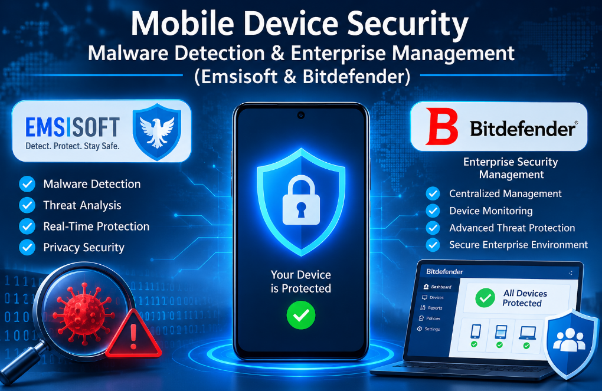

<br><br>

[📖 Overview](#overview) • [🏗️ Lab Architecture](#architecture) • [🧰 Tools](#tools) • [📂 Structure](#structure) • [🧪 Walkthrough](#walkthrough) • [🎯 Outcomes](#outcomes) • [📬 Contact](#contact)

</div>

---

<a id="overview"></a>

## 📖 Overview

This module demonstrates the **implementation and evaluation of mobile device security using two different approaches** on an Android endpoint:

1. **🛡️ Standalone protection — Emsisoft Mobile Security.** Security scanning and threat identification are performed to analyze a suspicious file and confirm the device stays safe.
2. **🏢 User-level protection + centralized management — Bitdefender Mobile Security with Bitdefender Central.** The phone is protected locally while also being enrolled, monitored and managed from a cloud security console.

Together, the two labs show how modern mobile security solutions provide **malware prevention, threat detection, privacy protection, device monitoring and centralized security management**.

> 💡 Every step below includes the original lab screenshot, so the whole workflow can be reproduced.

### 🎯 Lab Objectives

| 🧩 Part | 🎯 Goal |
| :--- | :--- |
| **Part 1 — Emsisoft** | Understand mobile malware detection, security alerts, suspicious APK analysis, malware removal and the role of antivirus in mobile security |
| **Part 2 — Bitdefender** | Install and configure user-level protection (malware scan, web protection, scam protection, app monitoring), then enroll the device in Bitdefender Central and use remote actions to monitor and respond to threats |

---

<a id="architecture"></a>

## 🏗️ Lab Architecture

<p align="center">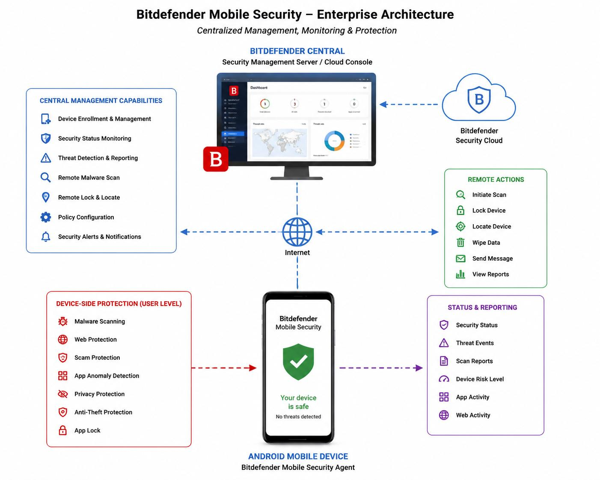</p>

| 🖧 Component | 🎭 Role | 📝 Details |
| :--- | :--- | :--- |
| **Security Management Server** (Bitdefender Central) | Centralized cloud console | Monitoring, reporting and control of mobile security activity: enrollment, status, remote malware scan, anti-theft |
| **Android Mobile Device** (TECNO CAMON 40 Pro) | Protected endpoint | Runs Emsisoft Mobile Security and Bitdefender Mobile Security; used for malware scans and feature testing |
| **APKPure + IKARUS TestVirus** | Threat simulation | A harmless test file used to trigger detection on both products |

### 🧭 Architecture at a Glance

| ☁️ Central Management | 📱 Device-Side Protection | ⚡ Remote Actions | 📊 Status & Reporting |
| :--- | :--- | :--- | :--- |
| Device enrollment & management | Malware scanning | Initiate scan | Security status |
| Security status monitoring | Web protection | Lock device | Threat events |
| Threat detection & reporting | Scam protection | Locate device | Scan reports |
| Remote malware scan | App anomaly detection | Wipe data | Device risk level |
| Remote lock & locate | Privacy protection | Send message | App activity |
| Policy configuration | Anti-theft protection | View reports | Web activity |
| Security alerts & notifications | App Lock | | |

---

<a id="tools"></a>

## 🧰 Tools & Technologies

| Category | Tools |
| :--- | :--- |
| 📱 Mobile Security | Emsisoft Mobile Security, Bitdefender Mobile Security (Total Security) |
| ☁️ Central Management | Bitdefender Central (cloud console, QR / link / email enrollment) |
| 🧪 Threat Simulation | IKARUS TestVirus (test file) downloaded from APKPure |
| 📲 Platform | Android, Google Play Store |
| 🔍 Protection Features | Malware Scanner, Download Scan, In-the-cloud Detection, Web Protection, Scam Alert / Scam Protection, Chat Protection, Scam Radar, App Anomaly Detection, App Lock, Smart Unlock, Anti-Theft |

---

<a id="structure"></a>

## 📂 Folder Structure

```text
Module-7-Mobile-Device-Security/
├── README.md
└── images/
    ├── ai.png                  # cover banner
    ├── page02_img01.png        # enterprise architecture diagram
    ├── page05_img01.png        # Phase 1 - Emsisoft screenshots
    ├── ...
    └── page34_img03.png        # last screenshot (account cleanup)
```

> Screenshot names follow the pattern `page<PDF page>_img<number on that page>.png`.

---

## 🗺️ Phase Map

| # | Phase | Steps |
| :-: | :--- | :-: |
| 1 | [📲 Phase 1 — Emsisoft Installation & Onboarding](#phase1) | 1–6 |
| 2 | [🔐 Phase 2 — Permissions, First Scan & App Anomaly Detection](#phase2) | 7–12 |
| 3 | [💬 Phase 3 — Scan Settings, Scam Alert & Chat Protection](#phase3) | 13–18 |
| 4 | [🔒 Phase 4 — App Lock & Smart Unlock](#phase4) | 19–31 |
| 5 | [🧪 Phase 5 — Malware Detection Test with IKARUS (Emsisoft)](#phase5) | 32–35 |
| 6 | [☁️ Phase 6 — Bitdefender Central: Subscription & Install Link](#phase6) | 36–43 |
| 7 | [📡 Phase 7 — Bitdefender Mobile Install & Device Enrollment](#phase7) | 44–49 |
| 8 | [🛡️ Phase 8 — Bitdefender Remote Actions & Protection Features](#phase8) | 50–60 |
| 9 | [🚨 Phase 9 — Threat Test & Centralized Response](#phase9) | 61–66 |

---

<a id="walkthrough"></a>

## 🧪 Lab Walkthrough

> Every step has its screenshot and full documentation below.

<a id="phase1"></a>

## 📲 Phase 1 — Emsisoft Installation & Onboarding

<sub>Steps 1–6</sub>

### 🔹 1. Install Emsisoft Mobile Security

<p align="center">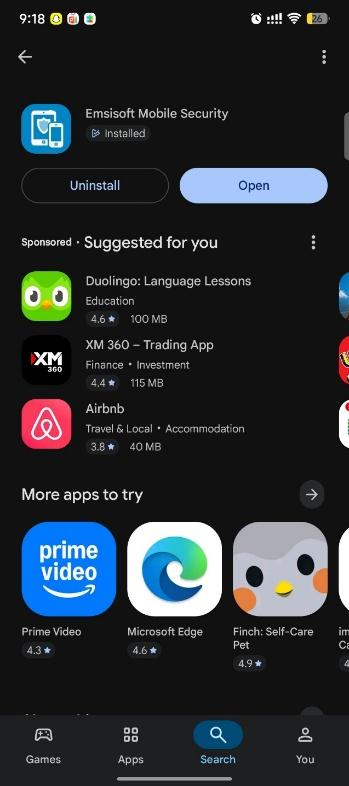</p>

- Open the Google Play Store on the Android device and search for Emsisoft Mobile Security.
- Tap Install; once the installation finishes, the button changes to Open.
- This is the standalone security solution used in the first part of the lab.

### 🔹 2. Launch the App and Get Started

<p align="center">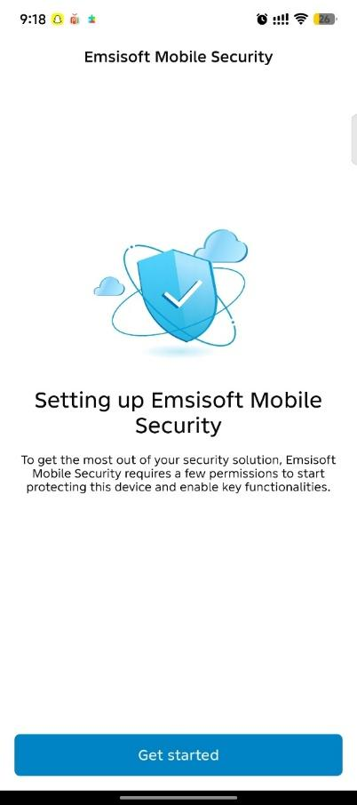</p>

- The welcome screen explains that Emsisoft needs a few permissions to start protecting the device.
- These permissions enable the key security functions of the app.
- Tap Get started to begin the setup.

### 🔹 3. Accept the Terms and Conditions

<p align="center">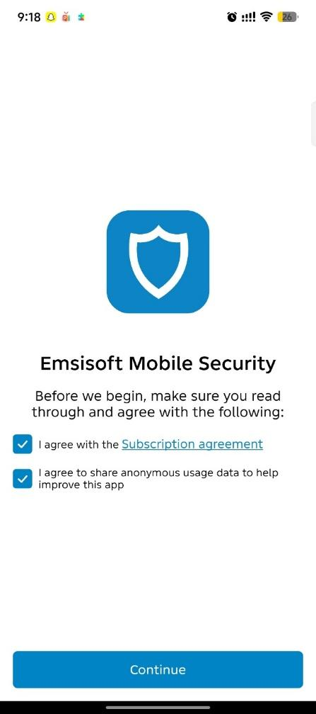</p>

- Agree to the Subscription agreement and to sharing anonymous usage data.
- Both checkboxes are ticked in the lab before continuing.
- Tap Continue to move to the account screen.

### 🔹 4. Sign In to MyEmsisoft

<p align="center">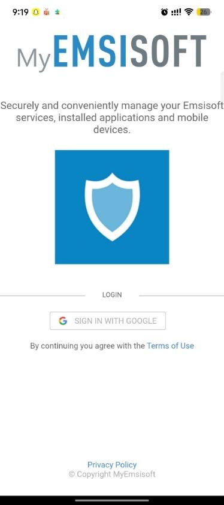</p>

- The MyEmsisoft screen offers sign-in with a Google account.
- The account is used to manage Emsisoft services, installed applications and mobile devices.
- Continuing means accepting the Terms of Use.

### 🔹 5. 30-Day Free Trial Started

<p align="center">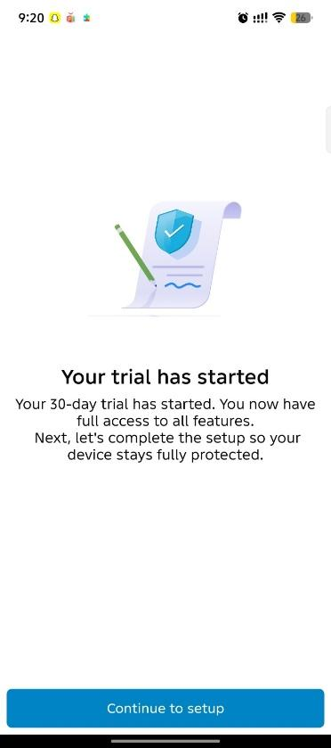</p>

- The app confirms that the 30-day trial has started with full access to all features.
- A free trial is enough for completing the lab.
- Tap Continue to setup to finish configuring the protection.

### 🔹 6. Allow VPN Permission

<p align="center">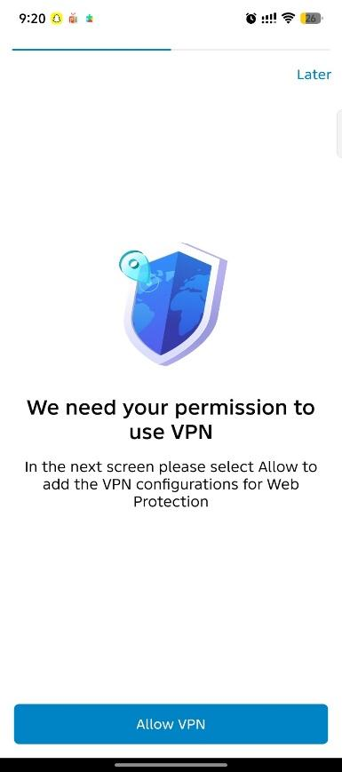</p>

- Emsisoft asks for permission to add VPN configurations so that Web Protection can work.
- Tap Allow VPN and confirm with Allow on the Android prompt.
- Web Protection is now ready to scan the device's web connections.

---

<a id="phase2"></a>

## 🔐 Phase 2 — Permissions, First Scan & App Anomaly Detection

<sub>Steps 7–12</sub>

### 🔹 7. Allow Display Over Other Apps

<p align="center">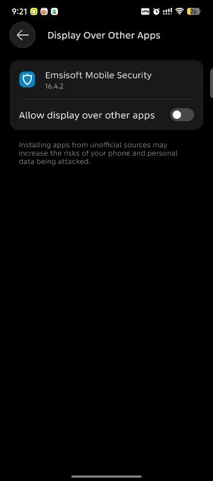</p>

- Open the Display Over Other Apps page in Android settings and turn on the toggle for Emsisoft.
- This lets Emsisoft show its security alerts on top of other apps, such as the browser or Downloads.
- Android warns that apps from unofficial sources may increase risk, so this permission is given only to a trusted security app.

### 🔹 8. Start the First Scan

<p align="center">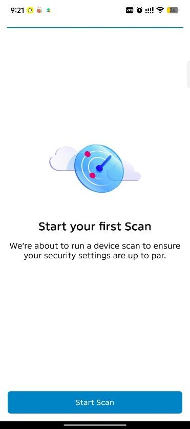</p>

- The "Start your first Scan" screen explains that a device scan checks that the security settings are up to par.
- Tap Start Scan to run the first scan.
- This creates the baseline for the device before any tests are done.

### 🔹 9. Home Dashboard — You Are Safe

<p align="center">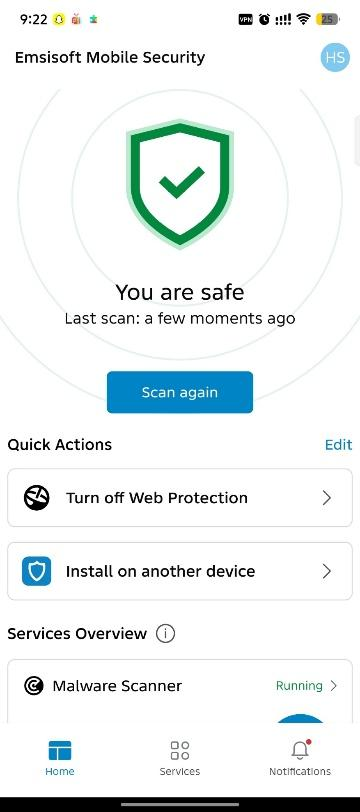</p>

- After the scan, the dashboard shows **You are safe** with the last scan time.
- Quick Actions and the Services Overview are visible, and the Malware Scanner is shown as Running.
- Open the Services tab and select Malware Scanner for the next configuration.

### 🔹 10. Malware Scanner — Device Is Clean

<p align="center">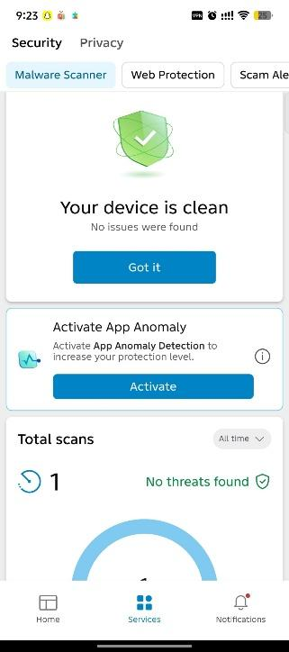</p>

- The Malware Scanner page reports **Your device is clean** with no issues found.
- Total scans shows 1 scan with no threats.
- An Activate App Anomaly card offers an extra protection level, which is enabled next.

### 🔹 11. Grant the Accessibility Permission

<p align="center">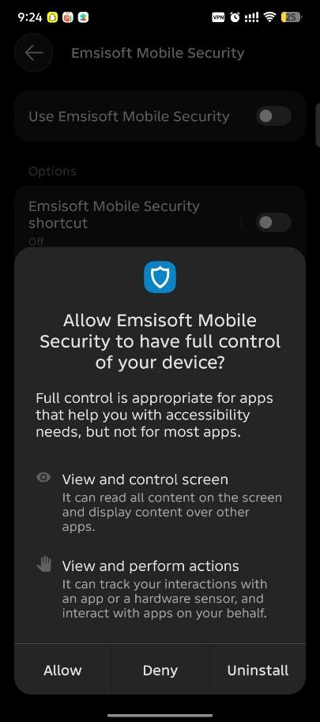</p>

- Android asks whether Emsisoft Mobile Security may have full control of the device.
- The dialog lists what it can do: view and control the screen, and view and perform actions.
- Accessibility is a powerful permission, so it should only be granted to trusted security apps. Tap Allow.

### 🔹 12. App Anomaly Detection Enabled

<p align="center">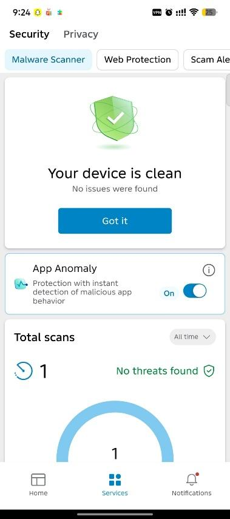</p>

- The App Anomaly toggle is now **On**.
- It provides protection with instant detection of malicious app behavior.
- The device still shows as clean with no threats found.

---

<a id="phase3"></a>

## 💬 Phase 3 — Scan Settings, Scam Alert & Chat Protection

<sub>Steps 13–18</sub>

### 🔹 13. Enable All Malware Scanner Scans

<p align="center">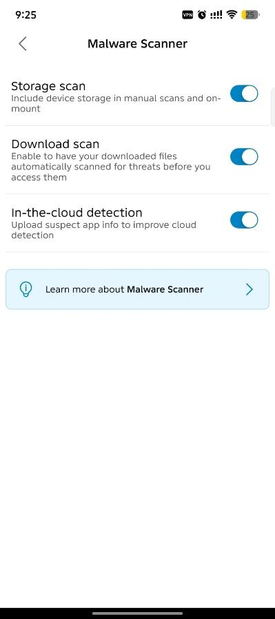</p>

- **Storage scan**, **Download scan** and **In-the-cloud detection** are all switched on.
- Download scan checks downloaded files for threats before they can be opened.
- This is the feature that catches the test file later in the lab.

### 🔹 14. Return to the Home Dashboard

<p align="center">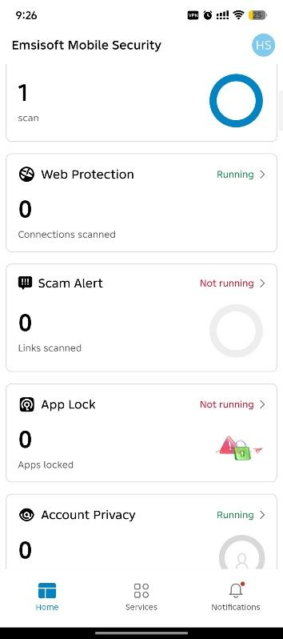</p>

- The dashboard lists the protection modules and their status.
- Web Protection and Account Privacy are Running, while Scam Alert and App Lock are still Not running.
- Scam Alert is turned on next.

### 🔹 15. Turn On Scam Alert

<p align="center">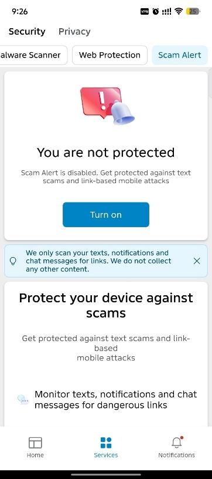</p>

- The Scam Alert tab shows **You are not protected** because the feature is disabled.
- It protects against text scams and link-based mobile attacks.
- Emsisoft states that it only scans texts, notifications and chat messages for links. Tap Turn on.

### 🔹 16. Scam Alert Enabled

<p align="center">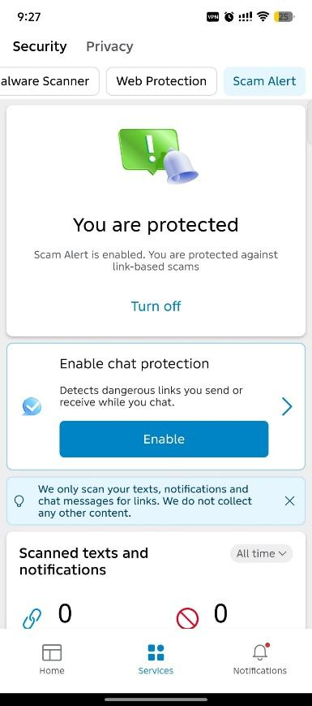</p>

- The status changes to **You are protected** against link-based scams.
- A card offers Enable chat protection, which detects dangerous links sent or received while chatting.
- Tap Enable to turn it on.

### 🔹 17. Chat Protection Enabled

<p align="center">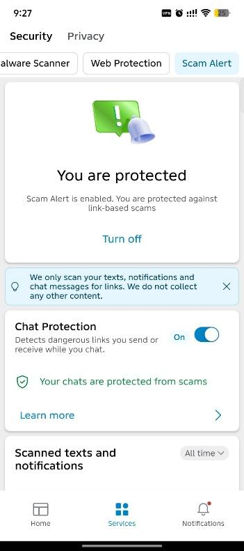</p>

- The Chat Protection toggle is **On**.
- The app confirms that chats are protected from scams.
- Scanned texts and notifications are counted below.

### 🔹 18. Back to the Dashboard

<p align="center">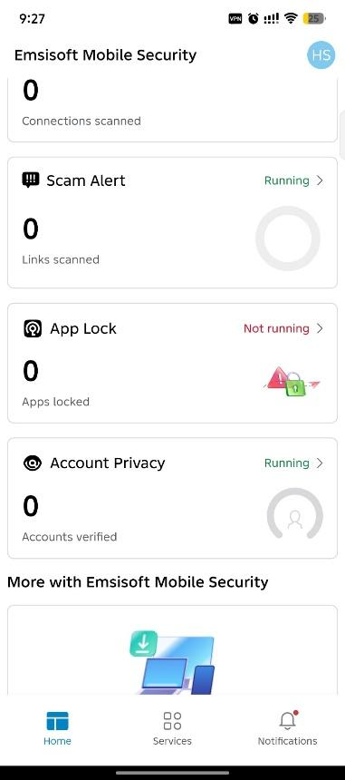</p>

- Scam Alert now appears as Running on the dashboard.
- App Lock is still Not running.
- App Lock is configured in the next phase.

---

<a id="phase4"></a>

## 🔒 Phase 4 — App Lock & Smart Unlock

<sub>Steps 19–31</sub>

### 🔹 19. App Lock Overview

<p align="center">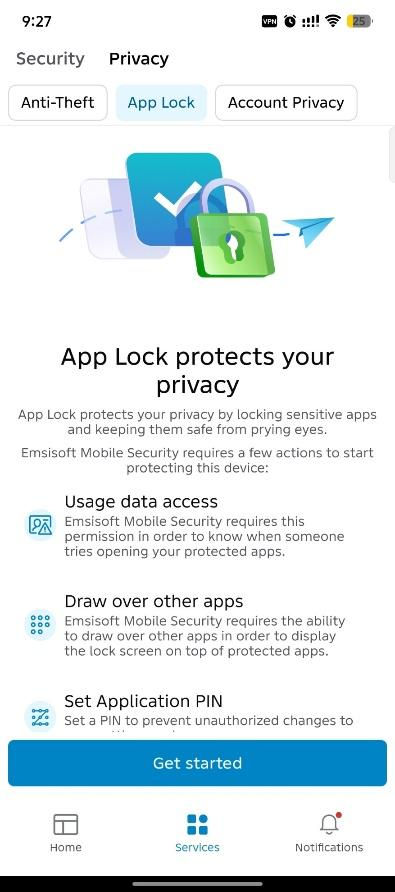</p>

- Under Privacy > App Lock, Emsisoft explains that it locks sensitive apps and keeps them away from prying eyes.
- Three requirements are listed: usage data access, draw over other apps and an application PIN.
- Tap Get started to begin the 4-step setup.

### 🔹 20. Usage Data Access (Step 1 of 4)

<p align="center">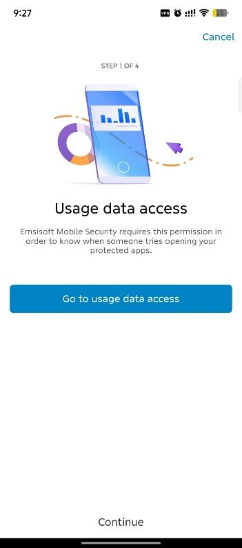</p>

- Emsisoft needs this permission to know when someone tries to open a protected app.
- Tap Go to usage data access to open the Android setting.
- The wizard continues after the permission is granted.

### 🔹 21. Permit Usage Access

<p align="center">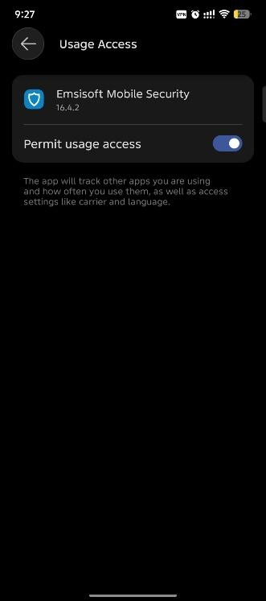</p>

- The Usage Access page lists Emsisoft Mobile Security.
- The **Permit usage access** toggle is turned on.
- Android notes that the app can track which other apps are used and how often.

### 🔹 22. Set a Security PIN (Step 2 of 4)

<p align="center">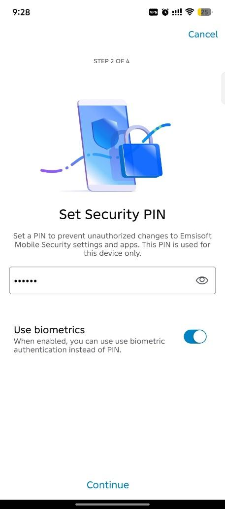</p>

- A PIN is set to prevent unauthorized changes to Emsisoft settings and apps.
- The option **Use biometrics** is enabled so a fingerprint can replace the PIN.
- Tap Continue to save it.

### 🔹 23. Security PIN Set Successfully

<p align="center">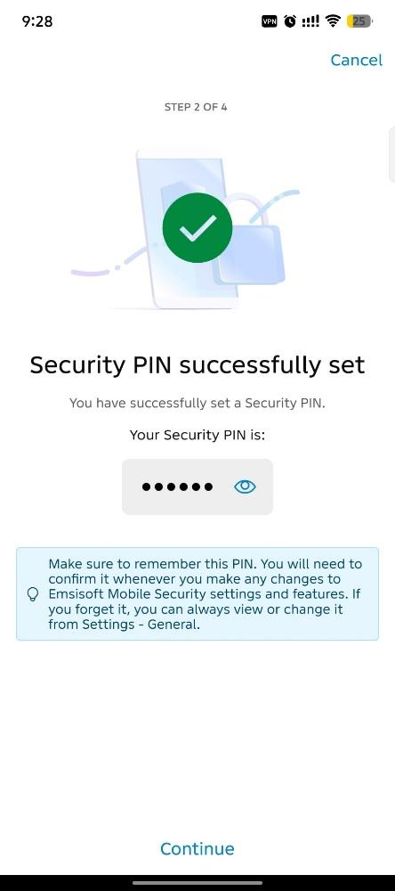</p>

- The confirmation screen shows that the Security PIN was set.
- The PIN must be remembered because it is needed for any change to Emsisoft settings and features.
- It can be viewed or changed later from Settings > General.

### 🔹 24. Location Access (Step 3 of 4)

<p align="center">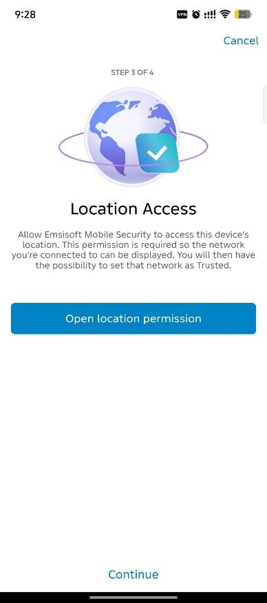</p>

- Emsisoft asks for the device location so the connected network can be displayed.
- The network can then be marked as Trusted for Smart Unlock.
- Tap Open location permission.

### 🔹 25. Location Permission Prompt

<p align="center">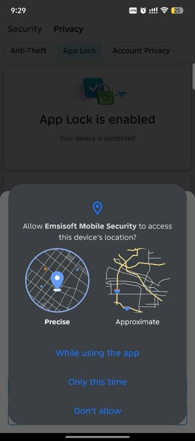</p>

- Android asks whether Emsisoft may access the device location, with Precise and Approximate options.
- The choices are While using the app, Only this time and Don't allow.
- Granting access allows Smart Unlock to recognize a trusted network later.

### 🔹 26. Pictures & Videos Access (Step 4 of 4)

<p align="center">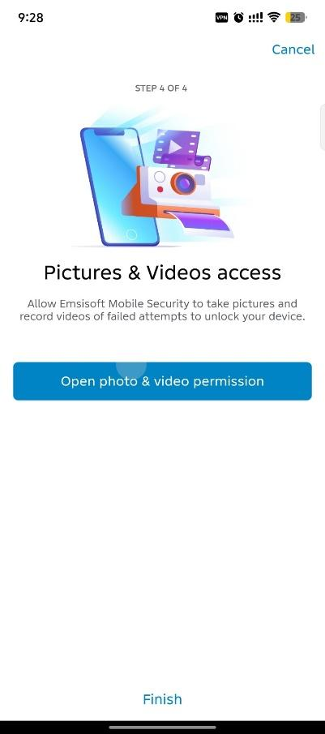</p>

- Emsisoft requests permission to take pictures and record videos of failed attempts to unlock the device.
- Tap Open photo & video permission and then Finish.
- This is a deterrent against someone trying to open locked apps.

### 🔹 27. App Lock Ready

<p align="center">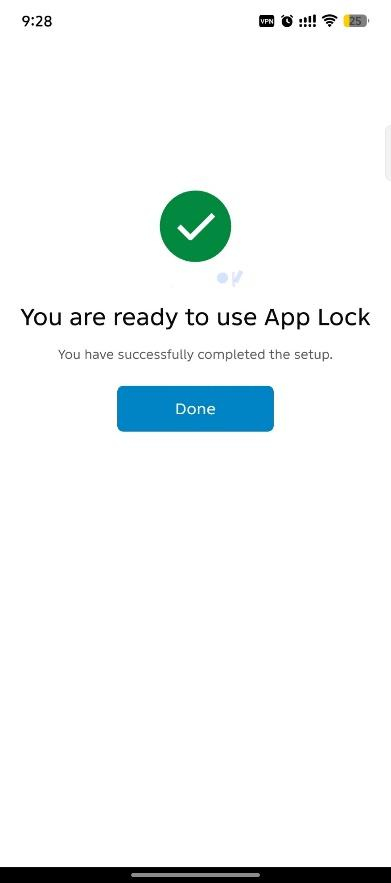</p>

- The screen shows **You are ready to use App Lock**.
- The setup wizard is completed successfully.
- Tap Done.

### 🔹 28. App Lock Enabled

<p align="center">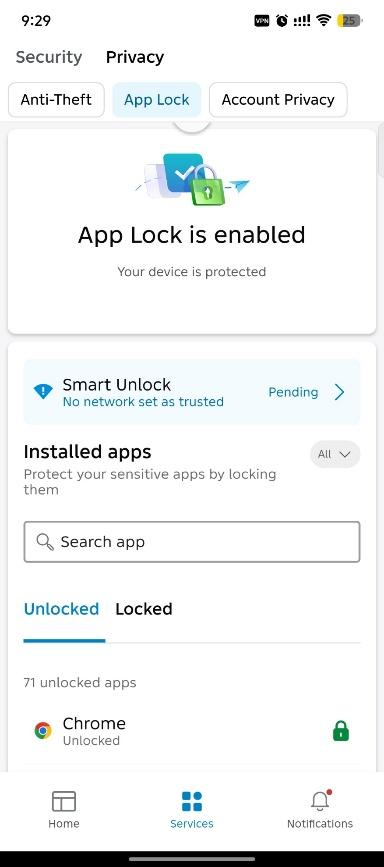</p>

- The status reads **App Lock is enabled — Your device is protected**.
- Smart Unlock is Pending because no network has been set as trusted yet.
- The list of installed apps (71 unlocked apps) lets the user choose which apps to lock.

### 🔹 29. Smart Unlock Needs Location

<p align="center">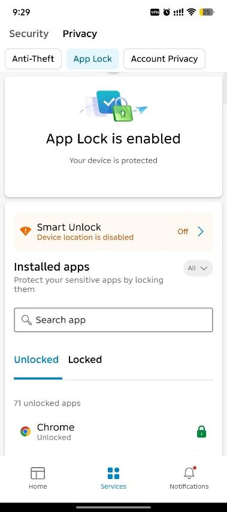</p>

- Smart Unlock shows as Off with the message that device location is disabled.
- Turning on the device location allows Emsisoft to detect the network.
- Tap the Smart Unlock card to continue.

### 🔹 30. Smart Unlock Enabled

<p align="center">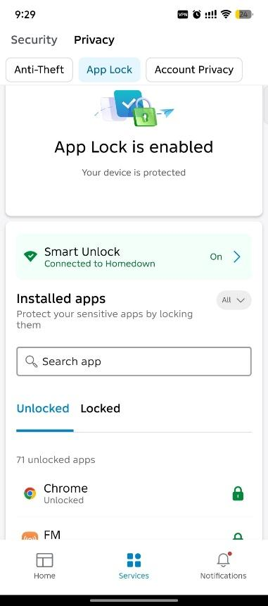</p>

- Smart Unlock is now **On** and reports that the phone is connected to a trusted network.
- On a trusted network the locked apps can be opened without repeated prompts.
- Away from it, the PIN or biometrics are required again.

### 🔹 31. Emsisoft Ready for Testing

<p align="center">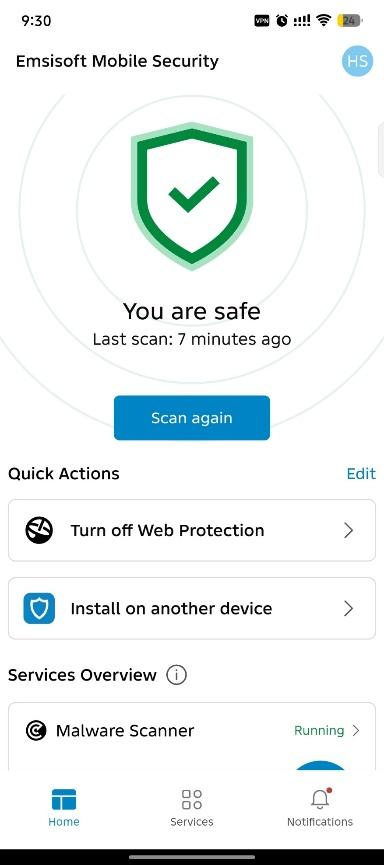</p>

- The dashboard shows **You are safe** with the latest scan time.
- Malware Scanner, Web Protection, App Anomaly, Scam Alert, Chat Protection and App Lock are all configured.
- Emsisoft is 100% ready for the malware detection test.
