

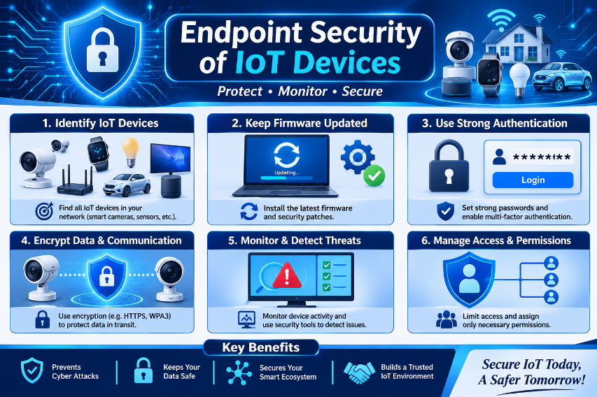

# 🛡️ Endpoint Security of IoT Devices

### Complete Study Notes · A–Z Guide · Introduction to Advanced Security Concepts

---

## 📑 Table of Contents

| # | Section | # | Section |
|---|---------|---|---------|
| 1 | [Introduction](#1--introduction) | 14 | [EDR for IoT](#14--endpoint-detection-and-response-edr-for-iot) |
| 2 | [What Is an IoT Endpoint?](#2--what-is-an-iot-endpoint) | 15 | [Standards & Frameworks](#15--iot-security-standards-and-frameworks) |
| 3 | [Why It Matters](#3--why-iot-endpoint-security-is-important) | 16 | [Challenges](#16--common-challenges) |
| 4 | [Major Threats](#4--major-security-threats) | 17 | [Real-World Attacks](#17--real-world-attack-examples) |
| 5 | [Security Components](#5--main-components-of-iot-endpoint-security) | 18 | [Incident Response](#18--incident-response) |
| 6 | [Architecture](#6--security-architecture) | 19 | [Practical: Secure a Camera](#19--practical-securing-an-iot-device) |
| 7 | [Security Technologies](#7--important-security-technologies) | 20 | [Future of IoT Security](#20--future-of-iot-endpoint-security) |
| 8 | [Secure Protocols](#8--secure-communication-protocols) | 21 | [Traditional vs IoT](#21--traditional-vs-iot-endpoint-security) |
| 9 | [Device Hardening](#9--device-hardening) | 22 | [Security Checklist](#22--complete-security-checklist) |
| 10 | [Lifecycle](#10--iot-endpoint-security-lifecycle) | 23 | [Terminology](#23--important-terminologies) |
| 11 | [Best Practices](#11--best-practices) | 24 | [Conclusion](#24--conclusion) |
| 12 | [Network Segmentation](#12--network-segmentation) | 25 | [Revision Questions](#25--revision-questions) |
| 13 | [Vulnerability Management](#13--vulnerability-management) | 👤 | [Author](#-author) |

---

## 1. 📘 Introduction

The **Internet of Things (IoT)** refers to physical devices connected to the internet that **collect, exchange, and process data**. They communicate with each other and with cloud platforms through networks.

> **Examples:** smart cameras, smart TVs, smart watches, smart locks, home appliances, industrial sensors, medical devices, connected vehicles.

**Endpoint Security of IoT Devices** is the practice of protecting individual IoT devices from **cyberattacks, unauthorized access, malware, data theft, and other threats**.

> ⚠️ Every connected IoT device is an **endpoint**. If one device is compromised, an attacker can use it to reach other devices, steal data, or attack the whole network.

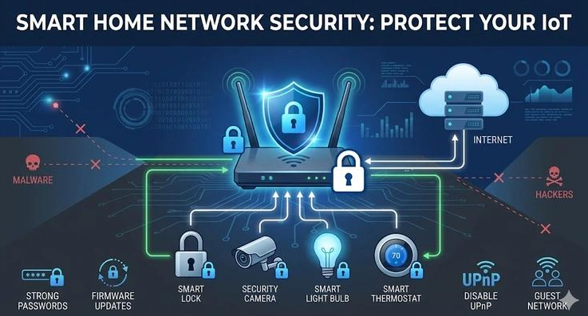
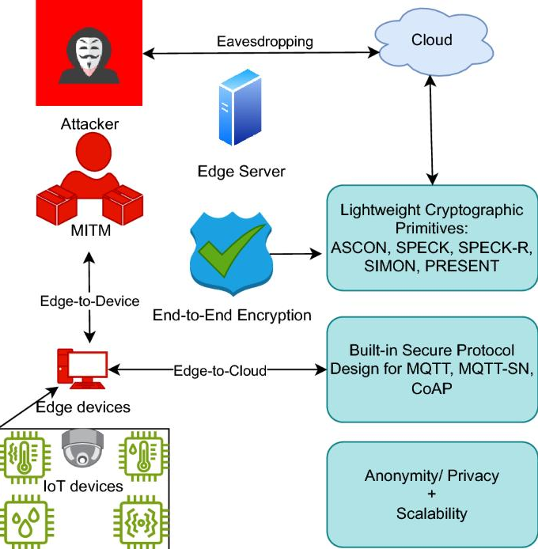

---

## 2. 📡 What Is an IoT Endpoint?

An **IoT endpoint** is any physical device connected to a network that can **send, receive, or process information**. Each endpoint may have its own OS, firmware, processor, memory, communication interface, and security configuration.

| 🔹 Endpoint | 📝 Description | 🎯 Risk |
|---|---|---|
| **Smart Security Cameras** | Capture and transmit video over a network | Unauthorized viewing & remote control |
| **Smart Thermostats** | Monitor/control temperature remotely | Settings manipulation, network access |
| **Smart Watches** | Collect health, personal & location data | Privacy and data leakage |
| **Industrial Sensors** | Monitor machines & production environments | Operational disruption |
| **Smart Door Locks** | Provide remote access control | Weak authentication → unauthorized unlock |

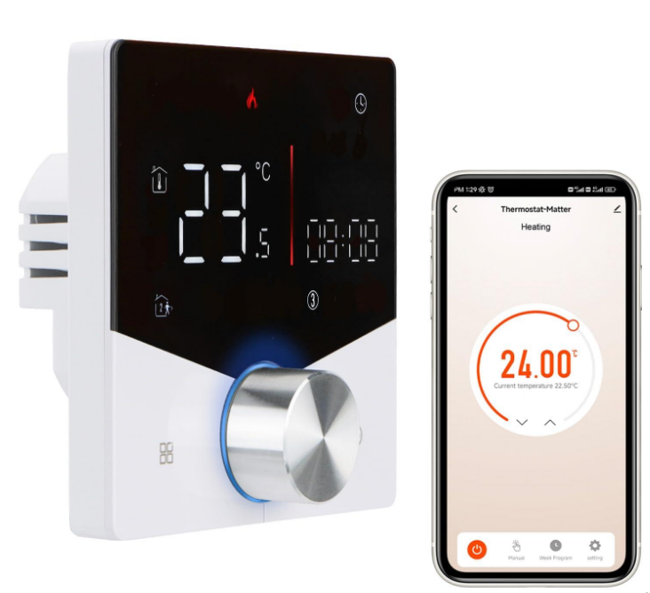
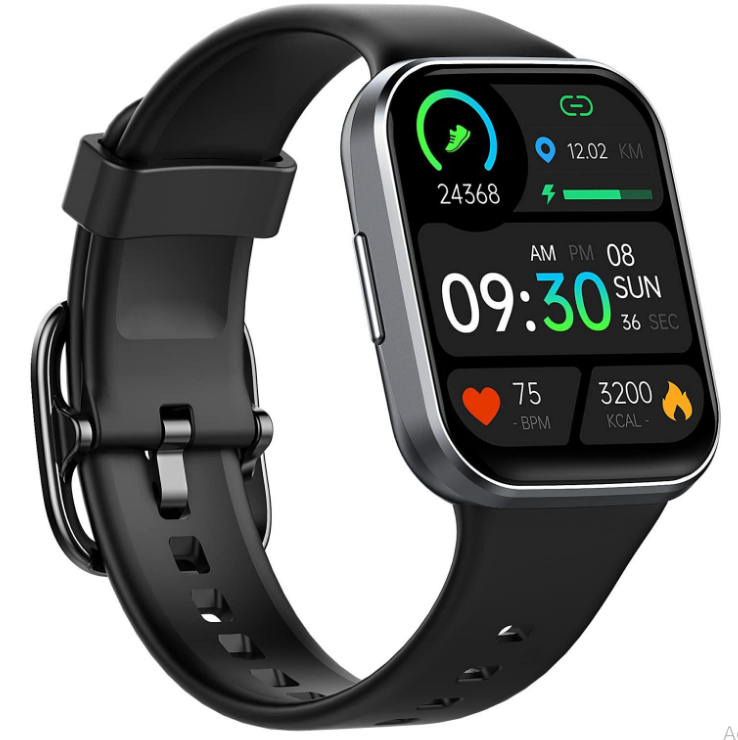

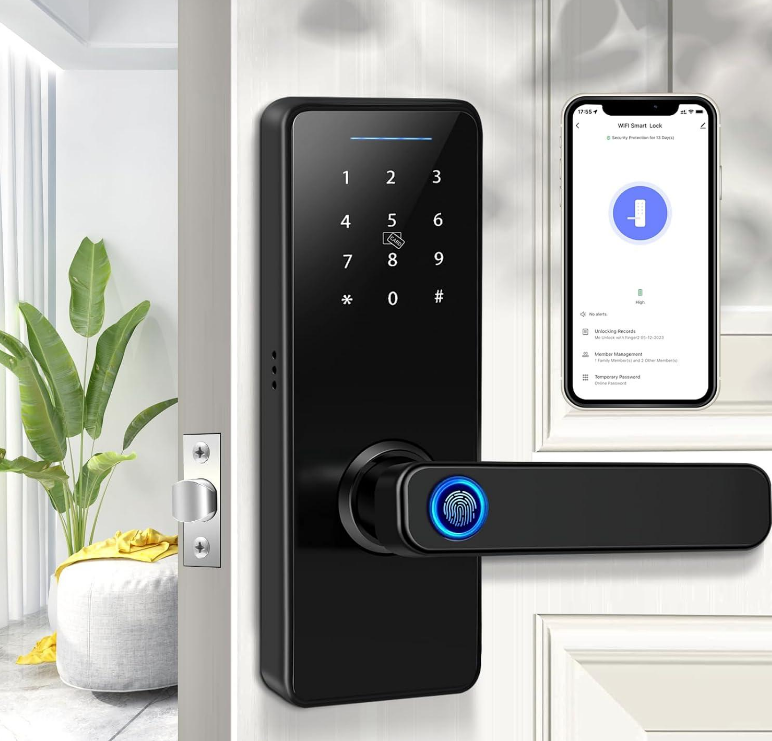

---

## 3. 🎯 Why IoT Endpoint Security Is Important

| # | Purpose | Meaning |
|---|---------|---------|
| 1 | 🔐 **Prevent Unauthorized Access** | Stop attackers from accessing devices without permission |
| 2 | 🗂️ **Protect Sensitive Data** | Secure personal, financial, medical & business information |
| 3 | 🦠 **Prevent Malware** | Defend against viruses, worms, ransomware, botnets |
| 4 | ⚙️ **Maintain Availability** | Keep devices operational and accessible |
| 5 | 🕵️ **Protect Privacy** | Prevent unauthorized monitoring/collection |
| 6 | ✅ **Ensure Integrity** | Prevent changes to configuration, firmware, stored data |
| 7 | 🌐 **Prevent Network Attacks** | Stop compromised devices becoming entry points |

---

## 4. 🚨 Major Security Threats

IoT devices face threats because of **limited resources, weak configurations, outdated firmware, and poor security practices**.

### 4.1 🔑 Weak or Default Passwords
Many devices ship with default credentials. If unchanged, attackers gain access easily.
> **Example:** An attacker finds a smart camera using the default password and watches its live feed.

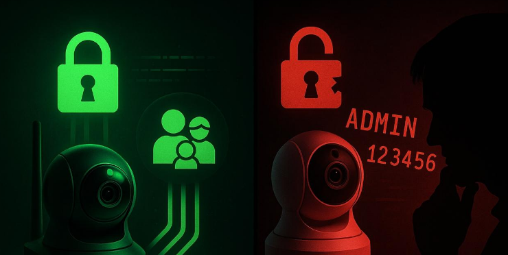

### 4.2 🦠 Malware Attacks
Malicious software designed to damage systems, steal information, or gain access. Infection paths: vulnerable firmware, compromised apps, malicious network activity.

### 4.3 🤖 Botnet Attacks
A **botnet** is a group of compromised devices controlled by an attacker.
> **Example:** **Mirai** infected IoT devices using default credentials and launched massive **DDoS** attacks.

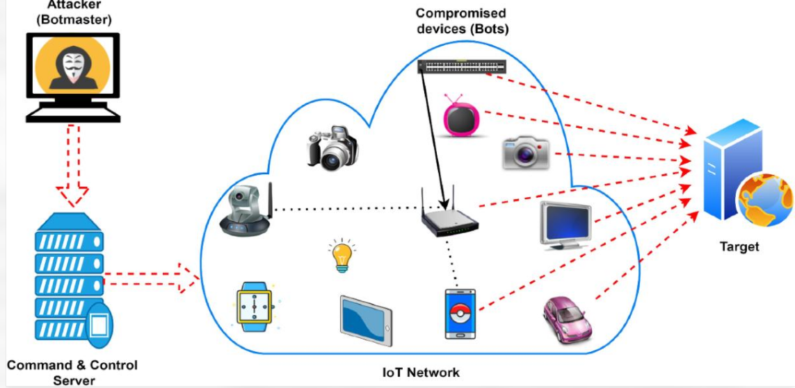

### 4.4 💾 Firmware Vulnerabilities
Outdated firmware contains weaknesses. *Example:* exploiting an unpatched smart router for admin access.

### 4.5 🕳️ Man-in-the-Middle (MITM)
An attacker secretly intercepts communication between two parties to read, modify, or steal data.
> **Example:** Intercepting unencrypted traffic between a smart sensor and its cloud server.

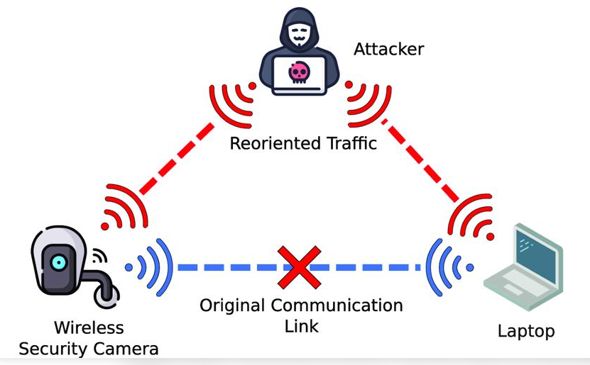

### 4.6 – 4.12 Quick Reference

| Threat | Description | Example |
|---|---|---|
| **DoS** | Overwhelm a device/service with requests | Thousands of requests to a smart home gateway |
| **DDoS** | Many compromised devices attack one target | Infected cameras flood a company website |
| **Physical Access** | Extract data, modify hardware, install bad firmware | Altering an industrial sensor's configuration |
| **Data Privacy Attacks** | Steal location, video, behavior data | Misuse of stolen personal activity |
| **Remote Code Execution (RCE)** | Run unauthorized code remotely | Taking control of a vulnerable camera |
| **Replay Attack** | Capture and retransmit valid communication | Replaying a smart lock's unlock command |
| **Firmware Tampering** | Modify firmware to add malicious functions | Router firmware secretly leaking data |

---

## 5. 🧩 Main Components of IoT Endpoint Security

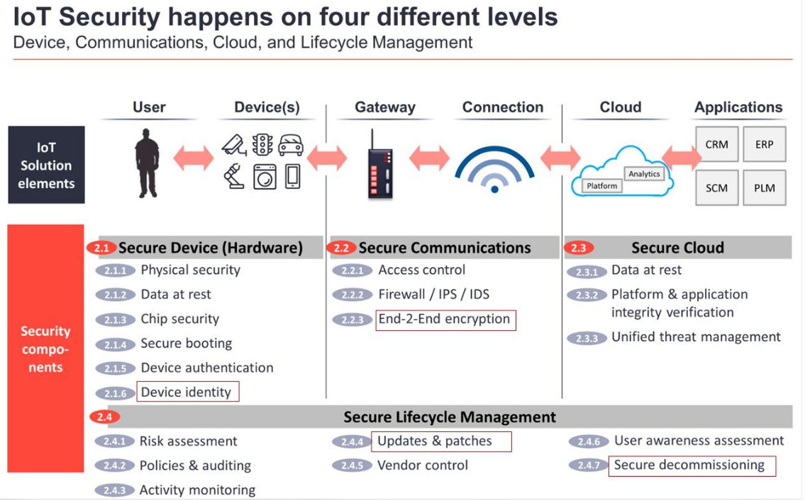

| # | Component | Purpose | Key Methods |
|---|-----------|---------|-------------|
| 5.1 | **Device Authentication** | Verify device identity | Passwords, digital certificates, PKI, MFA, cryptographic keys |
| 5.2 | **Access Control** | Define what a device/user can access | RBAC, ABAC, Least Privilege |
| 5.3 | **Data Encryption** | Make data unreadable to outsiders | AES, TLS · *At rest* + *In transit* |
| 5.4 | **Secure Boot** | Start only trusted software | Verify integrity of boot components |
| 5.5 | **Firmware Security** | Protect device software | Updates, signed firmware, integrity checks |
| 5.6 | **Network Security** | Protect communications | Firewalls, segmentation, IDS/IPS, VPN, secure Wi-Fi |
| 5.7 | **Endpoint Monitoring** | Detect unusual behavior | Traffic, logins, CPU, processes, config changes |
| 5.8 | **Physical Security** | Stop physical tampering | Locked cabinets, tamper-resistant cases, protected debug ports |

---

## 6. 🏗️ Security Architecture

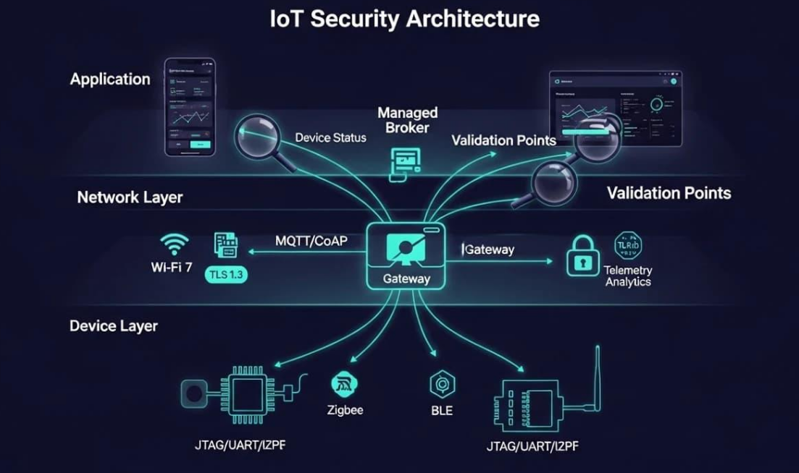

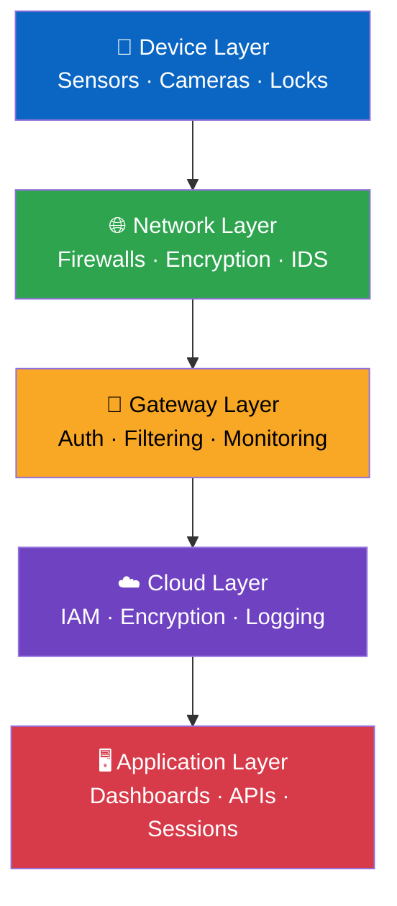

| Layer | Role | Security Controls |
|---|---|---|
| **1. Device** | Physical sensors, cameras, locks, controllers | Secure boot, device authentication, firmware protection, strong passwords, physical security |
| **2. Network** | Communication between devices & systems | Firewalls, encryption, secure protocols, segmentation, intrusion detection |
| **3. Gateway** | Connects devices to external networks/cloud | Authentication, traffic filtering, access control, protocol translation, monitoring |
| **4. Cloud** | Stores & processes device data | IAM, data encryption, secure APIs, logging, backup & recovery |
| **5. Application** | Dashboards & user interaction | Secure authentication, session management, API security, input validation, privacy |

---

## 7. 🛠️ Important Security Technologies

| Technology | Main Purpose |
|---|---|
| 🧱 **Firewall** | Filters network traffic |
| 👁️ **IDS** | Detects suspicious activities |
| 🚫 **IPS** | Detects *and blocks* malicious traffic |
| 🔒 **Encryption** | Protects sensitive information |
| 🥾 **Secure Boot** | Verifies trusted startup software |
| 📜 **PKI** | Manages digital certificates and identities |
| 🔢 **MFA** | Adds another authentication factor |
| 🌉 **VPN** | Creates protected network communication |
| 📊 **SIEM** | Collects and analyzes security logs |
| 🖥️ **EDR** | Detects/responds to endpoint threats where supported |
| 📲 **MDM** | Manages supported devices and configurations |

> 💡 **Important:** Traditional endpoint protection can't run on every IoT device (limited CPU, memory, OS support). **Lightweight controls and gateway-based monitoring** may be required.

---

## 8. 📶 Secure Communication Protocols

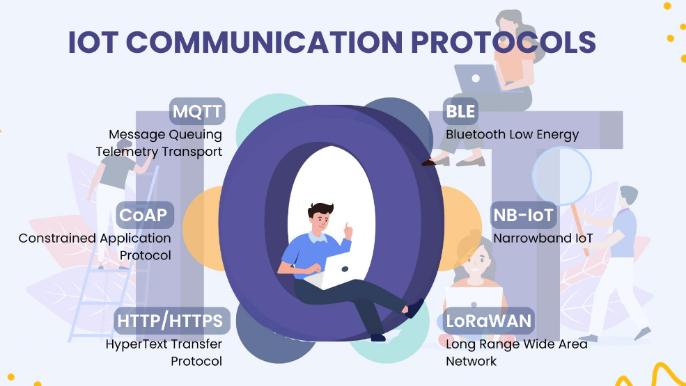

| Protocol | Description | Security |
|---|---|---|
| **MQTT** | Lightweight publish/subscribe messaging | TLS + username/password or certificates |
| **HTTPS** | Secure web communication | TLS encryption |
| **CoAP** | Designed for resource-limited devices | DTLS or OSCORE |
| **BLE** | Short-range, low-power communication | Secure pairing, authentication, encryption |
| **Zigbee** | Smart home & automation wireless protocol | Cryptographic protection, network security |
| **Wi-Fi** | Wireless network connectivity | WPA2/WPA3, strong credentials, network isolation |

---

## 9. 🔧 Device Hardening

**Hardening** = reducing the attack surface by removing unnecessary features, services, and weaknesses.

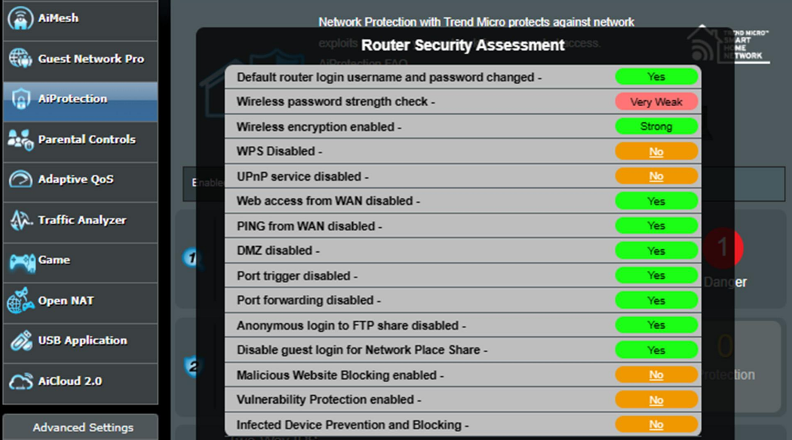

- [x] Change default usernames and passwords
- [x] Disable unnecessary ports and services
- [x] Disable unused remote administration
- [x] Install the latest security firmware
- [x] Use secure communication protocols
- [x] Enable encryption
- [x] Disable unnecessary USB and debugging interfaces
- [x] Restrict administrative privileges
- [x] Configure secure network settings
- [x] Disable unused wireless interfaces
- [x] Use unique credentials for every device
- [x] Regularly review device configurations

---

## 10. ♻️ IoT Endpoint Security Lifecycle

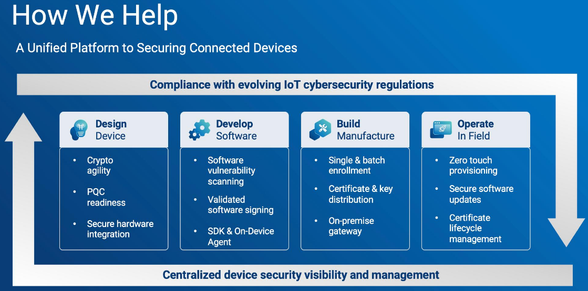

| Stage | Key Actions |
|---|---|
| **1. Manufacturing** | Unique device identities · no hardcoded default credentials · secure boot · protect cryptographic keys |
| **2. Provisioning** | Configure authentication · install trusted firmware · register device · secure communication · assign permissions |
| **3. Deployment** | Connect to trusted networks · apply security configs · disable unnecessary services · restrict physical access |
| **4. Monitoring** | Detect suspicious activity · monitor traffic · review auth logs · identify unauthorized changes |
| **5. Updates & Maintenance** | Apply patches · verify firmware signatures · remove outdated configs · track known vulnerabilities |
| **6. Decommissioning** | Delete sensitive data · revoke certificates/credentials · remove cloud access · secure reset · safe disposal |

---

## 11. ✅ Best Practices

| No. | Best Practice | Explanation |
|:-:|---|---|
| 1 | Strong passwords | Use unique and complex passwords |
| 2 | Regular updates | Install security patches |
| 3 | Encryption | Protect stored and transmitted data |
| 4 | Network segmentation | Separate IoT from critical systems |
| 5 | Access control | Grant minimum required permissions |
| 6 | Secure boot | Allow only trusted software to execute |
| 7 | Device monitoring | Detect unusual activities |
| 8 | Disable unused services | Reduce the attack surface |
| 9 | Secure APIs | Protect application communication |
| 10 | Backup | Maintain recoverable configurations and data |
| 11 | Physical protection | Prevent unauthorized device access |
| 12 | Vulnerability assessment | Identify and fix weaknesses |

---

## 12. 🧱 Network Segmentation

Network segmentation divides a network into **smaller isolated sections** so attackers cannot move freely between devices.

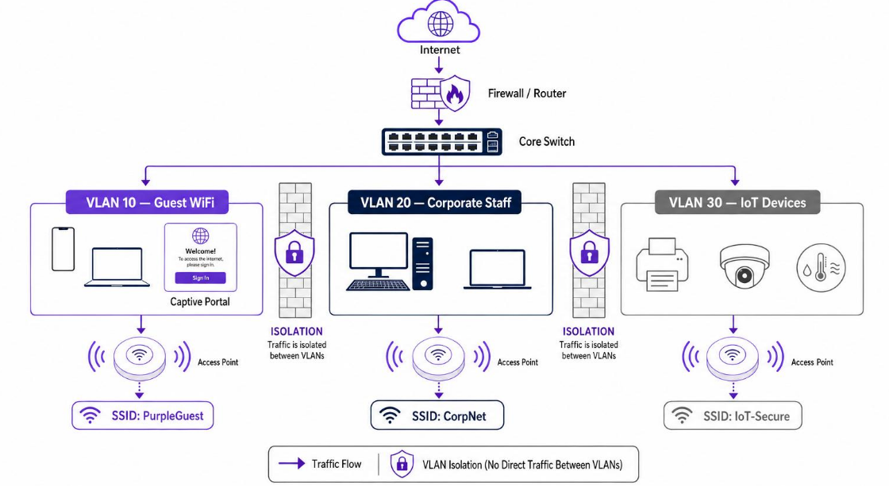

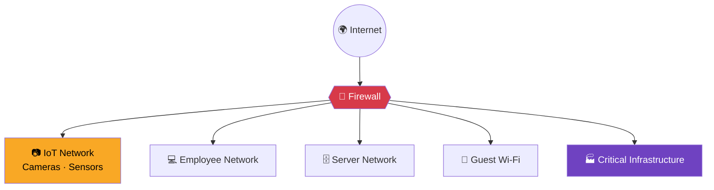

**Example:** A company has 100 smart cameras and one is compromised.

| Scenario | Result |
|---|---|
| ❌ **Without segmentation** | Attacker may try to reach internal company servers |
| ✅ **With segmentation** | Camera stays isolated in the IoT network; firewall rules restrict communication |

**Main benefit:** Limits **lateral movement** and reduces the impact of a successful attack.

---

## 13. 🔍 Vulnerability Management

A continuous process of **identifying, evaluating, prioritizing, and fixing** weaknesses.

| Step | Action |
|:-:|---|
| 1 | **Asset Identification** – identify all connected IoT devices |
| 2 | **Vulnerability Scanning** – scan for known vulnerabilities |
| 3 | **Risk Assessment** – evaluate severity & impact |
| 4 | **Prioritization** – fix critical issues first |
| 5 | **Remediation** – apply patches or secure configurations |
| 6 | **Verification** – confirm fixes worked |
| 7 | **Continuous Monitoring** – watch for new vulnerabilities |

**Key resources:** `CVE` (known vulnerabilities) · `NVD` (severity data) · `CVSS` (scoring method) · `OWASP IoT Top 10` (common IoT risks)

---

## 14. 🖥️ Endpoint Detection and Response (EDR) for IoT

EDR monitors endpoint activity to **identify, investigate, and respond** to threats. In IoT, EDR-like capabilities come from **lightweight agents, device telemetry, or network-based monitoring**.

**Functions:** continuous monitoring · threat detection · investigation · incident alerts · containment · security event analysis

> **Example:** An IoT camera suddenly talks to an unknown external server → the monitoring system raises an alert and triggers investigation or network isolation.

---

## 15. 📚 IoT Security Standards and Frameworks

| Standard / Framework | Purpose |
|---|---|
| **NISTIR 8259** | Foundational cybersecurity activities for IoT manufacturers |
| **NISTIR 8259A** | IoT device cybersecurity capability core baseline |
| **ETSI EN 303 645** | Consumer IoT cybersecurity requirements |
| **ISO/IEC 27001** | Information security management system |
| **ISO/IEC 27400** | IoT security and privacy guidelines |
| **IEC 62443** | Industrial automation & control system security |
| **OWASP IoT Top 10** | Awareness of common IoT security risks |

---

## 16. ⚡ Common Challenges

| # | Challenge | Description |
|:-:|---|---|
| 16.1 | **Limited Hardware Resources** | Low CPU/RAM/storage → no traditional antivirus |
| 16.2 | **Lack of Security Updates** | Manufacturers stop issuing firmware updates |
| 16.3 | **Device Diversity** | Different vendors, OSes, architectures, protocols |
| 16.4 | **Weak Authentication** | Weak passwords or insecure mechanisms |
| 16.5 | **Privacy Concerns** | Sensitive data collected without enough protection |
| 16.6 | **Physical Accessibility** | Devices in public/remote locations |
| 16.7 | **Large Attack Surface** | Thousands of devices = thousands of entry points |
| 16.8 | **Legacy Devices** | Outdated OS, insecure protocols, unpatchable firmware |

---

## 17. 💥 Real-World Attack Examples

### 🤖 Example 1: Mirai Botnet

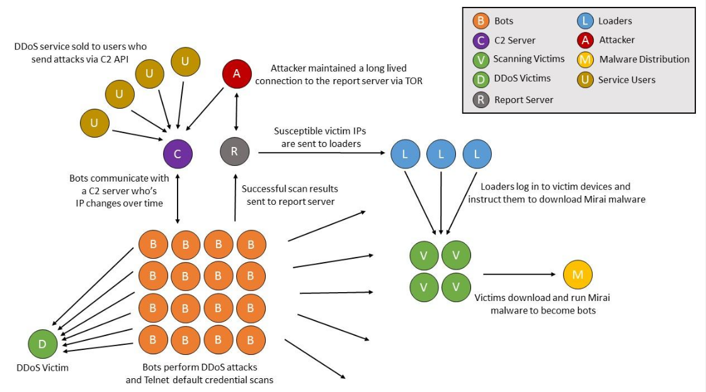

- Infected vulnerable IoT devices (default/weak credentials)
- Converted them into bots and controlled them remotely
- Used them to launch massive **DDoS** attacks

**🎓 Lesson:** Change default credentials, disable unnecessary remote access, update firmware.

### 📷 Example 2: Smart Camera Compromise
A company installs 50 cameras, keeps default passwords, skips firmware updates. Attacker may **watch live video, access recordings, change settings, or pivot into the network**.
**🎓 Lesson:** Strong authentication, secure configuration, firmware updates, segmentation.

### 🏠 Example 3: Smart Home Attack
Lights, cameras, locks, and thermostats share one network. One device with outdated firmware is compromised and used to reach the others.
**🎓 Lesson:** Isolate IoT devices, use strong Wi-Fi security, monitor connected devices.

### 🏭 Example 4: Industrial IoT Attack
An insecure sensor is compromised and sends **falsified data**; the monitoring system may make unsafe decisions.
**🎓 Lesson:** Protect sensor integrity, authenticate devices, monitor abnormal readings, isolate critical networks.

---

## 18. 🚒 Incident Response

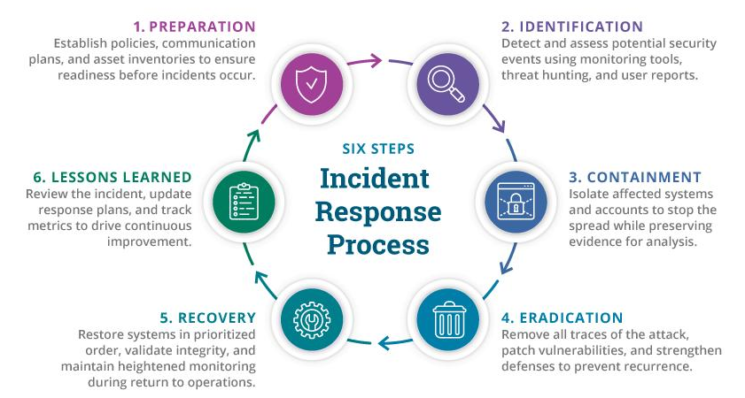

| Phase | Actions |
|---|---|
| **1. Preparation** | Security policies · IoT device inventory · response procedures · monitoring & logging |
| **2. Detection & Identification** | Spot suspicious behavior · review logs · investigate traffic · confirm compromise |
| **3. Containment** | Isolate the device · block malicious communication · disable unauthorized accounts · stop spread |
| **4. Eradication** | Remove malware · fix exploited vulnerabilities · reset credentials · install trusted firmware |
| **5. Recovery** | Restore configurations · reconnect securely · verify normal operation · watch for repeat attacks |
| **6. Lessons Learned** | Root-cause analysis · document incident · improve policies · add controls |

---

## 19. 🎥 Practical: Securing an IoT Device

Scenario: a **smart IP camera** on a home or organizational network.

| Step | Security Action | Expected Result |
|:-:|---|---|
| 1 | Change default password | Prevents easy unauthorized access |
| 2 | Enable MFA if supported | Adds authentication protection |
| 3 | Update firmware | Fixes known vulnerabilities |
| 4 | Enable HTTPS/TLS | Protects communication |
| 5 | Disable unused services | Reduces attack surface |
| 6 | Use secure Wi-Fi | Protects wireless communication |
| 7 | Isolate camera network | Limits lateral movement |
| 8 | Review device logs | Helps detect suspicious activity |
| 9 | Disable unnecessary remote access | Reduces external exposure |
| 10 | Monitor network traffic | Identifies unusual communication |

**✅ Outcome:** More resistant to unauthorized access, malware, data theft, and network-based attacks.

---

## 20. 🔮 Future of IoT Endpoint Security

| # | Approach | Description |
|:-:|---|---|
| 1 | 🤖 **AI-Based Threat Detection** | AI analyzes device behavior to spot suspicious activity |
| 2 | 🔐 **Zero Trust** | Every device/user must be authenticated & authorized; no automatic trust inside the network |
| 3 | 🧬 **Hardware-Based Security** | TPM, secure elements, HSMs protect keys and sensitive operations |
| 4 | 🔄 **Automated Firmware Updates** | Secure systems deliver and verify patches automatically |
| 5 | ⛓️ **Blockchain Device Identity** | Decentralized identity/integrity verification in certain environments |
| 6 | 🧮 **Post-Quantum Cryptography** | Quantum-resistant algorithms for long-term sensitive data |
| 7 | 🏗️ **Security by Design** | Security built in from the design stage, not added later |

---

## 21. ⚖️ Traditional vs IoT Endpoint Security

| Traditional Endpoint Security | IoT Endpoint Security |
|---|---|
| Protects computers, laptops, servers | Protects sensors, cameras, smart devices |
| Antivirus and EDR | Lightweight security & gateway monitoring |
| More processing resources | Limited CPU and memory |
| Regular software installation | Limited software installation options |
| Conventional operating systems | Embedded/specialized operating systems |
| Updates via OS mechanisms | Manufacturer-specific firmware updates |
| Users manage security directly | Centralized or manufacturer-managed security |

---

## 22. 📋 Complete Security Checklist

- [ ] Identify and register all IoT devices
- [ ] Change all default credentials
- [ ] Use strong and unique passwords
- [ ] Enable MFA where supported
- [ ] Install the latest firmware updates
- [ ] Enable secure boot
- [ ] Use encryption for data at rest and in transit
- [ ] Disable unnecessary ports and services
- [ ] Use secure communication protocols
- [ ] Implement network segmentation
- [ ] Configure firewall rules
- [ ] Restrict administrative privileges
- [ ] Protect physical device access
- [ ] Monitor device activities and network traffic
- [ ] Perform regular vulnerability assessments
- [ ] Maintain secure backups
- [ ] Prepare an incident response plan
- [ ] Revoke credentials when devices are retired

---

## 23. 📖 Important Terminologies

| Term | Simple Meaning |
|---|---|
| **IoT** | Physical devices connected to the internet |
| **Endpoint** | A device connected to a network |
| **Firmware** | Software that controls device hardware |
| **Authentication** | Verifying identity |
| **Authorization** | Defining permitted access |
| **Encryption** | Converting readable data into protected data |
| **Vulnerability** | A weakness that can be exploited |
| **Exploit** | A method of taking advantage of a vulnerability |
| **Malware** | Malicious software |
| **Botnet** | A network of compromised devices |
| **DDoS** | Attack that overwhelms a service with traffic |
| **MITM** | Intercepting communication between two parties |
| **Secure Boot** | Verifying trusted software during startup |
| **Network Segmentation** | Dividing a network into isolated sections |
| **Zero Trust** | Never automatically trust a device or user |
| **Patch Management** | Applying updates to fix vulnerabilities |
| **Attack Surface** | All possible points an attacker could target |

---

## 24. 🏁 Conclusion

Endpoint Security of IoT Devices is essential to modern cybersecurity because IoT is used in **homes, hospitals, industries, businesses, and smart cities**.

Every connected device can become an entry point if not properly secured. Weak passwords, outdated firmware, insecure communication, malware, and unauthorized access can compromise the **confidentiality, integrity, and availability** of IoT systems.

Organizations must implement **strong authentication, encryption, secure boot, firmware updates, network segmentation, vulnerability management, continuous monitoring, and incident response**.

> 🎯 **Main objective:** every connected device remains **trusted, protected, and available** throughout its entire lifecycle.

---

## 25. ❓ Revision Questions

<b>Click to expand all 15 questions</b>

1. What is IoT endpoint security, and why is it important?
2. What is an IoT endpoint? Give five examples.
3. Explain the major security threats affecting IoT devices.
4. How does the Mirai botnet compromise IoT devices?
5. What is secure boot, and how does it protect IoT devices?
6. Explain the importance of firmware updates in IoT security.
7. Differentiate between encryption at rest and encryption in transit.
8. How does network segmentation reduce IoT security risks?
9. What is the role of authentication and access control in IoT security?
10. Explain the importance of MQTT, HTTPS, CoAP, and Zigbee.
11. What is IoT device hardening?
12. Explain the IoT endpoint security lifecycle.
13. How can organizations detect and respond to compromised IoT devices?
14. What challenges make IoT endpoint security difficult?
15. Explain Zero Trust security in an IoT environment.

> 💡 **Final concept:** IoT endpoint security is not just about protecting one smart device. It is about protecting the **complete environment** in which devices communicate, exchange data, and perform operations.

---

## 👤 Author

**Sanawar Imran**
BS Cybersecurity · Air University, Multan Campus

⭐ **If these notes helped you, give the repo a star!** ⭐

