<div align="center">

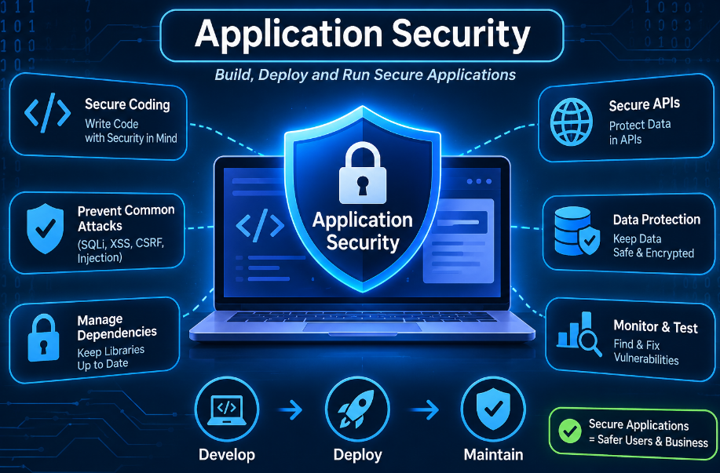

# 🛡️ Application Security (AppSec)

### Complete Study Notes | A–Z Guide | Cybersecurity


-red?style=for-the-badge&logo=owasp&logoColor=white)


*Protect the software itself: source code, databases, APIs, authentication and user data.*

</div>

---

## 📑 Table of Contents

| # | Section | # | Section |
|---|---------|---|---------|
| 1 | [Introduction](#1--introduction-to-application-security) | 13 | [Database Security](#13--database-security-in-applications) |
| 2 | [What Is AppSec?](#2--what-is-application-security) | 14 | [AppSec Tools](#14--application-security-tools) |
| 3 | [Why It Matters](#3--why-is-application-security-important) | 15 | [Standards & Frameworks](#15--standards-and-frameworks) |
| 4 | [Types of AppSec](#4--types-of-application-security) | 16 | [Challenges](#16--application-security-challenges) |
| 5 | [Common Vulnerabilities](#5--common-application-security-vulnerabilities) | 17 | [Real-World Scenarios](#17--real-world-scenarios) |
| 6 | [OWASP Top 10](#6--owasp-top-10-2025) | 18 | [AppSec vs Network Security](#18--appsec-vs-network-security) |
| 7 | [Security Testing](#7--application-security-testing-techniques) | 19 | [AppSec vs Endpoint Security](#19--appsec-vs-endpoint-security) |
| 8 | [SSDLC](#8--secure-software-development-life-cycle-ssdlc) | 20 | [Future of AppSec](#20--future-of-application-security) |
| 9 | [Secure Coding](#9--secure-coding-practices) | 21 | [Checklist](#21--complete-application-security-checklist) |
| 10 | [AuthN & AuthZ](#10--authentication-and-authorization) | 22 | [Terminologies](#22--important-terminologies) |
| 11 | [Session Management](#11--session-management-security) | 23 | [Conclusion](#23--conclusion) |
| 12 | [API Security](#12--api-security) | 24 | [Exam Questions](#24--important-questions-for-exam-preparation) |

---

## 1. 🔰 Introduction to Application Security

**Application Security (AppSec)** is the process of protecting software applications against cyberattacks, vulnerabilities, unauthorized access, data theft and malicious activity.

It applies security measures across the **entire application development lifecycle**: design, coding, testing, deployment and maintenance.

**Applications include:**

| 🌐 Web | 📱 Mobile | 🖥️ Desktop | 🏦 Banking |
|:---:|:---:|:---:|:---:|
| 🛒 E-commerce | 🏢 Enterprise | ☁️ Cloud-based | 🔌 APIs |

> 💡 **Example:** An online banking app stores usernames, passwords, account details and transaction records. AppSec protects this data from hackers and unauthorized users.

<div align="center">
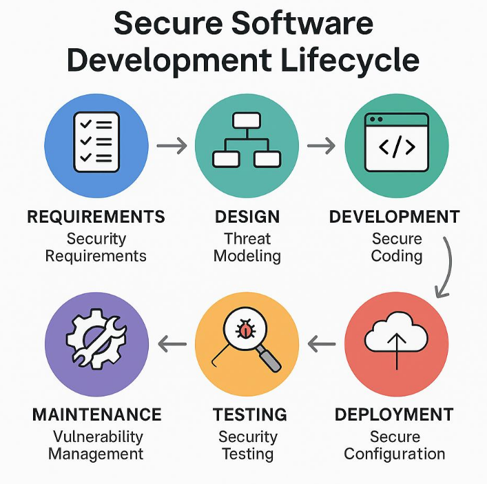
</div>

---

## 2. 🎯 What Is Application Security?

Application security is the combination of **practices, tools, technologies and processes** used to identify, prevent and fix security vulnerabilities in software.

Its main goal is to protect the **CIA Triad**:

| Principle | Meaning |
|-----------|---------|
| 🔒 **Confidentiality** | Sensitive information is accessible only to authorized users |
| ✅ **Integrity** | Data cannot be modified without authorization |
| ⚡ **Availability** | Applications stay accessible and operational when needed |

<div align="center">
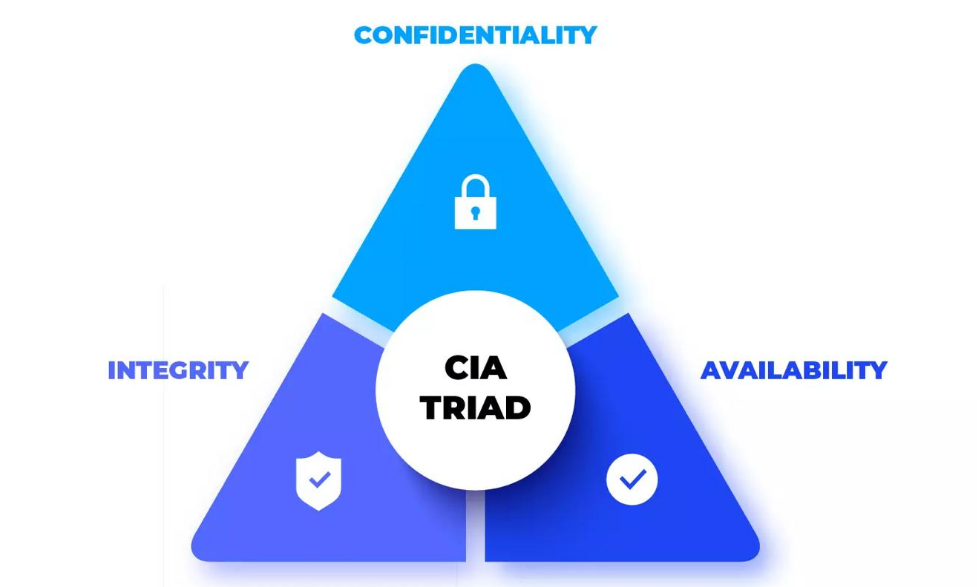
</div>

---

## 3. 💎 Why Is Application Security Important?

1. 🔐 **Protect sensitive data**: prevents theft of personal and financial information
2. 🚫 **Prevent unauthorized access**: only authorized users reach resources
3. 🏭 **Protect business operations**: avoids attacks that interrupt business
4. 💰 **Prevent financial loss**: reduces damage from cyberattacks
5. 🤝 **Maintain customer trust**: protects users and reputation
6. ✏️ **Prevent data manipulation**: attackers cannot alter important records
7. 📜 **Meet security requirements**: helps with compliance and privacy regulations
8. 🛠️ **Reduce cybersecurity risk**: finds and fixes vulnerabilities before attackers do

---

## 4. 🧩 Types of Application Security

| Type | Description |
|------|-------------|
| 🌐 **Web Application Security** | Protects websites from SQL injection, XSS and unauthorized access |
| 📱 **Mobile Application Security** | Protects Android/iOS apps from data leakage, insecure storage, reverse engineering and malicious code |
| 🖥️ **Desktop Application Security** | Protects installed applications from malware, unauthorized access and software flaws |
| ☁️ **Cloud Application Security** | Protects cloud-hosted apps via access control, encryption, secure configuration and monitoring |
| 🔌 **API Security** | Protects app-to-app communication via authentication, authorization, input validation and rate limiting |

---

## 5. 🐞 Common Application Security Vulnerabilities

> A **vulnerability** is a weakness in software that attackers can exploit to compromise an application or its data.

### 5.1 💉 SQL Injection (SQLi)

An attacker inserts malicious SQL statements into input fields to manipulate database queries.

> **Example:** A login form combines user input directly with an SQL query. An attacker manipulates the query to bypass authentication or read unauthorized records.

<div align="center">
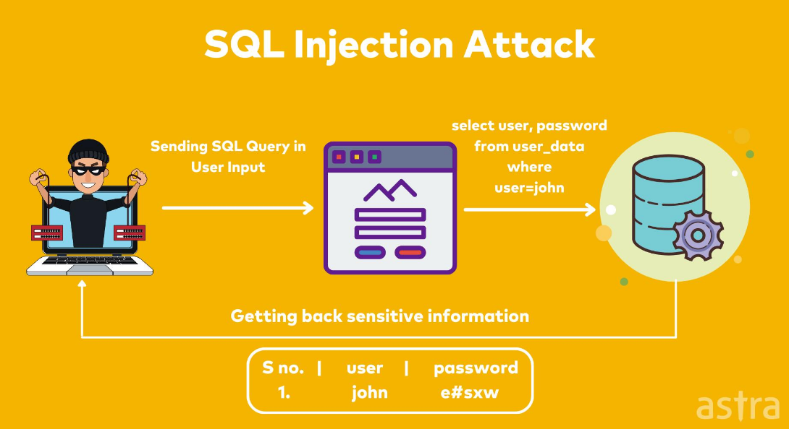
</div>

**🛡️ Prevention**
- ✅ Parameterized queries / prepared statements
- ✅ Validate user input
- ✅ Least privilege for database accounts
- ✅ Never expose database error details

### 5.2 📜 Cross-Site Scripting (XSS)

An attacker injects malicious scripts that execute in **another user's browser**.

> **Example:** JavaScript inserted in a comment section runs when other users open the page.

| Type | Description |
|------|-------------|
| **Stored XSS** | Script is stored on the server and runs when users view the content |
| **Reflected XSS** | Malicious input is reflected in the immediate server response |
| **DOM-Based XSS** | Client-side JavaScript handles unsafe data and executes malicious code |

**🛡️ Prevention:** Output encoding • Input validation • Content Security Policy (CSP) • Safe handling of user-generated content

### 5.3 🎭 Cross-Site Request Forgery (CSRF)

An attacker tricks an **authenticated user** into performing an unwanted action.

> **Example:** A user logged into a bank visits a malicious page that submits a transaction using the user's existing session.

**🛡️ Prevention:** CSRF tokens • SameSite cookies • Origin/Referer validation • Re-authentication for sensitive actions

<div align="center">
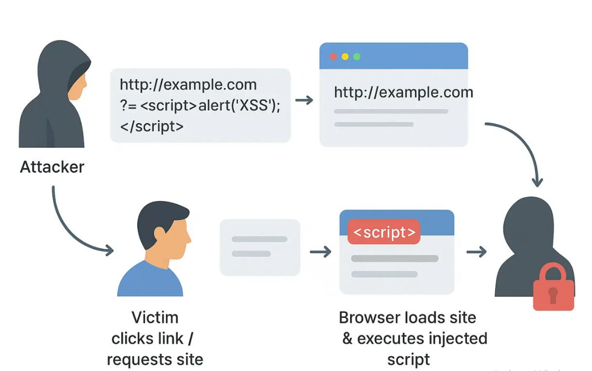
</div>

### 5.4 🔑 Broken Authentication

Occurs when authentication is implemented incorrectly (weak passwords, poor session handling, insecure login).

> **Example:** Unlimited login attempts allow brute-force password guessing.

**🛡️ Prevention:** Strong password policy • MFA • Rate limiting • Secure sessions • Lockout / progressive delays

### 5.5 🚪 Broken Access Control

The app fails to properly restrict what users can access or modify.

```text
example.com/account/101   →   example.com/account/102
```

The user sees another person's account without any permission check. This is **IDOR** (Insecure Direct Object Reference).

**🛡️ Prevention:** Server-side authorization • RBAC • Least privilege • Object-level permission checks

### 5.6 ⚙️ Security Misconfiguration

Insecure configuration of apps, servers, databases or frameworks.

- Default admin credentials
- Unnecessary open ports
- Directory listing enabled
- Debug mode in production
- Detailed error messages exposed
- Wrong cloud storage permissions

**🛡️ Prevention:** Secure configurations • Disable unused services • Regular review

### 5.7 🔓 Sensitive Data Exposure / Cryptographic Failures

> **Example:** A shopping app stores passwords in plain text.

**🛡️ Prevention:** Strong encryption • Hash with **Argon2id** or **bcrypt** • HTTPS/TLS • Protect keys • Store only what is necessary

### 5.8 📦 Insecure Deserialization

The app processes untrusted serialized data without validation. Attackers may escalate privileges or, in some cases, execute code.

> **Example:** The app trusts the administrator role inside a modified serialized user object.

**🛡️ Prevention:** Avoid deserializing untrusted data • Validate • Safe formats • Integrity checks • Restrict object types

### 5.9 🌍 Server-Side Request Forgery (SSRF)

An attacker tricks the **server** into sending requests to unintended internal or external resources.

> **Example:** A URL-fetching feature is abused to reach an internal admin service.

**🛡️ Prevention:** Validate URLs • Allowlists • Block internal networks • Restrict outbound requests • Network segmentation

### 5.10 💥 Remote Code Execution (RCE)

An attacker exploits a flaw to run unauthorized code on a remote system.

> **Example:** An insecure file-processing feature lets an attacker run commands on the server.

**🛡️ Prevention:** Secure coding • Input validation • Patching • Restricted privileges • Sandboxing

<div align="center">
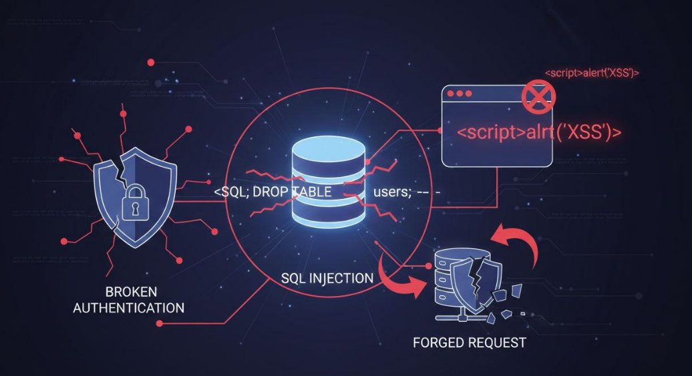
</div>

---

## 6. 🏆 OWASP Top 10 (2025)

**OWASP** is a nonprofit that provides standards, resources and guidelines for improving software security. The **Top 10** is a widely used awareness document of major web application risks.

| No. | Vulnerability | Explanation |
|:---:|---------------|-------------|
| **A01** | 🚪 Broken Access Control | Unauthorized access to resources |
| **A02** | ⚙️ Security Misconfiguration | Insecure application configurations |
| **A03** | 🔗 Software Supply Chain Failures | Risks in dependencies and supply chains |
| **A04** | 🔓 Cryptographic Failures | Weak or incorrect protection of sensitive data |
| **A05** | 💉 Injection | Malicious input changes application behavior |
| **A06** | 📐 Insecure Design | Security weaknesses in design |
| **A07** | 🔑 Authentication Failures | Weak or improper authentication |
| **A08** | 🧬 Software or Data Integrity Failures | Failure to verify software/data integrity |
| **A09** | 📋 Security Logging and Alerting Failures | Insufficient monitoring and alerting |
| **A10** | ⚠️ Mishandling of Exceptional Conditions | Improper handling of errors and unexpected states |

<div align="center">
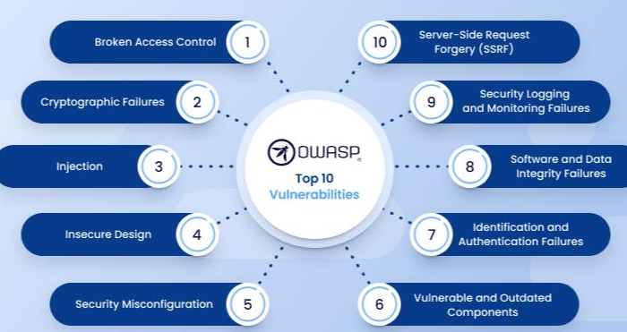
</div>

> ⚠️ **Important:** The OWASP Top 10 is an awareness and risk-ranking resource, **not** a complete security testing methodology.

---

## 7. 🧪 Application Security Testing Techniques

### 7.1 🔍 SAST: Static Application Security Testing
Examines source code, bytecode or binaries **without running** the app.
> **Example:** Detects hardcoded passwords or unsafe SQL construction in code.

✅ Finds issues early • ✅ Helps developers fix insecure code • ✅ Fits into dev workflows

<div align="center">
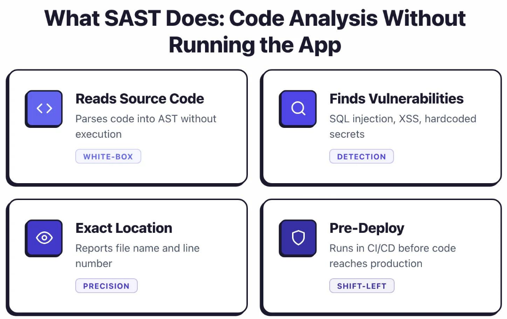
</div>

### 7.2 🌐 DAST: Dynamic Application Security Testing
Tests a **running** app from the outside, with no source code access.
> **Example:** Scanning a live web app for SQLi or XSS.

✅ Tests real behavior • ✅ Finds runtime vulnerabilities • ✅ No source code needed

<div align="center">
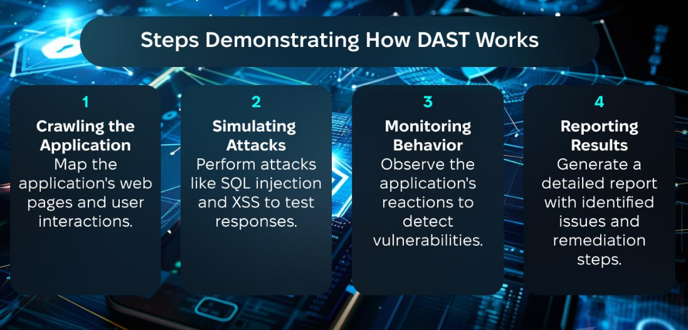
</div>

### 7.3 🔬 IAST: Interactive Application Security Testing
Combines static and dynamic testing using an **agent inside the running app** to monitor code execution and data flow.
> **Example:** While a tester submits input, IAST checks whether it reaches an unsafe database query.

### 7.4 📚 SCA: Software Composition Analysis
Finds vulnerabilities in **third-party libraries, open-source components and dependencies**.
> **Example:** An outdated open-source library with a known vulnerability is flagged so it can be updated.

### 7.5 🥷 Penetration Testing
An **authorized** assessment that simulates real-world attacks to find exploitable weaknesses.
> **Example:** An ethical hacker tests a banking app for auth bypass, access control flaws and injection.

### 7.6 🎲 Fuzz Testing
Sends unexpected, malformed or random input to find crashes, errors and weaknesses.
> **Example:** Sending oversized or malformed input to an API.

### 📊 Comparison

| Technique | Application State | Main Focus |
|-----------|-------------------|------------|
| **SAST** | Not running | Source code weaknesses |
| **DAST** | Running | External application behavior |
| **IAST** | Running | Runtime code and data flow |
| **SCA** | Dependency analysis | Third-party components |
| **Penetration Testing** | Usually running | Exploitable weaknesses |
| **Fuzz Testing** | Usually running | Unexpected input handling |

---

## 8. 🔄 Secure Software Development Life Cycle (SSDLC)

SSDLC integrates security into **every stage** of development. Security is considered from the beginning, not added at the end.

<div align="center">
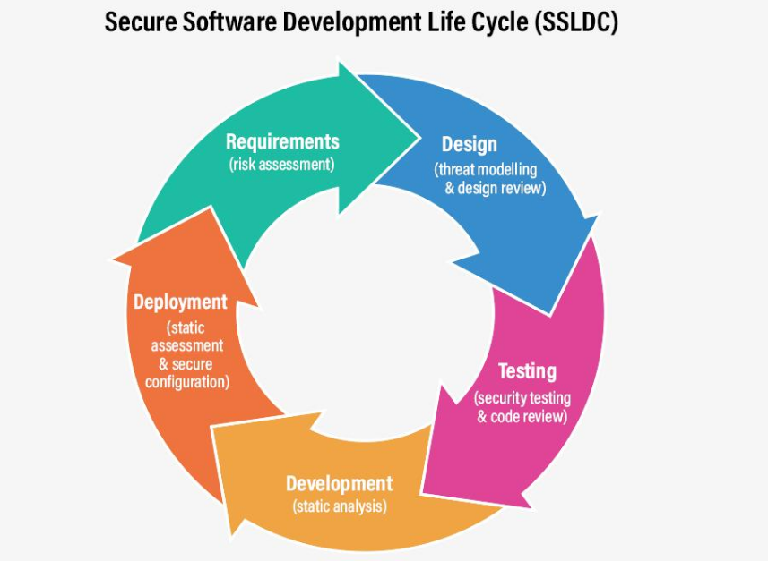
</div>

| Stage | Name | Key Activities |
|:---:|------|----------------|
| **1** | 📝 Planning | Business requirements • Security risks • Security policies • Identify sensitive information |
| **2** | 📋 Requirements Analysis | Authentication, authorization, data protection, privacy and compliance requirements |
| **3** | 📐 Secure Design | Threat modeling • Secure architecture • Access control design • Encryption design • Security boundaries |
| **4** | 💻 Secure Development | Input validation • Output encoding • Secure authentication • Safe DB queries • Secure error handling |
| **5** | 🧪 Security Testing | SAST • DAST • IAST • Vulnerability scanning • Penetration testing |
| **6** | 🚀 Deployment | Disable debug • Firewalls • HTTPS • Secure server settings • Protect secrets |
| **7** | 🔧 Maintenance | Patching • Log monitoring • Fix vulnerabilities • Update dependencies • Regular assessments |

---

## 9. 💻 Secure Coding Practices

1. Validate all user inputs
2. Use parameterized SQL queries
3. Encode output to prevent XSS
4. Implement proper authentication
5. Enforce server-side authorization
6. Use secure session management
7. Never hardcode passwords or API keys
8. Encrypt sensitive data
9. Handle errors securely
10. Keep libraries updated
11. Apply least privilege
12. Review code before deployment

**❌ Insecure (string concatenation, vulnerable to SQLi):**

```sql
SELECT * FROM users
WHERE username = '" + username + "'
```

**✅ Secure (parameterized query, Python):**

```python
cursor.execute(
    "SELECT * FROM users WHERE username = ?",
    (username,)
)
```

> The database treats the username as **data**, not executable SQL.

---

## 10. 🔐 Authentication and Authorization

<div align="center">
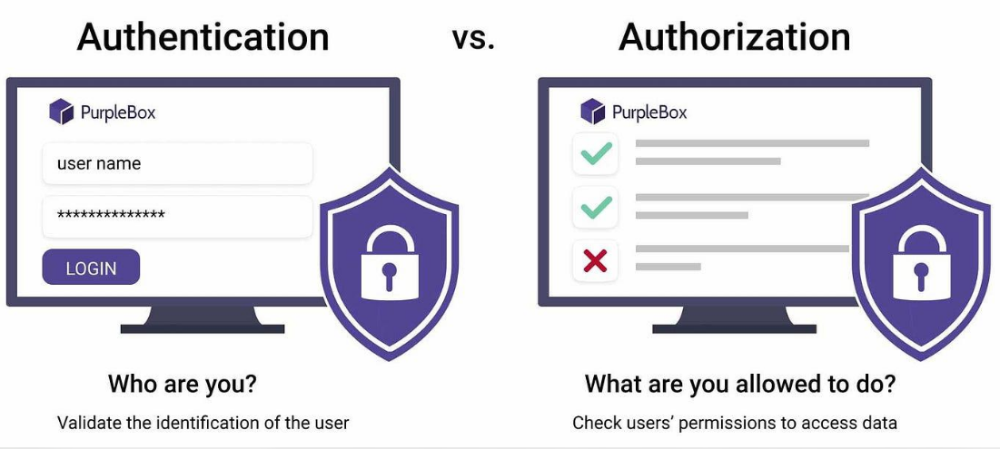
</div>

| | 🪪 Authentication | 🛂 Authorization |
|---|---|---|
| **Question** | *Who are you?* | *What are you allowed to do?* |
| **Purpose** | Verifies identity | Checks permissions |
| **When** | Before access is granted | Determines permitted actions |
| **Uses** | Passwords, OTP, biometrics | Roles and permissions |
| **Example** | User login | Admin-only dashboard |

**Authentication examples:** username/password, fingerprint, face recognition, OTP, MFA

**Authorization examples:** Admin manages users • Teacher manages grades • Student views own results • Guest sees public pages only

---

## 11. 🍪 Session Management Security

Session management maintains a user's authenticated state across requests using a **session identifier**.

**Best practices:**
- 🎲 Generate unpredictable session IDs
- 🔒 Use `Secure` cookies
- 🚫 Use `HttpOnly` cookies
- 🛡️ Configure `SameSite`
- ⏱️ Expire inactive sessions
- 🔄 Regenerate session ID after login
- 🚪 Invalidate sessions on logout

> ⚠️ **Session hijacking:** if an attacker steals a session cookie, they can impersonate the user.

---

## 12. 🔌 API Security

An **API** lets different applications communicate. For example, a mobile banking app uses APIs to talk to the bank's server.

<div align="center">
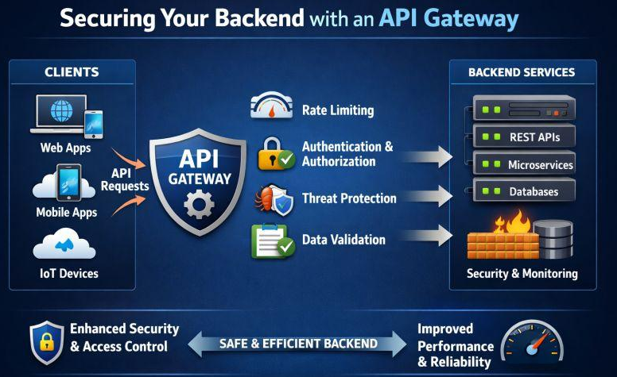
</div>

**Major API risks**

1. Broken Object Level Authorization (BOLA)
2. Broken Authentication
3. Excessive data exposure
4. Unrestricted resource consumption
5. Security misconfiguration
6. Injection attacks
7. Improper access control

**Best practices:** secure token handling • validate inputs • authorization checks • rate limiting • HTTPS • limit data exposure • monitor requests • protect API keys

<div align="center">
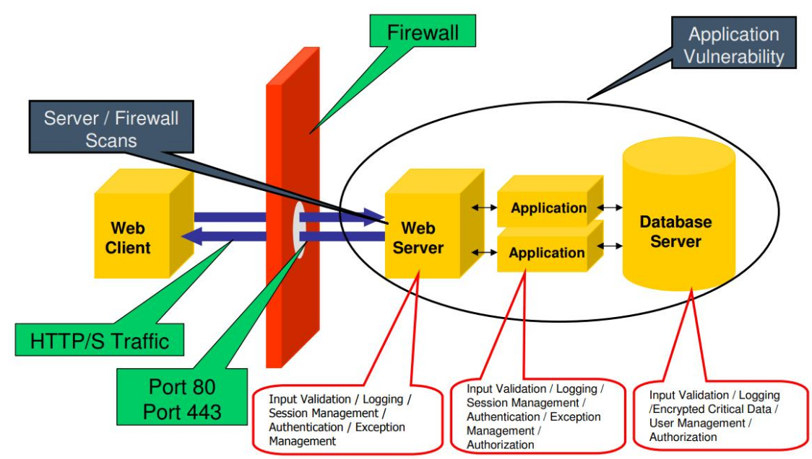
</div>

---

## 13. 🗄️ Database Security in Applications

- ✅ Parameterized queries
- ✅ Encrypt sensitive information
- ✅ Hash passwords securely
- ✅ Database access controls
- ✅ Separate database accounts
- ✅ Maintain backups
- ✅ Patch database software regularly
- ✅ Monitor database activity

---

## 14. 🧰 Application Security Tools

<div align="center">
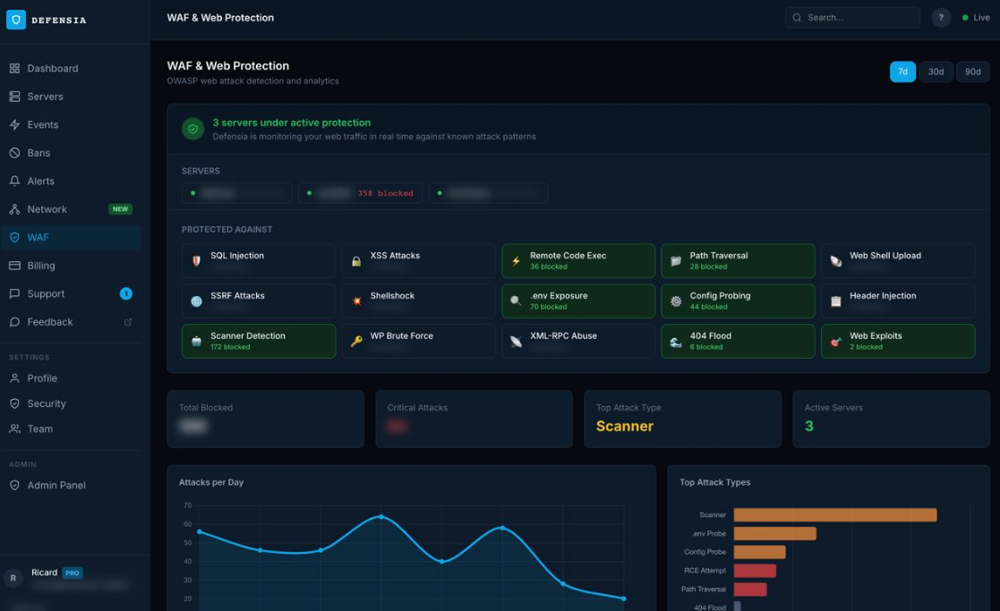
</div>

| Tool | Purpose |
|------|---------|
| 🔥 **Burp Suite** | Intercept HTTP requests, analyze traffic, test web apps |
| ⚡ **OWASP ZAP** | Automated and manual web app security testing |
| 📊 **SonarQube** | Source code analysis for bugs, quality and security issues |
| 🐍 **Snyk** | Vulnerabilities in dependencies, code, containers and IaC |
| 💣 **Metasploit** | Validate weaknesses in authorized penetration tests |
| 🗺️ **Nmap** | Discover hosts, open ports and services |

---

## 15. 📐 Standards and Frameworks

| Standard / Framework | Purpose |
|----------------------|---------|
| **OWASP Top 10** | Major web application security risks |
| **OWASP ASVS** | Application Security Verification Standard |
| **OWASP SAMM** | Software Assurance Maturity Model |
| **NIST SSDF** | Secure Software Development Framework |
| **ISO/IEC 27001** | Information security management |
| **PCI DSS** | Security requirements for payment card data |
| **CWE** | Common Weakness Enumeration |
| **CVE** | Common Vulnerabilities and Exposures |

---

## 16. 🚧 Application Security Challenges

1. ⏩ **Rapid development**: speed prioritized over security
2. 📦 **Third-party dependencies**: libraries may contain vulnerabilities
3. 🏚️ **Legacy applications**: unsupported tech and insecure coding
4. 🙋 **Human error**: mistakes introduce vulnerabilities
5. 🔑 **Poor authentication**: weak login enables unauthorized access
6. ☁️ **Cloud misconfiguration**: exposes sensitive data
7. 🕳️ **Zero-day vulnerabilities**: no patch available yet
8. 🧪 **Insufficient testing**: flaws reach production
9. 🔌 **API exposure**: insecure APIs leak data or functionality
10. 🔧 **Continuous maintenance**: new vulnerabilities appear after deployment

---

## 17. 🎬 Real-World Scenarios

<details>
<summary><b>🏦 Scenario 1: Online Banking Application</b></summary>

Users can change account IDs in the URL to view other customers' transactions, and authorization checks are missing.

**Risks:** Unauthorized access • Information disclosure • Broken access control • Possible financial fraud

**Controls:** Server-side authorization • Object-level validation • MFA for sensitive actions • Logging and monitoring
</details>

<details>
<summary><b>🛒 Scenario 2: E-Commerce Website</b></summary>

The product review field accepts JavaScript without output encoding, so the script runs in other customers' browsers.

**Risks:** Stored XSS • Session compromise • Unauthorized browser actions • Data theft

**Controls:** Output encoding • Input validation • CSP • Secure cookie configuration
</details>

<details>
<summary><b>🎓 Scenario 3: University Management System</b></summary>

A student changes a student ID in an API request and sees another student's personal details and exam results.

**Risks:** IDOR/BOLA • Privacy violation • Unauthorized data access

**Controls:** Object-level authorization • RBAC • API security testing • Access monitoring
</details>

<details>
<summary><b>🏥 Scenario 4: Healthcare Application</b></summary>

A mobile app stores authentication tokens and patient records in insecure local storage.

**Risks:** Sensitive data exposure • Unauthorized access • Privacy violations

**Controls:** Secure local storage • Encryption • Strong authentication • Secure token management
</details>

---

## 18. ⚖️ AppSec vs Network Security

| Application Security | Network Security |
|----------------------|------------------|
| Protects software applications | Protects network infrastructure |
| Focuses on application vulnerabilities | Focuses on network vulnerabilities |
| Prevents SQL injection and XSS | Prevents unauthorized network access |
| Uses SAST, DAST, code reviews | Uses firewalls, IDS, IPS |
| Secures APIs and application logic | Secures network traffic and communication |
| Protects application data and functionality | Protects network devices and connections |

## 19. ⚖️ AppSec vs Endpoint Security

| Application Security | Endpoint Security |
|----------------------|-------------------|
| Protects software applications | Protects devices connected to a network |
| Secure code and application behavior | Device protection |
| Prevents SQLi, XSS, CSRF | Prevents malware and unauthorized device access |
| Uses SAST, DAST, pentesting | Uses EDR, antivirus, device monitoring |
| Protects applications and their data | Protects computers, servers and supported IoT devices |

---

## 20. 🔮 Future of Application Security

| Trend | Description |
|-------|-------------|
| 🤖 **AI-Based Security** | AI helps detect suspicious activity and find vulnerabilities |
| 🔁 **DevSecOps** | Security integrated into development and operations |
| ⚙️ **Automated Security Testing** | Issues found automatically during development |
| 🧱 **Zero Trust Architecture** | Continuously verify users, devices and requests |
| ☁️ **Cloud-Native Security** | Protects containers, microservices and cloud apps |
| 🔗 **Supply Chain Security** | Protects source code, libraries, dependencies and builds |
| 🧠 **AI Application Security** | Defends against prompt injection, insecure output handling and data leakage |

---

## 21. ✅ Complete Application Security Checklist

- [ ] Identify application assets and sensitive data
- [ ] Follow secure software development practices
- [ ] Perform threat modeling during design
- [ ] Validate all user inputs
- [ ] Use parameterized database queries
- [ ] Implement secure authentication
- [ ] Enforce server-side authorization
- [ ] Use MFA where appropriate
- [ ] Secure session management
- [ ] Encrypt sensitive information
- [ ] Use HTTPS/TLS
- [ ] Protect APIs
- [ ] Update third-party libraries
- [ ] Perform SAST and DAST testing
- [ ] Conduct authorized penetration testing
- [ ] Secure server configurations
- [ ] Protect application secrets and keys
- [ ] Enable security logging and monitoring
- [ ] Maintain regular backups
- [ ] Apply security patches and updates

---

## 22. 📖 Important Terminologies

| Term | Simple Meaning |
|------|----------------|
| Application Security | Protecting software from attacks |
| Vulnerability | A weakness in software |
| Exploit | Method of abusing a vulnerability |
| SQL Injection | Manipulating database queries |
| XSS | Injecting malicious browser scripts |
| CSRF | Tricking a user into an unwanted action |
| RCE | Executing unauthorized code remotely |
| SSRF | Tricking a server into unintended requests |
| Authentication | Verifying identity |
| Authorization | Checking permissions |
| Encryption | Converting data into an unreadable format to protect it |
| Hashing | Producing a fixed-length digest from data |
| Session Hijacking | Taking over an authenticated session |
| Secure Coding | Writing code with security in mind |
| SAST | Testing source code without executing the app |
| DAST | Testing a running application |
| IAST | Monitoring application behavior during execution |
| Penetration Testing | Simulating authorized attacks |
| Threat Modeling | Identifying potential threats during design |
| DevSecOps | Integrating security into development and operations |
| Zero Trust | Never automatically trust access requests |

---

## 23. 🏁 Conclusion

Application Security is a fundamental part of cybersecurity because modern organizations depend on software to manage sensitive information, financial transactions, business operations and communication.

Applications can contain vulnerabilities such as **SQL Injection, XSS, Broken Authentication, Broken Access Control and Security Misconfiguration**, which attackers exploit to steal information, manipulate records or gain unauthorized access.

To protect applications, organizations should implement **secure coding, authentication, authorization, encryption, API security, vulnerability testing, penetration testing and continuous monitoring**.

> 🎯 **Final concept:** Application Security means securing the software itself (its source code, database interactions, APIs, authentication mechanisms and user data) so attackers cannot exploit weaknesses in the application.

---

## 24. 📝 Important Questions for Exam Preparation

1. Define Application Security and explain its importance.
2. Explain the CIA Triad in application security.
3. What is SQL Injection? Explain its working and prevention.
4. Differentiate between Stored, Reflected and DOM-Based XSS.
5. Explain Cross-Site Request Forgery with an example.
6. What is Broken Access Control? Explain IDOR.
7. Differentiate between authentication and authorization.
8. Explain SAST, DAST and IAST.
9. What is Secure Software Development Life Cycle?
10. Explain the OWASP Top 10.
11. What is API Security, and why is it important?
12. Explain secure coding practices.
13. What is insecure deserialization?
14. Explain Server-Side Request Forgery.
15. How does penetration testing improve application security?
16. What is session hijacking, and how can it be prevented?
17. Explain the role of encryption in application security.
18. What are the major challenges in securing legacy applications?
19. Explain Software Composition Analysis.
20. How can organizations implement DevSecOps?

---

<div align="center">

### ⭐ If these notes helped you, give the repo a star!


</div>
